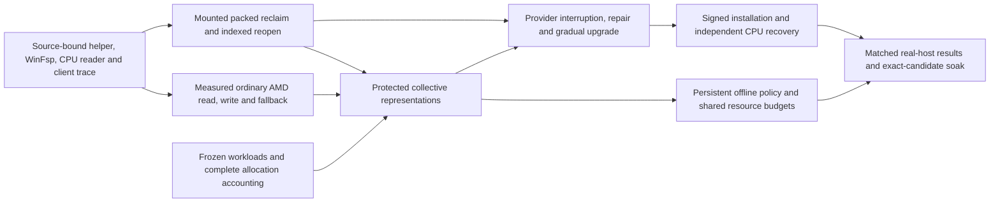

# FlitzFS stable release execution plan

Reconciled on 23 November 2026 against
`1a9ae9423b1eebf6eb31d05b6478e1596a8e5719`, tree
`c46ba218bbd54a74c944e62d63bc41b4a6e30b38`, and the source-bound
packed-tail scheduling change. The
[repository overview](REPOSITORY_OVERVIEW.md) maps
actual product entry points to their scope of qualification. The
[repository review](architecture/REVIEW.md) describes subsystem evidence
and the [revised architecture](architecture/TARGET.md) specifies designated
product boundaries. The [implementation plan](IMPLEMENTATION_PLAN.md) owns
the ordered engineering checkpoints. This document defines the release
qualification evidence for each checkpoint. The
[adaptive storage execution plan](architecture/ADAPTIVE_STORAGE_EXECUTION.md)
sets out the implementation order for sealed regions, model selection,
ordinary AMD I/O and provider-specific qualification.

[Current repository overview](REPOSITORY_OVERVIEW.md) ·
[Architecture evidence](evidence/architecture-reconciliation-2026-11-21.json) ·
[Current review and mounted retirement receipt](evidence/windows-mounted-packed-retirement-2026-11-23.json) ·
[Prior mounted/native differential](evidence/release-execution-reconciliation-2026-11-23.json) ·
[Previous architecture and research receipt](evidence/release-path-review-2026-11-23.json) ·
[Reopened Radeon hardware and SDK evidence](evidence/amd-reopened-paired-sealed-read-2026-11-23.json)

## Release assessment

FlitzFS remains in development qualification. A stable candidate still needs
one supported Windows package to exercise automatic space reuse, useful AMD
read and write work, and independently recoverable collective compression.
That package needs provider-specific durability, scalability, installation and
matched whole-volume performance evidence. The twelve release gates below
remain open at the product level. S10's cybersecurity work is deferred by
the owner.

The Explorer helper creates packed files when the qualified NTFS backing can
fit the complete layout and reopens sparse and packed files by their checked
format. A signed WinFsp 2.2 guest recovered an acknowledged overwrite and
rename, verified 1,024 neighboring files and accepted a continued write.
Two separate fixes now let an untouched Open survive automatic selection and
let the released physical tail advance independently of optional compression.
After 60 flushed revisions in the corrected mounted trial, occupied allocation
fell from 270,598,144 to 265,551,872 bytes, crossed the group boundary and
upgraded both allocation anchors. The held read, independent CPU reopen and
continued writable mount verified exact content. The trial stops at the
boundary crossing. Repeated churn through full settlement remains the S3
exit. [Mounted retirement evidence](evidence/windows-mounted-packed-retirement-2026-11-23.json)
[File attachment](../src/windows/volume_app_winfsp.cpp) ·
[Native adapter](../src/windows/winfsp_native.cpp) ·
[Controller](../src/windows/winfsp_controller.cpp) ·
[Mounted packed lifecycle](evidence/windows-packed-explorer-2026-11-23.json) ·
[Differential evidence](evidence/release-execution-reconciliation-2026-11-23.json)

| Area | Evidence now | Work that still determines release |
| --- | --- | --- |
| Native Windows storage | Checked paged paths, inodes and extents serve writable callbacks. In the 16,384-file short-file fixture, the fenced stored recheck read 76,462,421 backing bytes at writable reopen. | Replace the whole-inventory reopen cost with a qualified incremental path. Measure startup, traversal, mutation and recovery together in large mounted namespaces. [Stored recheck](evidence/indexed-fenced-stored-recheck-2026-11-22.json) |
| Mount and application | Signed WinFsp 2.2 guest testing covers both backings. Two populated file-backed trials recovered all 1,024 original files and a flushed write after helper termination. Nine mounted sealed-image process cuts recovered exact payload bytes and accepted new writes after reopen. [Sealed placement on NTFS](evidence/windows11-mounted-paired-sealing-2026-11-23.json) | Qualify interactive Explorer on the current client, the signed installer lifecycle, device-level recovery and mounted AMD operation. |
| AMD and CPU continuity | A Windows controller trial executed 14 AMD kernel launches and selected 12 advised members. Settled images used 319,488 bytes with the AMD route and 327,680 on CPU. Both verified all 36 files on an independent CPU reader. A deadline fixture recovered 15 files on CPU and re-admitted the adapter. A separate reopened paired-layout SDK test verified two Radeon read frames and CPU service through device refusal. | Connect automatic foreground writes in the helper and qualify mounted writes, cold reads, collective work and driver-reset continuity. Price each role over complete operations on held-out inputs. [Reopened reads](evidence/amd-reopened-paired-sealed-read-2026-11-23.json) |
| Compression | Live selection on the full AIT A–P fixture preserved the open handle and all bytes on independent CPU reopen. The paired-file layout preserved a Win32 handle through sealed selection on mounted NTFS. Locked workspace placement kept that layout and reduced attempted backing writes by about 58% in the SDK model. The reopened paired SDK test also verified Radeon reads and CPU service through worker refusal. [Workspace placement](evidence/volatile-paired-workspace-2026-11-23.json) · [Reopened Radeon read](evidence/amd-reopened-paired-sealed-read-2026-11-23.json) | Combine AMD reads with the mounted Win32 path and measure held-out total size, actual writes and access cost on each supported backing. |
| Learning and reclamation | Advisory checkpoints, incremental candidate discovery, and staged cold recompression work in checked fixtures. Verified committed totals now make history eligible after reopen. | Prove bounded lookup and restart at production scale, persistent automatic policy changes, and steady-state reuse that reduces occupied space and unnecessary write traffic. |
| Backing media | The controller binds geometry to the open handle. Signed guest tests cover sparse process recovery and automatic packed allocation-group release. The packed byte-I/O model passed 126 move cuts and 90 recovery cuts. | Verify repeated settled mounted reclamation and bound dense recovery state at scale. Qualify each provider's cache, removal, geometry and stable-write behavior on dedicated equipment. [Backing providers](architecture/ADAPTIVE_STORAGE_EXECUTION.md#4-backing-provider-qualification) · [Cross-group evidence](evidence/dense-cross-group-2026-11-23.json) |
| Durability and compatibility | Checked roots, mirrored payload recovery, generation-bound references and several interrupted-write models are exercised. | Bind acknowledgement to real backend barriers and close retained-generation repair, mixed-format upgrade and independent rescue gates. |
| Packaging and security | User-mode SDK staging and exact artifact checks are in place. The build stages and verifies its configured AddressSanitizer runtime before CTest. | Exercise the installer, driver reuse, interrupted update and removal on a clean client. Collect the separate S10 review and dependency evidence for the exact package. [Windows app](WINDOWS_VOLUME_APP.md) · [Sanitizer runtime staging](../cmake/WindowsAsanRuntime.cmake) |

[Read-ahead verification](evidence/sequential-read-ahead-2026-11-22.json) ·
[Media qualification plan](architecture/ADAPTIVE_STORAGE_EXECUTION.md#4-backing-provider-qualification) ·
[Mounted guest receipt](evidence/windows11-stable-winfsp-2.2-2026-11-20.json) ·
[Mounted volume activation](evidence/windows11-mounted-volume-activation-2026-11-21.json) ·
[Populated post-flush recovery](evidence/windows11-mounted-post-flush-recovery-2026-11-21.json) ·
[Helper selection and matched controller runs](evidence/helper-file-selection-2026-11-21.json) ·
[Cold compaction receipt](evidence/screened-cold-compaction-2026-11-20.json) ·
[AMD reference-profile receipt](evidence/amd-installed-reference-profile-2026-11-20.json) ·
[AMD deadline recovery receipt](evidence/amd-recovery-qualification-2026-11-21.json) ·
[Foreground AMD route activation](evidence/windows-amd-foreground-activation-2026-11-21.json) ·
[Indexed inventory receipt](evidence/indexed-reopen-single-pass-audit-2026-11-20.json) ·
[Latest collective packing and AMD receipt](evidence/indexed-cross-window-packing-2026-11-21.json)

### Remaining engineering effort

These ranges estimate remaining engineering and qualification work. The
relocation and sealed-image results retire specific implementation risks.
The remaining work still depends on the measured scope of large writable
reopen, installed AMD operation, held-out compression and backing qualification.

| Work to complete | Packages | Person-weeks | Evidence that narrows the estimate |
| --- | --- | ---: | --- |
| Scalable native I/O and reclamation | E01–E02 | 11–22 | Populated client scale curves and bounded reuse during foreground writes |
| Useful automatic AMD and CPU continuity | E03 | 4–9 | One mounted paired run with successful AMD, CPU-only and rejected-device routes |
| Collective compression and offline learning | E04–E07 | 18–44 | First held-out complete-size frontier with access costs, restart and write accounting |
| Windows interface, compatibility and package | E08–E10 | 11–22 | Two mounted providers on an exact signed client package and one old-volume migration |
| Independent durability and security qualification | E11 | 6–12 | First physical-backend interruption campaign across all publication barriers |
| Comparative qualification and stabilization | E12–E13 | 9–18 | Complete matched results and the exact-candidate soak |

The total is **59–127 person-weeks**, rounded to **60–130** for planning.
Confidence remains low until four observations arrive.

1. A populated mounted trace shows which resource dominates writable reopen
   and whether the incremental replacement preserves all audit decisions.
2. The signed client package completes real AMD foreground reads and writes,
   collective work and CPU continuity on a supported client/adapter tuple.
3. The held-out size study compares settled full-volume bytes and random
   access against the strongest applicable controls.
4. A dedicated persistent provider survives the first campaign of device
   interruption after acknowledged flushes and supports independent repair.

Re-estimate affected work packages after each observation. Client, adapter and
physical-failure lab availability and external signing affect elapsed time.
The stronger compression research stays open until measured. Run rolling
stability checks during development and exact-candidate soak after material
fixes. [Work-package estimates](IMPLEMENTATION_PLAN.md#17-completion-dependency-graph-and-effort)

## Current gate ledger

All twelve gates remain open for a stable candidate. Each row names the next
artifact and the observation needed before the related work can advance.

| Gate and work package | Next implementation or qualification artifact | Required evidence |
| --- | --- | --- |
| S1 · E10–E11 | Generate a candidate manifest from the CMake configurations, private dependency locks, staged toolchain and actual app, worker and SDK binaries. | Source, runtime and package hashes match the tested artifacts. Each applicable test lane identifies the exact candidate or the unchanged inputs it covers. |
| S2 · E01 | Extend the WinFsp populated client trace and add read, write and lock accounting at name lookup, inode read, publication and reopen. Exercise deep and wide layouts at several measured sizes and model larger populations. | Replay agrees with a reference namespace and independent CPU bytes. Backing work and resident state are measured at feasible sizes. Validate projected scaling against a held-out size. |
| S3 · E02 | Extend the passing mounted release across successive overwrite, delete and regrow phases. Compare the settled allocation ledger against detached and sparse references and exercise pin release and foreground pressure. | Repeated mounted churn settles at stable or falling occupied bytes for the same live data and protection. Readers and checked dependencies remain readable across cancellation, interrupted retirement and resumed writes. |
| S4 · E03 | Supply `offer_qualified_foreground_route` from the ordinary helper owner. Exercise writes, cold reads and shared-base work with one installed artifact manifest. | Verified, consumed device completions by role improve end-to-end cost or settled size on qualifying data. Missing or failed devices leave CPU service and every stored representation readable. |
| S5 · E04–E06 | Freeze the mixed held-out corpus and collect complete-image accounting for independent codecs, shared dictionaries, delta and multi-reference candidates and the existing shared-base control. | Net space gains survive protection, retained generations and reclamation costs. Independent restart units give practical cold random reads. Size and access results include all cohorts and losses. |
| S6 · E07 | Drive the persistent advisory catalog and policy from observed savings, live resource pressure and workload changes in the mounted lifecycle. | Corrupt or absent advice is rebuildable. Foreground bursts preempt the next quantum. Recovery, migration, learning, compaction and scan progress resume independently with measured write cost. |
| S7 · E08 | Extend the signed WinFsp guest fixture from build 26100 to the current interactive Windows 11 26H2 x64 servicing build and the Explorer and Win32 compatibility matrix. | Both supported backings cover create, attach, metadata, copy, sharing, mapped I/O, detach and fresh-process recovery. Scoped app, service, mount and worker ownership is verified through failure and removal. |
| S8 · E02, E11 | Build from the mounted Write, EOF shrink, rename, mapped write and image-selection cuts. Add concurrent cached and mapped flushes, then qualify the persistent backend on dedicated disposable hardware. | Each cut resolves to an allowed complete generation. Acknowledged bytes and namespaces survive the declared failure domain. A single protected-copy loss repairs with byte-exact independent recovery. |
| S9 · E09 | Add a capability and reader matrix for historical fixtures and mixed old/new representations. Exercise bounded, resumable format migration under regular writes and space pressure. | Supported history opens on CPU. Old writers refuse unsupported mandatory features before mutation. Upgrade interruption, compatible rollback and CPU-only export recover the promised data. |
| S10 · E10–E11 | Stage a signed Windows package and CPU recovery tool with owned installation, repair, removal and rollback. Review the parser, broker, update and dependency trust boundaries. | Every artifact is attributable. The supported install paths work on a clean client. Defensive negative tests and independent review close actionable issues for the exact packaged source. |
| S11 · E12 | Collect matched DiskSpd and real-file workflow results on real hardware against plain NTFS and verified built-in NTFS compression. | Raw results include native compression evidence per file, complete occupied bytes, CPU/GPU utilization, write amplification, foreground tails and independent recovery for every phase. |
| S12 · E13 | Freeze the candidate and run the existing soak and stability programme across the declared configurations. | Resolve material findings and rerun affected gates. Attach the evidence bundle to the owner's release decision. |

## Critical path

Use the [ordered engineering checkpoints](IMPLEMENTATION_PLAN.md#3-execution-order-and-dependencies).
The same source-bound installed Windows path must support native client
semantics, indexed publication, independently readable data and useful
automatic AMD work. The execution evidence below sets each gate's exit.
Independent corpus, process ownership, allocator and failure-model work can
begin before the integrated path closes.

Start with end-to-end AMD write calibration and successive mounted retirement.
They share the existing helper and can advance independently with source-bound
controls. Merge their operation identifiers into the same populated client
trace. Then use concurrent cached and mapped flushes to qualify generation-bound
reopen and incremental reuse. Keep the signed-driver Write, EOF shrink, rename
and selector cuts as regression controls. The allocator can now use an admitted
idle opportunity while cold codec screening is gated. Preserve the new
foreground-yield and due-scrub regressions. [Mounted retirement evidence](evidence/windows-mounted-packed-retirement-2026-11-23.json)

## 1. Candidate and platform ledger

- Maintain one source manifest for each candidate. Include the exact tree,
  dependency locks and resolved versions, compiler and SDK, WinFsp artifacts,
  ROCm package and HIP runtime digests, supported Windows versions, and
  applicable qualification receipts. Keep results bound to their original
  commit IDs and use the migration map when linking them to current history.
- Freeze a supported current Windows 11 x64 client and servicing channel for
  each campaign. Microsoft lists 26H2 in the General Availability Channel
  and identifies 26H1 as a separate new-device release. Test the exact client
  and updates the product promises to support.
  [Windows 11 release information](https://learn.microsoft.com/en-us/windows/release-health/windows11-release-information)
- Track the Windows release, AMD driver, ROCm package and loaded HIP runtime
  as separate inputs. AMD's 10.2.0 support table names Windows 11 25H2 and its
  component table lists HIP 7.17.0. Exercise the current 26H2 client explicitly
  for the product's AMD qualification. Record the vendor support statement,
  package build marker and actual runtime query, plus test results for each
  tuple. Keep CPU service available when a GPU tuple is unqualified.
  [AMD ROCm 10.2.0 release notes](https://rocm.docs.amd.com/en/docs-10.2.0/about/release-notes.html)
- Use the exact WinFsp artifact in correctness, installation and rollback
  checks. The release API identifies WinFsp 2026 as v2.2 and exposes the
  MSI and test archive digests. The download overview still links to an
  older installer, so verify the release inventory when selecting a package.
  [WinFsp 2026 release](https://github.com/winfsp/winfsp/releases/tag/v2.2)
- Qualify the exact signed WinFsp driver with retail integrity policy
  enabled, including compatible reuse when already present. Record installer
  ownership and the planned distribution mechanism. If a future custom
  kernel component is warranted, qualify it separately under the applicable
  Microsoft production signing and Windows client requirements.
  [Windows code integrity](https://learn.microsoft.com/en-us/windows/security/operating-system-security/driver-security/kernel-mode-code-signing-and-integrity) ·
  [Microsoft signing offerings](https://learn.microsoft.com/en-us/windows-hardware/drivers/dashboard/code-signing-attestation)
- Resolve the pinned ROCm Core SDK package, compiler, HIP headers, runtime DLL
  and code objects from the admitted Windows artifact. AMD publishes the Core
  SDK and HIP as distinct versioned components. The checked `10.2.0` archive
  carried package build `10.2.0rc2` and HIP `7.17.26434`. Qualify the exact
  installed driver/runtime, supported adapter and worker bundle on each host.
  Recheck the archive provenance and release status before promoting the pin.
  [AMD Core SDK release notes](https://rocm.docs.amd.com/en/latest/about/release-notes.html) ·
  [HIP installation](https://rocm.docs.amd.com/projects/HIP/en/latest/install/install.html) ·
  [Windows archive qualification](evidence/windows-rocm-10.2-qualification-2026-11-20.json)
- Keep routine builds and checks local. Use a new owned fixture, current
  resource observations, silent launches, and confirmed process retirement.
  Place development artifacts in the scoped workspace and keep live owner-host
  test volumes in memory. Use isolated systems for unqualified driver setup,
  abrupt failure testing and physical backing qualification.
- Save the selected gate list, original commands and return codes, the
  exact mounted or injected boundary, readback digests, and any failure or
  deferral. The checkout, package and mounted results must agree before the
  final candidate can pass S1.
- Keep the original tool and fixture failures with their run IDs. Track the
  executed native, reduced-codec, sanitizer, packaging and isolated lanes
  against the candidate that supplied their binaries. A rebuilt downstream
  package needs the applicable package and lifecycle checks. Use
  source-bound receipts to reuse evidence for unchanged components.

## 2. Large indexed volumes and foreground I/O

- Inventory every supported callback through the Windows adapter, native
  session and paged store. Check path resolution, large directory cursors,
  rename replacement, file lifetime after unlink, sparse ranges, EOF updates,
  flush, and delete-on-close. Include access, sharing and error codes.
- Keep root and path verification on cold reads and give the remainder of the
  graph an explicit resumable scrub. For writable resume, establish which
  generation and dependency claims the backend can prove under its leases.
  Preserve the full-audit path until the replacement passes the same
  acknowledgement and recovery matrix. Charge caches to live headroom and test
  their eviction and pinned generations under pressure.
- Replace application-visible full scans and prototype-sized work where they
  affect startup, enumeration, update or close. Use existing indexed cursors
  and generation-safe read views. Split background preparation from bounded
  publication and record the lock time of both.
- Measure volumes at a single-file control and several increasing feasible
  sizes. Choose rungs that expose page-depth and cache transitions on the
  backing being tested. Vary depth, directory width, allocation density and
  memory headroom. Include empty and byte-sized files, mixed real content,
  multi-gigabyte files and sparse files above 4 GiB. Use mixed workflows so
  small files and large streams compete for the same caches.
- Fit operation work from named files, extents, directory shape, tree depth
  and bytes touched. Hold out a larger measured rung or a different tree
  before projecting to 10 million and 30 million files. Separate extrapolated
  work from measured latency and capacity. Report the fit range, residuals
  and assumptions for depth, data distribution, caching and resource limits.
  Record live memory, pages visited, writes, open and enumeration costs, and
  I/O tails. Build the admitted smaller fixtures and label the results
  beyond the largest measured rung as projections.
- Verify a reference model with handle and operation traces after replay.
  S2 passes when ordinary clients complete the declared layouts and resource
  budgets with exact contents and namespace results.

[Indexed volume implementation](INDEXED_NATIVE_VOLUME.md) ·
[Windows controller](WINFSP_OWNED_CONTROLLER.md)

Reusing one checked view per indexed directory page reduced backing reads
from 27,261,323 to 20,183,683 bytes for 385 names read through single-entry
SDK buffers. A wide buffer reduced reads from 965,711 to 726,507 bytes in
the same directory. Both paths returned the expected names, inode IDs,
logical sizes, and termination markers. Add these cases to the large
mounted client trace and retain the mixed-size buffer cases when measuring
read throughput and contention.
[Directory query evidence](evidence/indexed-directory-query-2026-11-21.json)

### Next writable-resume qualification

The current paired start still runs a complete CPU inventory audit on each side
of the image and selector barriers. The healthy path now acquires both leases
before those barriers and issues one flush to each backing interface. On the
matched 16,384-file fixture it reduced backing reads from 197,479,086 to
130,327,966 bytes with zero startup backing writes. The existing five-MiB
WinFsp fixture and the larger native fixture bind separate evidence.
The large-volume gate still requires a mounted ordinary client and a larger
dataset.
[Indexed scale receipt](evidence/indexed-scale-reopen-2026-11-20.json) ·
[Five-MiB fixture](evidence/indexed-reopen-single-pass-audit-2026-11-20.json)

The Windows adapter now checks allocation, basic metadata and security
from the initial audit's reachable inodes. The 4,096-file WinFsp SDK fixture
read 34,756,618 backing bytes per startup, down from 355,798,881. It retained
both barriers and wrote zero backing bytes during reopen. A missing
descriptor on a reachable file still refuses startup before mirror repair.
The independent CPU reader checked the original files and the following
acknowledged callback write. Both complete native audits remain the next
startup scaling target.
[Windows indexed startup evidence](evidence/winfsp-indexed-startup-audit-2026-11-20.json)

The two audits now use the verified inode payloads directly and reuse the
previous extent owner while it remains the same inode. Writable reopen
read 113,630,294 backing bytes on the 16,384-file fixture and 29,995,842
on the 4,096-file WinFsp fixture. Both barriers and zero startup writes
were observed in each run. The separate compressed-object comparison
measures the saving from a single decoded check for byte-identical
encodings. Both stored copies still receive independent verification.
[Storage audit evidence](evidence/indexed-audit-reuse-2026-11-20.json)

The decoded name-page cache reduced median writable reopen from 271 ms
to 192 ms on 16,384 short files. On the 2,640-file CPython 3.15.2
standard-library fixture it moved from 163 ms to 132 ms. The comparison
used both fences and two full native inventories. Its short-file work model
projects about 64 GB of backing reads at 10 million files and 192 GB at
30 million under comparable layout and per-file cost. This identifies
the next target for large-volume startup. Move verified work off the
foreground path under a qualified root and backing proof, then measure
insertion churn, filesystem shape and mature mounted reads separately.
[Exact measurements and projection](evidence/indexed-audit-page-cache-2026-11-22.json)

The healthy retained path now reuses the first decoded audit after both
fences. A fresh object walk reads both encoded replicas and checks them
against the exact checkpoint. Fault fixtures refused newly degraded
raw data, compressed data and name pages at either fence. On the same
16,384-file shape, reopen image reads declined from 104.14 MB to
76.46 MB. The new short-file curve predicts the held-out result within
0.006% and projects 46.7 GB and 140.1 GB at 10 million and 30 million.
The stored walk still reads the entire live object inventory. The next scaling work is
to give foreground reads and writable admission a qualified bounded path
while a resumable check verifies the rest of the selected generation.
[Stored recheck evidence](evidence/indexed-fenced-stored-recheck-2026-11-22.json)

The ordinary helper now retains an existing backing after the initial
indexed and Windows metadata audit. This removes the separate read-only image
inspection. The focused startup control measured 1,644,441 backing bytes
before and 1,304,248 after, with the same three flushes and zero writes.
The test covers rejection of a corrupt selected image and handle retention
after a failed fence or mount. The native verification passes around the image
barrier still determine the scaling curve.
[Current attachment startup evidence](evidence/release-reconciliation-attachment-2026-11-21.json)

1. Extend the separate pre- and post-image-barrier counters by selector,
   object-table pages, name-index pages, inode/lifetime metadata, encoded
   payloads and dependency resolution. Use the same populated
   volume for a clean start, a start requiring verified repair and a read-only
   rescue. Collect call counts, backing bytes, allocations and elapsed
   distributions for both loaded and idle starts.
2. Define the reopened-writer invariant against a concrete selector and image
   identity, checkpoint generation, namespace sequence, decoder dependencies
   and in-flight lifetime state. Identify which proofs are valid under both
   leases, which become invalid at the flush, and which require revisiting
   stored bytes. Preserve the exact result for same-generation forks and
   damage appearing at or after the fence.
3. Evaluate a durable, versioned verification-progress record for bounded
   resumable audits. Bind progress to the exact root and backend admission
   evidence. Treat it as evidence of what was verified at that checkpoint;
   revalidate touched pages, frame digests and dependencies on use. Test
   torn, stale, corrupt and replayed progress plus older volumes that have no
   such record. Keep independent CPU rescue available without advisory state.
4. Qualify any alternative writable admission against the existing full audits
   as an oracle. Cover healthy starts, late and double replica damage,
   invalid native frames with valid storage digests, leaked lifetime state,
   interrupted repair, and writes concurrent with the next scrub quantum.
   Compare the acknowledged namespace and readback after a reopen in each arm.
5. Repeat the retained-data checks, large-population runs and mounted client
   operations on the selected implementation. Record foreground stalls,
   repair amplification, pending queue growth and recovery while another
   reader pins a generation. Keep the conservative admission path for
   any backend or legacy format whose invariants have not been qualified.

## 3. Allocation, reclamation and acknowledged data

Verified object-tree totals now recover a conservative compactable extent
estimate on reopen. The paired-range models at 4 KiB and 64 KiB both
qualified for compaction before the next foreground write. The previous
reader kept its allocation until release, and the settled volume reopened
byte-for-byte on CPU. The next mounted tests should carry this case over
multiple sessions and measure actual allocated bytes and write costs.
[Reopen and reclamation evidence](evidence/reopened-reclamation-2026-11-21.json)

- Trace each commit from record allocation through payload and metadata writes,
  barrier completion and root acknowledgement. Give reference records,
  readers and repair work explicit generation ownership. Preserve the
  previous valid graph across interrupted publication.
- Finish incremental reclamation in the standard volume lifecycle. Select a
  batch from measured reclaimable bytes, reserve its cost first, reconcile
  concurrent foreground commits, and return space only after old readers and
  references release it. Include new dictionaries and representation changes
  in that accounting.
- Charge occupied bytes for mirrors, metadata, free-space structures,
  unreclaimed tails, retained roots and protected decode dependencies.
  Measure rewrite bytes, live/retired space, recovery time and foreground
  interference after repeated create/update/delete cycles.
- Run full-volume, low-headroom, overlapping-reader and interrupted
  reclaim tests. Model failures before and after every handoff. Verify the
  same cases on each actual persistent backend in isolated qualification.
- Verify the backing provider's write and flush semantics. Windows exposes
  file flush as an OS boundary. Real durability depends on the complete
  path through the storage device. Record and test the hardware and failure
  model used for acknowledgements.
  [Microsoft file flush contract](https://learn.microsoft.com/en-us/windows/win32/api/fileapi/nf-fileapi-flushfilebuffers)
- S3 and S8 pass after the ordinary background path produces verified net
  space recovery, keeps existing acknowledged bytes through the supported
  failures and restores repairable protected copies.

## 4. Useful AMD work and independent CPU continuity

- Keep installed discovery selective and asynchronous. Verify the approved
  helper, module, runtime and hardware identity before the first compute
  attempt. Confirm the Windows adapter/node and current physical, commit
  and video budget for the actual request.
- Amortize fixed worker setup across multiple independently protected
  groups. Collect setup, transfer, kernel, reply, CPU verification and
  publication time. Calculate full-image savings per cohort. Use copy
  search if the reference working set or launch budget cannot be admitted.
  Preserve foreground responsiveness and the existing job ownership.
  In the current host trials, five existing disjoint groups published on
  CPU before each full AMD batch returned. The matched wait controls
  published zero during that interval. Complete size matched and timing
  ranges overlapped. [Overlap evidence](evidence/windows-amd-full-batch-overlap-2026-11-21.json)
- The rebuilt controller's installed reference route submitted 17 AMD kernel
  launches. The matched missing-package arm submitted zero. Both regrouped
  and recovered all 23 files on CPU, with identical 1 MiB compacted images.
  Use this pair as a device-execution and fallback control in the mounted
  qualification. [Current controller evidence](evidence/release-reconciliation-indexed-handle-2026-11-22.json)
- A completed AMD exchange now keeps its group reservation through foreground
  activity until a funded idle step can verify it. The installed-route trial
  published 90 advised members after a CPU read. A selected edit left advice
  usable for the other four groups, and all 15 files passed independent CPU
  readback. The read trial and its matched CPU control each settled at
  2,760,704 bytes. [Retired reply evidence](evidence/amd-retired-replies-2026-11-22.json)
- The installed anchor scheduler starts with complete groups and learns
  its launch allowance from independently verified exchanges. In a
  constrained Windows trial, the worker reached its hard deadline before
  publication and all five groups completed on CPU. The normal installed
  route verified a device-selected reference and recovered all 23 files.
  Compare warm and cold starts on mounted workloads and qualify recovery
  with fresh device evidence after an actual runtime interruption.
  [Measured batch evidence](evidence/amd-measured-batch-sizing-2026-11-21.json)
- The uniform LZ4 parent can group complete independent requests into one
  supervised AMD sweep. A live three-request comparison reduced median AMD
  time from 3.55 s to 1.44 s and kept the encoded bytes identical. A constrained
  trial refused stale memory telemetry at completion. Measure the sustained
  complete-operation benefit against CPU before enrolling this workload.
  [Independent request batching](evidence/amd-uniform-request-batching-2026-11-21.json)
- Foreground GPU preparation now releases the filesystem lock before encoding
  the worker request. The supervisor takes the immutable frame by move and
  retains its route pins. On the matched public-source trace the worker
  accounted for 97% or more of AMD response time. Keep that workload on CPU.
  Measure a finite readiness episode and the actual arrival of independent
  eligible requests before adopting any foreground warm-up policy.
  [Foreground worker evidence](evidence/windows-amd-foreground-worker-boundary-2026-11-22.json)
- The measured foreground route now verifies that the exact write fits the
  live work and host budget before deferring. A controlled AMD run refused a
  partial offer, adopted a funded sweep and recovered its complete bytes.
  [Complete measured-window evidence](evidence/windows-amd-full-measured-window-2026-11-22.json)
- The flat and paged writers now count actual committed candidate objects.
  Each verified mounted-route comparison must show some committed device
  output in every AMD sample to earn an offer. The new callback fixture uses
  the file helper's automatic compression policy and exercises aligned
  requests up to 63 native extents. The real 1 MiB input used CPU encoding
  after device verification. The longer sweep expired and recovered its
  complete bytes on CPU. Keep these inputs as controls. Capture partial,
  cached and aligned requests from the mounted helper, then compare a fast
  ingestion policy with later stronger compression to the automatic CPU
  baseline. [Write qualification](NATIVE_WINDOWS_LZ4_ADVICE.md#committed-device-output-and-the-file-helpers-write-policy) ·
  [Current Radeon write evidence](evidence/windows-amd-native-file-policy-2026-11-23.json)
- A one-request preparation lease now reaches actual AMD readiness before input
  delivery. On three matched 1 MiB public requests it cut the median response
  after submission from 1.79 s to 545 ms. Charging setup, the prepared median
  was 1.30 s. One unused preparation retired with no reply. Keep this workload
  on its existing CPU route until an end-to-end comparison earns a new decision.
  [Prepared sweep evidence](evidence/amd-prepared-sweep-2026-11-22.json)
- Measure automatic route selection for early ingestion and cold work
  separately. Use the CPU reference for forecast and fallback. Compare real
  public and controlled inputs across supported AMD classes and a CPU-only
  client. Require actual device work and verified storage benefit before
  issuing a qualified route profile.
- Exercise unsupported and missing artifacts, memory and queue pressure,
  malformed or stale advice, cancellation, changed file content, timeout
  and runtime removal. Test device loss and high-risk driver faults on
  isolated systems. Confirm CPU read/write continuity and bounded recovery
  attempts from distinct evidence after retirement.
- S4 passes when the installed application shows useful automatic AMD
  behavior in ordinary operation and a separate CPU reader reopens every
  admitted representation and generation.

[AMD route](AMD_RUNTIME_DISCOVERY.md) ·
[Worker ownership](WORKER_CHANNEL.md) ·
[GPU recovery policy](GPU_RECOVERY.md)

## 5. Strong collective compression and autonomous learning

- Extend the incremental similarity and coherence catalogs across distant
  files and many groups. The paged catalog now retains funded alternate
  nominations and can resume within a matching bucket. One controlled
  13-file workload recovered a live match after the newest nomination became
  stale, saving 116 KiB of combined image, selector and catalog space. The
  lookup count grew from 13 to 27. Test recall, space, write cost and time to
  find useful candidates across larger and denser buckets. Compare sparse
  slot order with size-aware ranking before widening the search. Keep the
  catalog independently rebuildable, and tie scan progress and eviction to
  observed resources. Keep measured costs and failed trials in the advisory area.
  [Displaced nomination evidence](evidence/indexed-coherence-alternates-2026-11-21.json)
- In the 5,121-record catalog trace, reusing the verified root and pruning
  empty key ranges reduced metadata traffic for 7,168 misses from 168 MiB to
  110.6 MiB. All 1,024 positive ranges resolved and older snapshots retained
  their own records across publication. A separate 16,384-fingerprint
  construction trial hit its 64 MiB backing allowance during appends.
  Compare write amplification under sorted and interleaved ingestion,
  compaction debt, total occupied bytes and read traffic on the same input.
  Qualify retained-reader overlap and restart with the managed physical-file
  catalog provider before increasing the scan envelope.
  [Sparse catalog evidence](evidence/indexed-coherence-range-reads-2026-11-21.json)
- Compact index pages and coalesced sibling writes reduced the interleaved
  16,384-fingerprint build from 121.8 MiB to 67.3 MiB. Backing writes fell
  from 122.8 MiB to 68.3 MiB. The compacted catalog uses 520 KiB more than the
  packed 4 KiB control. Miss traffic is lower in bytes and higher in read calls.
  [Compact catalog evidence](evidence/indexed-coherence-compact-pages-2026-11-21.json)
- Under the 64 MiB catalog reservation, the normal maintenance path
  compacted and retained 15,748 primary and 3,937 alternate nominations.
  The selected replacement occupied 8.6 MiB, and the next scan appended
  to it. The old and new backings occupied 73.0 MiB together while the old
  reader was pinned. Exercise repeated compactions and edits with uneven
  real data, using measured persistent-media read and write costs to choose
  between dense packed pages and compact update pages.
  [Reclamation evidence](evidence/indexed-coherence-reclamation-2026-11-21.json)
- The paired advisory journal now selects an identified catalog backing
  after its replacement has been checked. Independent Windows RAM fixtures
  cover restart before the first selector write, after the first barrier,
  after the final barrier and with the resolver returning the wrong complete
  catalog. New qualified managed files supply two sparse reservations.
  The model exercises reopening on both sides of the selector commit,
  waiting through one torn advice slot, deferring retirement under a live
  pin, and reusing a released range with a fresh identity. Qualify repeated
  rotation on populated volumes under native Windows allocation and
  interruption on disposable storage. Measure catalog writes and foreground
  response with the mounted helper active.
  [Catalog selection format](OPTIMIZATION_STATE.md#identified-catalog-selection) ·
  [Windows restart evidence](evidence/identified-coherence-selection-2026-11-21.json) ·
  [Managed range validation](evidence/managed-coherence-catalog-ranges-2026-11-21.json)
- Use training and held-out sets chosen before the evaluation. Test close
  revisions, unrelated files, small text, SVG, tabular and numeric data,
  binaries, media and already compressed files. Include nonsynthetic
  workloads and simple controls that isolate each encoding.
- Compare the total space of candidate encodings, including references,
  record padding, dictionaries, model storage, protected metadata, rebuild
  work and retained copies. Verify lossless decode independently on CPU.
  Measure cold random access and read amplification with the exact selected
  group representation. The interleaved-group audit now reuses verified
  bases within one pass and checks the stored replicas directly. Extend the
  backing-traffic comparisons to groups that exceed the audit cache and
  exercise recovery with pinned readers. Keep the owned session and
  independent snapshot read measurements. On the mixed public corpus, group
  packing lowered occupied bytes and owned-session backing reads, with higher
  backing reads from independent snapshots.
  [Grouped audit evidence](evidence/indexed-grouped-audit-2026-11-20.json)
- Persist advisory observations in the protected internal area. Key them
  by representation, workload signature, format generation and relevant
  device or backend identity. Age stale observations and make poor
  predictions recoverable. Keep every required decoding dependency separate
  from rebuildable learning data.
- Retained similarity lookup recovered one missed group in a controlled
  cross-window workload and saved 24 KiB after compaction. The three other
  workloads held their prior compacted sizes, including two public corpora.
  Keep this ranking for short extents with no fitting in-window partner.
  An earlier version that also reranked the current window enlarged the
  public revision image by 8 KiB. Compare joint group alternatives by
  verified occupied bytes, including the space required by displaced files,
  before applying wider reranking. Measure shortlist recall, maintenance
  reads and writes, and small-read amplification across larger populations.
  Carry useful lookup into the paged advisory catalog and retain the bounded
  in-memory window for active preparation. Expand the grouping envelope
  together with CPU range reads and dependency retirement.
  [Retained similarity comparison](evidence/indexed-retained-packing-similarity-2026-11-22.json)
- Use fresh idle opportunities and bounded work to choose further scans,
  grouping, consolidation and format migration. Learn from net space
  saved, foreground service time, memory and write cost. Stop or shrink
  background work promptly under contention. Measure the system as it learns
  across restart, routine edits and changing workload.
- S5 and S6 pass after held-out complete-image savings, practical access,
  offline learning, durable restart and low interference are demonstrated
  together on stated hardware and workloads.

## 6. Windows experience, compatibility and installation

- Use the existing helper and WinFsp integration as the normal Windows path.
  Exercise creation and clean attachment of memory volumes and controlled
  persistent volumes. Make mount target collision, drive removal, pause,
  unmount, helper shutdown and restart recoverable and visible in the app.
- Run native Win32 callers and Explorer for case and Unicode semantics,
  file attributes and access checks, long paths, replace and sharing,
  metadata enumeration, flush, cancellation and multi-process handle behavior.
  Exercise cached, noncached, overlapped and mapped I/O and record the tested
  combinations. Include notifications, streams, links and reparse behavior in
  the published compatibility contract and applicable qualification.
- Test interrupted installer installation, repair, upgrade, removal and
  rollback with the exact signed dependency chain. Confirm package staging
  resolves tools and runtimes without relying on a development machine.
  Test normal CPU operation without the AMD package and optional GPU
  availability on supported setups.
- Retain independent CPU readers for volumes written by at least the preceding
  three released versions. Until those releases exist, keep the supported
  historical fixtures and protected decoding dependencies. Reject unsupported
  mandatory features before mutation and preserve each codec identifier's
  meaning.
- Verify old and new readers, mixed storage, partial migration,
  interruption/restart, space pressure, and rollback to the supported
  previous generation. Verify bytes and persist new dependencies before
  publishing each migrated unit. Preserve a recovery route to exported bytes.
  Qualify old-software downgrade separately from new-reader compatibility.
- Close S7, S9 and S10 with actual client coverage, clean owned shutdown,
  compatible format and update behavior, and signed installation receipts.

## 7. Security and failure qualification

| Failure domain | Required observation on the affected path |
| --- | --- |
| Process exit and forced stop | Every acknowledged generation reopens exactly. User processes see predictable status. The helper, worker and supervisors retire. |
| Interrupted writes and reclamation | Recovery chooses a complete generation and resumes within the documented failure model. Later reclamation retains references and preserves space accounting. |
| One corrupted protected copy | Independent validation finds surviving data. Repair publishes a verified new copy and records the action. |
| Unrecoverable corruption or missing backend | Return an explicit failure, preserve surviving material, and provide an independent recovery or export route. |
| GPU reset or failed compute | Ignore the incomplete result. Continue with CPU and gate later attempts on authenticated evidence and verified retirement. |
| Hostile metadata, namespace or IPC | Bound parsing, authority and resource use. Verify the package, update and app trust boundaries and close actionable findings. |

Re-run the targeted portable, Windows, raw-codec and sanitizer lanes on the
exact change. Cover the native worker and package interfaces with targeted
negative cases. For final S10, retain current advisory evidence and review
dependencies, installer behavior, ACLs, update signing and the recovery tool.
The connector refused the Dependabot endpoint. An authenticated GitHub REST
read returned an empty first page of open alerts during this reconciliation.
Refresh that read for the exact release candidate and retain the published
advisory and artifact inventories.
[Current dependency receipt](evidence/release-reconciliation-indexed-handle-2026-11-22.json)

## 8. Benchmarks, soak and the release decision

- Use the full 2026 AIT Data Compression Challenge and retain its original
  training and held-out splits. Current measurements cover standalone codecs,
  verified mirrored image size and collective compression on complete CPython
  revisions. Continue with ordinary cold recompression and account for the
  persistent catalog and all maintained copies before claiming a size win.
  The paired Windows cold test saved 557,056 bytes beyond compaction on A–H.
  The read-only screens for I–P and A–P declined a rewrite. Standalone 256 KiB
  and 1 MiB blocks brought small gains on I–P. Measure complete image size,
  allocation and small-range access before choosing a native unit size.
  Evaluate protection overhead against the same isolated-failure recovery
  model before selecting a denser representation.
  [Public workloads and evidence](BENCHMARK_PROTOCOL.md#public-compression-workloads)
- Use Microsoft's DiskSpd 2.3 as the current controlled Windows I/O
  benchmark. Retain the exact binary, XML profile and results, cache mode,
  queue depth, duration, fixture data and platform topology. Run the common
  buffered and unbuffered profiles only where both filesystems can honor
  equivalent semantics. Report provider-specific acceleration such as
  NTFS BypassIO as a separately labeled result.
  [Microsoft DiskSpd](https://github.com/microsoft/diskspd)
- Pair DiskSpd with a repeatable file tree. Time Robocopy from a fixed source
  to a new destination, with fixed thread and retry settings and recorded
  metadata choices. Time Explorer enumeration and small file opens, then
  replay directory creation, renames, updates and deletion in the fixture.
  Use a pinned source checkout and a normal incremental build for a mixed
  read/write workflow. Reopen the volume and verify content and namespace
  after each workload. Measure foreground tails during background packing.
  [Microsoft Robocopy](https://learn.microsoft.com/en-us/windows-server/administration/windows-commands/robocopy)
- Compare FlitzFS at ingest, after admitted idle work, and after verified
  reclamation. Use NTFS on the same current Windows 11 build as the primary
  control, with both native defaults and supported NTFS compression.
  Capture the Windows build, NTFS volume information, allocation units, and
  enabled cache and compression settings. Match backing, usable capacity
  and corpus. Include exFAT and ReFS where available, and use offline codec
  controls for the compression frontier.
  [Microsoft NTFS volume queries](https://learn.microsoft.com/en-us/windows-server/administration/windows-commands/fsutil-fsinfo)
- Where a licensed UL PCMark 10 Data Drive fixture fits the available resource
  and protection envelope, retain its standard trace results as another
  workload. UL reports about 15 GB of writes at default settings. Fund the
  published workload before running it and reserve the storage-consistency
  test for separate endurance qualification.
  [UL PCMark 10 storage workloads](https://support.benchmarks.ul.com/support/solutions/articles/44002171443)
- Alternate repeated controls and candidates. Report absolute occupied
  space, foreground read/write throughput and tail latency, peak CPU/GPU/RAM
  use, process retirement, background duty, I/O amplification and wear-related
  write totals. Reopen and check all data in each phase. Treat overlapping
  timings and unqualified storage semantics explicitly.
- Benchmark on qualified real hardware. Capture isolation-guest results as
  correctness evidence. Keep the owner's development volumes in memory.
  Use a separate qualified physical test path for a claim about persistence
  or drive throughput.
- Freeze the exact candidate for the final soak. Cover sustained ordinary
  workloads, maintenance, power and recovery qualification within the
  failure model, and alternate supported host configurations. Inspect
  material failures and rerun affected gates. S11 and S12 require the
  complete retained evidence and the owner's release decision.
- Plan for the existing 30-day candidate soak and 90-day rolling stability
  record across supported configurations. Confirm the meaningful failure
  coverage and material fixes with the evidence from each lane.

## Immediate implementation order

Run the executable checkpoints below using the
[five implementation checkpoints](IMPLEMENTATION_PLAN.md#3-execution-order-and-dependencies)
and the [work-package dependency graph](IMPLEMENTATION_PLAN.md#17-completion-dependency-graph-and-effort).
Freeze corpus provenance, benchmark shapes and the platform matrix early.
Implement the first integrated slice before advancing to larger or more
disruptive fixtures. Keep each successfully qualified slice available as a
regression control for the next one.

### Execution checkpoints

#### 1. Close the first Windows product slice

- Preserve the verified packed create and sparse reopen, including backing
  identity, physical extent admission and exclusive creation. Run the
  existing two-group overwrite fixture on an otherwise comparable sparse
  backing. Reuse the packed trial and native reference for the differential
  below. Change only the stage whose observed behavior diverges.
  [Attachment factory](../src/windows/volume_app_winfsp.cpp) ·
  [Adapter construction](../src/windows/winfsp_volume_attachment.cpp) ·
  [Mounted differential](#next-integrated-qualification)
- Compare overwritten history and retirement after large-file deletion.
  Keep one open reader through image publication and independently verify
  every acknowledged live file, physical allocation, a fresh mount and a
  new flushed write. Add a second cycle after the first physical group
  release to check automatic re-entry. Cut the durable placement phases
  using the isolated process fixture and validate both anchor copies.
  [Packed relocation](PERSISTENT_VOLUME_FILE.md#moving-live-data-across-allocation-groups)
- Extend the external client trace to concurrent cached and mapped writes
  with independent witnesses. Distinguish view flush, file flush, callback
  completion and the engine's publication fences. Verify the expected ordering
  after each induced interruption, across handles and directory mutations.
  Run the same trace against memory and persistent qualified backings.
  [Prior mapped cuts](evidence/windows11-mounted-mapped-publication-cuts-2026-11-22.json) ·
  [Windows view flush contract](https://learn.microsoft.com/en-us/windows/win32/api/memoryapi/nf-memoryapi-flushviewoffile)
- Record build, package, OS and physical or memory provider identity. Attach
  via the same application entry point in all lanes. Include a populated
  result, duplicate attachment refusal, fresh-process readback, continued
  writes and confirmed retirement of dispatcher, mount and workers.
  **Exit:** S1 inputs and the first connected S3/S7/S8 result.

#### 2. Make that client use AMD automatically

- Start from the existing installed-route acquisition, deferred-write
  admission and read-ahead. Deliver a qualified write offer inside the volume
  owner's normal control path, keyed to the open volume, worker bundle,
  adapter and runtime. Build the decision outside callback execution. Invalidate
  it on observed identity change, failed worker retirement or changed resource
  evidence. Transfer only immutable, bounded request bytes while the volume
  owner retains the right to publish.
  [Controller](../src/windows/winfsp_controller.cpp) ·
  [Write policy](../src/windows/native_amd_write_policy.cpp)
- Use qualification records for each role and resource/workload range. Include
  the admitted adapter LUID and node, worker and ROCm/HIP identities, codec
  and verification mode, bytes, entropy class, batch shape, observed queue
  delay and total CPU/device/transport cost. Start from the CPU path while
  discovery or benchmarking is pending. Start a finite warm lease only for
  work already justified by compatible backlog or repeated measured demand.
  Cancel it on contradictory observations and release the slot after
  observable worker exit. A CPU encoder may choose a different representation.
  Every published GPU representation must decode independently on CPU.
- Begin with three matched client lanes using the same corpus and bytes.
  Exercise installed AMD with useful writes, cold reads and a completed
  collective group. Exercise normal CPU selection, then refuse or interrupt
  a worker request at the isolated transport boundary. Each lane must
  support official Win32 flush and an independent CPU-only reopen after
  retirement. Require device completions whose output was verified and
  actually consumed. Count prior preparation, copies, verification,
  persistence, discarded work and fallback in the full comparison.
- Keep failure state per adapter/runtime and separate unsupported configuration
  from transient load, lost device and unconfirmed retirement. Observe
  new installation/topology evidence, headroom and a quiet admitted
  opportunity before starting a replacement. Record the evidence that allows
  retry. CPU execution continues while the failed route quiesces. Keep real
  driver-resets and device-removal fault injection isolated.
- Use a role-specific device result contract. A read gives the CPU-verified
  requested bytes. A write offers a complete independently decodable
  encoded object or bounded advice for CPU encoding. Collective work offers
  checked candidate references, residuals or independently indexed streams.
  Run valid, stale, incomplete and rejected replies with the same owner
  state machine. CPU completion must be possible before optional teardown.
  Record CPU selection latency, teardown time and the first subsequent
  qualifying device result as three separate observations.
- Qualify discrete and integrated adapters and the CPU-only path as
  separate identities. Size work from measured host/device memory and
  pending foreground I/O. HIP 7.17.0 disables stream priority. Control
  interference with admission, in-flight work bounds and observed yield
  times. **Exit:** S4 with role-specific measurements and supported tuples.
  [AMD Core SDK release notes](https://rocm.docs.amd.com/en/docs-10.2.0/about/release-notes.html)

#### 3. Bound reopen and space reuse at scale

- Add per-stage counters to the above trace for outer anchors and dense
  directory, selected root and object index, name, inode and extent pages,
  payload/dependency verification, flush, cache and lease activity. Use
  known 1,024- and 16,384-file fixtures as regression anchors. Add one-file,
  deep and wide layouts, small files, large files and mixed churn. Choose
  the next admitted named-file population from observed headroom and the
  smallest rung that exposes the next index/cache transition.
- Separate lazy verified reads from writable admission. Bind any reusable
  checkpoint to the selected image and root, backing identity, ownership
  epoch and exact durable verification state. Validate mandatory roots and
  every referenced page and dependency before use. For writable operations,
  prove the relevant allocation and lifetime state before modifying it.
  Resume validation with a persisted generation-bound cursor. Compare against
  the full audit under post-fence damage, stale checkpoints, same-generation
  forks, lost replicas and concurrent scrubbing. Keep the conservative
  repair path for formats and providers without the required proof.
- Separate the dense container's virtual-to-physical mapping from native
  segment reuse. Page or summarize the dense map once the trace identifies
  directory scanning or resident runs as the limiting cost. The indexed
  store then needs reusable allocation incarnations owned by current and
  retained roots, active reader tokens and repair. Evacuate bounded victims,
  publish through the existing selector and preserve a recoverable old
  location until peers and readers retire. Establish a per-quantum movement
  and write budget from measured benefit. Whole-image rebuild supplies the
  equivalence and recovery oracle.
- For each reopen counter, compare clean detach, process interruption,
  media interruption and format transition. Bind the fast validation record
  to the reopened backing identity, selected image and incarnation, root
  generation, checked index summaries and completed barriers. Retain a full
  verifier for unknown, contradictory and legacy state. Fault the validation
  record as well as the data it covers. Require identical authoritative
  visibility and write admission in the fast and full lanes.
- Fit backing operations, bytes, resident pages and time to first usable
  open as separate outcomes. Use committed file and extent count, changed
  metadata pages, directory depth and fanout, cache state, sampled bytes and
  reclaimable ranges as separate inputs. Compare a full-inventory term to
  demand-path and dirty-range terms. Freeze the model before testing an
  excluded population and directory shape. Publish actual rungs, residuals,
  prediction intervals and backing assumptions for the 10- and 30-million-file
  projections. Limit supported scale claims to executed evidence.
  **Exit:** S2/S3 with bounded demand-path work and repeated reclamation at
  stable live content.

#### 4. Establish a whole-volume compression frontier

- Freeze contemporary AITDCC train and held-out files, unseen real families,
  and revision pairs whose related chunks may be grouped. Keep a reproducible
  mix of media, archives, high entropy, structured data and short files.
  Tune on the training families and fix the weightings, size ledger and
  acceptable practical access/foreground limits before the held-out run.
  [AITDCC dataset](https://aitdcc.github.io/dataset.html) ·
  [Protocol and public inputs](BENCHMARK_PROTOCOL.md#public-compression-workloads)
- Compare existing independent encodings, exact sharing, packed slices and
  shared-base groups first. Try one multi-reference representation with
  content-defined sampling for shifts and compacted immutable reference
  groups. Select candidates from paged sparse postings. Bound per-step high
  fan-out, and measure recall against exhaustive small oracles with skew
  and version changes. Separate logical group size from the restart frame
  and dependency budget for a range read.
- Give the sparse index three measured controls: exact content identity,
  the current projected-band lookup, and a byte-shift-tolerant sampled
  candidate lookup. Bind postings to extent identity and revision so rename
  is cheap and an edit invalidates only affected chunks. Measure posting
  bytes, updates, stale rejection, useful matches and query amplification
  across skewed and sparse workloads. Verify actual candidate payloads
  before they can become a dependency. Group membership may span thousands
  of files while one range read follows a bounded number of restart frames.
- Evaluate shared dictionaries, bounded residual references and reversible
  transforms with the same CPU range reader and accounting. In the initial
  multi-reference experiment, keep dependencies on protected immutable
  bases and measure whether the larger nomination pool pays for its index
  and decode cost. Test replacement, truncation, rename and removal of the
  file that originally supplied a base. Reference lifetimes follow committed
  reachability and reader pins throughout reclamation and upgrades.
- Select by settled occupied bytes after verified reclamation. Count
  duplicated metadata, every live reference, models/tables/dictionaries,
  parity or mirrors, indexes and retained generations. Record occupied,
  pending reclaim and peak scratch bytes separately. Verify each candidate
  independently on CPU and measure bytes touched, CPU/GPU cost and cold
  latency for a random range, whole file and one member of a large group.
  Every representation accepted for writing must also decode with the
  independent CPU recovery tool.
- Carry the winning protected format through normal writes, edits, group
  member removal, resumable publication, detach and independent CPU read.
  Let the existing compacted/sealed route be the control. If the new
  candidate loses on full-volume size or practical access, keep its results
  and test the next justified candidate family.
- Compare a small local learned policy against the existing heuristics using
  a frozen holdout and changed workload. Train it on observed costs, class
  features and outcomes. Store versioned, discardable advice and cursors
  under the internal advisory roots. Treat any decoder model as a distinct
  immutable dependency with an exact CPU decoding contract and mirrored
  storage. Require a measured net benefit before using a learned codec in
  the writable format. **Exit:** S5 with a supported size/access frontier,
  and evidence towards S6.
  [Representation work packages](IMPLEMENTATION_PLAN.md#8-e05--stronger-collective-compression-research-and-selection) ·
  [2026 placement and write-amplification study](https://www.usenix.org/conference/fast26/presentation/kim-jeeyun)
- Separate codec research from choosing when to use an existing codec. First
  compare a small quantized decision model with deterministic selection and
  conservative fallback using bytes saved after overhead and observed access
  costs. Then try an optional byte-exact predictor and entropy codec on
  a narrow family where the residual stream shows a testable advantage.
  Include model storage, restart state, CPU recovery cost and device setup
  in its price. Close an unpromising branch on the current evidence.
  Freeze a fresh holdout before a new round of tuning and evaluation.
  Keep the measured frontier and per-cohort outcomes even when a candidate
  is rejected.

#### 5. Make maintenance automatic and low-impact

- Combine foreground demand, verified bytes saved, live CPU/commit/device
  headroom, backing cost and recent preemption into a shared reservation
  scheme. Charge all attached volumes for scan, inference, GPU work,
  rewriting, cleanup, scrub and migration. Keep mandatory recovery separate
  from optional speculative work so each has bounded progress and a way to
  yield. Reserve work one quantum ahead and release unused credit promptly.
- Drive eligibility from verified data revisions, resource changes, access
  patterns and unfinished recoverable work. Age can make work eligible.
  Require fresh admission before dispatch. Track the host's measured
  foreground latency, allocation and write counters. Reduce quantum and
  queue depth or defer at pressure. Decline repeated unchanged candidates
  using their content/policy identity. Retry after meaningful new evidence.
- Persist the scan frontier, method/version outcomes, rewrite credit and
  host-class cost estimates with monotone sequence and validation. Publish
  a replacement advisory generation through its existing protected
  selection boundary. Crash, stale-version and corruption fixtures
  must preserve the authoritative roots and byte-exact independent reads.
  Rebuild optional state incrementally from a bounded cursor.
- Prevent optional scans from monopolizing admission while eligible repair
  or allocation retirement waits. Charge work across all attached volumes
  and distinguish temporary pressure, active storage ownership and a failed
  provider. Budget cancelled and unsuccessful work too. Verify automatic
  progress after a state change, foreground preemption and bounded total
  attempted backing writes on SSD/flash and seek-heavy policies on HDD.
- Replay stable, bursty and changed workloads, then reopen with intact, lost
  and older advice. Check that all acknowledged bytes remain readable and
  that policy resumes or rebuilds only advisory work. Quantify bytes saved
  per added foreground stall and per byte rewritten, plus cancellation time
  and memory/worker retirement. Exercise two volumes sharing resources and
  hardware with different bandwidth and queue behavior. **Exit:** S6 with
  reduced complete size and measured foreground interference.

#### 6. Qualify recovery and gradual upgrades by provider

- Maintain an independent client ledger of completed operations, flush
  acknowledgements and content hashes. Inject faults at payload write,
  data barrier, root write and barrier, selector activation, mirrored copy
  repair, relocation intent and directory publication, and extent release.
  Include disk-full, short transfers, lying or failed barriers, media
  removal and process termination. Classify which of these can be correctly
  handled for each contract, then run applicable power cuts on dedicated
  hardware. A completed acknowledgement must recover exactly. A pending
  write may recover the previous or complete newly published state.
- Verify fresh read-only rescue first. When one protected copy is intact,
  check independent CPU bytes, then repair in an exclusive bounded COW
  operation. If both copies are unavailable, fence the writer, surface the
  affected recovery scope and retain remaining verified exports.
  Separate failure of one mirror from loss of the entire storage device.
- Freeze a historical-fixture matrix with format flags, decoder methods and
  writer handling. Include dense v1 and pre-intent v2 transition cuts,
  same-generation conflicts, legacy flat/indexed representations and
  protected/packed dependencies. An older writer must refuse unknown required
  capabilities before mutation. Trial a gradual migration through a mixed
  representation state. Lease the previous generation, verify the replacement,
  atomically publish its capability and roots, and resume after restart.
  Prove rollback where the old representation is still retained and CPU
  export when it has retired.
- Define the supported reader window before declaring a release candidate.
  Use the E09 proposed baseline of the current format and at least the three
  preceding supported releases as they exist. Keep the existing development
  fixtures through the first transition. Embed required-reader, required-writer
  and optional advisory capabilities independently. First ship CPU read
  support for a new representation, then admit new writes, then permit
  background migration after space, CPU decode and recoverability checks.
  A migration cursor is restartable and its individual root updates obey
  ordinary flush and retirement ordering.
- Qualify internal memory, external RAM drive, NTFS sparse and packed on
  persistent media, and dense exFAT/FAT32 separately. Resolve the opened
  provider's maximum file extent and cache/removal semantics. Preserve
  distinct evidence on NVMe, SATA SSD, HDD and removable flash. Support
  claims require observed contracts and the applicable interruption campaign.
  **Exit:** S8/S9, with a versioned provider and compatibility matrix.
  [Provider architecture](architecture/ADAPTIVE_STORAGE_EXECUTION.md#4-backing-provider-qualification)

#### 7. Qualify the Windows package and ownership lifecycle

- Build from the admitted dependency locks and source/toolchain receipt.
  Stage the exact CPU rescue tool, helper, compatible WinFsp package and
  optional AMD user-mode worker. Install private dependencies in the
  package's owned scope. Discover system capabilities by supported API and
  artifact identity. Keep the user's GPU driver under its existing ownership.
  Exercise missing, incompatible and corrupt optional dependency cases with
  usable CPU service and silent, bounded failure reporting.
- On the supported Windows 11 client, test Explorer Create, Open, mount,
  detach, resume, copy and rename against both backing types. Exercise file
  attributes, ACL inheritance, sharing, Windows name rules, mapped I/O,
  caching, low-space errors and retained readers. Use the same verified
  app, controller and helper through install, repair, version change and
  removal. Ensure existing compatible WinFsp ownership and opened volumes
  survive rollback and uninstall. Close the independent evidence required
  by S10 for that package.
- Exercise the tray exiting and restarting independently of the volume
  owner. Prove mount cleanup, retained handles, ownership recovery after
  owner failure and deterministic stop/rollback. Package only the selected
  WinFsp, CPU decoder and optional AMD user-mode artifacts with an exact
  install/uninstall manifest. Test missing ASan or optional worker libraries
  as controlled launch refusals with useful diagnostics.
- Retain source-bound ASan runtime preflight and a stale/missing DLL
  regression under the unattended Windows supervisor. Verify cancellation,
  restart, shutdown and absence of orphaned workers or mounts. **Exit:**
  S1/S7/S10 on the exact signed package and CPU rescue bundle.

#### 8. Compare and stabilize that candidate

- Run recognized DiskSpd and the same external file/metadata workflow
  against FlitzFS CPU, active AMD, optimized steady state, plain NTFS and
  the built-in NTFS LZNT1 control. Verify each NTFS file's compression state
  after ingestion and after the trial. Collect cold/warm and sustained
  sequences with matched data, backing, cache/flush semantics and affinity.
  Compare standard workloads and complete size at ingestion, after
  convergence and under mature churn.
- Use real hardware for performance numbers. Keep isolated guest results
  in the correctness record. Publish complete allocation, quantiles, CPU/GPU
  work, peak headroom and write counts with raw files, source and platform
  receipts. Include failed pairs and unavailable comparators. Verify byte
  readback before scoring and use paired distributions to evaluate differences.
  [Benchmark protocol](BENCHMARK_PROTOCOL.md#plain-and-native-compressed-ntfs)
- Pair recognized `fsbench` namespace runs with a repeatable real-tree copy,
  open, edit, rename and delete trace. Use AITDCC 2026 A–H for tuning and I–P
  for a fixed general-purpose holdout, plus complete real file-family cohorts
  for cross-file grouping. Record intact canonically hashed files and the
  exact two-way NTFS controls from the same Windows build and geometry. Set
  native compression using ordinary `compact /C` or `FSCTL_SET_COMPRESSION`
  and query LZNT1 for every completed test file. Record per-file allocation
  and volume occupancy as separate quantities. Publish size/read/write
  trade-offs, paired uncertainty and adverse cohorts.
  [AITDCC dataset](https://aitdcc.github.io/dataset.html) ·
  [Native command](https://learn.microsoft.com/en-us/windows-server/administration/windows-commands/compact) ·
  [Compression query](https://learn.microsoft.com/en-us/windows/win32/api/winioctl/ni-winioctl-fsctl_get_compression)
- Freeze release candidate source, seed sets, package artifacts, supported
  providers and compatibility scope. Record dimension coverage and all
  unexplained failures. Requalify every affected path after a material fix.
  **Exit:** S11/S12 and an evidence bundle ready for the owner's decision.

### Next integrated qualification

The initial external-client lane starts from the populated, mapped and cached
I/O fixture and uses the existing exclusive volume attachment. It captures a
client acknowledgement, pending transfer, selector/allocator phase, promoted
or refused AMD route, readback result and confirmed teardown under stable
identifiers. Use the same format for every arm.

| Receipt component | Required fields |
| --- | --- |
| Candidate | Source parent, normalized changed input hashes, executable and dependency digests, build options and provider/runtime identity |
| Workload | Corpus and operation digest, fixture geometry, admitted resource envelope and supported cache/flush semantics |
| Operations | Client sequence and status, volume/image and root generation, owner fence outcome, acknowledged and pending operation IDs |
| Accelerator | Role, adapter/runtime qualification evidence, dispatch and verified output consumption, CPU-selection reason and worker retirement |
| Recovery and ownership | Recovered committed generation, independent manifest/content hashes, expected namespace and required metadata, live reader checks, final resource ownership |
| Cost | Logical and occupied bytes, source/backup/pending bytes, requested writes, CPU/GPU workload, backing calls and memory. Include elapsed latency only in comparable real-host runs. |

#### First implementation slice

The prior mounted trace finished all 65 inactive-image retirement steps and
observed 92 eligible tail opportunities withheld by the cold-compression
gate. For file volumes, known reclaimable backing now has its own work
selection. The same resource admission, selector checks, retirement quantum
and ownership checks apply. The signed mounted trial crossed the allocation
boundary and verified both upgraded anchors, the held read, independent CPU
reopen and a continued write. Use it as the first mounted retirement control.
[Mounted handoff](evidence/windows-mounted-packed-handoff-2026-11-23.json) ·
[Mounted retirement](evidence/windows-mounted-packed-retirement-2026-11-23.json) ·
[Detached differential](evidence/release-execution-reconciliation-2026-11-23.json)

| Order | Implementation and dependencies | Evidence required to advance |
| --- | --- | --- |
| 1A. Extend the mounted retirement control | Start from the passing source-bound packed fixture. Keep the first boundary check, then continue to quiescence. Repeat overwrite and delete/regrow, hold and release readers, and run equivalent sparse and detached reference lanes. Log logical live, protected, pinned, obsolete, allocator-reusable, EOF and host allocation separately. Carry the controller's observed idle work and deferrals through each transition. | With equal live bytes and protection, settled allocation stays bounded across successive cycles. Admit retire work only after proven ownership and no active pin on the retired range. The pending ledger explains every remaining byte. Full CPU verification and a continued write succeed after each cycle. |
| 1B. Calibrate the installed AMD write shapes | Reuse the helper-policy fixture and its committed candidate counter. Capture actual request sizes, offsets and cache flags from mounted Windows clients. Compare small, partial, aligned multi-extent and mixed-content cases. Account for callback-to-commit, preparation, transfer, independent verification and retirement in repeated alternating trials on quiet hardware. | The certificate binds useful committed device output and complete measured cost to the exact supported runtime, adapter, artifacts and shape. Compare occupied storage and independent readback. Enable an automatic offer for a demonstrated benefit with fresh resources. |
| 2. Wire and exercise the ordinary owner | Deliver the qualified result through the existing route offer from the normal helper controller. Keep CPU active during discovery and across adapter changes. Measure one ordinary trace in admitted AMD, CPU-only and refused-device configurations. Exercise cold reads and grouping through the same attachment and manifest. Pair client acknowledgements with the owned request, selected generation, prepared result consumption, fallback and teardown. | The first integrated path shows useful consumed hardware output by role, independent CPU recovery and immediate CPU service through worker refusal. Failed or stale qualification must leave the writes and subsequent reads correct. Host state and all owned resources retire. |
| 3. Bind concurrent flushes and incremental reopen | Extend that trace to cached and mapped writers, directory changes, reader pins and new durable generations. Keep a full independent verifier and record reachability, dirty work, backing bytes and peak resident state during reopen. Qualify a generation-bound incremental path against the existing full audit before it can expose the first file. | Compare the exact namespace, acknowledged payloads and successor write across interruptions, old-format images and clean reopen. Fit scaling at feasible sizes, then measure an excluded size and report residuals and extrapolation uncertainty. |
| 4. Hand off a replayable acceptance workload | Freeze exact source/runtime hashes, acknowledged operation stream, backing geometry, workload manifest and cost field definitions. Reuse these inputs for low-impact maintenance, provider qualification, comparative Windows I/O and exact-candidate soak. | An independent CPU reader reproduces the receipt without the GPU. Each comparator and provider declares which cache and durability semantics it exercised. |

#### Compression and scale decisions from current research

- RubikFS uses similarity and access hotness to cluster compressed data in a
  read-only image. Use that as a grouping and access-amplification control.
  For writable FlitzFS, grow a bounded, paged content-postings index from
  committed extent revisions, then expand candidate groups with measurements.
  Price protected bases and index growth before trying larger groups. Measure
  cold access from an independently CPU-decodable restart unit, regardless of
  how many files share a logical group.
  [RubikFS, FAST 2026](https://www.usenix.org/conference/fast26/presentation/huang)
- XLL removes duplicated update logging in a distributed key-value store.
  Apply the measurement question to FlitzFS by attributing every base,
  descriptor, reference, checkpoint and repair write to one logical update.
  Keep the authoritative dependency and extent changes in the same
  generation. Rebuild expendable similarity postings from that generation.
  Verify any new ordering against FlitzFS's own interruption matrix.
  [XLL, NSDI 2026](https://www.usenix.org/conference/nsdi26/presentation/shawger)

#### Exact platform and comparator preflight

Microsoft lists the observed host build `26300.10075` as the 19 November
Windows 11 26H2 preview update. The signed guest used build `26100`, so
carry its correctness tests to the current 26H2 servicing baseline and
record the exact client build. AMD ROCm Core SDK **10.2.0** lists HIP
**7.17.0** and specifies Windows 11 **25H2** in its current Radeon and Ryzen
support table. Retain the separately bound Windows package, headers, loaded
runtime, driver and device observations. Product support for a 26H2
configuration requires direct qualification and an explicit support boundary.
Select a private, approved user-mode artifact for qualification. Keep the
existing CPU path available throughout.
[Microsoft release information](https://learn.microsoft.com/en-us/windows/release-health/windows11-release-information) ·
[AMD ROCm 10.2.0 release notes](https://rocm.docs.amd.com/en/docs-10.2.0/about/release-notes.html) ·
[AMD installation options](https://rocm.docs.amd.com/en/docs-10.2.0/install/rocm.html)

Use DiskSpd 2.3 and the same real-file client manifest on a matched live
backing. Verify built-in NTFS LZNT1 compression on every compressed-arm file
and record the plain arm's uncompressed state. Compare fully settled
occupied bytes, the peak allocation during staging, counted writes,
throughput, cold random read latency and foreground interference. Record
each unavailable arm. Guest results support correctness and recovery gates.
[Compared workloads and measurements](BENCHMARK_PROTOCOL.md#plain-and-native-compressed-ntfs) ·
[DiskSpd 2.3](https://github.com/microsoft/diskspd/releases/tag/v2.3)

[Controller](../src/windows/winfsp_controller.cpp) ·
[Native maintenance](../src/windows/winfsp_native.cpp) ·
[File reclaimer](../src/native_volume_file.cpp) ·
[Dense allocator](../src/dense_volume_backing.cpp) ·
[WinFsp operation contract](https://winfsp.dev/apiref/)

The mapped, metadata and selector cuts supply the starting oracle. Reuse the
same operation sequence and acknowledged witness through CPU and AMD routes.

[Initial populated trace](evidence/windows11-populated-mount-access-time-2026-11-21.json) ·
[Post-flush recovery](evidence/windows11-mounted-post-flush-recovery-2026-11-21.json) ·
[Overwrite and rename cuts](evidence/windows11-overwrite-rename-recovery-2026-11-22.json) ·
[Mounted metadata cuts](evidence/windows11-mounted-metadata-publication-cuts-2026-11-22.json) ·
[Mounted selector cuts](evidence/windows11-mounted-selector-publication-cuts-2026-11-22.json) ·
[Mounted mapped cuts](evidence/windows11-mounted-mapped-publication-cuts-2026-11-22.json) ·
[Root-verification control](evidence/indexed-flush-root-reuse-2026-11-22.json) ·
[Exact release gates](IMPLEMENTATION_PLAN.md#18-exact-release-gates) ·
[Development state](DEVELOPMENT_STATE.json)
