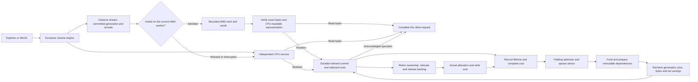

# FlitzFS release reconciliation · 25 November 2026

FlitzFS has a writable Windows filesystem, independent CPU recovery and
bounded AMD execution in development fixtures. The highest-value work is
to settle a packed volume through ordinary mounted I/O, prove an automatic
AMD advantage on actual client demand, and reduce complete occupied bytes
on held-out workloads. Writable attach must also scale beyond the current
full audit. Use one operation witness and common accounting across these
lanes so each change can be judged at the product boundary.

This review reconciles the 1,081-path parent
`26edc62d347a27170f13a30fb48f8fe2d583dc7a`, tree
`b3a631da922bbe42f95d4da48343a322c4d45e3f`, and the packed tail candidate.
Six commits changed 41 paths since the latest source baseline in the
24 November review. They cover writable audit, adaptive compression, AMD
startup and callback delivery. E01–E13 still define package completion.
[Source, checks and research](evidence/windows-packed-tail-continuation-2026-11-25.json) ·
[Previous review](RELEASE_RECONCILIATION_2026-11-24.md) ·
[Package plan](IMPLEMENTATION_PLAN.md) ·
[Current architecture](architecture/CURRENT.md) · [Target architecture](architecture/TARGET.md)

## Reconciled release gates

| Gate | Current evidence | Completion evidence |
| --- | --- | --- |
| S1 · Exact artifacts | Current scoped builds bind source and SDK/CPU artifacts. Earlier real device runs identify their exact ROCm binaries. | Bind one clean Windows 11 update, signed WinFsp pair, helper, workers, CPU decoder table and backing capabilities to the acceptance run. |
| S2 · Scale | Paged inodes, names and extents are live. Checked replica reads now group within a leaf and a bank, retaining the complete startup walk. | Verify bounded attach under a versioned authority contract. Fit and validate separate named-file curves for attach, restart, enumeration, mutation and resident memory. |
| S3 · Space reuse | Sparse backing settled while mounted after preselection on the 1,027-file trace. Packed work continued after detach. The new callback fixture releases an already-selected packed image’s confirmed suffix in bounded continuations. | Select and settle through the ordinary mounted controller. Measure actual allocation with pinned readers, sustained churn, constrained free space and interrupted recovery. |
| S4 · AMD and CPU continuity | Prepared AMD frames passed earlier SDK tests. The current stream binding survives unrelated callbacks in CPU semantic tests. The measured 1 MiB write shape still favors CPU. A new passive host check saw GPU engine peaks of 97% and 80%. | Prove a useful automatic region for each advertised AMD role in installed-client paths. Qualify CPU availability, verified delivery and condition-based device recovery. |
| S5 · Compression | Protected prefix selection can save an allocation pair. A 67-byte-shift restart fixture saves 122,880 complete bytes. Real corpus rebuild controls retained their sizes, with no catalog nominations required. AIT grouping and parity placement showed distinct effects. | Establish a held-out complete-size frontier including metadata and protection. Measure catalog recall and savings with a populated, funded search index. |
| S6 · Autonomy | Persistent sparse advice, workload samples, yield ranking and resource admission run in the controller. | Measure learning benefit, time to settle, interference, per-volume fairness and bytes written per byte reclaimed across workloads and restart. |
| S7 · Windows experience | The helper and WinFsp own memory and supported file-backed volumes. Signed guests exercised external clients and verified reopen. | Qualify Explorer and independent apps with the signed candidate. Cover sharing, mapped and cached I/O, names, metadata, repair and clean teardown. |
| S8 · Durability | Interruption fixtures exercised writes, flush, mapping and selector publication with independent CPU readback. | Qualify the acknowledged-operation and survivor-repair envelope for each backing. Explain unrecoverable failures precisely and retain the evidence for recovery. |
| S9 · Evolution | Native formats identify required CPU features. Packed cross-group moves use paired versioned anchors. | Freeze historical writers, readers and images. Test old reads, mixed generations, migration checkpoints, old-writer refusal and interrupted recovery. |
| S10 · Deployment | Private dependency staging and signed-provider fixtures exercise controlled setup. | Qualify relocation, missing optional AMD, offline rescue and clean install, upgrade, rollback and removal. Cybersecurity review remains separately deferred. |
| S11 · Comparisons | DiskSpd, a Win32 operation witness, public corpora and the native NTFS compression protocol are available. | Run matched installed-host plain NTFS, built-in compressed NTFS and FlitzFS CPU/AMD comparisons with distributions, occupied bytes and exact readback. |
| S12 · Stabilization | Scoped tests and pilot receipts exist across these lanes. | Resolve material regressions and pass the signed-candidate compatibility, recovery and soak matrix before the owner evaluates release. |

[Mounted operation trace](evidence/windows-populated-client-trace-2026-11-24.json) ·
[Preselected retirement](evidence/windows-mounted-range-retirement-2026-11-24.json) ·
[Fenced audit](evidence/indexed-fenced-read-runs-2026-11-25.json) ·
[Displaced coherence](evidence/indexed-shifted-coherence-2026-11-25.json) ·
[Collective compression](evidence/windows-collective-cold-order-2026-11-24.json) ·
[Prepared AMD startup](evidence/windows-amd-group-startup-admission-2026-11-25.json) ·
[Callback binding](evidence/windows-group-read-stream-binding-2026-11-25.json) ·
[Release matrix](RELEASE_EXECUTION_PLAN.md#current-gate-ledger)

## Research and design decisions

- **Placement is a measured source of write amplification.** FAST ’26
  DOGI predicts invalidation time in log-structured storage, and WARP
  finds that device-level placement depends on grouping and device
  behavior. For the Windows ordinary-file provider, first test age and
  observed rewrite frequency as optional software placement advice. Price
  the result on the same mutation trace before considering device hints.
  [DOGI](https://www.usenix.org/conference/fast26/presentation/kim-jeeyun) ·
  [WARP](https://www.usenix.org/conference/fast26/presentation/song)
- **Track EOF, allocation and persistence independently.** Windows EOF,
  allocation and flush operations have separate contracts. Allow a confirmed
  packed shorten to fund a bounded follow-up in the current idle window.
  Each step revalidates durable selectors and a provider-qualified retained
  prefix. The fixture established modeled extent accounting. Mounted
  allocation and persistence after power interruption require their own
  evidence.
  [Windows EOF operation](https://learn.microsoft.com/en-us/windows/win32/api/winbase/ns-winbase-file_end_of_file_info) ·
  [Windows buffered flush](https://learn.microsoft.com/en-us/windows/win32/fileio/flushing-system-buffered-i-o-data-to-disk)
- **Price the complete representation before adding a decoder model.**
  Tufa’s compact offline prior improved enwik9’s complete size by 0.56%
  over its online baseline after charging the decoder and model. Its
  sequential learning path is a research control. ZipLLM’s related tensor
  cohorts show why domain-specific residuals are worth testing. Price
  protected shared references and deterministic transforms first. A
  learned decoder must repay weights, restart checkpoints and access cost
  on held-out groups. A learner that only ranks reversible candidates can
  be replaced independently of stored data.
  [Tufa author report](https://tufalabs.ai/research/tufazip/) ·
  [NSDI ’26 ZipLLM](https://www.usenix.org/conference/nsdi26/presentation/wang-zirui)
- **Warm means ready to serve predicted work.** AMD documents asynchronous
  stream ordering and ways to overlap transfers and kernels. Measure a
  leased, validated context with bounded buffers and real arrivals. Charge
  the pre-demand and idle residency costs, then retire it on pressure or
  when the demand evidence expires. Resolve HIP capability against the
  exact Windows ROCm package and installed runtime.
  [AMD asynchronous execution](https://rocm.docs.amd.com/projects/HIP/en/latest/how-to/hip_runtime_api/asynchronous.html) ·
  [ROCm release and component changelog](https://rocm.docs.amd.com/en/latest/release/changelog.html)
- **Use file benchmarks and content corpora for distinct outcomes.**
  DiskSpd measures latency and throughput. AITDCC 2026 supplies a frozen
  heterogeneous lossless corpus. Add held-out versioned tree, binary,
  document and already-compressed cohorts to expose group-specific wins.
  Apply Windows’ file/directory compression state for the native NTFS
  arm and verify inheritance and individual file state.
  [DiskSpd workload](https://microsoft.github.io/VirtualClient/docs/workloads/diskspd/) ·
  [AITDCC 2026 dataset](https://aitdcc.github.io/dataset.html) ·
  [Microsoft NTFS compression state](https://learn.microsoft.com/en-us/windows/win32/fileio/compression-state)

## Target control and storage design

The CPU path can service all admitted formats, and the volume owner controls
durable publication. Read verification delivers bytes to the client.
Mutation and maintenance feed the commit boundary. Each new dependency
binds immutable bytes, a CPU decode capability, a restart boundary and a
reference whose lifetime outlasts its members. Discardable observations
predict profitability and placement. Durable authority controls release
and acknowledgements.

## Ordered implementation and decision points

### 1. Close ordinary mounted settlement · E02, E08, E11

1. Extend the common Win32 witness and controller observer with explicit
   copy, verification, selector, pin wait, logical retirement, relocation
   and shortening phases. Record old and selected identities plus host
   deferrals, durable authority, live slots, reusable gaps, releasable
   suffix, EOF and actual allocated bytes under the attached owner.
2. Replay the 1,027-file workload from normal writes with its flush,
   rename, mapped I/O, outstanding reads and continued writes. Use an
   equivalent arm with cold work withheld. Check durable operations and
   bytes with the independent CPU reader after stop and interruption.
3. Attribute time and bytes to phases before tuning. If copy dominates,
   remove repeated reads and candidate reconstruction using bounded pages
   and identity rechecks. If placement dominates, compare extent age and
   contiguous-gap candidates in shadow mode. Require an occupied plateau
   and fewer writes per reclaimed byte before replacing the allocator.
4. Repeat under constrained capacity, churn and retained readers. Verify
   the last reader wakes retirement. Cut durable selectors, directory
   peers, move intent, truncate, flush and reopen. Keep separate counts
   for logical release and physical settlement.

### 2. Prove useful automatic AMD service · E03, E06, E08

1. Instrument real client arrivals and committed group identities. Record
   readiness, transfer, compute, verification, delivery and retirement,
   including CPU work during startup and discarded GPU responses. Use the
   same supervision, demand order and byte oracle for CPU, cold AMD and
   verified-ready AMD.
2. Start with protected grouped reads. Alternate arms across contiguous
   and interleaved streams and several demand-supported sizes. Recheck
   generation and context before delivery. Submit only useful work and
   replenish it from new demand.
3. Run ingest and deep compression separately across actual arrival,
   locality and group distributions. Judge acceptance on service tails,
   total CPU/device cost and complete occupied bytes. Retain the measured
   losing write shape as a control for automatic CPU selection.
4. Compare leased readiness with cold startup and report idle memory,
   engine load and power where supported. Exercise busy, unsupported or
   replaced GPU, wrong reply, hang, cancellation and unconfirmed
   retirement. Serve immediately on CPU and require new configuration or
   readiness evidence plus verified retirement before GPU re-admission.

### 3. Make attach and background discovery scale · E01, E04, E07

1. Compare full audit with a shadow contract binding selector, checkpoint,
   provider identity, root structure and owned extents. Classify which
   proofs must precede writable access and which can be checked on demand.
   Keep full recovery authoritative on any missing premise or divergence.
2. Run named-file tiers beginning with 1,027 and 16,384, varying short
   files, concentrated directories, paths and larger extents. Fit attach,
   lookup, keyset listing, mutation, restart and resident bytes
   separately. Hold a feasible tier out and give the scale extrapolation
   an uncertainty interval and explicit workload assumptions.
3. Reuse sparse persisted coherence. Check displaced candidate recall
   against an exhaustive protected-cost oracle on small sets. Bound
   candidate work and residency by observed headroom. Compare rank
   changes, false positives, catalog writes and recall on held-out trees.
4. Train a compact local ranker in shadow mode against current heuristics.
   Charge persistence, exploration and rebuild. Keep data verification
   independent of model state and verify disconnected operation after
   restart, stale advice and loss of the learned state.

### 4. Establish the settled compression frontier · E04–E07, E12

1. Freeze equal-protection controls for independent high-level Zstandard,
   exact reuse, dictionaries/prefixes, short packing and current grouped
   residuals. Split training and held-out versions and file families.
   Include incompressible and precompressed files and report regressions.
2. Account for every occupied byte of payload, replicas, roots, journal,
   advice, dictionaries, shared bases and provider slack. Track transient
   staging separately. Measure verified decode, read amplification,
   random-range latency, time to settle, foreground p99 and rewrite cost.
3. Test immutable shared bases with independently accessible subgroups.
   Choose dependency depth and group geometry on measured savings and
   access cost. Prototype deterministic learned residuals separately if
   protected established codecs leave room. Validate independent CPU
   readback and successful interruption recovery before assigning formats.
4. Compare parity and mirroring separately on identical encoded objects
   with explicit fault-model differences. Stage a rewrite only for
   measured debt reduction and preserve both committed ownership and
   versioned progress through any interrupted migration.

### 5. Qualify an owner-reviewable candidate · E08–E13

1. Freeze the Windows 11 x64 artifact and compatibility manifest. Verify
   signed-provider setup, Explorer and normal clients, optional AMD,
   relocation, versioned CPU rescue, restart and clean lifecycle.
2. Test historical writers/readers against the compatibility window.
   Check dependencies before activation, old-writer refusal and gradual
   automatic migration. Check rollback at every durable phase.
3. Qualify acknowledgement and repair for each advertised provider.
   Distinguish process interruption, buffered flush and power/media
   failure. Use disposable environments for persistent-media faults.
4. Run installed-host DiskSpd and named-file tests across plain NTFS,
   native compressed NTFS and FlitzFS CPU/AMD. Match content, backing,
   driver baseline, cache, affinity, queue and I/O sizes. Report cold and
   prepared separately, distributions, skipped cases, hashes and complete
   occupied bytes. Use guest runs for correctness.
5. Close S1–S12 with the exact signed candidate, fault matrix and soak.
   Compile the compatibility and measured limitation evidence for the
   owner’s release decision.

## Effort and repricing

The current estimate remains **59–127 person-weeks**, rounded to
**60–130**, at low confidence, with an open compression research tail.
Reprice after ordinary mounted settlement, a repeatable AMD advantage
and a profitable held-out compression cohort. Use focused checks to
choose the next production change. Reserve comprehensive comparative,
fault and soak campaigns for candidates whose decisions depend on them.
[Effort by package](IMPLEMENTATION_PLAN.md#17-completion-dependency-graph-and-effort) ·
[Benchmark protocol](BENCHMARK_PROTOCOL.md)
