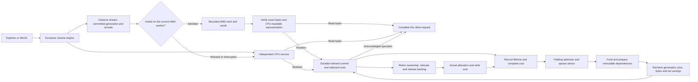

# FlitzFS release reconciliation · 25 November 2026

FlitzFS has a writable Windows filesystem, independent CPU recovery and
bounded AMD execution in development fixtures. The highest-value work is
to settle a packed volume through ordinary mounted I/O, prove an automatic
AMD advantage on actual client demand, and reduce complete occupied bytes
on held-out workloads. Writable attach must also scale beyond the current
full audit. Use one operation witness and common accounting across these
lanes so each change can be judged at the product boundary.

This review reconciles the 1,085 tracked files at
`e2dea97b2c5913c0e6205f67da51ed989feca94f` and the batched copy candidate.
Sixteen commits changed 70 paths since the 24 November full review.
The intervening work covers writable verification, space release,
adaptive compression, AMD startup and device read delivery.
[Source inventory, checks and research](evidence/windows-batched-staged-copy-2026-11-25.json) ·
[Earlier packed-tail review](evidence/windows-packed-tail-continuation-2026-11-25.json) ·
[Previous review](RELEASE_RECONCILIATION_2026-11-24.md) ·
[Package plan](IMPLEMENTATION_PLAN.md) ·
[Current architecture](architecture/CURRENT.md) · [Target architecture](architecture/TARGET.md)

## Ordinary packed follow-up

The follow-up starts after the 6,293-operation Win32 witness with the
original selected image. The mounted controller performed 662 copy steps,
including 584 continuations, without reaching publication in the observation.
The detached CPU path then selected the compact image and reduced allocation
to 6,160,384 bytes. All 1,027 files read back exactly across the three
helper lifecycles. The signed guest retired its mount and was disposed.
Use this trace to attribute rebuild work while mounted before tuning
retirement again. [Ordinary mounted and detached evidence](evidence/windows-ordinary-reclamation-progress-2026-11-25.json)

The current source also delivered two verified mixed AMD frames after an
unrelated callback. The installed-host SDK test verified independent CPU
readback, rejection of a late result and worker retirement. A matched
ordinary-client speed comparison remains open.
[Live Radeon evidence](evidence/windows-ordinary-reclamation-progress-2026-11-25.json)

## Rebuild verification reads

Coalescing checked frames within a leaf and a bank reduced provider reads
across the four measured rebuild phases from 14,231 to 9,006 in the
1,024-record fixture. The fragmented-source case fell from 14,201 to
10,336, with most of the savings on the packed target. During copy, the
two-copy check also provides the bytes for independent CPU comparison.
Transient target corruption still refused both verification passes.

The signed guest matched the 6,293-operation client transcript. It
advanced 548 copy steps while mounted and completed selection and space
release after detach. Independent CPU readback verified all 1,027 files.
[Phase counts and signed guest](evidence/windows-rebuild-verification-reads-2026-11-25.json)

## Batched staged copy

An unchanged short record can now move with its neighbors in the same
verified leaf and target mirror bank. One copy step writes and reads
back both runs. It independently decodes and compares each record before
the checked index and publication stages. The batch keeps the same wire
format, packed offsets and source-order digest.

| Copy phase per 1,024-record fixture | Previous | Candidate |
| --- | ---: | ---: |
| Advance calls | 1,025 | 300 |
| Target writes | 4,380 | 1,172 |
| Target read calls | 2,330 | 880 |
| Target bytes read | 1,161,652 | 1,161,652 |
| Target bytes written | 1,163,264 | 1,163,264 |

Counts match on contiguous and fragmented sources. Both complete images
match their controls byte for byte. The fault suite exercised 1,419 write
and barrier cuts, including six across the two grouped writes.
The first signed Windows guest reached the client admission check and
refused to launch the helper at its measured memory allowance. The Sandbox
was disposed. The 18 scoped checks ran on the live Windows 11 26H2 host
at build 26300.10075.
[Copy evidence](evidence/windows-batched-staged-copy-2026-11-25.json)

## Signed replay and expanded AMD read window

The subsequent signed replay matched the 6,293-operation transcript and
verified all 1,027 files across three helper lifecycles with a process cut.
The ordinary packed controller advanced 701 private rebuild steps and
ended before selection or space release. It retired the helper, mount and
guest. The earlier detached control remains the space-release evidence.

A source-bound Radeon SDK run decoded four grouped extents in one prepared
exchange and served them across two read callbacks. CPU readback matched
every byte and the worker exited. Compare this wider workload on the installed
automatic path with matched CPU controls. Attribute the packed controller's
remaining work to the inner rebuild phases before choosing the next fix.
[Signed replay and Radeon evidence](evidence/windows-expanded-group-read-and-mounted-replay-2026-11-25.json)

## Reconciled release gates

| Gate | Current evidence | Completion evidence |
| --- | --- | --- |
| S1 · Exact artifacts | Current scoped builds bind source and SDK/CPU artifacts. Earlier real device runs identify their exact ROCm binaries. | Bind one clean Windows 11 update, signed WinFsp pair, helper, workers, CPU decoder table and backing capabilities to the acceptance run. |
| S2 · Scale | Paged inodes, names and extents are live. Checked replica reads now group within a leaf and a bank, retaining the complete startup walk. | Verify bounded attach under a versioned authority contract. Fit and validate separate named-file curves for attach, restart, enumeration, mutation and resident memory. |
| S3 · Space reuse | Sparse backing settled while mounted after preselection on the 1,027-file trace. Packed work continued after detach. The new callback fixture releases an already-selected packed image’s confirmed suffix in bounded continuations. | Select and settle through the ordinary mounted controller. Batched copy makes fewer calls on identical bytes in both local layouts. Use the allocation trace to identify the next cost under pinned readers, sustained churn, constrained free space and interruption. |
| S4 · AMD and CPU continuity | Prepared AMD frames passed earlier SDK tests. The later live trial verified two mixed device frames after an unrelated callback and independent CPU readback. The measured 1 MiB write shape still favors CPU. | Prove a useful automatic region for each advertised AMD role in installed-client paths. Qualify CPU availability, verified delivery and condition-based device recovery. |
| S5 · Compression | Protected prefix selection can save an allocation pair. A 67-byte-shift restart fixture saves 122,880 complete bytes. Real corpus rebuild controls retained their sizes, with no catalog nominations required. AIT grouping and parity placement showed distinct effects. | Establish a held-out complete-size frontier including metadata and protection. Measure catalog recall and savings with a populated, funded search index. |
| S6 · Autonomy | Persistent sparse advice, workload samples, yield ranking and resource admission run in the controller. | Measure learning benefit, time to settle, interference, per-volume fairness and bytes written per byte reclaimed across workloads and restart. |
| S7 · Windows experience | The helper and WinFsp own memory and supported file-backed volumes. Signed guests exercised external clients and verified reopen. | Qualify Explorer and independent apps with the signed candidate. Cover sharing, mapped and cached I/O, names, metadata, repair and clean teardown. |
| S8 · Durability | Interruption fixtures exercised writes, flush, mapping and selector publication with independent CPU readback. | Qualify the acknowledged-operation and survivor-repair envelope for each backing. Explain unrecoverable failures precisely and retain the evidence for recovery. |
| S9 · Evolution | Native formats identify required CPU features. Packed cross-group moves use paired versioned anchors. | Freeze historical writers, readers and images. Test old reads, mixed generations, migration checkpoints, old-writer refusal and interrupted recovery. |
| S10 · Deployment | Private dependency staging and signed-provider fixtures exercise controlled setup. | Qualify relocation, missing optional AMD, offline rescue and clean install, upgrade, rollback and removal. Cybersecurity review remains separately deferred. |
| S11 · Comparisons | DiskSpd, a Win32 operation witness, public corpora and the native NTFS compression protocol are available. | Run matched installed-host plain NTFS, built-in compressed NTFS and FlitzFS CPU/AMD comparisons with distributions, occupied bytes and exact readback. |
| S12 · Stabilization | Scoped tests and pilot receipts exist across these lanes. | Resolve material regressions and pass the signed-candidate compatibility, recovery and soak matrix before the owner evaluates release. |

[Mounted operation trace](evidence/windows-populated-client-trace-2026-11-24.json) ·
[Preselected retirement](evidence/windows-mounted-range-retirement-2026-11-24.json) ·
[Fenced audit](evidence/indexed-fenced-read-runs-2026-11-25.json) ·
[Displaced coherence](evidence/indexed-shifted-coherence-2026-11-25.json) ·
[Collective compression](evidence/windows-collective-cold-order-2026-11-24.json) ·
[Prepared AMD startup](evidence/windows-amd-group-startup-admission-2026-11-25.json) ·
[Callback binding](evidence/windows-group-read-stream-binding-2026-11-25.json) ·
[Release matrix](RELEASE_EXECUTION_PLAN.md#current-gate-ledger)

## Research and design decisions

- **Placement is a measured source of write amplification.** FAST ’26
  DOGI predicts invalidation time in log-structured storage, and WARP
  finds that device-level placement depends on grouping and device
  behavior. For the Windows ordinary-file provider, first test age and
  observed rewrite frequency as optional software placement advice. Price
  the result on the same mutation trace before considering device hints.
  [DOGI](https://www.usenix.org/conference/fast26/presentation/kim-jeeyun) ·
  [WARP](https://www.usenix.org/conference/fast26/presentation/song)
- **Measure provider reads separately from throughput.** Windows generally
  serves buffered file reads through its cache. Group adjacent ranges on
  the existing backing interface and count operations and bytes together.
  The FAST ’26 grouped I/O work uses similar visibility into neighboring
  requests for its cloud storage workloads. FlitzFS’s separate CPU and
  backing checks determine correctness and benefit on its own workloads.
  [Windows file caching](https://learn.microsoft.com/en-us/windows/win32/fileio/file-caching) ·
  [FAST ’26 AITURBO](https://www.usenix.org/conference/fast26/presentation/hao)
- **Measure direct reuse separately from live copying.** FAST ’26 DisCoGC
  reports gains from releasing proven stale ranges independently of
  compaction in its storage system. For FlitzFS, compare a bounded
  ownership ledger for reusable ranges with whole-image rebuild on the
  same trace. Validate both durable roots and retained readers before any
  range becomes reusable.
  [FAST ’26 DisCoGC](https://www.usenix.org/conference/fast26/presentation/bian)
- **Track EOF, allocation and persistence independently.** Windows EOF,
  allocation and flush operations have separate contracts. Allow a confirmed
  packed shorten to fund a bounded follow-up in the current idle window.
  Each step revalidates durable selectors and a provider-qualified retained
  prefix. The fixture established modeled extent accounting. Mounted
  allocation and persistence after power interruption require their own
  evidence.
  [Windows EOF operation](https://learn.microsoft.com/en-us/windows/win32/api/winbase/ns-winbase-file_end_of_file_info) ·
  [Windows buffered flush](https://learn.microsoft.com/en-us/windows/win32/fileio/flushing-system-buffered-i-o-data-to-disk)
- **Price the complete representation before adding a decoder model.**
  Tufa’s compact offline prior improved enwik9’s complete size by 0.56%
  over its online baseline after charging the decoder and model. Its
  sequential learning path is a research control. ZipLLM’s related tensor
  cohorts show why domain-specific residuals are worth testing. Price
  protected shared references and deterministic transforms first. A
  learned decoder must repay weights, restart checkpoints and access cost
  on held-out groups. A learner that only ranks reversible candidates can
  be replaced independently of stored data.
  [Tufa author report](https://tufalabs.ai/research/tufazip/) ·
  [NSDI ’26 ZipLLM](https://www.usenix.org/conference/nsdi26/presentation/wang-zirui)
- **Warm means ready to serve predicted work.** AMD documents asynchronous
  stream ordering and ways to overlap transfers and kernels. Measure a
  leased, validated context with bounded buffers and real arrivals. Charge
  the pre-demand and idle residency costs, then retire it on pressure or
  when the demand evidence expires. Resolve HIP capability against the
  exact Windows ROCm package and installed runtime.
  [AMD asynchronous execution](https://rocm.docs.amd.com/projects/HIP/en/latest/how-to/hip_runtime_api/asynchronous.html) ·
  [ROCm release and component changelog](https://rocm.docs.amd.com/en/latest/release/changelog.html)
- **Use file benchmarks and content corpora for distinct outcomes.**
  DiskSpd measures latency and throughput. AITDCC 2026 supplies a frozen
  heterogeneous lossless corpus. Add held-out versioned tree, binary,
  document and already-compressed cohorts to expose group-specific wins.
  Apply Windows’ file/directory compression state for the native NTFS
  arm and verify inheritance and individual file state.
  [DiskSpd workload](https://microsoft.github.io/VirtualClient/docs/workloads/diskspd/) ·
  [AITDCC 2026 dataset](https://aitdcc.github.io/dataset.html) ·
  [Microsoft NTFS compression state](https://learn.microsoft.com/en-us/windows/win32/fileio/compression-state)

- **Budget the next unit from measured work.** HATS measures interference
  between foreground reads and compaction and adapts compaction rate in
  Cassandra. Test the corresponding decision in FlitzFS with separate
  service costs for copy, verification, index and retirement. Charge actual
  operations, bytes and interruptions to one idle opportunity. Use the
  per-phase Windows witness to decide whether adaptive admission, a local
  reuse path or a layout change brings the greater gain.
  [FAST ’26 HATS](https://www.usenix.org/conference/fast26/presentation/ren) ·
  [FAST ’26 WSBuffer](https://www.usenix.org/conference/fast26/presentation/zhan)
- **Keep candidate discovery independent of encoded boundaries.** ParaSync
  separates checksum work from boundary selection in file synchronization.
  A recent CDC preprint distinguishes cut-point rules from size policy and
  reports different outcomes across input classes. For FlitzFS, test
  shifted anchors and sampled fingerprints beside current extent geometry.
  Hold mean chunk size, windows and posting cost constant when testing
  new cut-point rules. Admit a format experiment only if complete byte
  savings and verified random reads justify changing the representation.
  [FAST ’26 ParaSync](https://www.usenix.org/conference/fast26/presentation/zhang-zhihao-parasync) ·
  [CDC evaluation preprint](https://arxiv.org/abs/2610.13704)
- **Treat ROCm package and HIP ABI as distinct measured fields.** AMD
  published ROCm Core SDK 10.2.0 on 18 November and documents Windows
  distribution options. The separate Windows HIP SDK documentation
  describes its 7.2.0 installer. Record the package channel, exact loaded
  HIP binary, runtime API version, compiler and approved module digests
  together. The existing 10.2.0 archive pin records internal package
  version `10.2.0rc2` and HIP `7.17.26434-2a0e6e6771`. Qualify
  the final Windows artifact with matching component provenance before
  enrollment. Recheck startup, retirement and live shapes for each tuple.
  Use the installed driver as a capability input.
  [ROCm 10.2.0 release](https://rocm.docs.amd.com/en/docs-10.2.0/about/release-notes.html) ·
  [AMD installation paths](https://rocm.docs.amd.com/en/docs-10.2.0/install/rocm.html) ·
  [Standalone Windows HIP SDK](https://rocm.docs.amd.com/projects/install-on-windows/en/latest/about/releasenotes.html)
- **Carry the same signed Windows stack across client checks.** The
  maintainer’s WinFsp 2026 stable record specifies v2.2, and the default
  FlitzFS SDK lock already uses that exact MSI digest. The v2.1 and v2.2B5
  locks are used by named comparison profiles. Track the signed provider
  and SDK as one tested pair. Check ownership, teardown and handoff with
  both the helper and external operations.
  [WinFsp v2.2](https://github.com/winfsp/winfsp/releases/tag/v2.2)
- **Qualify the current Windows client at its actual update level.**
  Microsoft lists Windows 11 26H2 at build 26300.10075 in its 19 November
  update record. The live host runs that build. The disposable mounted
  fixture runs build 26100 and is useful for correctness. Bind acceptance
  traces and comparisons to the intended Windows 11 x64 update and driver.
  [Windows 11 release information](https://learn.microsoft.com/en-us/windows/release-health/windows11-release-information)

## Target control and storage design

The CPU path can service all admitted formats, and the volume owner controls
durable publication. Read verification delivers bytes to the client.
Mutation and maintenance feed the commit boundary. Each new dependency
binds immutable bytes, a CPU decode capability, a restart boundary and a
reference whose lifetime outlasts its members. Discardable observations
predict profitability and placement. Durable authority controls release
and acknowledgements.

## Ordered implementation and decision points

Begin with the operations that can change the product's limiting cost or
close a release gate. Reuse the frozen client transcript and existing fault
oracles where the exercised path matches. Each stage needs one decision
before expanding the experiment.

| Priority | First deliverable | Decision before expanding |
| --- | --- | --- |
| 1 · Mounted allocation | Matched normal-controller run with checkpoint selection, pinned reuse and actual occupied bytes | If full-image movement sets the allocation floor, implement local reuse. If admission leaves useful work idle, correct the measured scheduling condition. |
| 2 · Real AMD service and CPU continuity | One repeatable installed-client read shape that consumes verified device bytes, paired with CPU and cold device runs | Promote that shape only with a complete-path win. Use its largest measured cost to choose the next write or collective improvement. |
| 3 · Compression that changes occupied size | Protected complete-volume profiles and oracle recall on held-out families | Keep the nondominated candidates in size and verified access. Choose an additional representation only when it improves an observed weak cohort. |
| 4 · Writable reopen at scale | Shadow authority decision beside the full audit and an independently validated scaling model | Fix the largest measured metadata cost. Authorize incremental attachment only when all authority and recovery invariants hold. |
| 5 · Windows release candidate | Signed package and recovery tool, old-format fixtures, matched baselines and explicit platform support | Close gate evidence on the exact candidate before the owner reviews release. |

### 1. Close ordinary mounted settlement · E02, E08, E11

1. Repeat the validated signed client witness with separate inner-stage
   counters for the source audit, payload copy, index construction,
   target verification, publication, pin wait, retirement,
   relocation and shortening outcomes. Record provider calls, bytes
   moved, actual occupied allocation and the reason every funded
   continuation stops. Qualify trace and teardown in the guest.
2. On the same 1,027 live files, compare ordinary churn, a cold-work
   control and detached CPU verification. Track the selected generation,
   selector and provider identities, live bytes, reusable slots, pinned
   ranges, file EOF and actual allocated bytes. Check successful flushes
   and every file's content. Repeat delete/regrow with a retained reader,
   then release the reader and observe the next eligible retirement.
3. Use the selected image's protected length and the provider's proven
   alignment to bound the allocation floor. Attribute extra bytes to
   retained generations, reusable gaps or work that is still eligible.
   If bounded scheduling prevents a ready phase from progressing, test
   phase-cost prediction against foreground pressure and maximum work per
   opportunity. If copy/rewrite or alternate capacity stays dominant,
   prototype a generation-bound retirement ledger and local reuse in
   shadow mode. Compare both to the checked full rebuild.
4. Make reuse transactional only after modeling ownership from both
   selectable roots, retained reader pins, allocation incarnation and
   provider geometry. Exercise crash cuts at allocate, transfer, verify,
   switch and release. Require stable settled allocation on a fixed live
   set and lower bytes written per byte reclaimed. Independently confirm
   content and recovery after interrupted selection and provider failure.

### 2. Prove useful automatic AMD service · E03, E06, E08

1. Instrument real client arrivals and committed group identities. Record
   readiness, transfer, compute, verification, delivery and retirement,
   including CPU work during startup and discarded GPU responses. Use the
   same supervision, demand order and byte oracle for CPU, cold AMD and
   verified-ready AMD.
2. Start with protected grouped reads. Alternate arms across contiguous
   and interleaved streams and several demand-supported sizes. Recheck
   generation and context before delivery. Submit only useful work and
   replenish it from new demand.
3. For write ingestion, preserve the losing 1 MiB shape as a CPU selection
   control. Price the completed captured group, accepted commit and
   allocated size across alignment, locality and cadence. For collective
   work, count protected bytes saved per eligible idle opportunity.
   Compare each separately with matched CPU outputs and readback.
4. Compare a demand-bound ready context against cold startup. Charge
   discovery and preparation, idle host/device residency, transfer,
   compute, verification and retired work to the same client trace.
   Compare observed interarrival gaps with readiness cost and resources.
   Revoke the lease on loss of demand, pressure, stop or identity change.
   Check busy, unsupported or replaced GPU, incorrect replies,
   cancellation and unconfirmed retirement. CPU serves immediately when
   the device declines. New acquisition requires relevant evidence and
   verified retirement.

### 3. Make attach and background discovery scale · E01, E04, E07

1. Compare full audit with a shadow contract binding selector, checkpoint,
   provider identity, root structure and owned extents. Classify which
   proofs must precede writable access and which can be checked on demand.
   Keep full recovery authoritative on any missing premise or divergence.
2. Run named-file tiers beginning with 1,027 and 16,384, varying short
   files, concentrated directories, paths and larger extents. Fit attach,
   lookup, keyset listing, mutation, restart and resident bytes
   separately. Hold a feasible tier out and give the scale extrapolation
   an uncertainty interval and explicit workload assumptions.
3. Reuse sparse persisted coherence. Check displaced candidate recall
   against an exhaustive protected-cost oracle on small sets. Bound
   candidate work and residency by observed headroom. Compare rank
   changes, false positives, catalog writes and recall on held-out trees.
4. Train a compact local ranker in shadow mode against current heuristics.
   Compare short-list recall and complete protected bytes saved per spent
   CPU/device unit. Update from confirmed trials with bounded memory,
   persistent versioned progress and limited exploration. Exercise family
   drift, stale advice, restart and loss of model state. Promote the policy
   only when it improves savings or lowers overhead on held-out groups.
   Keep data decode and repair independent of the ranker.

### 4. Establish the settled compression frontier · E04–E07, E12

1. Freeze equal-protection controls for independent high-level Zstandard,
   exact reuse, dictionaries/prefixes, short packing and current grouped
   residuals. Split training and held-out versions and file families.
   Include incompressible and precompressed files and report regressions.
2. Account for every occupied byte of payload, replicas, roots, journal,
   advice, dictionaries, shared bases and provider slack. Track transient
   staging separately. Measure verified decode, read amplification,
   random-range latency, time to settle, foreground p99 and rewrite cost.
3. Test immutable shared bases with independently accessible subgroups.
   Grow candidate groups across files and chunk sizes under measured
   search cost. Independently limit bytes decoded per random read and
   audited dependency depth. Keep an independent CPU restart path and
   compare any GPU decode service on those same protected bytes. Prototype
   deterministic learned residuals after identifying cohorts that existing
   candidates leave expensive. Charge model bytes, protection, restart
   state and training before assigning any format. Qualify interruption
   recovery and backwards-compatible reads first.
4. Compare parity and mirroring separately on identical encoded objects
   with explicit fault-model differences. Stage a rewrite only for
   measured debt reduction and preserve both committed ownership and
   versioned progress through any interrupted migration.

### 5. Qualify an owner-reviewable candidate · E08–E13

1. Freeze the Windows 11 x64 artifact and compatibility manifest. Verify
   signed-provider setup, Explorer and normal clients, optional AMD,
   relocation, versioned CPU rescue, restart and clean lifecycle.
2. Test historical writers/readers against the compatibility window.
   Check dependencies before activation, old-writer refusal and gradual
   automatic migration. Check rollback at every durable phase.
3. Qualify acknowledgement and repair for each advertised provider.
   Distinguish process interruption, buffered flush and power/media
   failure. Use disposable environments for persistent-media faults.
4. Run installed-host DiskSpd and named-file tests across plain NTFS,
   native compressed NTFS and FlitzFS CPU/AMD. Match content, backing,
   driver baseline, cache, affinity, queue and I/O sizes. Report cold and
   prepared separately, distributions, skipped cases, hashes and complete
   occupied bytes. Use guest runs for correctness.
5. Close S1–S12 with the exact signed candidate, fault matrix and soak.
   Compile the compatibility and measured limitation evidence for the
   owner’s release decision.

## Effort and repricing

The current estimate remains **59–127 person-weeks**, rounded to
**60–130**, at low confidence, with an open compression research tail.
Reprice after ordinary mounted settlement, a repeatable AMD advantage
and a profitable held-out compression cohort. Use focused checks to
choose the next production change. Reserve comprehensive comparative,
fault and soak campaigns for candidates whose decisions depend on them.
[Effort by package](IMPLEMENTATION_PLAN.md#17-completion-dependency-graph-and-effort) ·
[Benchmark protocol](BENCHMARK_PROTOCOL.md)
