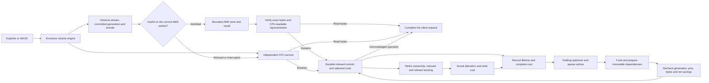

# FlitzFS release reconciliation · 25 November 2026

FlitzFS has a writable Windows filesystem, independent CPU recovery and
bounded AMD execution in development fixtures. The highest-value work is
to settle a packed volume through ordinary mounted I/O, prove an automatic
AMD advantage on actual client demand, and reduce complete occupied bytes
on held-out workloads. Writable attach must also scale beyond the current
full audit. Use one operation witness and common accounting across these
lanes so each change can be judged at the product boundary.

The full review of the 1,095-path parent `ff55509` supplies the architecture
and release-gate baseline. This update reconciles the 1,098 tracked paths
at `1568341d62f49108597468cb237f0e8ea3096635` and the runtime candidate tree
`efdec5fd0abd1265242bd0b6c8ecbaa0a2e80e79`. Three published checkpoints and
the current patch changed 18 code and build-related paths since that review.
The changed runtime paths cover checked rebuild, mounted maintenance,
CPU reference refresh and packed allocation. The prior inventory and gates
remain the comparison for the unchanged namespace, decoder, lifecycle
and deployment boundaries.
[Current runtime and reconciliation evidence](evidence/windows-packed-admission-and-sealing-2026-11-25.json) ·
[Full baseline inventory and source review](evidence/windows-indexed-cold-batched-copy-2026-11-25.json) ·
[Earlier rolling lookup review](evidence/release-reconciliation-rolling-lookups-2026-11-25.json) ·
[Earlier batched copy review](evidence/windows-batched-staged-copy-2026-11-25.json) ·
[Earlier packed-tail review](evidence/windows-packed-tail-continuation-2026-11-25.json) ·
[Previous review](RELEASE_RECONCILIATION_2026-11-24.md) ·
[Package plan](IMPLEMENTATION_PLAN.md) ·
[Current architecture](architecture/CURRENT.md) · [Target architecture](architecture/TARGET.md)

## Cold copy and inner-phase visibility

The mounted file reclaimer starts a foreground-reconciling rebuild and can
try stronger encoding on newly eligible data. Eligibility previously stopped
the mirrored batch at every such record. The copy now keeps these short records
in source order and prepares them within the existing one-leaf batch, with one
commit unit of aggregate cold input and two commit units of combined logical
and framed bytes. Larger records use one-record steps. The existing encoder
performs the trial, smaller frames go through the paired writer and an
independent CPU comparison of both copies precedes the next candidate step. A failed
trial leaves that generation eligible on a later copy.

The matched Windows RAM fixture created 192 files and 392 live objects.
Copy-phase entries fell from **215 to 42**, backing read calls from **1,755 to
1,027**, and target write calls from **1,092 to 362**. Both variants wrote
1,130,496 bytes in that phase and produced identical 1,335,296-byte images.
The separate 131,072-byte selector and all 192 pinned and reopened files
verified. The colder representation saved 2,156 live payload bytes in each
arm. A modeled torn write during private data copy retained the independently
verified acknowledged image. The experiment measures work and exactness in
the native session. Mounted throughput and protected size gains have their
own acceptance runs.

An ordinary WinFsp observation now reports the candidate's phase at entry to
each reclaimer step alongside outer copy, ready, publication, pin and
retirement outcomes. Initial candidate creation can have only an outer
outcome. Phase counts describe step entry and accompany provider calls,
allocation and reclaimer outcomes. Reconciliation after a ready candidate
can begin within that step, so these counts cannot measure its elapsed time.
[Matched cold copy and current qualification](evidence/windows-indexed-cold-batched-copy-2026-11-25.json)

## Fragmented source audit and phase accounting

The mirrored audit now uses its bounded paired scratch to read a medium
singleton's complete encoded frame from each bank. The index determines the
frame length. Both frames must match and pass the record digest before
decoding, with per-copy verification on a read or comparison failure.
In the fragmented 1,024-object control this reduced source reads from
5,014 to 3,194. The source-byte count, output BLAKE3 and independent CPU
readback matched. The short-record controls retained their measured counts.

The controller records backing calls, bytes and flushes at each admitted
reclaimer phase, plus the last candidate's identity and object cursor.
The admitted-step scope ends before deferred read-ahead so its effects are
visible in the overall totals. The Win32 buffered-file path keeps its
current open contract. Microsoft's scatter-read API requires asynchronous
unbuffered handles and aligned page buffers. The current optimization
uses the same checked range and scratch on any qualifying backing.
[Matched audit evidence](evidence/windows-mirrored-source-audit-2026-11-25.json) ·
[Microsoft ReadFileScatter contract](https://learn.microsoft.com/en-us/windows/win32/api/fileapi/nf-fileapi-readfilescatter)

The signed follow-up matched the same 6,293 operations and 1,027 independently
verified files. Source verification accounted for 4,428 of 4,897 reads and
5,670,910 of 7,341,540 read bytes across 250 phase entries. It includes the
private-root initialization at the transition to copy. The observer captured
39 copy entries. The final candidate's entry cursor was 324 of 2,111 objects,
with index construction and publication still ahead. Its mount, helper and
guest retired. The matched local fixture supplies the controlled read-count
comparison. Installed-host performance and ordinary packed settlement have
separate acceptance runs.
[Signed replay with backing attribution](evidence/windows-mirrored-source-audit-2026-11-25.json)

## CPU reference refresh during maintenance debt

A paid opportunity can be delayed longer than the accepted two-second CPU
window. Waiting with the original reference then needs a new sampling
interval before it supplies valid CPU admission. The controller now
requests one reference during the existing wait when work remains pending
and the volume is quiet. The original duty allowance applies. The new
telemetry cost adds to that debt and the paid opportunity checks current
resources.

The live Windows control used the same planned deadline for both samplers.
The original reference measured 3,609 ms and refused the window. The
refreshed reference supplied a valid 1,500 ms window. The same source
passed controller, raw-only and AddressSanitizer validation. On the
installed Radeon, the prepared callback fixture consumed four exact
decoded frames across requests of different sizes and verified all bytes
on the CPU. Its worker retired.
[Source, host, and device evidence](evidence/windows-maintenance-reference-refresh-2026-11-25.json)

Windows background mode supplies CPU, I/O and memory scheduling priority
for executing maintenance. The application continues to own admission and
pacing. Recent HATS results motivate evaluating adaptive compaction control
against foreground interference in the intended workload.
[Microsoft thread background mode](https://learn.microsoft.com/en-us/windows/win32/api/processthreadsapi/nf-processthreadsapi-setthreadpriority) ·
[FAST ’26 HATS](https://www.usenix.org/conference/fast26/presentation/ren)

### Ordinary packed publication and backing release

The longer signed replay matched all 6,293 client operations. The normal
mounted controller published image epoch 2 and reduced provider allocation
from **839,254,016 to 6,160,384 bytes** while attached. It recorded 163
continued inactive-range retirement steps, 181 continued packed-tail steps,
and four CPU reference refresh attempts. This is reclaimed backing space
after the write and delete workload. An independent detached CPU reopen
verified all 1,027 files at epoch 2 with no further reclamation pending or
change in provider allocation.

One maintenance step reported failure and the controller had yet to report
quiescence at the observation endpoint. Its outcome counter did not identify
the failed operation. Failure-free settlement remains open. Keep the
publication and allocation results and the separate final-cleanup result in
the next replay.
[Signed publication, backing release and recovery](evidence/windows-maintenance-reference-refresh-2026-11-25.json)

## Packed write admission and cold-seal workspace

A temporary signed replay localized the observed maintenance failure to
catalog retirement at advisory sequence 2. The packed backing had already
fenced writes. A deterministic provider with Windows-equivalent replacement
admissions exposed the packed allocator's stale-grant bug. It issued a
smaller grant, then refused a physical write attempted under the cached
larger grant. The allocator now uses the provider's latest admission.
Independent CPU reopen verified the previously acknowledged and new bytes
in the fixed regression.

An independent RAM model also reproduced a cold-seal failure. The planner
reserved a 917,504-byte workspace against a fitted 925,696-byte folded
image. The complete projected staging demand reached 2,482,176 bytes
against 2,457,600 reserved. The planner now aligns the workspace up and
prices that allocation before granting the staging budget. The same
workload completed compact publication and cold sealing at epoch 3.
The final backing measured 2,097,152 bytes and independently verified
all three files. Codec-enabled, raw-only and AddressSanitizer checks passed.
The signed probe verified all 1,027 live files after its one retirement
failure. Its report captures the point where retirement encountered the
fence. The fixed signed run stopped at host memory admission before the
guest started. Clean ordinary mounted settlement is still open.
[Diagnostic replay and fixed regressions](evidence/windows-packed-admission-and-sealing-2026-11-25.json)

## Ordinary packed follow-up

The follow-up starts after the 6,293-operation Win32 witness with the
original selected image. The mounted controller performed 662 copy steps,
including 584 continuations, without reaching publication in the observation.
The detached CPU path then selected the compact image and reduced allocation
to 6,160,384 bytes. All 1,027 files read back exactly across the three
helper lifecycles. The signed guest retired its mount and was disposed.
Use this trace to attribute rebuild work while mounted before tuning
retirement again. [Ordinary mounted and detached evidence](evidence/windows-ordinary-reclamation-progress-2026-11-25.json)

The current source also delivered two verified mixed AMD frames after an
unrelated callback. The installed-host SDK test verified independent CPU
readback, rejection of a late result and worker retirement. A matched
ordinary-client speed comparison remains open.
[Live Radeon evidence](evidence/windows-ordinary-reclamation-progress-2026-11-25.json)

## Rebuild verification reads

Coalescing checked frames within a leaf and a bank reduced provider reads
across the four measured rebuild phases from 14,231 to 9,006 in the
1,024-record fixture. The fragmented-source case fell from 14,201 to
10,336, with most of the savings on the packed target. During copy, the
two-copy check also provides the bytes for independent CPU comparison.
Transient target corruption still refused both verification passes.

The signed guest matched the 6,293-operation client transcript. It
advanced 548 copy steps while mounted and completed selection and space
release after detach. Independent CPU readback verified all 1,027 files.
[Phase counts and signed guest](evidence/windows-rebuild-verification-reads-2026-11-25.json)

## Batched staged copy

An unchanged short record can now move with its neighbors in the same
verified leaf and target mirror bank. One copy step writes and reads
back both runs. It independently decodes and compares each record before
the checked index and publication stages. The batch keeps the same wire
format, packed offsets and source-order digest.

| Copy phase per 1,024-record fixture | Previous | Candidate |
| --- | ---: | ---: |
| Advance calls | 1,025 | 300 |
| Target writes | 4,380 | 1,172 |
| Target read calls | 2,330 | 880 |
| Target bytes read | 1,161,652 | 1,161,652 |
| Target bytes written | 1,163,264 | 1,163,264 |

Counts match on contiguous and fragmented sources. Both complete images
match their controls byte for byte. The fault suite exercised 1,419 write
and barrier cuts, including six across the two grouped writes.
The first signed Windows guest reached the client admission check and
refused to launch the helper at its measured memory allowance. The Sandbox
was disposed. The 18 scoped checks ran on the live Windows 11 26H2 host
at build 26300.10075.
[Copy evidence](evidence/windows-batched-staged-copy-2026-11-25.json)

## Signed replay and expanded AMD read window

The subsequent signed replay matched the 6,293-operation transcript and
verified all 1,027 files across three helper lifecycles with a process cut.
The ordinary packed controller advanced 701 private rebuild steps and
ended before selection or space release. It retired the helper, mount and
guest. The earlier detached control remains the space-release evidence.

A source-bound Radeon SDK run decoded four grouped extents in one prepared
exchange and served them across two read callbacks. CPU readback matched
every byte and the worker exited. Compare this wider workload on the installed
automatic path with matched CPU controls. Attribute the packed controller's
remaining work to the inner rebuild phases before choosing the next fix.
[Signed replay and Radeon evidence](evidence/windows-expanded-group-read-and-mounted-replay-2026-11-25.json)

The grouped read controller now carries two adjacent grouped-read timing
observations across changes in request width. The matched SDK fixture
qualified four frames and delivered them in 3- and 1-extent reads with
exact independent CPU recovery. The first live variant deferred with 98.4%
peak GPU-engine use. After the device became idle, the RX 9070 XT decoded
all four frames with matching CPU readback and confirmed worker retirement.
The SDK fixture waited for the result before issuing its demand reads.
Measure the ready-versus-CPU comparison on the ordinary mounted path.
[Mixed-width admission evidence](evidence/windows-amd-variable-group-demand-2026-11-25.json) ·
[Live mixed-width AMD evidence](evidence/windows-amd-mixed-width-live-2026-11-25.json)

The new copy path groups preserved records across physical banks while
retaining a checked leaf and CPU work bound. It cut the copy steps from
931 to 81 and writes from 4,656 to 1,278 on the fragmented medium-record
fixture. The complete images and independent reads matched. Replay the
signed populated witness on this change before adjusting controller pacing.
[Bank-spanning copy evidence](evidence/windows-bank-spanning-rebuild-2026-11-25.json)

### Follow-up on both verification passes

The existing paired-stream reader now coalesces exact adjacent frames
across banks during both target audits and writable reopen. On the
fragmented rebuild, reads fell from 4,564 to 1,342 per target audit while
checked bytes and completed images matched. CPU reopen verified every
file in the 16,384-short-file and 2,640-file CPython controls. Their
provider reads fell to 60,452 and 21,564 respectively. Repeat the normal
signed client with the phase counters before tuning selection or pacing.
[Matched audit measurements](evidence/windows-bank-spanning-verification-2026-11-25.json)

## Restart discovery with one stored rolling key

The persisted index retains one rolling key for a candidate. A shifted
extent can still match that key after a local edit changes which of its
own rolling signatures it would persist. The scanner checks the preferred
key and then the remaining distinct rolling bands. Empty catalogs consume
zero search opportunities. Each step still admits one lookup, including
alternate lookups. Discovery feeds the existing live-revision, byte and
cost checks. The writer, durable format and catalog budget are unchanged.

| Paired model-memory restart control | Previous | Candidate |
| --- | ---: | ---: |
| Complete protected bytes, controlled shared extents | 2,543,616 | 2,420,736 |
| Complete protected bytes, CPython-derived extents | 2,543,616 | 2,420,736 |
| Catalog bytes in each pair | 159,744 | 159,744 |
| Lookups, controlled shared extents | 150 | 193 |
| Lookups, CPython-derived extents | 150 | 194 |
| Lookups, 374 intervening extents with an existing projected match | 3,754 | 4,879 |
| Lookups, same long-range shape with a single aligned nomination | 752 | 1,880 |

All expected bytes verified through the independent CPU reopen. Stale
nominations and the controls without rolling keys published no group.
Windows codec-enabled, raw-only and AddressSanitizer lanes passed. These
are controlled discovery results. The public case edits a verified
CPython extent and measures that fixture's protected volume footprint.
A future corpus run will measure the fraction of natural revisions where
the extra probes earn their cost.
[Paired controls and scoped verification](evidence/release-reconciliation-rolling-lookups-2026-11-25.json)

Caching checked pages within one immutable catalog reduced missing-key
page reads from 222,798 to 151,924 on the compact 16,384-fingerprint
fixture. It also reduced catalog reads from 18,822 to 14,322 in the
long-range projected fixture with the same 4,879 admitted lookups and
the same group. Positive lookups still read and verify their posting.
A forced payload read failure was rejected after the related leaf was
cached. The CPython-derived case kept its 2,420,736-byte settled footprint.
[Matched compact and legacy catalog controls](evidence/indexed-coherence-lookup-pages-2026-11-25.json)

### Signed packed replay after cold batching

The new signed guest matched all 6,293 Win32 operations and independently
verified all 1,027 files across three helper lifecycles. The controller recorded
385 outer copying outcomes, including 250 entries to source verification and
134 to payload copy. The remaining outcome was candidate creation. The run
reached payload copy and stopped before index construction or readiness.
Backing admission limited 17 continuations. All helper processes, mounts
and the guest retired.
[Matched mounted replay and phase counts](evidence/windows-indexed-cold-batched-copy-2026-11-25.json)

The previous signed run recorded 557 outer copying outcomes and 15 backing
limits on the same operation witness. These counts depend on the observed
opportunities and do not measure throughput. Source verification accounted
for most entries in the new run, and payload copy was the unfinished phase.
Attribute resource cost and remaining work before changing either phase.
[Previous signed control](evidence/windows-bank-spanning-mounted-replay-2026-11-25.json)

## Reconciled release gates

| Gate | Current evidence | Completion evidence |
| --- | --- | --- |
| S1 · Exact artifacts | Current scoped builds bind source and SDK/CPU artifacts. Earlier real device runs identify their exact ROCm binaries. | Bind one clean Windows 11 update, signed WinFsp pair, helper, workers, CPU decoder table and backing capabilities to the acceptance run. |
| S2 · Scale | Paged inodes, names and extents are live. Checked replica reads group adjacent frames across banks within each leaf. The complete startup walk still runs. | Verify bounded attach under a versioned authority contract. Fit and validate separate named-file curves for attach, restart, enumeration, mutation and resident memory. |
| S3 · Space reuse | The signed ordinary owner published and released backing allocation while mounted. Independent CPU reopen verified all 1,027 files. The diagnostic run found catalog retirement encountering a write fence. The grant and sealing fixes pass bounded models. | Repeat the fixed signed trace through clean quiescence. Qualify repeated settled allocation under churn, retained readers, pressure and interruption. |
| S4 · AMD and CPU continuity | The latest recorded installed Radeon SDK trial delivered four exact frames in two different request sizes, with independent CPU readback and confirmed worker retirement. The measured 1 MiB write shape still favors CPU. | Prove a useful automatic region for each advertised AMD role in installed-client paths. Qualify CPU availability, verified delivery and condition-based device recovery. |
| S5 · Compression | Protected prefix selection can save an allocation pair. Two secondary-key restart controls save 122,880 complete bytes each at the same catalog size. Broader real corpus rebuild controls retained their sizes, with no catalog nominations required. AIT grouping and parity placement showed distinct effects. | Establish a held-out complete-size frontier including metadata and protection. Measure catalog recall and savings with a populated, funded search index. |
| S6 · Autonomy | Persistent sparse advice, workload samples, yield ranking and resource admission run in the controller. | Measure learning benefit, time to settle, interference, per-volume fairness and bytes written per byte reclaimed across workloads and restart. |
| S7 · Windows experience | The helper and WinFsp own memory and supported file-backed volumes. Signed guests exercised external clients and verified reopen. | Qualify Explorer and independent apps with the signed candidate. Cover sharing, mapped and cached I/O, names, metadata, repair and clean teardown. |
| S8 · Durability | Interruption fixtures exercised writes, flush, mapping and selector publication with independent CPU readback. | Qualify the acknowledged-operation and survivor-repair envelope for each backing. Explain unrecoverable failures precisely and retain the evidence for recovery. |
| S9 · Evolution | Native formats identify required CPU features. Packed cross-group moves use paired versioned anchors. | Freeze historical writers, readers and images. Test old reads, mixed generations, migration checkpoints, old-writer refusal and interrupted recovery. |
| S10 · Deployment | Private dependency staging and signed-provider fixtures exercise controlled setup. | Qualify relocation, missing optional AMD, offline rescue and clean install, upgrade, rollback and removal. Cybersecurity review remains separately deferred. |
| S11 · Comparisons | DiskSpd, a Win32 operation witness, public corpora and the native NTFS compression protocol are available. | Run matched installed-host plain NTFS, built-in compressed NTFS and FlitzFS CPU/AMD comparisons with distributions, occupied bytes and exact readback. |
| S12 · Stabilization | Scoped tests and pilot receipts exist across these lanes. | Resolve material regressions and pass the signed-candidate compatibility, recovery and soak matrix before the owner evaluates release. |

[Mounted operation trace](evidence/windows-populated-client-trace-2026-11-24.json) ·
[Preselected retirement](evidence/windows-mounted-range-retirement-2026-11-24.json) ·
[Fenced audit](evidence/indexed-fenced-read-runs-2026-11-25.json) ·
[Displaced coherence](evidence/indexed-shifted-coherence-2026-11-25.json) ·
[Collective compression](evidence/windows-collective-cold-order-2026-11-24.json) ·
[Prepared AMD startup](evidence/windows-amd-group-startup-admission-2026-11-25.json) ·
[Callback binding](evidence/windows-group-read-stream-binding-2026-11-25.json) ·
[Release matrix](RELEASE_EXECUTION_PLAN.md#current-gate-ledger)

## Research and design decisions

- **Charge the complete representation.** The November tufazip report
  includes its decoder and seed weights in the 105,388,353-byte result on
  enwik9. Its smaller payload with a larger seed made the full bundle grow.
  ZipLLM shows that family-aware grouping and a reversible XOR delta can
  help structured tensor revisions. These results motivate a typed
  candidate experiment on similar revisions and a separate measurement of
  the model, indexes and restart state. Keep the first local learner a
  candidate ranker. Its output can change the search order while independent
  CPU decoding remains defined by the committed representation.
  [Tufazip author report](https://tufalabs.ai/research/tufazip) ·
  [NSDI ’26 ZipLLM](https://www.usenix.org/conference/nsdi26/presentation/wang-zirui)
- **Bind package, component and device separately.** AMD's ROCm Core SDK
  10.2.0 release notes list HIP 7.17.0. Follow the selected Windows package
  and record the actually discovered runtime, device and compatible worker.
  Streams and events provide explicit dependencies for a prepared
  worker. Compare overlapping transfers and compute inside that bound
  worker only after the end-to-end trace shows a reason to change it.
  [AMD ROCm 10.2.0 components](https://rocm.docs.amd.com/en/docs-10.2.0/about/release-notes.html#hip-7-17-0) ·
  [HIP 7.17 asynchronous execution](https://rocm.docs.amd.com/projects/HIP/en/docs-10.2.0/how-to/hip_runtime_api/asynchronous.html)
- **Keep the source and measurement scopes explicit.** The 2026 AITDCC
  canonical A–H and I–P sets supply published training and test files.
  Versioned directory trees supply the independent small-file and
  cross-version tests. Microsoft identifies the native compressed state
  as LZNT1. DiskSpd 2.3 documents defaults that can change affinity and
  buffer separation. Freeze all three identities in the comparison
  manifest, and include volume allocation as well as file counters.
  [AITDCC canonical files](https://aitdcc.github.io/dataset.html) ·
  [Microsoft native compression state](https://learn.microsoft.com/en-us/openspecs/windows_protocols/ms-fscc/62de177d-ed90-4884-ae04-9de52f1180f1) ·
  [Microsoft DiskSpd 2.3](https://github.com/microsoft/diskspd/releases/tag/v2.3)
- **Keep publication proof with the state it certifies.** The OSDI study
  on metadata write-once publication uses persistent memory. Its
  separation of prerequisite writes from complete recovery state
  motivates checking a prospective allocation summary at the selected
  root in FlitzFS. Win32 backing flushes, range ownership and CPU recovery
  remain provider-specific evidence. The FAST DisCoGC study motivates
  measuring live-byte movement and allocation release together.
  [OSDI ’25 metadata write once](https://www.usenix.org/conference/osdi25/presentation/pan) ·
  [FAST ’26 DisCoGC](https://www.usenix.org/conference/fast26/presentation/bian)

[Recorded source captures and scoped source routing](evidence/windows-packed-admission-and-sealing-2026-11-25.json)

- **Schedule from observed interference.** HATS evaluates concurrent
  foreground reads and compaction. AITURBO uses grouped operations to plan
  storage I/O across requests. Their deployments differ from FlitzFS. For our
  next step, correlate phase entry and provider operations against observed
  client activity. Group adjacent verified work inside the current lease,
  charge the aggregate and yield between steps. Win32 buffering documentation
  also makes alignment a requirement for an unbuffered path. Keep the
  supported buffered contract for this batch and qualify any new I/O mode as
  a separate backend choice.
  [FAST ’26 HATS](https://www.usenix.org/conference/fast26/presentation/ren) ·
  [FAST ’26 AITURBO](https://www.usenix.org/conference/fast26/presentation/hao) ·
  [Microsoft file buffering](https://learn.microsoft.com/en-us/windows/win32/fileio/file-buffering)
- **Price every physical copy.** XLL demonstrates that duplication across
  durability layers can dominate writes in its consensus-store environment.
  Use this as a measurement hypothesis for FlitzFS. Attribute written and
  occupied bytes to live data, mirrors or parity, index and selectors,
  relocation, and backing allocation. Optimization, retention and protection
  each get an explicit ledger. Consider local evacuation only if those
  counts show whole-image movement is the remaining cost.
  [NSDI ’26 XLL](https://www.usenix.org/conference/nsdi26/presentation/shawger)
- **Qualify the installed AMD route.** AMD currently documents the ROCm
  10.2.0 Windows tarball route and the standalone Windows HIP SDK 7.2.0
  separately. Resolve the selected package, runtime DLL, compiler and device
  capability as one measured tuple. A prepared context and stream can remove
  setup work from the next admitted operation. Measure actual resource
  residency and usable lead, and retire them when the evidence or demand
  expires. Keep CPU read and write service independently available.
  [ROCm installation](https://rocm.docs.amd.com/en/latest/install/rocm.html) ·
  [Windows HIP SDK release notes](https://rocm.docs.amd.com/projects/install-on-windows/en/latest/about/releasenotes.html) ·
  [HIP asynchronous execution](https://rocm.docs.amd.com/projects/HIP/en/latest/how-to/hip_runtime_api/asynchronous.html)
- **Use an identical Windows comparison contract.** Microsoft's DiskSpd
  2.3 notes changes to affinity and buffer defaults. Bind those choices,
  write-buffer inputs and cache and write-through modes in the run manifest.
  Use modes supported by every target. Verify the native NTFS compression
  format on the completed files. SPECworkstation 4.0's WPCstorage adds
  captured application traces as a later optional throughput and latency
  lane. Dataset bytes and protected size come from the independent corpus
  ledger and our full-volume accounting.
  [DiskSpd 2.3](https://github.com/microsoft/diskspd/releases/tag/v2.3) ·
  [DiskSpd parameters](https://github.com/microsoft/diskspd/wiki/Command-line-and-parameters) ·
  [Microsoft compression state](https://learn.microsoft.com/en-us/windows/win32/fileio/compression-state) ·
  [SPEC WPCstorage](https://github.com/SPEC-GWPG-Dev/SPECgwpg-Docs/blob/main/SPECworkstation4/SPECworkstation4-Workload-Documentation.md#223-wpcstorage)

The current research receipt records page identity, native extraction status
and digests. Performance results above and in the papers apply to their
respective workloads.
[Current research receipt](evidence/windows-indexed-cold-batched-copy-2026-11-25.json)

- **Placement is a measured source of write amplification.** FAST ’26
  DOGI predicts invalidation time in log-structured storage, and WARP
  finds that device-level placement depends on grouping and device
  behavior. For the Windows ordinary-file provider, first test age and
  observed rewrite frequency as optional software placement advice. Price
  the result on the same mutation trace before considering device hints.
  [DOGI](https://www.usenix.org/conference/fast26/presentation/kim-jeeyun) ·
  [WARP](https://www.usenix.org/conference/fast26/presentation/song)
- **Measure provider reads separately from throughput.** Windows generally
  serves buffered file reads through its cache. Group adjacent ranges on
  the existing backing interface and count operations and bytes together.
  The FAST ’26 grouped I/O work uses similar visibility into neighboring
  requests for its cloud storage workloads. FlitzFS’s separate CPU and
  backing checks determine correctness and benefit on its own workloads.
  [Windows file caching](https://learn.microsoft.com/en-us/windows/win32/fileio/file-caching) ·
  [FAST ’26 AITURBO](https://www.usenix.org/conference/fast26/presentation/hao)
- **Measure direct reuse separately from live copying.** FAST ’26 DisCoGC
  reports gains from releasing proven stale ranges independently of
  compaction in its storage system. For FlitzFS, compare a bounded
  ownership ledger for reusable ranges with whole-image rebuild on the
  same trace. Validate both durable roots and retained readers before any
  range becomes reusable.
  [FAST ’26 DisCoGC](https://www.usenix.org/conference/fast26/presentation/bian)
- **Track EOF, allocation and persistence independently.** Windows EOF,
  allocation and flush operations have separate contracts. Allow a confirmed
  packed shorten to fund a bounded follow-up in the current idle window.
  Each step revalidates durable selectors and a provider-qualified retained
  prefix. The fixture established modeled extent accounting. Mounted
  allocation and persistence after power interruption require their own
  evidence.
  [Windows EOF operation](https://learn.microsoft.com/en-us/windows/win32/api/winbase/ns-winbase-file_end_of_file_info) ·
  [Windows buffered flush](https://learn.microsoft.com/en-us/windows/win32/fileio/flushing-system-buffered-i-o-data-to-disk)
- **Price the complete representation before adding a decoder model.**
  Tufa’s compact offline prior improved enwik9’s complete size by 0.56%
  over its online baseline after charging the decoder and model. Its
  sequential learning path is a research control. ZipLLM’s related tensor
  cohorts show why domain-specific residuals are worth testing. Price
  protected shared references and deterministic transforms first. A
  learned decoder must repay weights, restart checkpoints and access cost
  on held-out groups. A learner that only ranks reversible candidates can
  be replaced independently of stored data.
  [Tufa author report](https://tufalabs.ai/research/tufazip/) ·
  [NSDI ’26 ZipLLM](https://www.usenix.org/conference/nsdi26/presentation/wang-zirui)
- **Warm means ready to serve predicted work.** AMD documents asynchronous
  stream ordering and ways to overlap transfers and kernels. Measure a
  leased, validated context with bounded buffers and real arrivals. Charge
  the pre-demand and idle residency costs, then retire it on pressure or
  when the demand evidence expires. Resolve HIP capability against the
  exact Windows ROCm package and installed runtime.
  [AMD asynchronous execution](https://rocm.docs.amd.com/projects/HIP/en/latest/how-to/hip_runtime_api/asynchronous.html) ·
  [ROCm release and component changelog](https://rocm.docs.amd.com/en/latest/release/changelog.html)
- **Use file benchmarks and content corpora for distinct outcomes.**
  DiskSpd measures latency and throughput. AITDCC 2026 supplies a frozen
  heterogeneous lossless corpus. Add held-out versioned tree, binary,
  document and already-compressed cohorts to expose group-specific wins.
  Apply Windows’ file/directory compression state for the native NTFS
  arm and verify inheritance and individual file state.
  [DiskSpd workload](https://microsoft.github.io/VirtualClient/docs/workloads/diskspd/) ·
  [AITDCC 2026 dataset](https://aitdcc.github.io/dataset.html) ·
  [Microsoft NTFS compression state](https://learn.microsoft.com/en-us/windows/win32/fileio/compression-state)

- **Budget the next unit from measured work.** HATS measures interference
  between foreground reads and compaction and adapts compaction rate in
  Cassandra. Test the corresponding decision in FlitzFS with separate
  service costs for copy, verification, index and retirement. Charge actual
  operations, bytes and interruptions to one idle opportunity. Use the
  per-phase Windows witness to decide whether adaptive admission, a local
  reuse path or a layout change brings the greater gain.
  [FAST ’26 HATS](https://www.usenix.org/conference/fast26/presentation/ren) ·
  [FAST ’26 WSBuffer](https://www.usenix.org/conference/fast26/presentation/zhan)
- **Keep candidate discovery independent of encoded boundaries.** ParaSync
  separates checksum work from boundary selection in file synchronization.
  A recent CDC preprint distinguishes cut-point rules from size policy and
  reports different outcomes across input classes. For FlitzFS, test
  shifted anchors and sampled fingerprints beside current extent geometry.
  Hold mean chunk size, windows and posting cost constant when testing
  new cut-point rules. Admit a format experiment only if complete byte
  savings and verified random reads justify changing the representation.
  [FAST ’26 ParaSync](https://www.usenix.org/conference/fast26/presentation/zhang-zhihao-parasync) ·
  [CDC evaluation preprint](https://arxiv.org/abs/2610.13704)
- **Treat ROCm package and HIP ABI as distinct measured fields.** AMD
  published ROCm Core SDK 10.2.0 on 18 November and documents Windows
  distribution options. The separate Windows HIP SDK documentation
  describes its 7.2.0 installer. Record the package channel, exact loaded
  HIP binary, runtime API version, compiler and approved module digests
  together. The existing 10.2.0 archive pin records internal package
  version `10.2.0rc2` and HIP `7.17.26434-2a0e6e6771`. Qualify
  the final Windows artifact with matching component provenance before
  enrollment. Recheck startup, retirement and live shapes for each tuple.
  Use the installed driver as a capability input.
  [ROCm 10.2.0 release](https://rocm.docs.amd.com/en/docs-10.2.0/about/release-notes.html) ·
  [AMD installation paths](https://rocm.docs.amd.com/en/docs-10.2.0/install/rocm.html) ·
  [Standalone Windows HIP SDK](https://rocm.docs.amd.com/projects/install-on-windows/en/latest/about/releasenotes.html)
- **Carry the same signed Windows stack across client checks.** The
  maintainer’s WinFsp 2026 stable record specifies v2.2, and the default
  FlitzFS SDK lock already uses that exact MSI digest. The v2.1 and v2.2B5
  locks are used by named comparison profiles. Track the signed provider
  and SDK as one tested pair. Check ownership, teardown and handoff with
  both the helper and external operations.
  [WinFsp v2.2](https://github.com/winfsp/winfsp/releases/tag/v2.2)
- **Qualify the current Windows client at its actual update level.**
  Microsoft lists Windows 11 26H2 at build 26300.10075 in its 19 November
  update record. The live host runs that build. The disposable mounted
  fixture runs build 26100 and is useful for correctness. Bind acceptance
  traces and comparisons to the intended Windows 11 x64 update and driver.
  [Windows 11 release information](https://learn.microsoft.com/en-us/windows/release-health/windows11-release-information)

- **Price offset-independent recall at the filesystem boundary.** Use
  version-separated file trees and an exhaustive small-set savings oracle.
  Measure recovered protected bytes and idle quanta for each signature family.
  Test a shared read plan over exact indexed keys if misses dominate. Introduce
  fragment indexing only when it recovers additional profitable groups with
  its catalog and maintenance cost included. ParaSync studies work under
  shifted content and the 2026 preprint compares content-defined chunking
  choices. RubikFS studies compression and access together on read-only
  layouts. The writable candidate needs its own churn and restart evidence.
  [FAST ’26 ParaSync](https://www.usenix.org/conference/fast26/presentation/zhang-zhihao-parasync) ·
  [CDC evaluation preprint](https://arxiv.org/abs/2610.13704) ·
  [FAST ’26 RubikFS](https://www.usenix.org/conference/fast26/presentation/huang)
- **Bind bounded recovery to published ownership.** F2FSJ and Metadata
  Write-Once measure costs of fine-grained recovery and dependency ordering
  in their environments. Compare existing COW root publication with a
  generation-bound changed-range summary on FlitzFS. A new admission path
  must retain ordered flush and independent full-audit comparison. Model
  empty, stale, interrupted and corrupt summaries before it admits writes.
  [OSDI ’25 F2FSJ](https://www.usenix.org/conference/osdi25/presentation/cui) ·
  [OSDI ’25 Metadata Write-Once](https://www.usenix.org/conference/osdi25/presentation/pan)
- **Measure GPU submission separately from dependency setup.** HIP graphs
  can combine recurring operations in one launch. Qualify a reusable graph
  only if submission dominates on an eligible repeated shape. Compare
  streams and graphs with the same bytes, verification, demand and resource
  grants. AMD lists stream-priority limitations for HIP 7.17.0. Admit idle
  device batches through the controller and measure interaction with normal
  load.
  [HIP graphs](https://rocm.docs.amd.com/projects/HIP/en/latest/tutorial/graph_api.html) ·
  [ROCm 10.2.0 release notes](https://rocm.docs.amd.com/en/docs-10.2.0/about/release-notes.html)

## Target control and storage design

The CPU path can service all admitted formats, and the volume owner controls
durable publication. Read verification delivers bytes to the client.
Mutation and maintenance feed the commit boundary. Each new dependency
binds immutable bytes, a CPU decode capability, a restart boundary and a
reference whose lifetime outlasts its members. Discardable observations
predict profitability and placement. Durable authority controls release
and acknowledgements.

## Ordered implementation and decision points

Begin with the operations that can change the product's limiting cost or
close a release gate. Reuse the frozen client transcript and existing fault
oracles where the exercised path matches. Each stage needs one decision
before expanding the experiment.

| Priority | First deliverable | Decision before expanding |
| --- | --- | --- |
| 1 · Mounted allocation | Run the frozen corrected controller through selection, actual occupied-byte release and quiescence | If any failure remains, isolate the first write fence. If the trace settles, use the cost ledger to decide whether local reuse or pacing earns the next change. |
| 2 · Real AMD service and CPU continuity | One repeatable installed-client read shape that consumes verified device bytes, paired with CPU and cold device runs | Promote that shape only with a complete-path win. Use its largest measured cost to choose the next write or collective improvement. |
| 3 · Compression that changes occupied size | Protected complete-volume profiles and oracle recall on held-out families | Keep the nondominated candidates in size and verified access. Choose an additional representation only when it improves an observed weak cohort. |
| 4 · Writable reopen at scale | Shadow authority decision beside the full audit and an independently validated scaling model | Fix the largest measured metadata cost. Authorize incremental attachment only when all authority and recovery invariants hold. |
| 5 · Windows release candidate | Signed package and recovery tool, old-format fixtures, matched baselines and explicit platform support | Close gate evidence on the exact candidate before the owner reviews release. |

### 1. Close ordinary mounted settlement · E02, E08, E11

1. Resume with the fixed signed candidate at fresh host memory admission.
   Match all 6,293 trace records and the successful flushes. Require ordinary
   publication, lower occupied bytes while mounted, zero failed
   maintenance steps and actual controller quiescence. Verify all 1,027
   live files after detach at the selected epoch with no further reclaim.
   If a fence recurs, capture its first provider operation and granted
   versus attempted extent with the selected epoch. Classify attempted
   allocation, write, flush, shortening and retirement separately. Use the
   matching bounded regression before repeating the full witness.
2. On the same 1,027 live files, compare ordinary churn, a cold-work
   control and detached CPU verification. Track the selected generation,
   selector and provider identities, live bytes, reusable slots, pinned
   ranges, file EOF and actual allocated bytes. Check successful flushes
   and every file's content. Repeat delete/regrow with a retained reader,
   then release the reader and observe the next eligible retirement.
3. Use the selected image's protected length and the provider's proven
   alignment to bound the allocation floor. Attribute extra bytes to
   retained generations, reusable gaps or work that is still eligible.
   If bounded scheduling prevents a ready phase from progressing, test
   phase-cost prediction against foreground pressure and maximum work per
   opportunity. If source verification dominates provider work, measure
   verified read runs and fragmentation in `verify_quantum`. Compare bounded
   gathering on each mirror bank with the existing adjacent-frame path and
   keep the fault-localizing per-record fallback. If copy or alternate
   capacity dominates, evaluate a generation-bound retirement ledger and
   local reuse in shadow mode against the checked full rebuild.
4. Make reuse transactional only after modeling ownership from both
   selectable roots, retained reader pins, allocation incarnation and
   provider geometry. Exercise crash cuts at allocate, transfer, verify,
   switch and release. Require stable settled allocation on a fixed live
   set and lower bytes written per byte reclaimed. Independently confirm
   content and recovery after interrupted selection and provider failure.

### 2. Prove useful automatic AMD service · E03, E06, E08

1. Instrument real client arrivals and committed group identities. Record
   readiness, transfer, compute, verification, delivery and retirement,
   including CPU work during startup and discarded GPU responses. Use the
   same supervision, demand order and byte oracle for CPU, cold AMD and
   verified-ready AMD.
2. Start with protected grouped reads. Alternate arms across contiguous
   and interleaved streams and several demand-supported sizes. Recheck
   generation and context before delivery. Submit only useful work and
   replenish it from new demand.
3. For write ingestion, preserve the losing 1 MiB shape as a CPU selection
   control. Price the completed captured group, accepted commit and
   allocated size across alignment, locality and cadence. For collective
   work, count protected bytes saved per eligible idle opportunity.
   Compare each separately with matched CPU outputs and readback.
4. Compare a demand-bound ready context against cold startup. Charge
   discovery and preparation, idle host/device residency, transfer,
   compute, verification and retired work to the same client trace.
   Compare observed interarrival gaps with readiness cost and resources.
   Revoke the lease on loss of demand, pressure, stop or identity change.
   Check busy, unsupported or replaced GPU, incorrect replies,
   cancellation and unconfirmed retirement. CPU serves immediately when
   the device declines. New acquisition requires relevant evidence and
   verified retirement.

### 3. Make attach and background discovery scale · E01, E04, E07

1. Compare full audit with a shadow contract binding selector, checkpoint,
   provider identity, root structure and owned extents. Classify which
   proofs must precede writable access and which can be checked on demand.
   Keep full recovery authoritative on any missing premise or divergence.
2. Run named-file tiers beginning with 1,027 and 16,384, varying short
   files, concentrated directories, paths and larger extents. Fit attach,
   lookup, keyset listing, mutation, restart and resident bytes
   separately. Hold a feasible tier out and give the scale extrapolation
   an uncertainty interval and explicit workload assumptions.
3. Reuse sparse persisted coherence. Check displaced candidate recall
   against an exhaustive protected-cost oracle on small sets. Bound
   candidate work and residency by observed headroom. Compare rank
   changes, false positives, catalog writes and recall on held-out trees.
4. Train a compact local ranker in shadow mode against current heuristics.
   Compare short-list recall and complete protected bytes saved per spent
   CPU/device unit. Update from confirmed trials with bounded memory,
   persistent versioned progress and limited exploration. Exercise family
   drift, stale advice, restart and loss of model state. Promote the policy
   only when it improves savings or lowers overhead on held-out groups.
   Keep data decode and repair independent of the ranker.

### 4. Establish the settled compression frontier · E04–E07, E12

1. Freeze equal-protection controls for independent high-level Zstandard,
   exact reuse, dictionaries/prefixes, short packing and current grouped
   residuals. Split training and held-out versions and file families.
   Include incompressible and precompressed files and report regressions.
2. Account for every occupied byte of payload, replicas, roots, journal,
   advice, dictionaries, shared bases and provider slack. Track transient
   staging separately. Measure verified decode, read amplification,
   random-range latency, time to settle, foreground p99 and rewrite cost.
3. Test immutable shared bases with independently accessible subgroups.
   Grow candidate groups across files and chunk sizes under measured
   search cost. Independently limit bytes decoded per random read and
   audited dependency depth. Keep an independent CPU restart path and
   compare any GPU decode service on those same protected bytes. Prototype
   deterministic learned residuals after identifying cohorts that existing
   candidates leave expensive. Charge model bytes, protection, restart
   state and training before assigning any format. Qualify interruption
   recovery and backwards-compatible reads first.
4. Compare parity and mirroring separately on identical encoded objects
   with explicit fault-model differences. Stage a rewrite only for
   measured debt reduction and preserve both committed ownership and
   versioned progress through any interrupted migration.

### 5. Qualify an owner-reviewable candidate · E08–E13

1. Freeze the Windows 11 x64 artifact and compatibility manifest. Verify
   signed-provider setup, Explorer and normal clients, optional AMD,
   relocation, versioned CPU rescue, restart and clean lifecycle.
2. Test historical writers/readers against the compatibility window.
   Check dependencies before activation, old-writer refusal and gradual
   automatic migration. Check rollback at every durable phase.
3. Qualify acknowledgement and repair for each advertised provider.
   Distinguish process interruption, buffered flush and power/media
   failure. Use disposable environments for persistent-media faults.
4. Run installed-host DiskSpd and named-file tests across plain NTFS,
   native compressed NTFS and FlitzFS CPU/AMD. Match content, backing,
   driver baseline, cache, affinity, queue and I/O sizes. Report cold and
   prepared separately, distributions, skipped cases, hashes and complete
   occupied bytes. Use guest runs for correctness.
5. Close S1–S12 with the exact signed candidate, fault matrix and soak.
   Compile the compatibility and measured limitation evidence for the
   owner’s release decision.

### Package handoffs

| Package | First bounded change and evidence needed before expansion |
| --- | --- |
| E01 · Scale | Compare a version-bound attach summary with the full audit in shadow mode. Record would-accept, audit result, pages touched and disagreement cause. Use held-out file-count tiers and count metadata residency. |
| E02 · Allocation | Isolate the first ordinary packed witness's maintenance failure. Repeat through clean quiescence after the confirmed publication and backing release. Price phase costs under real load before choosing local evacuation or admission changes. |
| E03 · AMD | Measure verified-ready and cold delivery on one real grouped-read stream. Charge preparation, transfers, CPU verification, useful delivery and residency. Enroll a repeatable winning shape, then price one representative write shape and one collective job. |
| E04 · Coherence | Run the funded catalog against a sealed family split. Count candidates retrieved, stale and negative lookups, actual savings and metadata cost versus a bounded exhaustive oracle. Grow discovery where the savings gap justifies additional index space. |
| E05 · Candidate design | Run independently strong frames, exact reuse, protected bases and short restartable deltas against the same incumbent on held-out families. Add a representation only after locating repeatable residual bytes and bounding CPU access. |
| E06 · Grouped encoding | Store any winning representation with versioned, bounded CPU restart points and explicit dependency ownership. Reconcile the protection and index cost before enabling it under the Windows helper. |
| E07 · Autonomy | Use existing persistent advice to learn measured admission and yield by class. Compare against fixed policy with the same windows and write budget, including adaptation after drift or restart. Loss of advice returns to verified defaults. |
| E08 · Windows I/O | Run the same acknowledged-operation witness through the exact signed helper and WinFsp pair. Extend Explorer, mapped I/O, concurrent rename and held-handle cases based on proven semantics and clean detach. |
| E09 · Evolution | Freeze representative predecessor images and their independent reader. Introduce new features in unused ranges, commit only after readback and test interruption and old-writer refusal at every migration transition. |
| E10 · Packaging | Qualify private discovery and staging on varied Windows 11 installs. Check exact SDK and driver provenance, offline CPU rescue, version conflicts, upgrade and removal. |
| E11 · Recovery | Replay logical interruption cuts and later qualify backend flush and repair behavior for every supported medium. Verify the acknowledged operation prefix and surviving allocation authority with an independent CPU reader. |
| E12 · Comparison | Run alternating DiskSpd and named-file cohorts on equivalent live targets, with plain and native-compressed NTFS, CPU FlitzFS and automatic AMD. Report occupied bytes, run distributions, foreground interference and pack settling. |
| E13 · Readiness | Freeze an exact candidate after functional gates pass. Resolve discrepancies before extending soak, validate repeatability, and deliver the evidence and scope for the owner's release decision. |

### Decisions to carry into the package plan

| First measured result | Next implementation |
| --- | --- |
| Most unfinished mounted work is waiting for an eligible quantum | Correct the specific resource or foreground gate with the same resident bounds. Show that the changed gate both reaches publication and yields under competing operations. |
| Most unfinished work is moving verified live bytes after the copy optimizations | Use a disjoint-range ownership differential beside the current full rebuild. Verify retained snapshots and both anchors at every release/reuse boundary before changing allocation authority. |
| Automatic ready AMD beats CPU only for one consumed read shape | Admit that shape from ordinary client evidence. Reuse the same workload capture and verification for writes and search. Keep measured losing shapes on CPU. |
| Secondary keys recover some groups, and the saved bytes cluster in a few cohorts | Attribute attempts, stale returns, false positives, hits and realized bytes by family on sealed inputs. If negative probes dominate, measure exact-key read coalescing in the existing index before spending persistent space on more summaries. |
| The index already finds nearly all profitable groups and protected size still misses the target | Compare exact reuse, strongest independent CPU frames, protected bases and multiple bounded fragments on the same equal-protection cohort. Price a learned residual only after identifying compressed bytes it can remove. |
| The attach oracle finds a global dependency the summary cannot prove | Classify it and extend the prospective durable proof or retain the full audit for that backing and state. Recheck every crash and repair decision before allowing faster writable attach. |

[Source-level implementation tickets](IMPLEMENTATION_PLAN.md#next-implementation-tickets) ·
[Storage and optimizer boundaries](architecture/TARGET.md#3-make-reopen-and-reclamation-scale-incrementally)

## Implementation packets and exit decisions

Each packet has a production decision and a reused control. Advance a
packet when its result can change implementation or release qualification.
Durable authority, the independent CPU reader and the published Windows
semantics constrain every optimization.

| Packet | Production entry point | Reused measurement | Release dependency |
| --- | --- | --- | --- |
| Settled allocation | Packed range owner and live controller | Frozen signed client trace, grant replacement and cold-seal cases | E02, E08, E11 |
| Consumed AMD work | Ordinary controller, indexed callback capture and supervised worker | Matched CPU, cold AMD and prepared AMD client trace | E03, E06, E08 |
| Protected size | Indexed coherence catalog and protected candidate builder | Held-out families and their exact-cost shortlist oracle | E04–E07, E12 |
| Scalable authority | Checked indexed reopen, selector and backing ownership | Full inventory audit and completed client operations | E01, E02, E11 |
| Owner acceptance | Signed helper, WinFsp and standalone CPU rescue | Compatibility, backing-specific interruption and installed comparisons | E08–E13 |

### Allocation and write cost

1. In `native_volume_file.cpp`, group the observation by selected epoch,
   currently admitted extent, retained ranges and provider allocation.
   Keep `DenseVolumeBacking` responsible for the latest grant and recheck
   the two selectors before retirement. Attach each physical release to
   the retirement proof that authorized it.
2. The diagnostic replay counted 4,428 source-verification backing reads
   and 5,840 across the two target checks, out of 27,621 total reads.
   Copy issued 8,388,570 of 15,358,810 backing write bytes. These are
   provider-call counts and bytes from the diagnostic fixture. Use them to
   scope attribution on the clean candidate. If waiting dominates, revise
   eligibility for a measured quantum. If live bytes moved dominate after
   existing batched copy, model evacuating one old group while keeping the
   current image switch and ownership oracle.
3. Measure complete occupied bytes, outstanding reader pins, peak
   staging, work admitted per quiet period and backing bytes written per
   byte reclaimed across delete/regrow and pressure. Advance smaller
   reclaim only after the modeled ownership ledger agrees with full
   reconstruction on interruptions and stale readers. Price flash
   rewrites against observed reclaim and locality. Evaluate seek locality
   on rotational media and release promptly on memory backings.

### Ready AMD and continuous CPU service

1. Use the normal helper's `winfsp_controller.cpp` and
   `IndexedVolumeView::capture_group_range` as the read entry points.
   Measure onset of actual work, identity and generation checks, queue
   delay, input/output copy, kernel, CPU verification and callback
   delivery. Record reuse, eviction and teardown in the same trace.
   Use FlitzZip's device/headroom probe and event timing as reference
   mechanisms. Count elapsed client time at the filesystem boundary.
2. On the installed host, alternate the same range and interarrival trace
   across CPU, cold AMD and a prepared worker on the same qualified
   device tuple. Compare complete distributions and useful delivered
   bytes. Estimate the next usable lead from consumed arrivals and
   current headroom. Retain a prepared context only while the expected
   saved work justifies its measured idle residency and the next window
   remains available. Foreground pressure, lost demand, retirement or an
   identity change ends that opportunity.
3. Verify the candidate before delivery or commit. Preserve old CPU
   service while a device is loading, busy or lost. Use the existing
   transition evidence to reopen AMD service only after the earlier
   worker retires and circumstances change. Apply the paired design
   separately to write batches and low-priority matching. The current
   1 MiB write case stays a CPU control. Advance a verified automatic
   role only on a repeatable complete-path gain on ordinary requests.

### Maximum complete-size gain

1. Start with file families and content chunks already represented in
   the rolling, projected and aligned lookup lanes of
   `indexed_coherence.cpp`. Freeze independent high-level Zstandard,
   exact reuse, protected prefixes and current grouped residuals.
   Hold out whole versions or families as well as the published AITDCC
   testing set. Include precompressed and unrelated files to price
   wasted candidate work. Count all live allocations, required recovery
   copies, metadata, indexes, dictionaries, padding and persistent advice.
2. For a bounded held-out cohort, compare selected candidates with all
   admissible direct candidates at equal protection, declaring how
   complete savings are measured. Measure probe cost, useful matches,
   explainable misses and saved bytes after retirement. Improve lookup
   locality or train a small incrementally updated local ranker if the oracle
   finds missed profitable groups. The ranker uses local size, lifetime,
   sketch and past outcome features. Log decisions in shadow mode,
   persist versioned bounded advice and test restart, drift and missing
   advice before promotion.
3. If oracle and actual matches agree and complete size still misses the
   target, prototype independently restartable fragment deltas or
   typed XOR residuals for the measured cohort. Define extent offset
   mapping, immutable base references, CPU decode, maximum work per
   random read and protection cost before comparing sizes. Price reusable
   tables and model weights as stored data. Keep a learned decoder
   experiment in private workspaces until it beats the current equal-
   protection frontier and passes exact CPU recovery. Assign a durable method identifier after measured size and access
   justify the maintenance and compatibility cost.

### Reopen scale and release

1. Derive a shadow ownership decision next to
   `IndexedVolumeView::verify_inventory`. Record checkpoint identity,
   selected root, backing identity, page ownership and each footprint
   proof missing from the summary. Compare healthy, old, interrupted and
   one-copy-degraded fixtures. Preserve the full audit for uncertain
   authority. Introduce a versioned fast path only after proving it
   cannot authorize an ambiguous owner or hide off-path damage from
   bounded scrub.
2. Measure attach, cold restart, keyset enumeration, lookup, mutation,
   peak resident bytes and advisory scanning using several file-count,
   directory-shape and churn tiers. Choose another feasible tier for
   prediction validation. Report error bounds and extrapolate under the
   observed page and extent assumptions. Recheck background memory and
   work per cycle with pressure independent of total file count.
3. Freeze the exact signed package and compatible CPU rescue after these
   decisions. Bind capabilities to the latest qualified Windows 11
   build and actual supported backings. Exercise historical readers and
   images, mixed-generation reads, interrupted automatic migration and
   clean install, Explorer access and teardown. Verify acknowledged
   operations and repairs inside each backing's failure model.
4. Run file-target DiskSpd and named-file workloads on installed hardware.
   Match native LZNT1 NTFS and plain NTFS, and FlitzFS CPU and AMD.
   Check per-file compression state, occupied-byte accounting, cached
   and durable paths, adaptive settling, independent data equality and
   repeated distributions. Compare equal semantics and report confidence
   for each claimed gain. Do performance comparison after coverage
   closes on the corresponding path. Bring the signed and measured
   candidate to the owner with all twelve gate verdicts.

[Source-level implementation contracts](IMPLEMENTATION_PLAN.md) ·
[Release gate exits](RELEASE_EXECUTION_PLAN.md#current-gate-ledger) ·
[Readiness and recovery architecture](architecture/TARGET.md)

## Effort and repricing

The current estimate remains **59–127 person-weeks**, rounded to
**60–130**, at low confidence, with an open compression research tail.
Reprice after ordinary mounted settlement, a repeatable AMD advantage
and a profitable held-out compression cohort. Use focused checks to
choose the next production change. Reserve comprehensive comparative,
fault and soak campaigns for candidates whose decisions depend on them.
[Effort by package](IMPLEMENTATION_PLAN.md#17-completion-dependency-graph-and-effort) ·
[Benchmark protocol](BENCHMARK_PROTOCOL.md)
