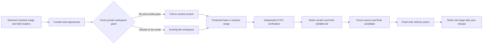
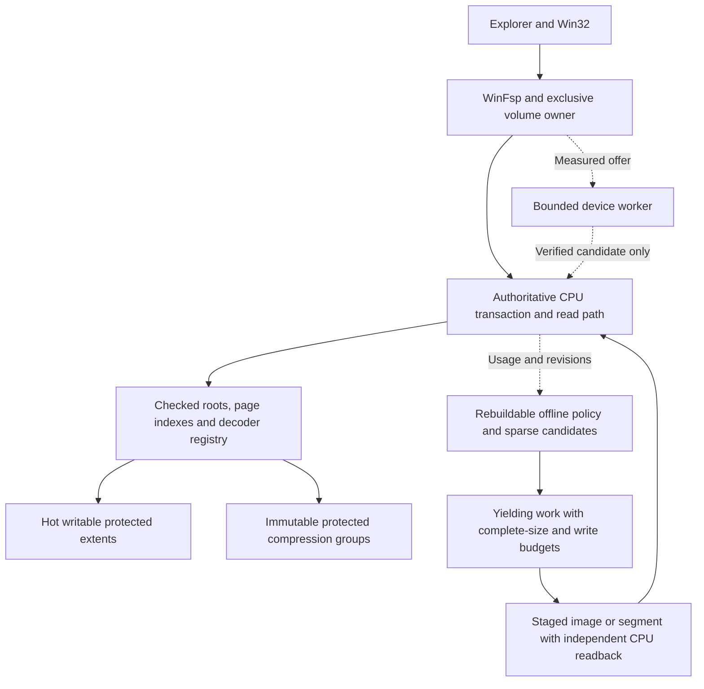

# FlitzFS release reconciliation · 26 November 2026

FlitzFS has a writable Windows filesystem engine, a WinFsp helper and a CPU
recovery reader. It has consumed real Radeon results in controlled Windows
callbacks and passed separately signed guest mounts. A stable release still
requires automatic AMD service on the ordinary mounted path, scalable
writable reopen, supported-media recovery and matched Windows comparisons.
Use this review for implementation order. The E01–E13 plan retains the
detailed package contracts and the release execution plan retains the gates.
[Implementation packages](IMPLEMENTATION_PLAN.md#3-execution-order-and-dependencies) ·
[Release gates](RELEASE_EXECUTION_PLAN.md#current-gate-ledger)

The review starts from commit `d9b20094a3ecaeaf351f0794e201160ad8b7e9c1`
and the eight changed source/test files frozen in tree
`790912f42c849b0a84a62e2c610c97d2a5206b4f`. The evidence records the live
Windows build, matched controls, source navigation and primary-source
captures. Earlier receipts retain their original source and test scope.
[Current evidence](evidence/windows-independent-seal-workspace-2026-11-26.json)

The follow-up AMD checkpoint made priority optional in the Windows workers
and passed an installed Radeon read through the callbacks. Live write
dispatch awaits measured headroom. The matched mounted comparison remains
the next AMD release decision.
[Stream capability qualification](HIP_PRIORITY_CAPABILITY.md#26-november-windows-qualification)

## Repository and release evidence

| Subsystem | Implemented and observed | Remaining release proof |
| --- | --- | --- |
| Windows and volume ownership | The helper and WinFsp callbacks use exclusive memory and file-backed volume ownership. Signed guest clients covered populated operations, cached and mapped flush interruption, reclaim and writable reopen. | Qualify the ordinary signed helper and driver together on current Windows 11. Verify Explorer behavior, lifecycle, sharing and the advertised file semantics. |
| Indexed store and scale | Copy-on-write names, inodes, extent maps and payload ownership are queryable in pages. Read callbacks reuse checked metadata. A 32-callback control read 54,672 backing bytes after the change, down from 341,008. Writable reopen verifies the full inventory, including Windows admission checks. | Put a durable bound on normal attach I/O without skipping namespace, allocation or dependency invariants. Measure named-file growth and memory on a held-out scale tier. |
| Space reuse and recovery | Protected append, paired selectors, staged compaction, reader pins, alternate peer recovery and independently readable sealed parity are implemented. Priced packing and the locked-workspace seal both run through the volume owner. | Qualify continuous settlement under churn and pressure, all relevant publication cuts and each advertised storage medium. Prove the bounds on delay from pinned readers and incomplete work. |
| Compression | Foreground CPU codecs, verified device candidates, protected small-file packing and shared bases exist. Subset refinement reduced one matched mixed group from 752 to 560 KiB. It reached the same settled bytes on the existing CPython and AITDCC holdouts. | Move useful pages and segments into their smallest verified form. Compare codecs and groups at equal protection and charge model, dependency, repair and allocation costs. |
| AMD | The existing hardware receipt recorded two verified Radeon write extents and two delivered read extents. The controller has measured admission, bounded worker exchange, retained preparation and CPU continuity. | Make low-priority stream capability optional without weakening device/admission checks. Prove workload regions where accepted device output gives end-to-end read, write and collective benefit. |
| Autonomous policy | Persistent sparse candidates, revision guards, input-funded maintenance and live contention/resource gates already exist. | Test drift, restart, fairness, idle recovery and write cost with ordinary workloads. Qualify the full chain from offline advice to independently verified net savings. |
| Evolution and deployment | CPU readers, required features, format checks and pinned setup exist. Format and provider evidence is distributed across historical fixtures. | Freeze the supported compatibility window, run interrupted gradual migration, and qualify private dependency setup, the exact signed installer and offline recovery. |
| Measurement and stabilization | A Win32 operation witness, DiskSpd and named public inputs support repeatable comparisons. | Execute matched current NTFS and FlitzFS runs on live hardware, then close the declared fault, compatibility and soak matrix on one source-bound candidate. |

[Current source flows](architecture/CURRENT.md) ·
[Win32 operation witness](evidence/windows-populated-client-trace-2026-11-24.json) ·
[Read and device evidence](evidence/windows-foreground-query-reuse-2026-11-25.json) ·
[Shared-base comparison](evidence/windows-subset-reference-refinement-2026-11-26.json)

### What the latest round establishes

The model held the same file bytes, 6 MiB slot, failure unit and available
sealing credit across arms. The previous planner declined the transition
with either scratch offer. The new planner declined the file-only arm and
reached **4.25 MiB** with private memory, a **1.75 MiB reduction (29.2%)**.
It retained the old snapshot and retired the scratch and inactive allocation.
The Windows SDK fixture with locked memory sealed in the same slot size,
wrote through a held callback handle and independently reopened the CPU
bytes. That callback fixture has its own allocation accounting and
workload. Neither fixture measures physical crash durability or throughput.

The practical limit is now two budgets. A seal must already have a funded
opportunity. Private scratch receives a separate process-owned memory
allowance, while parity and the writable tail still fit the checked inactive
range. Refused scratch falls back to the file plan. The current scheduler
still uses the established file-workspace estimate to identify eligible
opportunities. A future change that admits additional memory-only
opportunities needs a common price and credit model.
[Volume-file sealing contract](PERSISTENT_VOLUME_FILE.md#sealed-paired-images)

## Research that changes decisions

- **Support the runtime that is actually present.** AMD published ROCm Core
  SDK 10.2.0 on 18 November with HIP 7.17.0. The release notes disable priority
  streams, although the APIs remain described. FlitzFS currently requires
  both priority exports and a corroborated range before every device role.
  Separate optional priority support from basic nonblocking stream support.
  The official Core SDK table names Windows 11 25H2 and Microsoft lists
  26H2 as the newer general update. Treat the local 26H2 CPU/SDK pass and
  documented AMD runtime support as different evidence. The locked Core
  archive recorded an internal `10.2.0rc2` label. Verify package, API,
  runtime DLL, driver and adapter independently before making a support
  claim or changing the pinned package.
  [AMD release notes](https://rocm.docs.amd.com/en/docs-10.2.0/about/release-notes.html#hip-7-17-0) ·
  [AMD stream APIs](https://rocm.docs.amd.com/projects/HIP/en/docs-10.2.0/reference/hip_runtime_api/modules/stream_management.html) ·
  [AMD compatibility matrix](https://rocm.docs.amd.com/en/latest/compatibility/compatibility-matrix.html) ·
  [Windows release health](https://learn.microsoft.com/en-us/windows/release-health/windows11-release-information) ·
  [Observed SDK package](../tools/rocm-sdk-lock.json)
- **Price redundancy before increasing codec complexity.** An earlier AITDCC
  I–P run used 35,635,200 mirrored image bytes and 22,523,904 sealed image
  bytes for the same 25,153,011 logical bytes. Range reads were slower in
  that experiment and its accounting excluded the outer volume selector.
  The latest subset route settled at 35,160,064 bytes with the selector.
  These are separate controls. Measure the current candidate, including the
  selector and retained/dependent data, before quoting a comparative gain.
  Windows Storage Spaces uses mirrored writes and a colder parity tier.
  Ceph and FAST ’26 work on repair emphasize pricing reconstruction I/O.
  FlitzFS keeps its local single-failure-unit repair model and measures it.
  [Sealed corpus evidence](evidence/sealed-indexed-images-2026-11-22.json) ·
  [Storage Spaces](https://learn.microsoft.com/en-us/windows-server/storage/storage-spaces/plan-volumes) ·
  [Ceph erasure coding](https://docs.ceph.com/en/latest/rados/operations/erasure-code/) ·
  [FAST ’26 LESS](https://www.usenix.org/conference/fast26/presentation/cheng)
- **Separate logical grouping from read units.** FAST ’26 RubikFS reports
  benefits from clustering similar chunks and grouping by access
  temperature on read-only images. Its study justifies measuring clustering
  and read amplification. FlitzFS needs reusable immutable dependencies,
  a bounded CPU restart unit and transaction-scoped membership changes for
  writable volumes. FAST ’26 CoFS similarly uses a packed lookup structure
  for a fixed read-only tree. Keep the paged writable index for FlitzFS and
  measure attach work independently of client lookups.
  [RubikFS](https://www.usenix.org/conference/fast26/presentation/huang) ·
  [CoFS](https://www.usenix.org/conference/fast26/presentation/wang-li)
- **Pin tools and qualify the exact configuration.** WinFsp publishes stable
  v2.2 and the repo already pins its MSI. Zstandard 1.6.0 is the current
  qualified source dependency. DiskSpd 2.3 changed default thread
  placement and buffer separation. Freeze explicit affinity, cache mode,
  buffer settings and verified bytes in comparisons. Windows exposes its
  built-in NTFS compression as per-file and per-directory state. A compressed
  fixture directory sets the default for new files. Verify the resulting
  state on every timed file.
  [WinFsp 2.2](https://github.com/winfsp/winfsp/releases/tag/v2.2) ·
  [Zstandard 1.6.0](https://github.com/meta/zstd/releases/tag/v1.6.0) ·
  [DiskSpd 2.3](https://github.com/microsoft/diskspd/releases/tag/v2.3) ·
  [Native NTFS compression](https://learn.microsoft.com/en-us/windows/win32/fileio/compression-state)

The research receipt records two initial extractions that failed their
content checks. Subsequent captures confirmed the AMD asynchronous/stream
references and the native compression state API. The accepted set holds
18 substantive primary pages. The local FlitzZip reference at
`11396b5123505a4a1959173e1db2d0858c10dd6d` supplies a pinned host-buffer
allocation precedent. Use it only where end-to-end staging pays its own
cost. FlitzFS keeps its independent filesystem format and CPU decoder.
[Source and validation receipt](evidence/windows-independent-seal-workspace-2026-11-26.json) ·
[FlitzZip host-buffer allocation](https://github.com/strmt7/FlitzZip/blob/11396b5123505a4a1959173e1db2d0858c10dd6d/src/gpu/hip_device.cpp#L373) ·
[AMD asynchronous execution](https://rocm.docs.amd.com/projects/HIP/en/docs-10.2.0/how-to/hip_runtime_api/asynchronous.html)

## Target control and storage design

The volume owner remains the single authority for acknowledgements and
publication. Host observations govern admission, worker lifetime and
background quanta. They cannot authorize stale results, failed barriers
or retired backing access. Recovery selects a consistent checked root
chain. Decoder dependencies live in protected authoritative records.
Learning state can lose its progress and rebuild from a checked snapshot.
[Target architecture](architecture/TARGET.md) ·
[Recovery model](RESILIENT_STORE_DESIGN.md)

## Detailed implementation order

### Make ordinary AMD execution portable and useful

**E03, E08 and S4.** Use the existing populated client trace as the witness.
Begin with the narrow runtime compatibility change. In `hip_api.hpp`,
bind ordinary nonblocking streams separately from priority negotiation.
Share stream creation and classification across the decode, match,
uniform-compression and grouped routines. Treat unavailable or explicitly
unsupported priority as a capability outcome. Preserve terminal behavior
for a failed device identity, failed initialization, inconsistent memory
evidence or a real device fault. Carry effective priority support in the
route result so foreground admission and low-impact maintenance can make
different decisions.

1. Extend the existing HIP stub matrix for optional/missing exports,
   unsupported priority, a functioning priority path, zeroed outputs,
   partial reports and real faults. Verify exactly one selected
   nonblocking route and cleanup when a subsequent allocation fails.
   Bind the tested toolset runtime, ABI and app-local sanitizer guard.
2. Reuse the installed route's phase instrumentation and SDK worker
   cases. Measure cold launch, ready idle, no-device/refused, basic
   stream and supported priority behavior. Check that the GPU actually
   produced the accepted device bytes. If the runtime offers no priority,
   admit maintenance only under demonstrated idle headroom with small
   dispatch quanta. Verify yield under client load before enabling that
   path by default.
3. On a qualified ordinary mount, run the same reads and writes with CPU
   selection and automatic AMD. Separate read preparation, matched write
   admission and collective work. Include transfer, verification, fencing,
   commit, timeouts and retirement in the comparison. Permit a learned
   route only where repeated full-path measurements beat CPU within
   noise and preserve access tail latency and total occupied bytes.
4. Keep an already-qualified context, module and bounded buffers only
   while measured reuse repays memory and startup costs. Track queue
   pressure, demand decay, runtime identity and device health. Retire
   cleanly when idle conditions change and on detach. Use zero keepalive
   kernels. Any refused, expired or failed offer immediately takes the
   available CPU path. A retry needs fresh changed evidence and confirmed
   retirement of the previous worker. Failover must never await GPU
   cleanup. Use isolated recovery tests for real driver loss or failure.

[Current worker gate](../src/windows/hip_api.hpp) ·
[Recovery policy](GPU_RECOVERY.md) ·
[Mounted workload protocol](BENCHMARK_PROTOCOL.md#populated-windows-operation-trace)

### Measure settled protection and remove redundant staging

**E02, E06, E11 and S3, S5, S8.** Start with the existing engine and its
actual refusal reasons. Replay a matched mixed workload of small files,
large unrelated files and repeated updates. Test both observed backing
geometries, a held snapshot, near-full allocation, a denied memory offer
and a fresh CPU reopen. Attribute backing writes, flushes, released
allocation and logical versus occupied capacity to each phase. Preserve
the client's acknowledgement log and exact files.

1. Carry the current private-workspace offer into one checked seal
   opportunity projection, with explicit charges for memory, backing
   allocation, backing writes and selector publication. Reuse the same
   estimate for the scheduler and commit admission. Keep the original
   file path when locking is refused. Count credit refunds only for work
   that incurred no backing writes. Select candidates by settled bytes
   and durable progress under the existing bounded maintenance grants.
2. Instrument folded build, parity output, verification, tail binding,
   select and retirement before choosing a larger refactor. If scratch
   limits material held-out savings, prototype emitting complete stripes
   to the owned inactive range in logical order. Separate root/index
   construction and any rewrite/read-after-write dependencies from the
   append pass. Retain only bounded verified state or use the existing
   workspace for cases that need random access. Reuse the current stripe
   layout and CPU reader if byte-for-byte format comparison permits it.
3. Independently decode and verify the prepared image, then bind and
   flush the tail, recheck source revision, and publish the selector
   peers. Keep the prior root available until both copies and reader
   lifetimes permit release. Cut at each barrier and range release.
   Require exact surviving payloads, metadata and accounting. If the
   streaming candidate fails that proof, retain the verified workspace
   path. Consider segment-local compaction only after the phase trace
   assigns sustained write amplification to complete image copies.

[Paired layout](PERSISTENT_VOLUME_FILE.md#sealed-paired-images) ·
[Reclaim and repair exits](IMPLEMENTATION_PLAN.md#5-e02--allocation-dependency-ownership-and-automatic-reclamation)

### Bound writable attach and discovery as the namespace grows

**E01, E04, E07 and S2, S6.** The current inventory verifies checked name
pages, every inode and extent, Windows admission and reference ownership.
Keep it as the baseline for old or ambiguous images.

1. Specify which checked fields are sufficient for a normal writable
   attach. Bind the volume identity, root generation, required features,
   namespace/extent roots, allocation and dependency ownership summaries
   and recoverable transaction state in the same publication. Update the
   affected checks on create, rename, unlink, mutation, dependency handoff
   and migration. Derive counters from verified deltas. Compare against a
   reconstructed inventory in development.
2. Verify the touched page or extent on access and bound the outstanding
   repair or verification debt. Admit allocation and mutation only from
   checked state. A missing, damaged, unsupported or conflicting proof
   selects the full recovery path before admitting writes or reclaim.
   Carry foreground repair through the same ownership and CPU recovery
   rules. Rate-limit background auditing using resource and workload
   evidence.
3. Replay the same named-file trace at geometric tiers from one file to
   the largest tier local headroom safely permits. Measure attach with
   cold and retained caches, directory enumeration, random open/read,
   mutations, restart, bytes read and peak memory. Regress against page
   counts, file sizes and live/shadow allocation. Hold out one feasible
   tier and report error bounds before extrapolating to tens of millions.
   Treat enumeration and explicit full repair as workload-proportional
   operations.
4. Persist a bounded scan cursor per volume generation. Refresh changed
   content by revision and preserve sparse shortlist keys under churn.
   Keep the reserved logical area paged and rebuildable. Measure sampled
   discovery against exhaustive ranking on small frozen subsets, then
   use a budgeted shortlist for larger populations.

[Indexed audit](../src/native_indexed_volume.cpp) ·
[Scalable namespace and discovery contracts](IMPLEMENTATION_PLAN.md#4-e01--scalable-native-inode-name-and-extent-storage)

### Improve complete compression with offline, adaptive selection

**E04–E07 and S5–S6.** The first comparison is strong independent Zstandard
and the existing staged shared-base route with the same protection. Price
a candidate on actual settled occupied bytes. Include live payloads,
reference models, indexes, padding, parity, the selector and retained
generations. Record temporary peak space and extra writes separately.
A representation enters production only with exact independent CPU
readback at normal and partial read boundaries.

1. Freeze mixed named corpora and family splits before selecting settings.
   Keep the published AITDCC I–P and CPython results as repeatable controls.
   Freeze a fresh blind revision-family cohort for any new tuning. Use
   shifted, sparse, already compressed and unrelated inputs alongside
   highly redundant inputs. Keep exact-source copies, attribution and
   input and restored output digests.
2. Compare the existing fixed windows to rolling anchors and
   content-defined chunks under an equal scan budget. Price shared bases,
   dictionary/prefix, reference patches and strong independent encodings
   with their full retained cost. Begin with candidate reranking and
   result reuse. Preserve the local paging and revision invalidation
   behavior already present.
3. Let groups grow across many files when the measured savings justify
   it. Use indexed restart units with bounded depth and scratch, and
   measure bytes fetched and decoded per returned range. Route GPU work
   to high-volume matching, real compression and verified decoding where
   measured. Keep decode semantics independent of adapter or model
   availability. A CPU encoder can choose a different valid layout.
4. Use an offline compact ranker only after a simple measured policy
   supplies a reference. Train on held-out benefit prediction from
   sparse similarity, access temperature, allocation shape and actual
   compression history. Compare saved bytes per unit of background work,
   false admission, p99 foreground interference and writes per net byte
   saved before enabling online adaptation. Continue with the simpler
   rule when a model earns no gain. An experimental lossless codec must
   separately improve the verified occupied-size frontier including its
   model overhead and honest CPU decoding cost.
5. Run maintenance in bounded resumable steps with below-normal
   scheduling, fresh RAM/VRAM/CPU and I/O headroom, and idle-budget
   accounting. Measure with multiple volumes, workload drift, battery
   or graphics pressure and user writes arriving mid-step. Derive write
   cost and reuse policy from backing capabilities and measured latency.
   Retain wear and recovery reserves on persistent media. Measure
   seek-heavy work on HDDs and written bytes on SSD and removable flash.
   Derive admission from the provider contract and observed behavior,
   including when the bus identity is ambiguous.

[Collective compression design](IMPLEMENTATION_PLAN.md#9-e06--protected-collective-representation-in-ordinary-storage) ·
[Official AITDCC dataset](https://aitdcc.github.io/dataset.html)

### Qualify Windows lifecycle, evolution and backend recovery

**E08–E11 and S1, S7–S10.** Reuse signed WinFsp and the current helper lifecycle.
The tray should expose the owned memory and persistent volume workflows,
show which capabilities the selected backing supports and report recoverable
failures. Determine media capabilities by probing the backing. Qualify
the advertised NVMe, SATA SSD, HDD and flash combinations before exposing
them in setup.
Use the ordinary Explorer and an independent Win32 client for absent,
already-in-use and distinct owned mount targets. Cover open sharing,
rename/replace/delete, sparse extension and truncation, enumeration,
Win32 naming, timestamps and attributes, applicable access checks,
memory maps, cache modes, explicit flush, repeated clean detach and
exhausted-resource behavior. Document the exact supported semantics.

1. Freeze the current source, compiler, pinned dependencies, exact driver,
   helper, CPU decoder and optional AMD worker identities before the
   candidate run. Exercise clean setup, offline CPU operation, upgrade,
   refusal, rollback and removal on declared Windows builds. Stage missing
   supported user-mode dependencies privately. Record the AMD runtime
   compatibility evidence and retain CPU access if accelerator setup
   is unavailable. Confirm teardown of every owned process, handle and
   allocation.
2. Freeze golden images and independent readers for each promised format
   generation. Maintain tested CPU reads throughout the declared
   multi-release window. Migrate through bounded copy-on-write work with
   persisted progress and an intact recovery anchor, including models and
   any new codec features. Check old-reader behavior, unknown required
   features, stale writers, interruption before and after each selector
   change and return to service.
3. Define a durability matrix per supported backing. Specify the safe
   failure unit, which successful operations and flushes are durable, the
   peer or parity reconstruction envelope and observable corruption
   outcomes. Inject incomplete writes and lost or damaged units at the
   existing barriers, with independently retained acknowledged operations
   and expected file hashes. Run destructive, physical and driver-fault
   qualification on disposable isolated systems. Establish recovery of
   acknowledged file bytes, metadata, names and allocation before writes
   resume. Device destruction and losses beyond surviving redundancy need
   an independent copy. Advisory-state loss can be recovered by rescan.

[Windows system boundaries](WINDOWS_ARCHITECTURE.md) ·
[Compatibility package](IMPLEMENTATION_PLAN.md#12-e09--multi-release-readers-and-gradual-format-migration) ·
[Durability package](IMPLEMENTATION_PLAN.md#14-e11--durability-repair-and-independent-failure-qualification)

### Run matched real-host comparisons and freeze the candidate

**E12–E13 and S11–S12.** First replay the ordinary Windows witness with
fixed test files and independently verified outcomes. Predeclare which
workloads require a gain and report neutral and negative cohorts.
Run DiskSpd 2.3 as the recognized throughput and access-latency tool.
Use the named-tree operation trace for Windows semantics, cold/steady
maintenance and storage allocation. AITDCC A–H and I–P are separate
controls. Named real files and at least one fresh protected cohort
exercise grouped behavior across files and directories.

- On the same current Windows build and equivalent disposable backing,
  compare plain NTFS, Windows-native NTFS compression, FlitzFS CPU and
  automatic AMD at ingest and after settlement. Use native
  `FSCTL_SET_COMPRESSION` with `COMPRESSION_FORMAT_DEFAULT` in the new
  compressed fixture directory and verify each file's state with
  `FSCTL_GET_COMPRESSION`. Bind the NTFS geometry and OS build. Record
  occupied size independently of write throughput. Run a common cache
  and durability path before any optional provider-specific benchmark.
- Keep public workload hashes, benchmark parameters and raw results.
  Alternate trial order and report dispersion, p50/p95/p99 access, durable
  write and read throughput, peak and settled bytes, decode amplification,
  CPU/GPU use, backing writes, interference and verified byte counts.
  Report a result as inconclusive when run variation exceeds the effect.
  Guest correctness results provide separate evidence.
- Reuse a successful narrow proof while inputs remain identical. Run the
  full comparative grid once the candidate can change the release
  decision. Close each advertised tuple on the frozen artifacts and
  complete rolling and final soak with zero unresolved data-integrity or
  lifecycle failures. The owner reviews the result and decides on release.

[Objective benchmark protocol](BENCHMARK_PROTOCOL.md) ·
[Exact release gates](IMPLEMENTATION_PLAN.md#18-exact-release-gates)

## Remaining effort and repricing

The existing package estimate remains **59–127 person-weeks** at low
confidence, with an open research tail for stronger collective compression.
The new evidence removes one staging constraint and exposes a concrete AMD
compatibility task. It does not close any release gate or support a release
date. Reprice after the ordinary automatic AMD comparison, a named-file
attach curve, a complete protected-size frontier and the first backed
interruption campaign.
[Package effort and critical path](RELEASE_EXECUTION_PLAN.md#remaining-engineering-effort)
