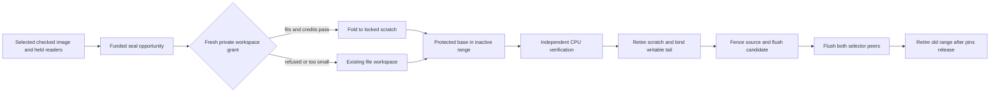
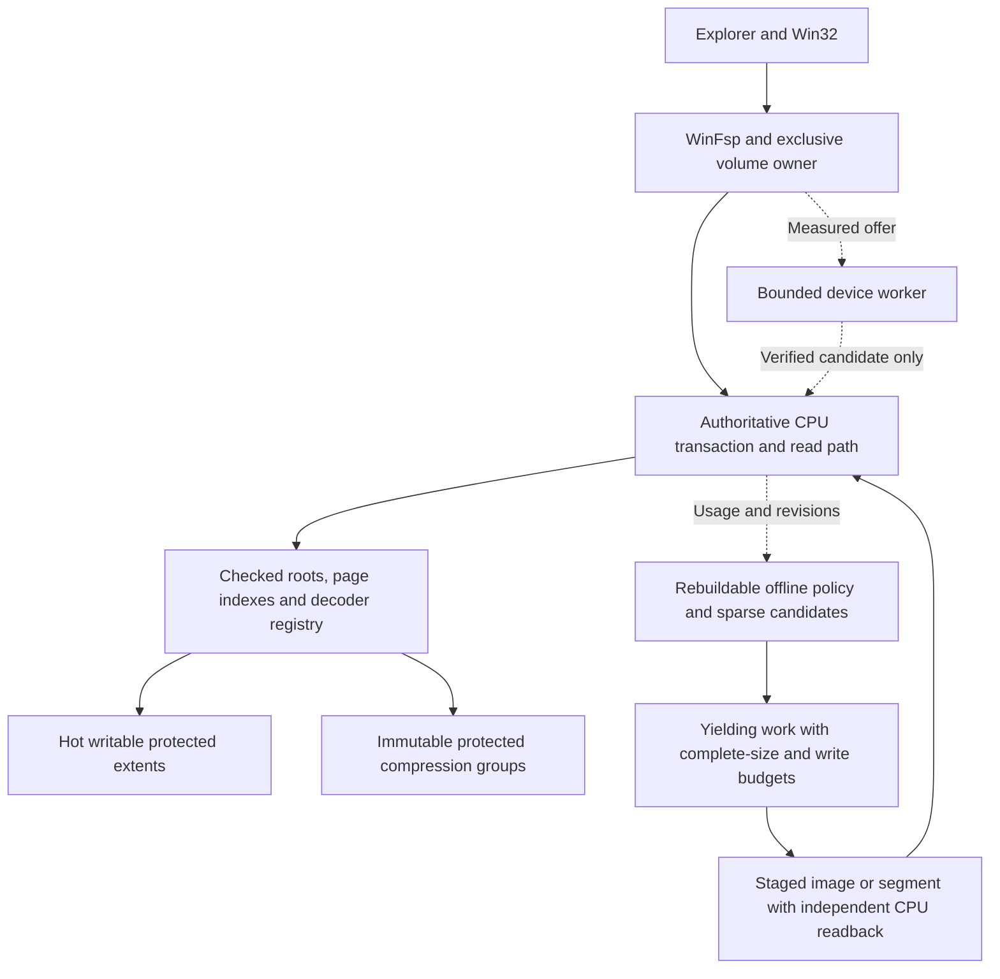

# FlitzFS release reconciliation · 26 November 2026

FlitzFS has a writable Windows filesystem engine, a WinFsp helper and a CPU
recovery reader. It has consumed real Radeon results in controlled Windows
callbacks and passed separately signed guest mounts. A stable release still
requires automatic AMD service on the ordinary mounted path, scalable
writable reopen, supported-media recovery and matched Windows comparisons.
Use this review for implementation order. The E01–E13 plan retains the
detailed package contracts and the release execution plan retains the gates.
[Implementation packages](IMPLEMENTATION_PLAN.md#3-execution-order-and-dependencies) ·
[Release gates](RELEASE_EXECUTION_PLAN.md#current-gate-ledger)

The current checkpoint builds on `811c160ca4d295b529b3e13bb292348ea8343fa9`.
Source tree `e2dec721d56f6202ae418fbeecae9487eb5abf19` retains verified grouped read
work through unrelated commits to the selected image. One matched 64 KiB
native access used 9,498 backing bytes after preparation, compared with
75,336 bytes on the CPU control. The changed member read its current
bytes on CPU. Seven WinFsp callback trials delivered 131,072 ready bytes
each across intervening writes.
[Composition and sample accounting](evidence/windows-prepared-group-checkpoints-2026-11-26.json)

The same build consumed two verified Radeon group frames in the owned
Windows callback fixture. A later request continued on the CPU, and
shutdown retired the final pending request. The sealed volume reopened
for a verified write and independent CPU readback. A matched mounted
comparison remains the next device performance gate.
[Installed Radeon and fallback](evidence/windows-prepared-group-checkpoints-2026-11-26.json)

The shifted-fragment checkpoint builds on `31474b79b77dfd415634689b26fecd6cc79dce16`.
Source tree `b23965211dcab367717fc05fd3b93c10922fe809` adds funded discovery of
shifted fragments in the native maintenance controller. The independently
reopened Khronos holdout occupies 864,256 bytes, down from 925,696
bytes with the existing bands. The test retained the source paths and
compared complete protected placements under the same geometry.
[Shifted-fragment evidence](evidence/windows-shifted-fragment-discovery-2026-11-26.json)

The preceding compact-control checkpoint builds on `5dacbcae6e0215c7ec4b7b9773dc8715d7b81883`.
The tested source tree `dfc42cb6d683316a366e4a44b25f61342a2067f0`
sizes sealed control records to the covered failure unit. The paired
owner uses the smaller layout automatically when the backing can isolate
the records. The grouped CPython fixture now fits a sealed base and tail
in 593,920 bytes including its selector. An independent CPU reader
verified every file and all 48 shared references.
[Compact-control evidence](evidence/windows-compact-sealed-controls-2026-11-26.json) ·
[Source review](architecture/REVIEW.md)

The follow-up AMD checkpoint made priority optional in the Windows workers.
The installed Radeon delivered two verified read extents through callbacks.
After fresh headroom became available, a separate write fixture stored
sixteen verified extents and independently reopened the exact bytes.
Withdrawing a later device grant selected CPU and preserved the exact files.
The matched mounted comparison remains the next AMD release decision.
[Stream capability qualification](HIP_PRIORITY_CAPABILITY.md#26-november-windows-qualification) ·
[Installed write and CPU continuation](evidence/windows-private-seal-credit-2026-11-26.json)

The latest live write owner waits for worker exit, activity and actual
deadlines. A failed source-free preparation releases the slot before its
original deadline. A prepared request still requires independent CPU
validation and a later resource observation before publication. Callback
tests cover readiness, acceptance, pressure, setup refusal and shutdown.
Mounted AMD benefit still needs the external client comparison.
[Owned write scheduling](OWNED_DEFERRED_WRITES.md#event-driven-write-service)

On the byte-plane source tree, fresh host headroom admitted a separate
Radeon grouped-read check. The SDK callback fixture consumed two
independently verified device frames totaling 131,072 bytes across 32
client-shaped calls. The exact worker retired. This validates the
existing grouped path on the physical adapter. The byte-plane encoder
and inverse ran on CPU. Both admission attempts for the compact-control
checkpoint deferred under concurrent adapter load. Mounted throughput
remains a separate gate.
[Radeon callback evidence](evidence/windows-native-byte-plane-2026-11-26.json) ·
[Current admission checks](evidence/windows-compact-sealed-controls-2026-11-26.json)

## Repository and release evidence

| Subsystem | Implemented and observed | Remaining release proof |
| --- | --- | --- |
| Windows and volume ownership | The helper and WinFsp callbacks use exclusive memory and file-backed volume ownership. Signed guest clients covered populated operations, cached and mapped flush interruption, reclaim and writable reopen. | Qualify the ordinary signed helper and driver together on current Windows 11. Verify Explorer behavior, lifecycle, sharing and the advertised file semantics. |
| Indexed store and scale | Copy-on-write names, inodes, extent maps and payload ownership are queryable in pages. Read callbacks reuse checked metadata. A 32-callback control read 54,672 backing bytes after the change, down from 341,008. Writable reopen verifies the full inventory, including Windows admission checks. | Put a durable bound on normal attach I/O without skipping namespace, allocation or dependency invariants. Measure named-file growth and memory on a held-out scale tier. |
| Space reuse and recovery | Protected append, paired selectors, staged compaction, reader pins, alternate peer recovery and independently readable sealed parity are implemented. The paired owner can isolate compact controls using the provider's declared failure unit. | Qualify continuous settlement under churn and pressure, all relevant publication cuts and each advertised storage medium. Prove the bounds on delay from pinned readers and incomplete work. |
| Compression | Foreground CPU codecs, verified device candidates, protected small-file packing and shared bases exist. Standalone byte planes helped named AITDCC inputs. Compact placement now also reduces fixed overhead while retaining the CPython group. | Compare verified transforms, shared bases and parity at equal failure coverage on unseen file families. Charge model, dependency, allocation and rewrite costs. |
| AMD | HIP workers can use a nonblocking stream when stream priority is unavailable. Radeon callbacks delivered verified read and write bytes. The foreground write service wakes on worker exit, adapts burst depth to headroom and can revisit a larger grant. The latest public-source write fixture favored CPU on occupied size, 240 versus 264 KiB. | Establish winning workloads on the ordinary mount, by role. Bind retained preparation to measured demand and account for discovery, readiness, validation, committed size, misses and idle residency. Target predictable grouped reads and collective search before more small uniform-write tuning. |
| Autonomous policy | Persistent sparse candidates, revision guards, input-funded maintenance and live contention/resource gates already exist. | Test drift, restart, fairness, idle recovery and write cost with ordinary workloads. Qualify the full chain from offline advice to independently verified net savings. |
| Evolution and deployment | CPU readers, required features, format checks and pinned setup exist. Format and provider evidence is distributed across historical fixtures. | Freeze the supported compatibility window, run interrupted gradual migration, and qualify private dependency setup, the exact signed installer and offline recovery. |
| Measurement and stabilization | A Win32 operation witness, DiskSpd and named public inputs support repeatable comparisons. | Execute matched current NTFS and FlitzFS runs on live hardware, then close the declared fault, compatibility and soak matrix on one source-bound candidate. |

[Current source flows](architecture/CURRENT.md) ·
[Win32 operation witness](evidence/windows-populated-client-trace-2026-11-24.json) ·
[Read and device evidence](evidence/windows-foreground-query-reuse-2026-11-25.json) ·
[Shared-base comparison](evidence/windows-subset-reference-refinement-2026-11-26.json)

### What changes the next implementation decision

The packed-slice comparison now survives an unrelated extent in a complete
staged group. One matched 4 KiB protection fixture retained 24 short files
and left the unrelated extent's object and revision unchanged. The complete
compacted image moved from **304 to 296 KiB**, or **432 to 424 KiB**
including the selector.
The prior 16-member diagnostic tied at 296 KiB. The CPython control's best
settled arm occupied **440 KiB including its selector** in both binaries.
Pinned, current and independently copied images returned exact CPU bytes.
The result supports an additional representation on an existing verified
path. The largest compression investment still depends on measured
coverage and closed-loop results on real workloads.
[Subset packing and CPython control](evidence/windows-packed-shared-subsets-2026-11-26.json)

The latest Radeon write fixture funded eight prepared requests and
accepted two in the observed opportunity. Three stored extents contributed
192 KiB of independently CPU-verified input. Engine activity deferred the
next pass, which still completed through CPU. The image size gap and
headroom results give two reasons to prioritize grouped reads and
collective search as the next physical AMD comparisons.
This round's collective preflight deferred under roughly 99% existing
device-engine load. The Windows suite, guarded sanitizer run and raw
controls all passed.
[Callback data and occupied size](evidence/windows-amd-write-grant-growth-2026-11-26.json)

### Protected placement evidence

The model held the same file bytes, 6 MiB slot, failure unit and available
sealing credit across arms. The previous planner declined the transition
with either scratch offer. The new planner declined the file-only arm and
reached **4.25 MiB** with private memory, a **1.75 MiB reduction (29.2%)**.
It retained the old snapshot and retired the scratch and inactive allocation.
The Windows SDK fixture with locked memory sealed in the same slot size,
wrote through a held callback handle and independently reopened the CPU
bytes. That callback fixture has its own allocation accounting and
workload. Neither fixture measures physical crash durability or throughput.

The scheduler and commit admission now compare the two placement charges.
Private scratch receives a process-owned memory allowance. Parity and the
writable tail must still fit the checked inactive range and the selected
plan must earn backing writes. The recorded case had enough credit only
for the memory plan. A refused scratch lock preserved the selected image
and the unspent credit. The next decision needs per-phase costs on a named
workload, including reclaim and the complete outer volume.
[Private seal credit evidence](evidence/windows-private-seal-credit-2026-11-26.json) ·
[Volume-file sealing contract](PERSISTENT_VOLUME_FILE.md#sealed-paired-images)

## Research that changes decisions

- **Cluster by affinity and access together.** FAST 2026 RubikFS reported
  better compression and fewer unnecessary reads on its read-only
  workloads by clustering similar chunks and grouping by access
  temperature. Use that result to test fragment-level candidate recall and
  read amplification together. FlitzFS needs bounded online updates and
  immutable published restart units. Start with the existing sparse
  catalog and a small offline oracle for the alternative orderings.
  [FAST 2026 RubikFS research](https://www.usenix.org/conference/fast26/presentation/huang)
- **Charge the full placement.** EROFS's project comparison explicitly
  identifies fragment packing and deduplication in the compressed images.
  Compare those mechanisms separately in FlitzFS by holding protection
  constant and counting metadata, shared dependencies and allocation
  rounding. The 16-member tie in this round illustrates why a smaller
  encoded representation alone gives an incomplete answer.
  [EROFS deduplication and fragment comparison](https://erofs.docs.kernel.org/en/latest/comparison/dedupe.html)
- **Keep a current public control and a named-file holdout.** The public
  2026 AITDCC release provides checksums and separate A–H training and
  I–P testing sets. Use those files for byte-exact codec comparisons.
  The named Windows trees independently test directory structure,
  metadata, random reads, edits and collective coverage. Freeze the
  family-level split and bytes before reranking an encoder.
  [AITDCC 2026 official dataset](https://aitdcc.github.io/dataset.html)
- **Support the runtime that is actually present.** AMD published ROCm Core
  SDK 10.2.0 on 18 November with HIP 7.17.0. The release notes disable priority
  streams, although the APIs remain described. The FlitzFS worker now
  negotiates priority separately from basic nonblocking stream support.
  The official Core SDK table names Windows 11 25H2 and Microsoft lists
  26H2 as the newer general update. Treat the local 26H2 CPU/SDK pass and
  documented AMD runtime support as different evidence. The locked Core
  archive recorded an internal `10.2.0rc2` label. Verify package, API,
  runtime DLL, driver and adapter independently before making a support
  claim or changing the pinned package.
  [AMD release notes](https://rocm.docs.amd.com/en/docs-10.2.0/about/release-notes.html#hip-7-17-0) ·
  [AMD stream APIs](https://rocm.docs.amd.com/projects/HIP/en/docs-10.2.0/reference/hip_runtime_api/modules/stream_management.html) ·
  [AMD compatibility matrix](https://rocm.docs.amd.com/en/latest/compatibility/compatibility-matrix.html) ·
  [Windows release health](https://learn.microsoft.com/en-us/windows/release-health/windows11-release-information) ·
  [Observed SDK package](../tools/rocm-sdk-lock.json)
- **Separate first-use and service costs.** AMD documents lazy runtime
  initialization and explicit initialization within a process. Retain the
  initialized stream and buffers only while observed demand funds the
  worker. Park on an event without issuing keepalive kernels. Windows
  supports waiting on both an event and an exact thread handle. Its coarse
  tick is generally 10–16 ms, so record GPU completion and telemetry timing
  with a high-resolution clock before redesigning the freshness boundary.
  Retain a budget sampler only while its exact adapter and factory are
  current. Collect fresh local, non-local and host observations for each
  paid boundary.
  [AMD HIP initialization](https://rocm.docs.amd.com/projects/HIP/en/docs-10.2.0/how-to/hip_runtime_api/initialization.html) ·
  [Windows multiple-object wait](https://learn.microsoft.com/en-us/windows/win32/api/synchapi/nf-synchapi-waitformultipleobjects) ·
  [Windows tick resolution](https://learn.microsoft.com/en-us/windows/win32/api/sysinfoapi/nf-sysinfoapi-gettickcount64) ·
  [DXGI topology change](https://learn.microsoft.com/en-us/windows/win32/api/dxgi/nf-dxgi-idxgifactory1-iscurrent)
- **Price redundancy before increasing codec complexity.** An earlier AITDCC
  I–P run used 35,635,200 mirrored image bytes and 22,523,904 sealed image
  bytes for the same 25,153,011 logical bytes. Range reads were slower in
  that experiment and its accounting excluded the outer volume selector.
  The latest subset route settled at 35,160,064 bytes with the selector.
  These are separate controls. Measure the current candidate, including the
  selector and retained/dependent data, before quoting a comparative gain.
  Windows Storage Spaces uses mirrored writes and a colder parity tier.
  Ceph and FAST ’26 work on repair emphasize pricing reconstruction I/O.
  FlitzFS keeps its local single-failure-unit repair model and measures it.
  [Sealed corpus evidence](evidence/sealed-indexed-images-2026-11-22.json) ·
  [Storage Spaces](https://learn.microsoft.com/en-us/windows-server/storage/storage-spaces/plan-volumes) ·
  [Ceph erasure coding](https://docs.ceph.com/en/latest/rados/operations/erasure-code/) ·
  [FAST ’26 LESS](https://www.usenix.org/conference/fast26/presentation/cheng)
- **Separate logical grouping from read units.** FAST ’26 RubikFS reports
  benefits from clustering similar chunks and grouping by access
  temperature on read-only images. Its study justifies measuring clustering
  and read amplification. FlitzFS needs reusable immutable dependencies,
  a bounded CPU restart unit and transaction-scoped membership changes for
  writable volumes. FAST ’26 CoFS similarly uses a packed lookup structure
  for a fixed read-only tree. Keep the paged writable index for FlitzFS and
  measure attach work independently of client lookups.
  [RubikFS](https://www.usenix.org/conference/fast26/presentation/huang) ·
  [CoFS](https://www.usenix.org/conference/fast26/presentation/wang-li)
- **Try pipelined candidate discovery and price all model bytes.** FAST '26
  ParaSync overlaps content-defined chunking, comparison and reconstruction
  in a synchronization pipeline. Test its stage-separation principle
  locally with checked source generations, bounded queues and no required
  network access. The November Tufazip report includes its model weights
  and decoder in the final size for enwik9. A model that improved payload
  size further lost after charging its added weight bytes. Use a small
  offline ranker to prioritize candidates first. A new on-volume
  predictor also has to repay its protected state and CPU restart cost.
  [ParaSync](https://www.usenix.org/conference/fast26/presentation/zhang-zhihao-parasync) ·
  [Tufazip author's report](https://tufalabs.ai/research/tufazip/)
- **Pin tools and qualify the exact configuration.** WinFsp publishes stable
  v2.2 and the repo already pins its MSI. Zstandard 1.6.0 is the current
  qualified source dependency. DiskSpd 2.3 changed default thread
  placement and buffer separation. Freeze explicit affinity, cache mode,
  buffer settings and verified bytes in comparisons. Windows exposes its
  built-in NTFS compression as per-file and per-directory state. A compressed
  fixture directory sets the default for new files. Verify the resulting
  state on every timed file.
  [WinFsp 2.2](https://github.com/winfsp/winfsp/releases/tag/v2.2) ·
  [Zstandard 1.6.0](https://github.com/meta/zstd/releases/tag/v1.6.0) ·
  [DiskSpd 2.3](https://github.com/microsoft/diskspd/releases/tag/v2.3) ·
  [Native NTFS compression](https://learn.microsoft.com/en-us/windows/win32/fileio/compression-state)

The research receipt records two initial extractions that failed their
content checks. Subsequent captures confirmed the AMD asynchronous/stream
references and the native compression state API. The accepted set holds
18 substantive primary pages. The local FlitzZip reference at
`11396b5123505a4a1959173e1db2d0858c10dd6d` supplies a pinned host-buffer
allocation precedent. Use it only where end-to-end staging pays its own
cost. FlitzFS keeps its independent filesystem format and CPU decoder.
[Source and validation receipt](evidence/windows-independent-seal-workspace-2026-11-26.json) ·
[FlitzZip host-buffer allocation](https://github.com/strmt7/FlitzZip/blob/11396b5123505a4a1959173e1db2d0858c10dd6d/src/gpu/hip_device.cpp#L373) ·
[AMD asynchronous execution](https://rocm.docs.amd.com/projects/HIP/en/docs-10.2.0/how-to/hip_runtime_api/asynchronous.html)

The follow-up verified fourteen primary pages for the write wait, compression
research, host benchmark and Windows durability contracts. One NTFS API
render lacked the required content. The accepted compression-state and
wire-format pages restored the native-control evidence.
[Follow-up research receipt](evidence/windows-deferred-write-events-2026-11-26.json)

The byte-plane review adds four decisions for the next implementation batch.
The native captures, including the content-check failures and replacements,
are indexed in the source-bound evidence.

- **Use a small set of reversible transforms.** Blosc2 documents typed
  byte shuffling and byte delta filters. Compare cheap sample features with
  measured protected savings before adding more widths or compositions.
  RubikFS also motivates measuring affinity and access order together.
  Keep FlitzFS random access bounded by the existing native extent and
  independently price cross-file reference dependencies.
  [Blosc2 filters](https://blosc.org/python-blosc2/reference/autofiles/low_level/blosc2.Filter.html) ·
  [FAST 2026 RubikFS](https://www.usenix.org/conference/fast26/presentation/huang)
- **Evaluate GPU decode at the Windows client boundary.** AMD's HIP
  asynchronous documentation supplies the overlap and completion contract.
  Microsoft's March 2026 DirectStorage preview describes both CPU and GPU
  Zstandard decompression. It is an additional study candidate after a
  qualified HIP comparison. Any comparison must establish usable delivery
  into a Windows file read, independent readback and physical-device
  execution on the exact tuple.
  [AMD asynchronous execution](https://rocm.docs.amd.com/projects/HIP/en/docs-10.2.0/how-to/hip_runtime_api/asynchronous.html) ·
  [Microsoft DirectStorage preview](https://devblogs.microsoft.com/directx/directstorage-1-4-release-adds-support-for-zstandard/)
- **Prove global ownership separately from local page checks.** The Btrfs
  project documents pre-write and post-read metadata checks. They motivate
  checked page admission. For FlitzFS, the write checkpoint also has to
  bind allocation and reference ownership across indexes. Compare the
  incrementally maintained proof against the complete CPU inventory.
  [Btrfs tree checker](https://btrfs.readthedocs.io/en/latest/Tree-checker.html)
- **Declare the provider and benchmark geometry explicitly.** Microsoft's
  buffering reference distinguishes logical and physical-sector alignment,
  and its flush reference covers the file API boundary. Verify actual
  ordering and interruption behavior for each backing. Use Windows'
  default native compression as documented for the NTFS control. Pin
  DiskSpd's affinity and buffer choices to avoid implicit baseline changes.
  [File buffering](https://learn.microsoft.com/en-us/windows/win32/fileio/file-buffering) ·
  [FlushFileBuffers](https://learn.microsoft.com/en-us/windows/win32/api/fileapi/nf-fileapi-flushfilebuffers) ·
  [Native NTFS compression](https://learn.microsoft.com/en-us/windows/win32/api/winioctl/ni-winioctl-fsctl_set_compression) ·
  [DiskSpd 2.3](https://github.com/microsoft/diskspd/releases/tag/v2.3)

## Target control and storage design

The volume owner remains the single authority for acknowledgements and
publication. Host observations govern admission, worker lifetime and
background quanta. They cannot authorize stale results, failed barriers
or retired backing access. Recovery selects a consistent checked root
chain. Decoder dependencies live in protected authoritative records.
Learning state can lose its progress and rebuild from a checked snapshot.
[Target architecture](architecture/TARGET.md) ·
[Recovery model](RESILIENT_STORE_DESIGN.md)

## Detailed implementation order

### Make ordinary AMD execution portable and useful

**E03, E08 and S4.** Treat optional priority, verified device output and
event-driven foreground waits as implemented. Retained preparation still
has a high measured first-use cost. In the latest eight-window native
fixture, readiness took 3.179 s of the 3.258 s exchange. The earlier
CPython 64 KiB trial favored CPU for both service time and occupied bytes,
including when preparation was reported separately. The production
controller's arrival trial replays already-committed writes in private.
Its result is a measurement. An independently qualified offer can be
applied to the live callback path, where the exact request still has to
qualify.

AMD's current Core SDK release notes list 10.2.0. Its native Windows HIP
SDK release notes list 7.2.0. Use the vendor's Windows package and
adapter/driver/runtime compatibility for installation and execution.
Discover the actual runtime and capabilities at launch. Core SDK release
numbers alone give no Windows package or driver guarantee.
[AMD Core SDK release notes](https://rocm.docs.amd.com/en/latest/about/release-notes.html) ·
[Windows HIP SDK release notes](https://rocm.docs.amd.com/projects/install-on-windows/en/latest/about/releasenotes.html) ·
[AMD platform versioning](https://rocm.docs.amd.com/projects/install-on-windows/en/latest/about/release-versioning.html)

1. Bind the populated client witness to the exact signed helper, runtime,
   modules, adapter, CPU decoder and owned backing. First collect a cold
   CPU run and a CPU replay under concurrent but refused device demand.
   Then time cold, prepared, missed and consumed device work on the same
   geometry. Attribute discovery, runtime initialization, ready idle
   residency, input staging, kernel, transfer, supervisor retirement,
   CPU comparison, completion observation and commit. Record the cost of
   abandoned work and the share of device results actually delivered.
   Include unrelated writes before and after publication. Count prepared
   bytes that remain verifiable, requests served on CPU and backing bytes
   required for the new reference checks. Measure capture separately from
   delivery. Use the existing client traces to define the workload mix.
   [WinFsp concurrency contract](https://winfsp.dev/doc/WinFsp-API-winfsp.h/) ·
   [NSDI 2026 delayed-cache-hit measurements](https://www.usenix.org/conference/nsdi26/presentation/keren)
2. Prioritize grouped reads with predictable lead and large or recurring
   write cohorts. Feed only a bounded eligible range into the retained
   worker. The installed write trial now funds the largest complete
   burst within the observed grant. It records funded and completed
   request counts separately and can revisit a geometry when fresh
   headroom funds a larger burst. The current suppression watermark
   records funded count for an input-size slot under the selected storage
   policy. Keep that protection against repeated launches. Drive the next
   eligibility decision from completed and consumed counts, changed
   arrival cadence, input class, runtime identity and measured readiness.
   A grant of eight and consumption of two gives evidence about the
   opportunity that occurred. Record the cause of unused reservations
   before allowing this size to recalibrate with unchanged headroom.
   Retire promptly on stalls, pressure, detach or incompatible I/O.
   Background admission on a
   runtime without stream priority requires fresh idle evidence and
   finite dispatch. A refused or failed route leaves CPU I/O available
   without waiting for GPU cleanup. Retry only with relevant changed
   evidence and confirmed retirement.
   [Funded burst and CPU verification](evidence/windows-adaptive-amd-write-bursts-2026-11-26.json)
   · [Grant growth and engine deferral](evidence/windows-amd-write-grant-growth-2026-11-26.json)
3. The foreground writer now binds the fresh completion observation to the
   exact request and records counter order after CPU validation. The SDK
   verifies acceptance within a coarse tick and CPU fallback on ambiguous
   ordering. Measure actual collection and handoff latency on the installed
   path. If those costs materially affect service, reuse the live DXGI
   sampler on one owner while LUID, node, topology and pinned route remain
   current. Pair against the current event-driven path and preserve
   refusal on old evidence, missing headroom or device changes.
   A controlled Radeon callback accepted both fresh budget observations
   and stored 16 device-compressed extents. Independent CPU readback
   verified 1 MiB. The cold callback took 4.006 s. Prioritize amortizing
   worker setup across useful work while recording the smaller stages
   for attribution.
   [Completion observation](OWNED_DEFERRED_WRITES.md#ordering-the-completion-observation) ·
   [Live Radeon and CPU readback](evidence/windows-ordered-write-budget-2026-11-26.json)
4. For foreground compression, price a prepared process and compare
   occupied bytes and end-to-end client time against the existing CPU
   writer. If the device wins only over a batch, use a funded finite burst
   with independent retirement and CPU verification for collective
   recompression. Begin by using the existing native format and shared
   reference selection. Check source freshness again before applying the
   batch. Prioritize savings over tuning an already-losing small shape.
5. Run the winning role on the ordinary supported mount with matched
   baseline and refusal runs. Require current enough evidence to cover
   runtime and workload drift. Bind learned eligibility to device role
   and workload. Prove exact readback, one response, retained prior
   state and clean retirement after refusal, cancellation or loss.
   Measure full p95/p99 and actual protected size against the declared
   access envelope before making a role automatic. Use isolated driver
   failure campaigns to qualify real device loss.

[Current worker gate](../src/windows/hip_api.hpp) ·
[Recovery policy](GPU_RECOVERY.md) ·
[Mounted workload protocol](BENCHMARK_PROTOCOL.md#populated-windows-operation-trace)

### Measure settled protection and remove redundant staging

**E02, E06, E11 and S3, S5, S8.** Start with the existing engine and its
actual refusal reasons. Replay a matched mixed workload of small files,
large unrelated files and repeated updates. Test both observed backing
geometries, a held snapshot, near-full allocation, a denied memory offer
and a fresh CPU reopen. Attribute backing writes, flushes, released
allocation and logical versus occupied capacity to each phase. Preserve
the client's acknowledgement log and exact files.

The matched Windows memory fixture produced these complete sizes,
including the selector and the writable tail where present.

| Dataset | Ordinary mirror | Byte-plane mirror | Ordinary seal | Byte-plane seal |
| --- | ---: | ---: | ---: | ---: |
| AITDCC I–P | 35,143,680 | 33,816,576 | 22,495,232 | 21,659,648 |
| AITDCC A–H | 15,572,992 | 14,925,824 | 10,260,480 | 9,854,976 |
| CPython revisions | 1,474,560 | 1,474,560 | 1,449,984 | 1,449,984 |

The direct folded copy reached the byte-plane seal size in all three
cohorts. On I–P it avoided 33,824,768 bytes of the two-pass build writes,
including the intermediate mirror and selector update. In the same
fixture, sampled range reads asked for 10,133,504 backing bytes from
the byte-plane sealed arm and 8,906,099 from its mirrored counterpart.
Use this distinction when modeling the read cost of parity. The
independent CPU reader recovered a sample with one damaged sealed unit,
and the funded file reclaimer selected the final sealed image in one
publication while a snapshot pinned the previous generation.

The CPython table measures independently encoded files from one initial
image. Its previously measured **696,320-byte grouped** result remains a
smaller alternative. Preserve the group before considering placement.
Microsoft's mirror and parity tiers and the FAST 2026 repair study
motivate measuring write, range-read and repair costs independently.
[Current placement evidence](evidence/windows-folded-cold-placement-2026-11-26.json) ·
[Grouped CPython control](evidence/windows-native-byte-plane-2026-11-26.json) ·
[Microsoft mirror-accelerated parity](https://learn.microsoft.com/en-us/windows-server/storage/refs/mirror-accelerated-parity) ·
[FAST 2026 repair study](https://www.usenix.org/conference/fast26/presentation/cheng)

The retained-group comparison reproduced 696,320 bytes for CPython with
48 referenced extents and 13 shared bases. Sealing declined before
writing the workspace, base or tail. For the AITDCC splits, the full
group scan kept the independent records. The selected sealed totals were
still 21,659,648 bytes for I–P and 9,854,976 bytes for A–H. The planner
now prices a seal from checked live records in both Windows backing
owners. The funded file fixture's workspace fell from the 2,228,224-byte
append-based estimate to the 2,097,152-byte reservation.

The mixed CPython and AITDCC I–P fixture kept the same 48 references and
13 shared bases through selection and standalone CPU reopen. Its
grouped mirror occupied 34,234,368 bytes and its seal occupied 21,925,888
bytes, both including the selector. The same sampled ranges read
1,747,401 and 2,527,232 backing bytes respectively. This combined result
gives the next comparison a baseline for both occupied size and
read amplification. The names and decoded bytes matched in both arms.
[Retained group comparison and workspace funding](evidence/windows-retained-group-placement-2026-11-26.json)

The compact layout now realizes the earlier 593,920-byte CPython projection.
The same test executable ran the historical and compact layouts on the
same inputs with a modeled 4 KiB failure unit. Every total includes the
same 131,072-byte selector.

| Input | Settled mirror | Historical seal | Compact seal | Compact minus mirror |
| --- | ---: | ---: | ---: | ---: |
| CPython, 24 files | 696,320 B | Declined before staging | 593,920 B | −102,400 B |
| AITDCC A–H | 14,925,824 B | 9,854,976 B | 9,486,336 B | −5,439,488 B |
| AITDCC I–P | 33,816,576 B | 21,659,648 B | 21,291,008 B | −12,525,568 B |
| CPython with AITDCC I–P | 34,234,368 B | 21,925,888 B | 21,557,248 B | −12,677,120 B |

The three matched seals reclaimed exactly 368,640 bytes of control space
with the same sampled data-read bytes and verified dependencies. The
CPython seal rewrote 594,432 backing bytes in the measured transition and
used 356,352 workspace write bytes. Its sampled read traffic increased
from 1,006,352 to 1,110,016 bytes compared with the mirror, about 10.3%.
Measure demand and repair on the same workload before using this result
to predict service time. A low-overhead layout and equal bytes on reopen
are implementation evidence. The 4 KiB failure assumptions still need
qualification for each physical provider.
[Exact input, byte and recovery evidence](evidence/windows-compact-sealed-controls-2026-11-26.json)

Microsoft exposes a physical sector for alignment and documents explicit
file-buffer flushes. These interfaces inform the provider contract.
Qualify that contract separately for torn or reordered writes and for
the backing's actual persistence domain. The FAST 2026 LESS study
measures repair traffic separately from steady state. Use both counts
when deciding how far to trade mirrors for protected sealing.
[Windows file buffering](https://learn.microsoft.com/en-us/windows/win32/fileio/file-buffering) ·
[Windows flush semantics](https://learn.microsoft.com/en-us/windows/win32/api/fileapi/nf-fileapi-flushfilebuffers) ·
[FAST 2026 LESS](https://www.usenix.org/conference/fast26/presentation/cheng)

1. Reuse the current two-placement seal projection and confirm both
   admission paths on the same named workload. Record private scratch
   peak, backing capacity, writes and selector publication separately.
   Exercise memory offers that fit, are refused, and release after
   cancellation. Preserve the funded file path and confirm credit
   refunds only when no backing writes occurred. Compare both outcomes
   with the original protected image and repeat with a pinned reader.
2. Instrument folded build, parity output, verification, tail binding,
   select and retirement before choosing a larger refactor. If scratch
   limits material held-out savings, prototype emitting complete stripes
   to the owned inactive range in logical order. Separate root/index
   construction and any rewrite/read-after-write dependencies from the
   append pass. Retain only bounded verified state or use the existing
   workspace for cases that need random access. Reuse the current stripe
   layout and CPU reader if byte-for-byte format comparison permits it.
3. Independently decode and verify the prepared image, then bind and
   flush the tail, recheck source revision, and publish the selector
   peers. Keep the prior root available until both copies and reader
   lifetimes permit release. Cut at each barrier and range release.
   Require exact surviving payloads, metadata and accounting. If the
   streaming candidate fails that proof, retain the verified workspace
   path. Consider segment-local compaction only after the phase trace
   assigns sustained write amplification to complete image copies.

[Paired layout](PERSISTENT_VOLUME_FILE.md#sealed-paired-images) ·
[Reclaim and repair exits](IMPLEMENTATION_PLAN.md#5-e02--allocation-dependency-ownership-and-automatic-reclamation)

### Bound writable attach and discovery as the namespace grows

**E01, E04, E07 and S2, S6.** The current inventory verifies checked name
pages, every inode and extent, Windows admission and reference ownership.
Keep it as the baseline for old or ambiguous images.

Indexed pages already provide local integrity and the complete CPU audit
provides global ownership checks. The next design must preserve both.
The OSDI 2025 WOFS prototype groups checked metadata by operation in a
different persistence domain. Carry over the transaction-local evidence
idea and keep FlitzFS's existing ordered Windows provider fences. Compare
startup reads, mutation writes and recovery work as a joint cost.
[OSDI 2025 WOFS](https://www.usenix.org/conference/osdi25/presentation/pan) ·
[Existing transaction authority](architecture/CURRENT.md#5-indexed-transaction-and-failure-boundaries)

1. Specify which checked fields are sufficient for a normal writable
   attach. Bind the volume identity, root generation, required features,
   namespace/extent roots, allocation and dependency ownership summaries
   and recoverable transaction state in the same publication. Update the
   affected checks on create, rename, unlink, mutation, dependency handoff
   and migration. Derive counters from verified deltas. Compare against a
   reconstructed inventory in development.
2. Verify the touched page or extent on access and bound the outstanding
   repair or verification debt. Admit allocation and mutation only from
   checked state. A missing, damaged, unsupported or conflicting proof
   selects the full recovery path before admitting writes or reclaim.
   Carry foreground repair through the same ownership and CPU recovery
   rules. Rate-limit background auditing using resource and workload
   evidence.
3. Replay the same named-file trace at geometric tiers from one file to
   the largest tier local headroom safely permits. Measure attach with
   cold and retained caches, directory enumeration, random open/read,
   mutations, restart, bytes read and peak memory. Regress against page
   counts, file sizes and live/shadow allocation. Separate fixed startup,
   checked I/O requests, bytes read and live records visited in the
   cost model. Validate the model on a larger held-out tier and on a
   different file-size distribution. Report errors and projections for
   ten million and higher independently of measured runs. Treat full
   enumeration and explicit repair as workload-proportional operations.
4. Persist a bounded scan cursor per volume generation. Refresh changed
   content by revision and preserve sparse shortlist keys under churn.
   Keep the reserved logical area paged and rebuildable. Measure sampled
   discovery against exhaustive ranking on small frozen subsets, then
   use a budgeted shortlist for larger populations.

[Indexed audit](../src/native_indexed_volume.cpp) ·
[Scalable namespace and discovery contracts](IMPLEMENTATION_PLAN.md#4-e01--scalable-native-inode-name-and-extent-storage)

### Improve complete compression with offline, adaptive selection

**E04–E07 and S5–S6.** The first comparison is strong independent Zstandard
and the existing staged shared-base route with the same protection. Price
a candidate on actual settled occupied bytes. Include live payloads,
reference models, indexes, padding, parity, the selector and retained
generations. Record temporary peak space and extra writes separately.
A representation enters production only with exact independent CPU
readback at normal and partial read boundaries.

The shifted-fragment path makes an additional bounded nomination from
the same rolling scan. Two distinct rare keys can link
extents whose existing combined bands differ. The current owner orders
these trials by observed protected savings, charges their working set
and applies the existing byte and allocation checks.

| Named Khronos input | Existing bands | Added fragment nominations | Saved |
| --- | ---: | ---: | ---: |
| Calibration, 13 files | 1,339,392 B | 1,257,472 B | 81,920 B (6.1%) |
| Held-out families, 15 files | 925,696 B | 864,256 B | 61,440 B (6.6%) |

The held-out run grew from 23 to 31 references. It read 1,592,682
additional bytes during maintenance, wrote 442,368 additional bytes
during grouping and read 65,536 more backing bytes for the fixed
range sample. The sealed copy itself was smaller. All files and the
retained source snapshot matched independently. This single paired
fixture establishes size and work counts. Application latency and
long-run write cost require a separate comparison.
[Source assets and fixity](https://github.com/KhronosGroup/glTF-Sample-Assets/tree/e124e8d8d7330a5372bc2b4d00d39a4a9d7997ea/Models) ·
[Complete placement and read evidence](evidence/windows-shifted-fragment-discovery-2026-11-26.json)

The wider fragment-first experiment also discovered an overlapping
short pair that settled 16,384 bytes smaller than the dedicated packing
arm on that control. The current shortlist reserves fits for the packing
pass. The next comparison should evaluate both representations against
the same checked objects before committing a result. Retain the stale
partner control while changing that decision.
[Cross-window comparison](evidence/windows-shifted-fragment-discovery-2026-11-26.json)

FAST 2026 RubikFS provides a recent comparison of content grouping and
access locality on immutable images. LoopDelta shows why low-cost
locality signals and read penalties matter to reference selection.
Use the measured saved allocation and restart work to decide which of
the new fine keys belongs in FlitzFS's persistent advisory index.
[RubikFS](https://www.usenix.org/conference/fast26/presentation/huang) ·
[LoopDelta](https://mingzhe-zhang.github.io/publications/tos2025)

The current pair control found no improving pair or merge in the 24
CPython samples. In the eight AITDCC first extents, four directed pairs
saved space, with no shared nonconstant 16-byte fragment between files.
The independent Zstandard trial improved whole-image results. Comparing
the highest funded preset with level 13 released two more protected
allocation pairs across the complete I–P split, reducing the settled image by
16 KiB with equal selector overhead. Use an independent cold control
before attributing savings on a mixed corpus to better match discovery.
[Protected occupancy and research](evidence/windows-cold-parser-selection-2026-11-26.json)

The native opt-in uses four byte planes for standalone file payloads, with
the same funded Zstandard presets in both arms. All three controls
reopened through the CPU reader. The measurement includes the 131,072-byte
selector in both arms. Earlier encoded-frame probes and measurements using
another layout remain separate observations.

| Dataset | Ordinary cold bytes | Byte-plane cold bytes | Protected bytes saved |
| --- | ---: | ---: | ---: |
| AITDCC I–P | 35,143,680 | 33,816,576 | 1,327,104 (3.78%) |
| AITDCC A–H | 15,572,992 | 14,925,824 | 647,168 (4.16%) |
| CPython revision cohort | 696,320 | 696,320 | 0 |

Both image roots declare the experimental reader when a selected record
uses the new codec. An independent CPU export can rewrite every record
with the ordinary encoder. The cut fixture checks the old and new images,
partial reads, unsupported or missing feature refusal and this export.
Use these results as the starting point for profitable admission and
the parity experiment below. The two published AITDCC splits were visible
during the width selection. Freeze a fresh revision-family holdout before
optimizing the next policy.
[Native size and cut evidence](evidence/windows-native-byte-plane-2026-11-26.json) ·
[Paged format](PAGED_OBJECT_STORE.md#experimental-cold-byte-planes)

Minimize settled protected bytes across the declared workload. Reserve
separate envelopes for admissible range-read latency, peak temporary
space, foreground interference and backing wear. Estimate each cohort's
unrealized savings on its measured byte share. This determines whether
the next implementation changes metadata packing, reference discovery,
parity placement or the codec.

1. Freeze mixed named corpora and family splits before selecting settings.
   Keep the published AITDCC I–P and CPython results as repeatable controls.
   Freeze a fresh blind revision-family cohort for any new tuning. Use
   shifted, sparse, already compressed and unrelated inputs alongside
   highly redundant inputs. Keep exact-source copies, attribution and
   input and restored output digests.
2. Compare the existing fixed windows to rolling anchors and
   content-defined chunks under an equal scan budget. Price shared bases,
   dictionary/prefix, reference patches and strong independent encodings
   with their full retained cost. Begin with candidate reranking and
   result reuse. Preserve the local paging and revision invalidation
   behavior already present. Persist per-content-revision sketches and
   capped postings or candidate neighborhoods in protected advisory
   pages. Update touched entries from committed revisions. Compare
   candidate recall and retained bytes against an exhaustive oracle on
   small subsets before extending the scan to large populations.
3. Let groups grow across many files when the measured savings justify
   it. Use indexed restart units with bounded depth and scratch, and
   measure bytes fetched and decoded per returned range. Route GPU work
   to high-volume matching, real compression and verified decoding where
   measured. Keep decode semantics independent of adapter or model
   availability. A CPU encoder can choose a different valid layout.
4. Use an offline compact ranker only after a simple measured policy
   supplies a reference. Train on held-out benefit prediction from
   sparse similarity, access temperature, allocation shape and actual
   compression history. Compare saved bytes per unit of background work,
   false admission, p99 foreground interference and writes per net byte
   saved before enabling online adaptation. Continue with the simpler
   rule when a model earns no gain. An experimental lossless codec must
   separately improve the verified occupied-size frontier including its
   model overhead and honest CPU decoding cost.
5. Run maintenance in bounded resumable steps with below-normal
   scheduling, fresh RAM/VRAM/CPU and I/O headroom, and idle-budget
   accounting. Measure with multiple volumes, workload drift, battery
   or graphics pressure and user writes arriving mid-step. Derive write
   cost and reuse policy from backing capabilities and measured latency.
   Retain wear and recovery reserves on persistent media. Measure
   seek-heavy work on HDDs and written bytes on SSD and removable flash.
   Derive admission from the provider contract and observed behavior,
   including when the bus identity is ambiguous.

[Collective compression design](IMPLEMENTATION_PLAN.md#9-e06--protected-collective-representation-in-ordinary-storage) ·
[Official AITDCC dataset](https://aitdcc.github.io/dataset.html)

### Qualify Windows lifecycle, evolution and backend recovery

**E08–E11 and S1, S7–S10.** Reuse signed WinFsp and the current helper lifecycle.
The tray should expose the owned memory and persistent volume workflows,
show which capabilities the selected backing supports and report recoverable
failures. Determine media capabilities by probing the backing. Qualify
the advertised NVMe, SATA SSD, HDD and flash combinations before exposing
them in setup.
Use the ordinary Explorer and an independent Win32 client for absent,
already-in-use and distinct owned mount targets. Cover open sharing,
rename/replace/delete, sparse extension and truncation, enumeration,
Win32 naming, timestamps and attributes, applicable access checks,
memory maps, cache modes, explicit flush, repeated clean detach and
exhausted-resource behavior. Document the exact supported semantics.

1. Freeze the current source, compiler, pinned dependencies, exact driver,
   helper, CPU decoder and optional AMD worker identities before the
   candidate run. Exercise clean setup, offline CPU operation, upgrade,
   refusal, rollback and removal on declared Windows builds. Stage missing
   supported user-mode dependencies privately. Record the AMD runtime
   compatibility evidence and retain CPU access if accelerator setup
   is unavailable. Confirm teardown of every owned process, handle and
   allocation.
2. Freeze golden images and independent readers for each promised format
   generation. Maintain tested CPU reads throughout the declared
   multi-release window. Migrate through bounded copy-on-write work with
   persisted progress and an intact recovery anchor, including models and
   any new codec features. Check old-reader behavior, unknown required
   features, stale writers, interruption before and after each selector
   change and return to service.
3. Define a durability matrix per supported backing. Specify the safe
   failure unit, which successful operations and flushes are durable, the
   peer or parity reconstruction envelope and observable corruption
   outcomes. Inject incomplete writes and lost or damaged units at the
   existing barriers, with independently retained acknowledged operations
   and expected file hashes. Run destructive, physical and driver-fault
   qualification on disposable isolated systems. Establish recovery of
   acknowledged file bytes, metadata, names and allocation before writes
   resume. Device destruction and losses beyond surviving redundancy need
   an independent copy. Advisory-state loss can be recovered by rescan.

[Windows system boundaries](WINDOWS_ARCHITECTURE.md) ·
[Compatibility package](IMPLEMENTATION_PLAN.md#12-e09--multi-release-readers-and-gradual-format-migration) ·
[Durability package](IMPLEMENTATION_PLAN.md#14-e11--durability-repair-and-independent-failure-qualification)

### Run matched real-host comparisons and freeze the candidate

**E12–E13 and S11–S12.** First replay the ordinary Windows witness with
fixed test files and independently verified outcomes. Predeclare which
workloads require a gain and report neutral and negative cohorts.
Run DiskSpd 2.3 as the primary throughput and access-latency tool. Use
the named-tree operation trace for Windows semantics, cold and settled
maintenance and storage allocation. AITDCC A–H and I–P are separate
reproducibility controls. Use a new named file family for a blind
grouping comparison. Evaluate UL PCMark 10 Storage traces as a secondary
control when its licensed runner, target validity and fixture budget can
be matched on all arms.
[DiskSpd 2.3](https://github.com/microsoft/diskspd/releases/tag/v2.3) ·
[UL PCMark 10 Storage methodology](https://support.benchmarks.ul.com/support/solutions/articles/44002171465-full-system-drive-benchmark) ·
[AITDCC 2026 inputs](https://aitdcc.github.io/dataset.html)

- On the same current Windows build and equivalent disposable backing,
  compare plain NTFS, Windows-native NTFS compression, FlitzFS CPU and
  automatic AMD at ingest and after settlement. Use native
  `FSCTL_SET_COMPRESSION` with `COMPRESSION_FORMAT_DEFAULT` in the new
  compressed fixture directory and verify each file's state with
  `FSCTL_GET_COMPRESSION`. Bind the NTFS geometry and OS build. Record
  allocated bytes per file and the whole-volume allocation delta. The
  latter includes metadata, dependencies and protection. Expose any
  difference between NTFS and FlitzFS protection in the comparison.
  Run common cache and client flush scenarios before any provider-specific
  benchmarks. Use Microsoft-defined native compression on the comparator
  throughout. Record late changes in inherited state as failed trials.
  Qualify provider durability separately from host performance.
  [Native compression control](https://learn.microsoft.com/en-us/windows/win32/api/winioctl/ni-winioctl-fsctl_set_compression) ·
  [Native format constants](https://learn.microsoft.com/en-us/openspecs/windows_protocols/ms-fscc/62de177d-ed90-4884-ae04-9de52f1180f1)
- Keep public workload hashes, benchmark parameters and raw results.
  Alternate trial order and report dispersion, p50/p95/p99 access, durable
  write and read throughput, peak and settled bytes, decode amplification,
  CPU/GPU use, backing writes, interference and verified byte counts.
  Report a result as inconclusive when run variation exceeds the effect.
  Keep affinity, data and cache modes fixed within a pair. Use repeated
  pairs within observed host headroom. Classify guest runs as correctness
  evidence.
- Reuse a successful narrow proof while inputs remain identical. Run the
  full comparative grid once the candidate can change the release
  decision. Close each advertised tuple on the frozen artifacts and
  complete rolling and final soak with zero unresolved data-integrity or
  lifecycle failures. The owner reviews the result and decides on release.

[Objective benchmark protocol](BENCHMARK_PROTOCOL.md) ·
[Exact release gates](IMPLEMENTATION_PLAN.md#18-exact-release-gates)

### Implement the next three integrated results

| Priority and decision | Next deliverable | Acceptance and follow-through |
| --- | --- | --- |
| 1. Minimize complete protected size | Measure which profitable pairs the new fragment path misses. Compare packed, direct and assembled alternatives on the same candidates before adding fine keys to persistent advice. | Prove the selected group and placement on exact names and bytes. Charge dependency, access, repair and retirement work. Keep the strongest arm for each measured cohort, including small files. |
| 2. Consume automatic AMD work through Windows | Join actual client demand, worker readiness, verified results and consumption in the populated Win32 witness. Start with grouped sequential reads and collective candidate search. Use short writes as the matched CPU reference and add larger recurring cohorts. | Alternate matched lanes. Report verified and consumed bytes, CPU continuity, occupied size, p99, idle residency and retirement on the observed installation. A device result earns a policy only when the useful path gains after all overhead. |
| 3. Bound writable attach and recovery | Build a source-bound checked-attach comparison against the existing CPU inventory. Add named churn at geometric tiers, including one reserved larger tier. | Show identical admission and reference ownership on healthy, stale and interrupted images. Record lookup I/O, memory, touched and live pages, fallback and repair debt. Qualify each promised provider boundary before changing writable attach. |

**1. Compression and placement.**

1. Extend the public reencoding fixture's `protected_layout` report.
   It already separates mirrored object bytes, metadata and rounding.
   Split root, index, record and allocation costs where the distinction
   changes a decision. Add parity, retained ranges, bytes rewritten and
   temporary peak. Reconcile the categories to observed backing length
   or physical allocation. Hold each comparison to one input generation
   and a deliberate placement geometry.
2. Use compact sealing where the provider covers its declared geometry.
   Hold the selector, group references, restart units and failure coverage
   fixed across new encoder arms. Compare exact footprint, restart and
   repair work after retirement. Retain a mirror where the verified seal
   loses on space or exceeds the cohort's read or rewrite budget.
3. Keep the fixed Khronos families as a reproducibility control. Their
   JSON, binary geometry, image resources and alternate containers
   exercise shifted content in separate files. Preserve their paths
   and license records. Add a separately pinned document tree,
   source tree and incompressible negative controls. Put all related
   variants of each family in one split. Freeze the manifest, maximum
   size, split and selection seed before encoding. Preserve AITDCC and
   CPython as repeatable controls.
   [Khronos glTF Sample Assets](https://github.com/KhronosGroup/glTF-Sample-Assets/blob/main/README.md)
4. Start with current exact sharing and bounded banded matching. For
   moved content add a content-defined shortlist in the experimental
   fixture. Compare nominations to a bounded exact compression oracle on
   the same candidates. Label by settled protected bytes saved per work
   unit after charging shared bases, descriptors, padding, parity,
   decode working set and realistic cancellation. Measure share of
   attainable savings and read work, including dissimilar input. Try a
   small offline ranker only where a cheap rule misses meaningful
   attainable savings. Store bounded, revision-scoped shortlist entries,
   score history and a resumable cursor in the advisory store.
5. Admit background rewrites from live host and backing observations
   and use the volume owner's existing staged verification protocol.
   Count committed backing bytes, reclaim delay with readers and
   promptness of yielding when client work resumes. If the rule loses
   on the blind tree, retain the ordinary policy for that cohort.
   Consider a new learned codec only when the residual exceeds the
   cost of its decoder, model, parity and access amplification.

**2. AMD service and ordinary Windows I/O.**

1. Use `WinFspVolumeController` and the grouped read path to bind an
   operation key to demand lead, exact checked revision and adapter
   identity. Emit timestamps for setup, staging, dispatch, return,
   independent validation, consumption and worker retirement at existing
   transition boundaries. Reuse the same client trace for CPU-only and
   automatic admission. Bound retained samples by the live queue budget.
2. Offer an initialized worker only when recent cadence can fund its
   setup and resident cost. Park on a waitable event, keep a finite
   admitted working set and retire on demand change, memory pressure,
   errors or unmount. Persist matching opportunity history in rebuildable
   advice. Each retry needs relevant changed evidence and confirmed
   worker retirement. The authoritative CPU path remains serviceable
   throughout.
   Calibrate the step from cold CPU-only service through preparing,
   available, in flight and retiring. Keep a worker ready only while
   observed demand is likely to consume enough verified work to repay
   startup, transfers, validation and residency. Wait without periodic
   compute dispatch. Keep discovery keyed to runtime identity, adapter
   observation and cause of refusal. Fresh capacity can reopen a
   resource refusal. A failed runtime identity needs relevant changed
   evidence and confirmed quiescence.
3. First measure a large grouped read and a batch of candidate discovery
   work through the ordinary route. Try the existing permutation and
   verified decoder with multiple independent extents per grant.
   Use the cold CPU encoder and fallback as the reference for encoded
   bytes. Promote an AMD compression mode only when its verified output
   improves service or the complete protected-size frontier for its
   observed workload. Run denied, late, failed and next-qualified
   requests through the same mounted client before enabling a policy.

**3. Checkpoint proof, provider recovery and scale.**

1. Enumerate the current `IndexedVolumeView::verify_inventory` checks.
   Classify local page checks, ordered ownership intervals, cross-tree
   reachability, Windows admission and dependent-object retirement.
   Specify the touched keys and state transitions that can change each.
2. Generate a proof beside the existing full audit. Bind its version,
   image identity, selector generation, feature set, index roots and
   verified ownership aggregates in the checked publication. Pair a
   live ownership/retirement delta with the mutation that creates it.
   Report proof bytes, keep/drop decisions, deferred checks and extra
   backed writes. Initially run in comparison mode with no authority
   to attach. Diff allocation ownership, name-key consistency, shared
   dependencies and retired ranges against the existing audit under
   every mutation and cut. On eventual adoption, require the exclusive
   lease and check every touched path before allocation, mutation or
   reclaim. Absent or ambiguous evidence selects the independently
   runnable full CPU recovery operation.
3. Start the size and attach curves with existing 1,024 and 16,384-file
   controls, plus feasible smaller and larger tiers chosen from current
   headroom. Run named enumeration, random open/read, mutation,
   reconciliation and restart. Fit cost against checked pages, touched
   records and live allocation, then report holdout error and intervals
   before projecting the ten-million-file range. Treat explicit complete
   verification and enumeration as operations that visit their full input.
4. When the proof agrees, qualify incremental attach together with
   provider-specific barriers, reclaim and CPU recovery. Use isolated
   cut and device-loss experiments for correctness. Verify the
   acknowledgement contract after interrupted create, replace, flush,
   seal, repair, selector change and upgrade. Freeze supported provider
   tuples after this evidence and the companion Windows lifecycle run.

The same client log should support all three decisions. Run a focused test
for a changed invariant and reuse source-bound unaffected evidence. Require
the larger cross-product of tuples at candidate freeze, after these results
can inform what the product will support. Provider durability, Windows
package ownership and historical CPU compatibility remain parallel release
dependencies. The final NTFS, compression and soak grid runs on the same
signed artifacts and explicitly declared compatibility window.

## Remaining effort and repricing

The existing package estimate remains **59–127 person-weeks** at low
confidence, with an open research tail for stronger collective compression.
The compact control layout removes a measured cost and opens a previously
unprofitable placement. The sustained mounted path and physical recovery
campaign still determine release advancement. All twelve
formal gates remain open for a stable candidate. Reprice after the first
ordinary automatic AMD comparison, proof-versus-audit attach curve,
blind complete-size comparison and backed interruption campaign. Close
compatibility, installer, native NTFS comparison and soak on the same
signed candidate. The owner makes the release decision.
[Package effort and critical path](RELEASE_EXECUTION_PLAN.md#remaining-engineering-effort)
