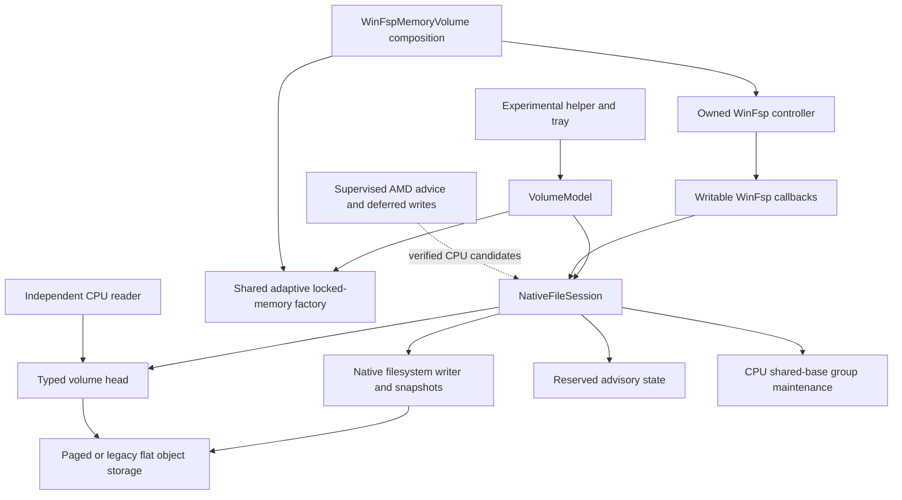

# FlitzFS repository overview

Reconciled against the **915-file** tree at
`148d728d36d2fdb8e3cd0ee2a5874c7548799b54` and the accompanying handle metadata
change. The review mapped current Windows attachment, metadata, allocation,
recovery, AMD, background maintenance and package paths to their qualification
evidence. The [release execution plan](RELEASE_EXECUTION_PLAN.md) identifies the
next artifact for each gate. The [detailed implementation plan](IMPLEMENTATION_PLAN.md)
defines the implementation and acceptance steps.

[Original architecture review](evidence/repository-review-2026-11-17.json) ·
[Current reconciliation evidence](evidence/release-reconciliation-indexed-handle-2026-11-22.json) ·
[Reviewed commit](https://github.com/strmt7/FlitzFS/commit/148d728d36d2fdb8e3cd0ee2a5874c7548799b54)
Later checkpoints are recorded under recent executed evidence and in the
[development state ledger](DEVELOPMENT_STATE.json).

## Assessment

FlitzFS is in **development qualification**. Its indexed engine and Windows
integration can serve writable workloads, and its controller has exercised
real AMD collective work. Release depends on carrying these paths through the
same installed Windows client, at scale, with backend-specific recovery,
independent CPU reads, and controlled size and performance results.

Keep the shared CPU-readable engine, copy-on-write publication, protected
decoding dependencies, WinFsp integration and isolated GPU execution. Replace
the assumptions that make current production paths depend on small volumes,
append ordering and full-image copies. Carry automatic GPU admission through
the supported client workflows and account for all occupied bytes.

There is no evidence yet that FlitzFS beats modern filesystems or the strongest
applicable compression methods on representative held-out data. That remains a
research and engineering objective. The full owner goal remains active; no
release, tag, publication or product-version change is authorized by this review.

## What is in the repository

The baseline Git tree contains 915 tracked files and 14,954,593 bytes of
tracked content. The `src/` and `include/` directories contain 190 tracked
files and 1,980,075 bytes. Each receipt identifies its inspection or test scope.

| Area | Inventory | Responsibility |
| --- | ---: | --- |
| `src/` | 150 files | Storage, native filesystem, codecs, Windows adapters, controllers and workers |
| `include/` | 40 files | Public core, session, storage, resource and recovery interfaces |
| `tests/` | 146 files | Model, malformed-input, failure, SDK, process, application and qualification fixtures |
| `tools/` | 63 files | Dependency staging, provenance, resource containment and qualification |
| `docs/` | 461 files | Contracts, plans, historical results and source-bound evidence |
| `.github/` | 19 files | Complementary build, analysis and experimental workflows |
| `third_party/` | 19 files | Pinned BLAKE3 sources, licensing and provenance |
| `cmake/`, `evidence/`, `resources/`, and top-level files | 17 files | Build support, historical evidence, branding, README and licensing |

Use the [current reconciliation evidence](evidence/release-reconciliation-indexed-handle-2026-11-22.json)
for the exact build and executed results.

## Reconciliation

The active checkout and GitHub `main` agreed on the reviewed parent. The
original checkout remains on `d6bb574` with earlier working changes. Use the
active checkout and its source-bound builds for this change.

Five hosted workflows failed on the earlier `227c82d` baseline. A dual-codec cold
coverage fixture accounted for five failed test jobs. It verified its
checkpoint before rejecting unrelated grouping of shared test data. The
Linux history test also compiled the current oracle against an older core
with a different API. The remaining failures occurred during portable notice
validation and a Windows interruption-probe build. Follow the
[reconciliation receipt](evidence/release-reconciliation-2026-11-21.json)
for the original run IDs, corrections and current validation scope.

On `4203079`, GitHub reported 12 successful workflows, one failed application
workflow and one cancelled native matrix. The application's portable harness
imports an exact Windows synchronization API set already admitted in the
portable CPU audit. The GUI audit now uses that shared Windows import list
and adds its own role-specific dependencies. The native matrix reported
successful Linux CPU jobs, with its sanitizer job cancelled.
[Application workflow](https://github.com/strmt7/FlitzFS/actions/runs/44900112256) ·
[Native matrix](https://github.com/strmt7/FlitzFS/actions/runs/44900112207) ·
[Microsoft Windows API sets](https://learn.microsoft.com/en-us/windows/win32/apiindex/windows-apisets)

FlitzZip's current developer guide separates build, runtime qualification,
coverage, comparative results and package evidence. Its native build receipt
and device measurement tools describe reusable mechanisms for verifying a
Windows toolchain, inspecting the exact HIP binary and pairing real device
execution with independent verification. FlitzFS applies the same evidence
boundaries to its volume, WinFsp and storage contracts.
[FlitzZip developer guide](https://github.com/strmt7/FlitzZip/blob/11396b5123505a4a1959173e1db2d0858c10dd6d/docs/development/README.md) ·
[Device measurement](https://github.com/strmt7/FlitzZip/blob/11396b5123505a4a1959173e1db2d0858c10dd6d/docs/development/hip-device-coverage.md)

The current FlitzZip developer guide and repository instructions were checked
for connector publication, dependency staging and evidence conventions.
FlitzFS uses its own indexed storage, format and volume lifecycle.

The populated Windows file-backed trial recovered the external client's
flushed write after helper termination. The CPU reader verified all 1,024
original files before the fresh helper mounted the same volume and flushed
another write. Handle metadata queries now reuse the verified inode after
checking the same ancestry and deletion state. The 4,096-file controller
fixture recorded 4,698 to 3,048 backing reads and 12,419,980 to 7,717,324
backing bytes across 64 queries, with zero writes in both builds.
[Mounted recovery](evidence/windows11-mounted-post-flush-recovery-2026-11-21.json) ·
[Handle metadata and exact test scope](evidence/release-reconciliation-indexed-handle-2026-11-22.json)

## Current architecture

The indexed WinFsp composition owns its memory backing and one controller
through creation, callback service, retirement, compaction and CPU inspection.
The helper can select memory backing or a volume file through the qualified
Explorer build. Both use the same owned controller. File selection includes
exclusive new-file creation, checked reopen and explicit close after
detachment. Both providers passed mounted Win32 operations in a signed
WinFsp guest. Persistent activation also passed duplicate-create refusal and
reopen in a fresh process. Interactive Explorer, supported installation,
physical recovery and AMD through the mounted path remain to be qualified.
[Helper factory](../src/windows/volume_app_winfsp.cpp) ·
[File attachment factory](../src/windows/winfsp_volume_attachment.cpp) ·
[Mounted evidence](evidence/windows11-stable-winfsp-2.2-2026-11-20.json)
[Mounted helper qualification](evidence/windows11-mounted-volume-activation-2026-11-21.json)

The diagnostic CLI operates on experimental image/container formats. It is not
the final user-facing mount, creation or management interface. Historical ZIP
compatibility work was retired; it is not a product requirement or a proposed
filesystem format.

## Architecture decisions after reconsideration

| Boundary | Decision for the successor | Reason and first proof |
| --- | --- | --- |
| Windows namespace | Keep WinFsp and one engine behind Explorer, Win32 and the helper. Prototype the supported installed driver/runtime binding before considering a custom driver. | The SDK callbacks already cover substantial behavior. Measure the bridge with a memory reference and qualify the actual mounted lifecycle before attributing latency to the driver. |
| Authority and formats | Keep CPU-readable immutable roots and current readers. Introduce a separately negotiated capability for new indexes and reusable allocation rather than reinterpret old references. | The current child and payload ordering checks rely on append offsets. New readers need explicit generation, lifetime and range proofs before recycling them. |
| Metadata | Replace whole-model authority with ordered directory and extent pages, stable inode identities and a small per-transaction overlay. | An object index keyed by integers alone does not supply ordered parent/name and inode/range access. Prove bounded point and range costs with real populated files. |
| Space and repair | Use verified full-image rebuild for bounded migration, recovery and initial handoff. Design incremental segment evacuation for steady operation. | A full copy requires another image and any current foreground commit invalidates it. Sustained low-rate writes must still allow useful reclamation. |
| Data protection | Retain independent verification and recovery, compare record packing and redundancy layouts under equivalent failure assumptions. | With a 64 KiB failure unit, even a single small mirrored payload and its metadata can allocate at least 256 KiB before other costs. Compaction alone cannot turn that transaction geometry into high small-file efficiency. |
| Foreground and GPU | Keep CPU completion independent. Use measured automatic dispatch and compare accelerator roles at complete-operation cost. | Kernel throughput alone cannot overcome transfers, setup, verification and publication. Some GPU work may earn its budget through a smaller settled volume. |
| Strong compression | Keep shared-base coding as a control. Compete with bounded multi-reference, dictionary, reversible transform and learned candidates across content families. | The winning method can depend on data, protection cost and retrieval work. A versioned CPU decoder and held-out complete-size results decide adoption. |
| Learning and scheduling | Separate advisory models/coherence from required decoding objects. Replace prototype thresholds with measured yielding, budgeted exploration and persistent sparse progress. | The volume stays readable after advice loss. Background compute and writes need demonstrated useful savings and measured foreground impact. |
| Physical storage and upgrades | Keep the operation contract shared. Qualify each provider and explicit format migration, including interrupted upgrade and rollback. | A RAM volume and an append-only file model have different failure domains. Recovery must refer to a specified acknowledged state. |
| Tooling, tests and docs | Keep reproducible private dependencies, meaningful independent oracles and immutable historical evidence. Consolidate current decisions in this review, the plan and its index. | Many old checkpoints still describe earlier scopes. They inform regressions and research without imposing obsolete host restrictions or closing current product gates. |

The protected metadata path is worth preserving as a design pattern. Different
storage geometry, shorter publication paths or less redundancy require separate
capacity and failure evidence before replacing it.

## Implemented behavior and practical limits

| Component | Implemented and supported by evidence | Material remaining gap |
| --- | --- | --- |
| Object storage | Flat and paged stores, checked COW transactions, replicated metadata, streaming rebuild and bounded indexed selector publication | Durable segment allocation, reclamation under concurrent writes and backend qualification |
| Native namespace | Indexed path and handle transactions, typed head selection, mounted guest evidence, scheduled retirement and staged compaction | Full Windows 11 client semantics and interference measurements during large live mutations |
| Populated capacity | Million-object paged inventory, 16,384 populated files in the native reopen fixture, and 4,096 in the Windows SDK startup fixture | Comparable mounted scale curves for large directories, population, I/O and recovery |
| Compression | Optional CPU Zstd/LZ4, exact sharing and independently readable indexed shared-base literal-patch members | Stronger shifted/multi-reference/type-aware/learned collective representations and representative complete-size results |
| Background work | Incremental indexed similarity discovery, live Windows admission, advisory checkpointing and automatic paired-range reclamation | Persistent scale, workload-driven codec selection and a measured policy for background writes |
| CPU recovery | Independent parsers/decoders, typed-head validation, surviving-copy reads and source-preserving repair/rebuild primitives | Full backend failure qualification, repair after wider dependency damage and production recovery orchestration |
| GPU | Automatic installed-runtime admission exercised in a controlled WinFsp owner, verified AMD collective proposals and independent CPU reopen | Automatic foreground and collective selection on the installed client, recovery across supported adapters and measurable net benefit |
| Windows interface | Writable native SDK callbacks, owner ACL/time initialization, contexts, cleanup/close, metadata/security and directory operations | Current-source mounted product qualification, complete Unicode/path/Win32 behavior, caching/mapping/concurrency and deployment |
| Application | Native helper/tray, owned worker, volume selection and two mounted workflows with external Win32 callers in a signed-driver guest | Interactive Explorer on the target client, complete volume management and a supported installer |
| Memory composition | Live adaptive admission beyond the old ceiling, on-demand page locking, retained backing through stop and explicit-join CPU inspection | Larger populated volumes, multiple-volume aggregate policy and broker/process-failure behavior |
| Indexed volume files | Exclusive create and audited reopen from the helper, persistent head and advice, independent CPU inspection and paired-range reclamation eligibility after reopen | Incremental reclamation during concurrent edits and actual media durability qualification |
| Learning state | Budgeted scan checkpoints, a paged coherence catalog and stale-posting compaction in owned indexed memory volumes | Full paged catalog on the persistent provider, higher candidate recall and observed adaptive policy wins across restart and workload change |
| Compatibility | Several historical native encodings and explicit capabilities remain readable | A published support window, mixed-version migration program, rollback boundaries and exact released-reader matrix |

### The important namespace bottleneck

The Windows session's legacy writer keeps all nodes, names and per-file extents
in `Model`. Its scoped inode-record queries verify the touched path and records.
Mutation staging still copies the model and compares namespace records against
the backing. The indexed writer stages affected inodes and ranges against the
paged object tree and publishes names, extents and counters together.

A 17-byte replacement in the indexed 1,024-file fixture read 202,492 backing
bytes. It kept that read count while full scrub dropped from 160,435,457 to
4,268,322 bytes. On a separate five-MiB paired volume, a healthy writable
reopen read 23,036,690 bytes, down from 42,381,786, with zero backing writes.
Both startup audits still validate the complete inventory. The retained
reader, repair, typed-corruption and post-flush failure checks passed.
[Current indexed audit evidence](evidence/indexed-reopen-single-pass-audit-2026-11-20.json)

The matched 16,384-short-file fixture used a height-three object tree. Keeping
verified branch pages across leaf lookups reduced writable-reopen reads from
197,479,086 to 130,327,966 bytes. Acquiring both owners before the image flush
reduced the healthy path from three backing flushes to two. The remaining
full inventories are still proportional to volume population.
[Scale and ownership evidence](evidence/indexed-scale-reopen-2026-11-20.json)

The helper's existing-file open now joins the native writable audit during
exclusive acquisition. In the matched in-memory attachment fixture, backing
reads fell from 1,644,441 to 1,304,248 bytes with three flushes and zero
writes in each run. Within the revised run, helper and direct adapter reads
matched exactly. Remaining startup work includes the selected-image inventory
checks on both sides of the image barrier.
[Attachment and reconciliation evidence](evidence/release-reconciliation-attachment-2026-11-21.json)

The indexed head and lifetimes now reach the owned Windows provider.
The controller consumes closed-file retirement in bounded transactions.
The next effort is physical reuse, bounded live truncation and lower
metadata read/write amplification with independent verification.
[Indexed writer evidence](evidence/native-indexed-writer-2026-11-18.json)

Authoritative source: [native limits and interfaces](../include/flitzfs/native_filesystem.hpp),
[`Model`, namespace decode/matching and staging](../src/native_filesystem.cpp),
[paged object API](../include/flitzfs/paged_store.hpp).

### The important compression bottleneck

The current group format stores an immutable 64-KiB base. Indexed members can
use literal patches, anchor copies, packed XOR planes or modular deltas. CPU
decoding verifies both the base and reconstructed member digests. Arbitrary
reordering and learned grouping and transforms remain open.

Discovery uses digests and band features. The indexed scanner extends aligned
features with shifted samples and restores verified feature bindings from
budgeted checkpoints. Its sparse catalog supplies point nominations outside the
current window. Full catalogs can drop stale postings in a verified compacted
copy. Complete retained outcome policy remains open. The current representation
has one-level base dependencies.
More complex representations require explicit dependency, access-cost and
recovery designs.

Publishing a group also appends history. The maintenance counters distinguish
hypothetical compacted savings from retained history added. A smaller live
representation can therefore coexist with a larger current image. If a group
cannot fit, the owner releases its staged batch and considers measured append
shortfall when scheduling a verified rebuild. A foreground commit still
invalidates the staged rebuild even if it touched unrelated files. Develop a
reclaimer that makes incremental progress across concurrent edits. Evaluate
compression using **total occupied bytes after safe reclamation**.

The current mirrored paged format pairs 64 KiB units on the memory provider.
For a commit adding one small nonempty payload, it seals a paired payload bank
and allocates at least one paired metadata bank. This is a lower bound of
256 KiB of new layout space, excluding any alignment gap. The reclaimer must
address packing and short-transaction amplification as well as stale records.
A smaller failure unit requires backend evidence, especially on persistent
storage. Child/page ordering also forbids simply substituting arbitrary free
offsets into the existing format.

The packer can now match an otherwise stranded short extent with a fitting
retained representative. It saved 16 KiB on a controlled boundary case.
The public docs and source comparisons retained the same occupied sizes
and backing read counts.
Representative workload gains still need measurement.
[Current cross-window evidence](evidence/indexed-cross-window-packing-2026-11-21.json)

Source: [group encoder/decoder](../src/native_group_codec.cpp),
[automatic discovery](../src/native_maintenance.cpp),
[shared-base contract](SHARED_BASE_GROUPS.md),
[staged rebuild](STAGED_PAGED_REBUILD.md).

### The important GPU bottleneck

A qualified installed package can route indexed background copy search
to AMD when current resources admit a group. The native deferred write
service also has CPU selection and separately tracked retirement.
Automatic foreground acceleration still needs current route, health and
complete-operation cost evidence.

The last matched six-request observation at `d384b6c` used 1 MiB per trial:
CPU median 24.2311 ms, GPU median 513.918 ms, and identical 1,310,720-byte images.
It demonstrated actual GPU work and CPU recovery; it demonstrated no speed or
complete-size advantage in that case. It was unmounted and is not a benchmark
of today's paged factory, a different corpus or every AMD GPU.

CPU verification now combines overlapping AMD copy suggestions that have
the same mapping. On the matched public code and documentation cohorts
it compared 41.6% and 48.5% fewer bytes in the accepted replies. The
compacted images stayed at 491,520 and 540,672 bytes respectively, and
independent CPU readback verified all files.
[Source-bound comparison](evidence/amd-coalesced-copy-verification-2026-11-20.json)

Indexed grouping now charges the encoded records that would be committed.
Automatic grouping can keep a valid subset after complete reference trials.
In two repeated host CPU comparisons, the 20-file code revision image went
from 480 KiB to 280 KiB and the 20-file documentation revision image went
from 528 KiB to 312 KiB. These totals include replicated metadata and payload
storage. Independent CPU reads matched every original. Full-corpus backing
read bytes increased by 31.0% and 19.2% respectively. These file sets
characterize the change without establishing a throughput result.
[Indexed group profitability and readback evidence](evidence/indexed-group-profitability-2026-11-20.json)

The installed route now reads Windows device status before DXGI discovery and
dispatch. On the live host, Code 21 stopped GPU launch while the owner
compressed two groups on CPU and recovered all ten files byte for byte.
[Device readiness evidence](evidence/windows-amd-device-readiness-2026-11-20.json)

Current matched trials advanced independent CPU candidates during three
fully submitted AMD batches. Each overlap trial published five groups before
the device reply. The paired images retained the same total size and byte-exact
CPU readback. The installed-profile trial independently selected AMD advice
for 18 members, and the missing-package trial completed through CPU.
[Current AMD and CPU scheduling evidence](evidence/windows-amd-full-batch-overlap-2026-11-21.json)

Wider backend qualification and useful collective gains still need complete
operation and size measurements. CPU fallback may choose a different encoding
and stored size. Every admitted GPU-produced representation needs an
independent CPU decoder.

Source: [deferred service](../src/windows/native_deferred_write.cpp),
[controlled native writes](../src/windows/native_uniform_write.cpp),
[matched observation](evidence/owned-service-comparison-d384b6c.json).

## Main risks and inefficiencies

These priorities describe engineering and release risk, not newly proven
security vulnerabilities.

| Priority | Finding | Consequence and required response |
| --- | --- | --- |
| Critical | Indexed paths and extents still need mounted scale qualification | Measure lookup, enumeration, startup and mutation across large populated volumes. Replace prototype-sized operations using bounded indexed access. |
| Critical | Automatic reclamation needs ordinary-client and persistent-media qualification | Staged cold compaction reduced occupied images in bounded fixtures. Prove steady-state reuse, foreground interference and recovery across concurrent commits. |
| High | Current append-order format and failure-unit padding limit useful space | Reusing extents changes the proof of record identity and graph validity. Measure occupied bytes and writes by record class and introduce explicit reusable-allocation semantics. |
| Critical | GPU benefit remains workload-specific | An approved profile can use indexed copy search or shared-reference pricing. Foreground routing, supported host breadth and net collective benefit still need full comparisons. |
| Critical | Physical durability is not qualified | `StoreIoContract` describes assumptions; RAM ordering and modeled faults do not attest to a drive's power-loss behavior. |
| High | Global callback serialization and synchronous publication | Foreground requests can wait for an in-flight quantum/commit. Add immutable read views, bounded concurrency and measured interference. |
| High | Full namespace validation and full-image opening/scrubbing costs | Startup/read/maintenance work will not scale by carrying today's checks unchanged. Replace them with checked tree paths and scheduled scrubbing, without removing integrity validation. |
| High | Indexed Windows names still need mounted client qualification | The versioned Unicode profile and WinFsp callbacks support case-preserving names and longer paths. The WinFsp owner fills missing directory summaries when idle. Exercise Explorer and native applications on the current Windows 11 client and measure backfill interference on wide directories. [Automatic backfill](INDEXED_NATIVE_VOLUME.md#automatic-backfill) |
| High | Candidate recall and persistent learning | The paged catalog preserves funded alternate nominations and resumes within a matching fingerprint range. Measure recall, total occupied bytes and lookup cost across held-out workloads and dense buckets. Qualify persistent-provider reuse across restarts. [Displaced nomination evidence](evidence/indexed-coherence-alternates-2026-11-21.json) |
| High | Quiet-work policy remains an initial fixed policy | A 12.5% busy threshold and 1% elapsed pacing are mechanisms, not proof of optimal host adaptation or low interference. |
| High | Driver/runtime qualification and historical retirement faults remain open | A valid signature or later clean fake-lifecycle test does not explain earlier failures or qualify a new native combination. |
| High | Security claims exceed current mechanisms if read too broadly | Checksums are not authentication; owner ACLs are not volume encryption. No full hostile-media/parser/update assessment is established here. |
| Medium | Partial codec-enabled qualification | The pinned Windows codec lane covers the paged store and SDK callbacks. Complete current-source application, mounted and recovery-package coverage remain open. |
| Medium | Process-lifetime RAM ownership | Stop retention now works; last-owner/process loss still loses temporary contents. Broker and persistent-provider policies must be explicit. |
| Medium | Evidence/documentation fan-out | Current and historical descriptions drift across large ledgers. Use one current requirement/exit map and immutable evidence references. |
| Medium | Many automatic hosted workflows remain | Local qualification is primary. Reduce redundant heavy runs and reserve remote/isolation resources for a stated coverage need. |

The callback surface does not currently expose a complete implementation of all
Win32 filesystem features: for example, its volume-label setter rejects the
operation, POSIX unlink/rename support is disabled, and stream/reparse behavior
must not be inferred from the callback table. Features must be implemented or
explicitly reported unsupported, with a published compatibility contract.

Source: [WinFsp callback table and parameters](../src/windows/winfsp_native.cpp),
[session release ordering](../src/windows/winfsp_session.cpp),
[controller](../src/windows/winfsp_controller.cpp),
[backend contract](../include/flitzfs/object_store.hpp).

## Fresh dependency and alert check

The authenticated GitHub REST endpoint returned **zero open Dependabot
alerts** in this reconciliation. The connector rejected the alert endpoint.
The release checks confirmed the current Zstandard, LZ4, BLAKE3, WinFsp,
CMake, LLVM, fio and DiskSpd stable tags.
[Current dependency receipt](evidence/release-reconciliation-indexed-handle-2026-11-22.json)

| Dependency/tool | Repository selection | Fresh official result / qualification limit |
| --- | --- | --- |
| Zstandard | v1.5.7 pin | Still the latest stable release returned by the API |
| LZ4 | v1.11.1 pin | Latest stable, published 10 November 2026 |
| BLAKE3 | 1.8.7 pin | Latest stable returned by the API |
| WinFsp | Stable v2.2, build 2.2.26323 | Latest stable tag and MSI digest confirmed through GitHub. The disposable guest fixture and current user-mode SDK results have separate receipts. |
| ROCm Core SDK | 10.2.0 package pin | The exact official Windows archive carries package build 10.2.0rc2, HIP 7.17.26434 and AMD Clang 24.0.0git. The installed runtime and driver are measured separately. |
| CMake | Windows private staging recipe 4.5.1 | Latest stable API result and the official checksum file agree. Windows staging and a fresh indexed test build exercised the patch. |
| Linux verification tools | CMake 4.5.1 and LLVM 23.1.6 pins | Both archive sizes and digests match their official release inventories. The Linux lane records unpacking and executable verification. |
| GitHub Actions | checkout 7.0.1 / setup-python 7.1.0 / upload-artifact 7.0.2 | Selected version labels match fresh stable release metadata |
| CocoIndex Code | 0.2.43 isolated tooling | Selected version label matches the current stable API result; this is agent tooling, not a product dependency |
| DiskSpd | Not newly installed/run | Current official release API returns v2.3; benchmark planning only |

AMD's 10.2.0 release notes list HIP 7.17.0 and Windows 11 25H2. The package
lock separately records the Windows archive's `10.2.0rc2` build marker,
HIP 7.17.26434 and the SHA-256 measured from the official download. The
release supply-chain review needs the exact signed artifacts and runtime,
driver and OS profiles for each supported configuration.
[AMD ROCm Core SDK 10.2.0 release notes](https://rocm.docs.amd.com/en/docs-10.2.0/about/release-notes.html)

The inspected host reported Windows 11 Pro 26H2 build 26300.10075. Microsoft
lists that build in the General Availability Channel. AMD's Core SDK 10.2.0
release notes list Windows 11 25H2. Treat vendor coverage and observed
FlitzFS behavior on 26H2 as separate qualification inputs.
[Windows release information](https://learn.microsoft.com/en-us/windows/release-health/windows11-release-information)

[AMD SDK qualification](evidence/windows-rocm-10.2-qualification-2026-11-20.json) ·
[Current ROCm lock](../tools/rocm-sdk-lock.json) ·
[Dependency audit history](DEPENDENCY_AUDIT.md)

## Recent executed evidence

Indexed flush shares the verified object-tree root between storage and
namespace validation within each barrier phase. Four Windows memory fixtures
read 16 KiB less per flush. A root replica that failed during the barrier
still fenced the writer, and the independent CPU reader recovered both files.
The complete writable-reopen audits remain in the startup path.
[Indexed flush evidence](evidence/indexed-flush-root-reuse-2026-11-22.json)

On 19 November, six paired multiwindow comparisons on the physical Windows
host produced equal compacted sizes and byte-exact CPU readback in both routes.
The related cohort retained 27.4% of its input image size and the mixed cohort
retained 20.8%. CPU finished sooner in every pair when including discovery,
publication, verified compaction and readback. A near-full model separately
verified that background compression releases its staged input, waits for a
changed image and resumes after verified reclamation.
[Matched maintenance and capacity evidence](evidence/amd-maintenance-parity-2026-11-19.json)

The indexed background controller now discovers related extents through checked
ordered lookups. One 129-member group grew through five publications while
foreground writes continued. A live Windows run used the SDK callbacks and
actual resource observations to publish and independently reopen a group.
Durable scan progress, broader similarity methods and useful collective
AMD throughput remain open.
[Automatic indexed discovery evidence](evidence/automatic-indexed-discovery-2026-11-18.json)

Indexed shared-base preparation now yields before each member and follows live
extent identity at publication. A 64-member fixture completed in 65 steps with
foreground edits interleaved and verified. The 528 modeled indexed publication
interruptions reopened complete checkpoints. Persistent discovery and useful
collective AMD execution remain open.
[Cooperative indexed grouping](evidence/cooperative-indexed-shared-base-2026-11-18.json)

Packed compaction now separates payload and index space. In a 1,926-object
mirrored fixture, three changed records needed 40 KiB of sizing metadata
reads, down from 328 KiB. Packing reduced complete compacted size by 15.5%
at 4 KiB isolation and 86.8% at 64 KiB. The indexed grouping path also
reopened and checked all 1,032 populated files around an eight-member
publication. Actual Windows resource scheduling completed staged compaction
and retired with balanced handles.
[Packed compaction evidence](evidence/packed-rebuild-accounting-2026-11-18.json)

The controller now uses the remainder of an idle CPU sample for private
indexed rebuild steps. One matched Windows memory fixture completed in
3,063 ms, down from 36,391 ms, with byte-exact open-handle and independent CPU
readback. The paired-range model also verified fresh observations at both
publication boundaries and retained the old range while a reader pinned it.
[Compaction pacing evidence](evidence/indexed-compaction-idle-credit-2026-11-19.json)

Indexed compaction also reconciles foreground commits against the same private
image. In the 66-file memory model, a late rename reached Ready on the tenth
advance after about 700 advances to build and verify the initial copy. The paired-range model retained
the candidate identity through a late write and recovered the acknowledged
files after 348 interruptions across replay, publication and retirement.
Persistent candidate restart and segment-level space reuse remain open.
[Reconciliation evidence](evidence/indexed-compaction-reconciliation-2026-11-19.json)

A verified CPU fallback on a live indexed volume now queues append-only
repair. The Windows controller restored both payload copies with the file
open, and independent reopen matched the acknowledged bytes. A write that
touches a recoverable record returns a retryable status before publication.
The repair fault model recovered the acknowledged data across 360 injected
interruptions.
[Live repair evidence](evidence/indexed-live-payload-repair-2026-11-20.json)

If a verified repair cannot append, the controller can select a verified
alternate image. The owned memory provider restored redundancy at the same
occupied size with zero free space in the selected image. The paired-range
model preserved acknowledged bytes through 12 selector interruptions, and
the Windows owner completed the switch with an open callback handle.
[Capacity repair evidence](evidence/indexed-capacity-repair-rotation-2026-11-20.json)

The Windows owner now checks payload replicas in idle work before a file
is read. It advances a bounded key cursor across foreground commits,
queues the existing verified repair when exactly one copy survives,
and exposes an integrity warning when an object or index cannot be
verified.
[Scrub validation](evidence/indexed-payload-scrub-2026-11-20.json)

The Windows scrub can save and resume a verified prefix of the selected
image. Fresh checks fund the paired advisory write and preserve the
compression policy budget. The restart model keeps data readable through
interruptions to either advisory slot. The Windows SDK lifecycle resumed
from that prefix after closing and reopening a paired-range fixture.
[Durable scrub validation](evidence/indexed-durable-scrub-2026-11-20.json)

Healthy writable reopen retains a checked image writer through the final
image and head barriers. The matched 5 MiB Windows paired-range fixture
read 42,460,278 backing bytes, down from 165,511,388, with zero backing
writes in either case. The source and the fenced image still receive
full checks. A different paged root with equal generation, or damage to
one or both replicas during the final barrier, aborts writable admission.
[Verified reopen validation](evidence/indexed-retained-reopen-2026-11-20.json)

The closed indexed writer restores damaged payload replicas before
attaching when the current checkpoint is verifiable and append space
permits it. Across 534 modeled interruptions at 4 KiB and 64 KiB failure
units, an independent CPU reopen retained the acknowledged bytes and a
subsequent attempt restored healthy replicas.
[Startup repair validation](evidence/indexed-startup-repair-2026-11-20.json)

If the image is full during startup, the paired-range and owned Windows
memory paths can restore redundancy in an alternate. The closed owner
compares the native namespace and every referenced object before switching
the selector. A subsequent reopen can recover an interrupted attempt using
the verified selection. Old detached lifetimes resolve before writable
callbacks start.
[Full startup repair validation](evidence/indexed-full-startup-repair-2026-11-20.json)

The writable controller now stays available for the owner-controlled
lifetime. Probe time budgets belong to the external test supervisor.
The controller wakes on a stop, dispatcher termination, deferred write
retirement or a storage fence. A 31-second injected SDK idle test passed
with no maintenance or GPU budget queries and balanced handles after stop.
Current mounted Windows 11 lifetime qualification remains open.
[Controller evidence](evidence/owned-writable-lifetime-2026-11-18.json)

Indexed volumes now publish protected cross-file shared bases. Eight related
synthetic files occupied 76.2% less after compaction in the 4 KiB model,
and 63.6% less in the 64 KiB model. All 591 modeled indexed interruptions
recovered a complete checkpoint. Six paired SDK overwrites on the CPU and
AMD device preserved the other group members, with exact CPU reopen and
equal occupied bytes. The current foreground comparison selects CPU.
Scalable automatic candidate selection and preparation remain open.
[Indexed shared-base evidence](evidence/indexed-shared-base-2026-11-18.json)

Owned native sessions can now reuse verified shared bases across reads of an
unchanged checkpoint. The live Windows comparison used two public revision
corpora with identical baseline and candidate image sizes. Full-file backing
traffic fell from 461,938 to 268,462 bytes for code and from 572,355 to
287,231 bytes for documentation. Independently opened CPU snapshots read the
same backing bytes across both builds and recovered all file contents. The
next access step is to measure cold and hot read amplification in mounted
and mixed workloads, then include those costs in candidate admission.
[Retained base read evidence](evidence/indexed-retained-anchor-reads-2026-11-20.json)

CPU maintenance can also build one protected reference from shared sections
across the group. It verifies each reconstructed extent and compares the two
sealed layouts before committing. The four-file fixture compacted from 491,520
to 458,752 bytes and recovered complete checkpoints through nine modeled
interruptions. In two paired live-host repetitions the raw-backed public code
corpus fell from 868,352 to 860,160 bytes. The public documentation corpus and
both outer-compressed configurations retained their previous sizes.
[Assembled reference evidence](evidence/indexed-section-references-2026-11-20.json)

Indexed maintenance can now rediscover an assembled base through its reverse
references and add new members. Removing the initial representative, reopening,
and extending the fixture preserved all nine remaining files. The complete
compacted image used 392 KiB, compared with 520 KiB before the extension.
Measure broader incremental workloads and price assembled references on AMD.
[Reuse evidence](evidence/indexed-assembled-base-reuse-2026-11-20.json)

The Windows controller collects GPU memory observations on demand. A
relocated executable acquired the installed AMD package, and three 512 KiB
AMD writes each verified eight candidate extents and sixteen mirrored
records. Independent CPU readback passed. All comparisons occupied
1,835,008 bytes per path. CPU completed in 1.21–1.60 ms and AMD in
703–1,331 ms, so this profile selects CPU for that request class. Useful
automatic GPU work, multi-AMD qualification and mounted response delivery
remain release work.
[Installed AMD evidence](evidence/installed-amd-routing-2026-11-18.json)

Indexed memory compaction now uses the staged CPU verification to select a
new image without re-reading its full contents at the switch. The current
provider uses the actual Windows page size and reserves virtual image capacity
from available headroom. In a controlled small-write fixture the image fell
from 3.75 MiB to 360 KiB with identical readback. An old CPU snapshot kept its
image pinned until release. [Compaction and sizing evidence](evidence/indexed-background-compaction-2026-11-18.json)

The owned indexed provider passed local Windows lifecycle and CPU recovery
checks with injected WinFsp operations. The real host scheduler retired
65 mappings in two transactions. The SDK phase fixture retired 129 in
three transactions and verified five resource refusals without backing I/O.
The linked provider passed the external indexed write/flush/rename/delete
fixture on disposable Windows Server 2025. It reopened the retained volume
on the CPU after unmount. [Owned indexed evidence](evidence/indexed-owned-windows-2026-11-18.json)

The controlled indexed WinFsp callback sent 128 KiB to the actual AMD device.
Both mirrored copies of each of the two stored extents matched verified
worker output. CPU reopen recovered the bytes with HIP unloaded from the
reader. The callback took 1.02 s in this single trial. Representative speed,
storage benefit and mounted behavior remain open.
[Indexed AMD evidence](evidence/indexed-lz4-deferred-2026-11-18.json)

Managed indexed selection and the SDK passed 22 selected Windows executions
across raw, codec and AddressSanitizer configurations. The compaction fixture
reduced occupied bytes from 385,024 to 147,456 and selected a complete old
or new image through 12 modeled interruptions. SDK checks covered sparse
writes, detach/reopen, independent reads and append-tail space reporting.
[Indexed managed evidence](evidence/indexed-managed-winfsp-2026-11-18.json)

The common memory provider uses headroom instead of a 40 MiB capacity ceiling.
On the Release run it admitted 91,881,472 bytes of domain capacity, locked zero
bytes for empty stores and locked 20,480 bytes for the growth fixture.
Routine status and background maintenance no longer scan all committed pages.
[Memory provider evidence](evidence/demand-locked-memory-2026-11-18.json)

At the reviewed commit, [the factory checkpoint](evidence/memory-volume-factory-2026-11-17.json)
binds 18 successful bounded local runs: raw and ASan builds, memory composition,
controller, SDK callback/fault suites, helper model/advice, live opportunities,
GUI workflow, and a separate app-only build with WinFsp disabled.

Each configuration passed 4,290 SDK callback checks and 492 modeled publication
failures. The raw memory-composition window published a live two-file group;
the final ASan window did not claim publication. Both final helper live tests
recorded real resource deferral. Modeled quiet-provider grouping and byte-exact
foreground reads were checked separately. Native RNG initialization was
distinguished from exact factory handle balance. Earlier failures are retained.

The new Windows codec lane used private CMake 4.5.0 and source-pinned static
Zstandard and LZ4. Nine paged storage tests, three codec tests, five SDK tests
and the helper model passed. The former helper maintenance fixture assumed that
three already compact files would benefit from grouping and failed its publication
assertion with Zstandard enabled. The initial build attempt also exposed MSVC
D8040 from Zstandard's separate default /MP fan-out. The bounded build passed
with the pinned upstream option disabled. [Review receipts](evidence/repository-review-2026-11-17.json).

The follow-up removed duplicate zero writes over complete metadata pages.
The focused mirrored 4 KiB-unit commit wrote 24 KiB instead of 32 KiB for the
same 16 KiB growth and two required root updates. The candidate passed 24
selected CTest invocations and three helper maintenance cases across codec,
raw and AddressSanitizer configurations. In the codec lane the helper declined
the already compact family without writes and grouped a separate profitable
family with at least 128 KiB of modeled compacted savings. The live helper runs
recorded resource deferral. [Follow-up evidence](evidence/paged-write-accounting-2026-11-17.json).

On 19 November, AMD full-tile reference pricing produced 11.3% smaller
protected compacted images than sampled reference selection in two
controlled cohorts. Eighteen matched runs reopened all files on CPU.
The next 18 trials exercised full-tile CPU pricing, which matched AMD's
compacted size and completed sooner on both cohorts. CPU now performs this
work in bounded steps during normal indexed maintenance. A separate set of
40 public file revisions measured grouping savings on top of Zstandard
and quantified backing reads. The grouped reader reduced backing reads
on both cohorts across rotating CPU and AMD runs. Extending verified AMD
copy hints enabled the writer to select spans in three of four public
revision profiles and cut the raw source image by another 8 KiB.
Independent CPU reads matched every file in all 36 matched trials.
CPU completed sooner on these small cold workloads. Sustained device
throughput and foreground interference measurements remain open.
[Full-tile reference evidence](evidence/amd-full-reference-pricing-2026-11-19.json)
[CPU reference pricing evidence](evidence/cpu-full-reference-pricing-2026-11-19.json)
[Public revision reads](evidence/public-revision-reads-2026-11-19.json)
[Matched reader and AMD hint qualification](evidence/verified-device-copy-refinement-2026-11-19.json)

The installed Windows controller verified a four-dispatch copy search and
published ten advised members in an eleven-file group. A separate live
foreground cancellation completed on CPU. Short transfers use serial waits
when they cannot fill the qualified queue. The small public revision pairs
provide timing and compacted-size controls for that decision.
[Windows queue qualification](evidence/native-anchor-wait-qualification-2026-11-19.json)

The owned Windows controller and desktop helper now reuse a fresh CPU
observation for short preparation steps with refreshed memory. The final
installed AMD callback fixture completed in 30.2 seconds compared with
62.2 seconds on the previous controller. Fresh observations still govern
publication, and an independent CPU reader verified every file.
[Windows preparation evidence](evidence/windows-maintenance-opportunities-2026-11-19.json)

Verified AMD copy advice now survives foreground reads while its staged
source remains eligible. On the Windows callback fixture, the same read
burst left one advised member on the previous controller and ten on the
updated controller. A selected edit invalidated the prepared group and
CPU rebuilt it with exact readback of the edited file.
[Foreground advice evidence](evidence/amd-verified-foreground-2026-11-19.json)

The evidence covers specific CPU paths, modeled failures, SDK callbacks and
helper behavior. Full current-source CTest, an actual mounted product, useful
ordinary GPU operation and physical power-loss qualification remain open.
Earlier million-object and hardware/mount results keep their source and fixture scope.

## What current research changes

Research is recent and primary, with native extraction receipts. Preprints and
abstract-only captures remain labeled as such; reported results are not FlitzFS
measurements.

- **Similar-data grouping is established research.** FAST 2026 RubikFS groups
  and reorders chunks using similarity and hotness. It is a read-only design,
  so FlitzFS still has substantial writable, recovery and GPU questions to solve.
  Grouping alone cannot establish uniqueness. [RubikFS](https://www.usenix.org/conference/fast26/presentation/huang).
- **Structured families deserve explicit candidates.** NSDI 2026 ZipLLM studies
  model-family redundancy and combines deduplication with lossless delta coding.
  Its specialized workload is not evidence of gains on arbitrary files.
  [Primary publication](https://www.usenix.org/conference/nsdi26/presentation/wang-zirui).
- **GPU-friendly representations can be valuable beyond LZ4.** EuroSys 2026
  Invariant Bit Packing studies structured ML data and transfer cost. Treat it
  as a candidate mechanism, not a generic-filesystem or AMD performance result.
  [Extended primary paper](https://arxiv.org/html/2605.30728v1).
- **Learned compression needs a decode-cost design.** The November 2026
  invocation-bottleneck preprint examines the cost of model calls and
  reproducibility of probability computation. Investigate bounded deterministic
  predictors rather than assuming a large model yields usable file reads.
  [Preprint](https://arxiv.org/html/2611.05871v1).
- **Search can choose reversible transforms.** The August 2026 Brevis preprint
  investigates typed program synthesis for lossless tensor compression. A bounded
  search over safe reversible operators is a candidate for FlitzFS research;
  arbitrary executable programs from stored media are not.
  [Preprint](https://arxiv.org/html/2608.02162v1).
- **Windows already offers relevant GPU decompression research/software.**
  Microsoft's DirectStorage 1.4 work includes CPU/GPU Zstd and asset-conditioning
  techniques. Some conditioning is lossy and must be excluded. Destination,
  readback, workload and CPU-recovery requirements need evaluation before use
  in a general filesystem. [Microsoft](https://devblogs.microsoft.com/directx/directstorage-1-4-release-adds-support-for-zstandard/).
- **Record comparisons need complete rules.** The maintained large-text benchmark
  is useful for specialized compression comparisons, not filesystem semantics.
  Model/decoder costs and access constraints must be disclosed; a text result
  cannot stand in for heterogeneous storage. [Benchmark](https://mattmahoney.net/dc/text.html).

## Release distance and course correction

There is no defensible completion percentage. A million object keys, a tray
application, a GPU request and thousands of checks do not compose into a
million-file, accelerated, durable product automatically.

The detailed plan retains a low-confidence engineering envelope of roughly
**60–130 person-weeks**, with an open research tail for the compression frontier.
That is a work estimate, not a promised calendar for an autonomous agent.
It must be recalibrated after the scalable native engine, real mounted path and
first held-out collective comparison. The small recent integration slices do
not justify calling a release imminent or silently lowering the exit criteria.

The populated Windows trace now covers acknowledged overwrite, EOF shrink and
rename through helper termination and fresh writable attachment. The next
checkpoint carries the paged image publication cuts into mounted recovery
and uses separate selector cuts during image replacement. Follow with
bounded writable admission, safe segment reuse and useful mounted AMD
operation. Advance sparse coherence and held-out compression selection
alongside that work. [Recovery evidence](evidence/windows11-overwrite-rename-recovery-2026-11-22.json) ·
[Current gate ledger](RELEASE_EXECUTION_PLAN.md#current-gate-ledger)
