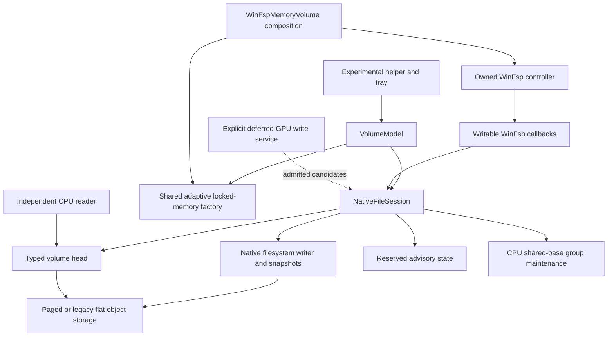

# FlitzFS repository overview

Reviewed on **17 November 2026** at
[`38a4a48f005c2ea6c9a7f8cbd9d7ee07df044d70`](https://github.com/strmt7/FlitzFS/commit/38a4a48f005c2ea6c9a7f8cbd9d7ee07df044d70).
This is a repository-wide architectural and delivery review, not an exhaustive
security audit or a new full-suite, mounted-filesystem or GPU qualification.
The [detailed implementation plan](IMPLEMENTATION_PLAN.md) is the forward plan.
[Review receipts](evidence/repository-review-2026-11-17.json) bind inventories,
semantic searches, inspected sources, current research and API captures.

## Assessment

FlitzFS has a substantial experimental storage foundation and several working
Windows integration components. It is **not close to a stable release candidate**.
The main problem is no longer a lack of safety mechanisms or diagnostic fixtures.
It is the gap between those mechanisms and a complete, scalable, automatically
optimized filesystem that ordinary Windows applications can use.

Keep the shared CPU-readable engine, copy-on-write publication, protected
decoding dependencies, WinFsp integration and isolated GPU execution. Replace
the assumptions that make current production paths depend on small volumes,
append ordering, full-image copies and a supplied GPU routing decision. The
next milestones must exercise complete application operations and account for
all occupied bytes.

There is no evidence yet that FlitzFS beats modern filesystems or the strongest
applicable compression methods on representative held-out data. That remains a
research and engineering objective. The full owner goal remains active; no
release, tag, publication or product-version change is authorized by this review.

## What is in the repository

The clean reviewed checkout contains 697 tracked files, about 9.65 MB in total.
The `src/` and `include/` semantic inventory contains 152 code files, about
1.13 MB. These are inventory measurements, not measures of completion.

| Area | Inventory | Responsibility |
| --- | ---: | --- |
| `src/` | 117 files | Storage, native filesystem, codecs, Windows adapters, controllers and workers |
| `include/` | 36 files | Public core, session, storage, resource and recovery interfaces |
| `tests/` | 138 files | Model, malformed-input, failure, SDK, process, application and qualification fixtures |
| `tools/` | 57 files | Dependency staging, provenance, resource containment and qualification |
| `docs/` | 297 files | Contracts, plans, historical results and source-bound evidence |
| `.github/` | 19 files | Complementary build, analysis and experimental workflows |
| `third_party/` | 18 files | Pinned BLAKE3 sources, licensing and provenance |

The current raw/ASan SDK build configurations each register **153 CTest entries**.
Only inventory enumeration was performed for that count; it is not a statement
that all 153 were executed in this review. Recent executed checks are described
separately below.

## Current architecture

The WinFsp composition now owns real backing and a real controller; its current
qualification uses actual SDK callbacks with injected lifecycle operations.
This is distinct from invoking the native mounted provider. The ordinary helper
and the new composition still do not automatically use GPU compression.

The diagnostic CLI operates on experimental image/container formats. It is not
the final user-facing mount, creation or management interface. Historical ZIP
compatibility work was retired; it is not a product requirement or a proposed
filesystem format.

## Architecture decisions after reconsideration

| Boundary | Decision for the successor | Reason and first proof |
| --- | --- | --- |
| Windows namespace | Keep WinFsp and one engine behind Explorer, Win32 and the helper. Prototype the supported installed driver/runtime binding before considering a custom driver. | The SDK callbacks already cover substantial behavior. Measure the bridge with a memory reference and qualify the actual mounted lifecycle before attributing latency to the driver. |
| Authority and formats | Keep CPU-readable immutable roots and current readers. Introduce a separately negotiated capability for new indexes and reusable allocation rather than reinterpret old references. | The current child and payload ordering checks rely on append offsets. New readers need explicit generation, lifetime and range proofs before recycling them. |
| Metadata | Replace whole-model authority with ordered directory and extent pages, stable inode identities and a small per-transaction overlay. | An object index keyed by integers alone does not supply ordered parent/name and inode/range access. Prove bounded point and range costs with real populated files. |
| Space and repair | Use verified full-image rebuild for bounded migration, recovery and initial handoff. Design incremental segment evacuation for steady operation. | A full copy requires another image and any current foreground commit invalidates it. Sustained low-rate writes must still allow useful reclamation. |
| Data protection | Retain independent verification and recovery, compare record packing and redundancy layouts under equivalent failure assumptions. | With a 64 KiB failure unit, even a single small mirrored payload and its metadata can allocate at least 256 KiB before other costs. Compaction alone cannot turn that transaction geometry into high small-file efficiency. |
| Foreground and GPU | Keep CPU completion independent. Use measured automatic dispatch and compare accelerator roles at complete-operation cost. | Kernel throughput alone cannot overcome transfers, setup, verification and publication. Some GPU work may earn its budget through a smaller settled volume. |
| Strong compression | Keep shared-base coding as a control. Compete with bounded multi-reference, dictionary, reversible transform and learned candidates across content families. | The winning method can depend on data, protection cost and retrieval work. A versioned CPU decoder and held-out complete-size results decide adoption. |
| Learning and scheduling | Separate advisory models/coherence from required decoding objects. Replace prototype thresholds with measured yielding, budgeted exploration and persistent sparse progress. | The volume stays readable after advice loss. Background compute and writes need demonstrated useful savings and measured foreground impact. |
| Physical storage and upgrades | Keep the operation contract shared. Qualify each provider and explicit format migration, including interrupted upgrade and rollback. | A RAM volume and an append-only file model have different failure domains. Recovery must refer to a specified acknowledged state. |
| Tooling, tests and docs | Keep reproducible private dependencies, meaningful independent oracles and immutable historical evidence. Consolidate current decisions in this review, the plan and its index. | Many old checkpoints still describe earlier scopes. They inform regressions and research without imposing obsolete host restrictions or closing current product gates. |

The protected metadata path is worth preserving as a design pattern. Different
storage geometry, shorter publication paths or less redundancy require separate
capacity and failure evidence before replacing it.

## Implemented behavior and practical limits

| Component | Implemented and supported by evidence | Material remaining gap |
| --- | --- | --- |
| Object storage | Flat and paged stores, checked records, COW transactions, replicated metadata, resume and streaming rebuild | Production allocation/free-space policy, reader-safe automatic reclamation and backend qualification |
| Native namespace | Stable inode IDs, metadata and checked enumeration. The indexed snapshot opened and byte-checked 1,024 nonempty files with on-demand names and extents. Explicit legacy export publishes a verified new image. | Current mounts still reconstruct a bounded whole `Model`. The new layout needs a writable transaction engine, collective representation support and verified volume-head selection. |
| Populated capacity | The paged object layer has a million-object result | The native layer still caps 256 nodes and 255 populated/reserved extent references; sparse logical size is not populated capacity |
| Compression | Optional CPU Zstd/LZ4, exact sharing and protected shared-base literal-patch members | Stronger shifted/multi-reference/type-aware/learned collective representations and representative complete-size results |
| Background work | Automatic aligned-family discovery, feature reuse, negative-outcome suppression, real Windows observations and low-priority paced opportunities | Persistent scalable features, restartable learning, workload-driven codec selection, automatic compaction and a lifetime write governor |
| CPU recovery | Independent parsers/decoders, typed-head validation, surviving-copy reads and source-preserving repair/rebuild primitives | Full backend failure qualification, repair after wider dependency damage and production recovery orchestration |
| GPU | Actual bounded AMD work, independent comparison, protected worker exchange, recovery policy and explicit native write service | Automatic discovery/cost acquisition and a useful ordinary Windows I/O path; stronger collective GPU work |
| Windows interface | Writable native SDK callbacks, owner ACL/time initialization, contexts, cleanup/close, metadata/security and directory operations | Current-source mounted product qualification, complete Unicode/path/Win32 behavior, caching/mapping/concurrency and deployment |
| Application | Native helper/tray, create/save/read/optimize/discard, owned worker and GUI qualification | Explorer-facing mounted lifecycle, complete volume-management workflows and a supported installer |
| Memory composition | Fresh adaptive admission, retained backing through stop, explicit-join CPU inspection and surviving-reader lease | Larger qualified volumes, multiple-volume aggregate policy and broker/process-failure behavior |
| Learning state | Protected bounded advisory profiles/benchmarks and funding/repair primitives | An autonomous persisted learner and a paged coherence catalog; these records do not implement either by themselves |
| Compatibility | Several historical native encodings and explicit capabilities remain readable | A published support window, mixed-version migration program, rollback boundaries and exact released-reader matrix |

### The important namespace bottleneck

`Model` owns maps for all nodes, names and per-node extents. Inode-record decode
enumerates records and assembles an aggregate namespace frame. Staging copies
the model. `checked_namespace()` compares the cached namespace against backing;
for inode-record layouts, `namespace_matches()` regenerates and reads the
expected namespace records. Even an inode read follows that check.

This protects the current bounded prototype, but it is the wrong scaling path
for millions of files. Raising constants would retain the full-residency and
repeated whole-namespace work. The existing paged object tree is reusable;
native inode/name/extent access must actually become paged, with checked paths,
bounded caches and atomic multi-index updates.

Authoritative source: [native limits and interfaces](../include/flitzfs/native_filesystem.hpp),
[`Model`, namespace decode/matching and staging](../src/native_filesystem.cpp),
[paged object API](../include/flitzfs/paged_store.hpp).

### The important compression bottleneck

The current group format stores an immutable 64-KiB base and ordered literal
patches for members. Its CPU decoder verifies both the base and reconstructed
member digests. This is a useful protected cross-file baseline. It is not a
general learned codec or a solution for arbitrary shifted/reordered data.

Discovery currently uses a full-content digest and eight aligned band features
inside the bounded native model. Features and attempted outcomes are volatile.
They are not a persistent global coherence database. The current representation
has one-level base dependencies; more complex representations require explicit
dependency, access-cost and recovery designs.

Publishing a group also appends history. The maintenance counters distinguish
hypothetical compacted savings from retained history added. A smaller live
representation can therefore coexist with a larger current image. A foreground
commit invalidates the existing staged rebuild even if it touched unrelated
files. Use its protected handoff for bounded rebuilds and develop a reclaimer
that makes incremental progress across concurrent edits. Evaluate compression
using **total occupied bytes after safe reclamation**.

The current mirrored paged format pairs 64 KiB units on the memory provider.
For a commit adding one small nonempty payload, it seals a paired payload bank
and allocates at least one paired metadata bank. This is a lower bound of
256 KiB of new layout space, excluding any alignment gap. The reclaimer must
address packing and short-transaction amplification as well as stale records.
A smaller failure unit requires backend evidence, especially on persistent
storage. Child/page ordering also forbids simply substituting arbitrary free
offsets into the existing format.

Source: [group encoder/decoder](../src/native_group_codec.cpp),
[automatic discovery](../src/native_maintenance.cpp),
[shared-base contract](SHARED_BASE_GROUPS.md),
[staged rebuild](STAGED_PAGED_REBUILD.md).

### The important GPU bottleneck

The explicit native deferred service already supports CPU selection and a single
response while separately tracking later worker retirement. That mechanism
should be reused, not rebuilt. Normal product factories do not configure it
automatically, and its health/cost/binding inputs still need product acquisition.

The last matched six-request observation at `d384b6c` used 1 MiB per trial:
CPU median 24.2311 ms, GPU median 513.918 ms, and identical 1,310,720-byte images.
It demonstrated actual GPU work and CPU recovery; it demonstrated no speed or
complete-size advantage in that case. It was unmounted and is not a benchmark
of today's paged factory, a different corpus or every AMD GPU.

GPU work remains required. The next objective is a useful automatic route and
more valuable collective work, with complete-operation cost and size accounting.
CPU fallback may encode differently and produce a different size; every admitted
GPU-produced representation still needs an independent CPU decoder.

Source: [deferred service](../src/windows/native_deferred_write.cpp),
[controlled native writes](../src/windows/native_uniform_write.cpp),
[matched observation](evidence/owned-service-comparison-d384b6c.json).

## Main risks and inefficiencies

These priorities describe engineering and release risk, not newly proven
security vulnerabilities.

| Priority | Finding | Consequence and required response |
| --- | --- | --- |
| Critical | Native namespace/extents remain globally bounded and resident | Ordinary populated files and large directories hit prototype limits. Replace the access model rather than enlarging constants. |
| Critical | No automatic reclamation closes the compression transaction | Compacted savings do not ensure smaller occupied storage. Qualify bounded handoff and implement segment-level reclamation that survives unrelated foreground commits. |
| High | Current append-order format and failure-unit padding limit useful space | Reusing extents changes the proof of record identity and graph validity. Measure occupied bytes and writes by record class and introduce explicit reusable-allocation semantics. |
| Critical | Ordinary GPU use and benefit remain absent | Explicit requests are not the requested product. Add automatic qualified discovery/calibration/routing and a beneficial collective backend. |
| Critical | Physical durability is not qualified | `StoreIoContract` describes assumptions; RAM ordering and modeled faults do not attest to a drive's power-loss behavior. |
| High | Global callback serialization and synchronous publication | Foreground requests can wait for an in-flight quantum/commit. Add immutable read views, bounded concurrency and measured interference. |
| High | Full namespace validation and full-image opening/scrubbing costs | Startup/read/maintenance work will not scale by carrying today's checks unchanged. Replace them with checked tree paths and scheduled scrubbing, without removing integrity validation. |
| High | Current Windows name profile is ASCII and short | Many normal Windows workloads are unsupported. Implement a specified Unicode/case/path model and test ordinary clients. |
| High | Product lifecycle still inherits experimental mount plans | A finite probe lifetime is not a normal mounted-volume lifetime. Separate qualification limits from product ownership and cancellation. |
| High | No complete persistent coherence/learner | Restart loses feature/outcome progress; no autonomous learned strategy currently closes the loop. |
| High | Quiet-work policy remains an initial fixed policy | A 12.5% busy threshold and 1% elapsed pacing are mechanisms, not proof of optimal host adaptation or low interference. |
| High | Driver/runtime qualification and historical retirement faults remain open | A valid signature or later clean fake-lifecycle test does not explain earlier failures or qualify a new native combination. |
| High | Security claims exceed current mechanisms if read too broadly | Checksums are not authentication; owner ACLs are not volume encryption. No full hostile-media/parser/update assessment is established here. |
| Medium | Partial codec-enabled qualification | The pinned Windows codec lane covers the paged store and SDK callbacks. Complete current-source application, mounted and recovery-package coverage remain open. |
| Medium | Process-lifetime RAM ownership | Stop retention now works; last-owner/process loss still loses temporary contents. Broker and persistent-provider policies must be explicit. |
| Medium | Evidence/documentation fan-out | Current and historical descriptions drift across large ledgers. Use one current requirement/exit map and immutable evidence references. |
| Medium | Many automatic hosted workflows remain | Local qualification is primary. Reduce redundant heavy runs and reserve remote/isolation resources for a stated coverage need. |

The callback surface does not currently expose a complete implementation of all
Win32 filesystem features: for example, its volume-label setter rejects the
operation, POSIX unlink/rename support is disabled, and stream/reparse behavior
must not be inferred from the callback table. Features must be implemented or
explicitly reported unsupported, with a published compatibility contract.

Source: [WinFsp callback table and parameters](../src/windows/winfsp_native.cpp),
[session release ordering](../src/windows/winfsp_session.cpp),
[controller](../src/windows/winfsp_controller.cpp),
[backend contract](../include/flitzfs/object_store.hpp).

## Fresh dependency and alert check

Authenticated GitHub REST capture on 17 November returned **HTTP 200 and zero
open Dependabot alerts**, with complete cursor pagination. The initial review
request incorrectly supplied `page` and received HTTP 400; it was corrected.
This is a current successful API check, not an inference from the old 403 or a
claim that every C++/runtime dependency is vulnerability-free.

| Dependency/tool | Repository selection | Fresh official result / qualification limit |
| --- | --- | --- |
| Zstandard | v1.5.7 pin | Still the latest stable release returned by the API |
| LZ4 | v1.11.1 pin | Latest stable, published 10 November 2026 |
| BLAKE3 | 1.8.7 pin | Latest stable returned by the API |
| WinFsp | v2.2B5 development SDK | Latest available prerelease; stable endpoint still returns v2.1. This does not qualify an installed driver. |
| ROCm Core SDK | 10.1.0 package pin | Current AMD Core documentation is 10.1.0; its HIP component is 7.16.0. Do not substitute the legacy Windows HIP SDK 7.2 documentation or equate package/component version numbers. |
| CMake | Private staging recipe 4.5.0 | Latest stable API result is 4.5.0. It was checksum-verified and used in the new Windows codec lane. The earlier raw/ASan factory results used the Visual Studio bundle. |
| GitHub Actions | checkout 7.0.1 / setup-python 7.1.0 / upload-artifact 7.0.2 | Selected version labels match fresh stable release metadata |
| CocoIndex Code | 0.2.43 isolated tooling | Selected version label matches the current stable API result; this is agent tooling, not a product dependency |
| DiskSpd | Not newly installed/run | Current official release API returns v2.3; benchmark planning only |

The ROCm lock records an observed `10.1.0rc3` package identity and an archive
digest measured locally from AMD HTTPS, not an independently published AMD
checksum. Preserve that distinction in release supply-chain qualification.
Do not install or replace a GPU driver to resolve it.

Client compatibility also needs an explicit distinction. The inspected host
reported Windows 11 Pro build 26300. Microsoft's current page lists Windows 11
26H2 build 26300.9974, while the captured ROCm 10.1 compatibility matrix lists
Windows 11 25H2. A build-family observation is not a full servicing/driver
qualification. Test the actual target combination and keep vendor-documented
support separate from a locally exercised profile; do not change the OS or GPU
driver to make a probe fit a document.
[Windows release information](https://learn.microsoft.com/en-us/windows/release-health/windows11-release-information),
[ROCm compatibility matrix](https://rocm.docs.amd.com/en/docs-10.1.0/compatibility/compatibility-matrix.html).

[AMD Core release notes](https://rocm.docs.amd.com/en/docs-10.1.0/about/release-notes.html),
[current lock](../tools/rocm-sdk-lock.json),
[dependency policy/history](DEPENDENCY_AUDIT.md).

## Recent executed evidence

At the reviewed commit, [the factory checkpoint](evidence/memory-volume-factory-2026-11-17.json)
binds 18 successful bounded local runs: raw and ASan builds, memory composition,
controller, SDK callback/fault suites, helper model/advice, live opportunities,
GUI workflow, and a separate app-only build with WinFsp disabled.

Each configuration passed 4,290 SDK callback checks and 492 modeled publication
failures. The raw memory-composition window published a live two-file group;
the final ASan window did not claim publication. Both final helper live tests
recorded real resource deferral. Modeled quiet-provider grouping and byte-exact
foreground reads were checked separately. Native RNG initialization was
distinguished from exact factory handle balance. Earlier failures are retained.

The new Windows codec lane used private CMake 4.5.0 and source-pinned static
Zstandard and LZ4. Nine paged storage tests, three codec tests, five SDK tests
and the helper model passed. The former helper maintenance fixture assumed that
three already compact files would benefit from grouping and failed its publication
assertion with Zstandard enabled. The initial build attempt also exposed MSVC
D8040 from Zstandard's separate default /MP fan-out. The bounded build passed
with the pinned upstream option disabled. [Review receipts](evidence/repository-review-2026-11-17.json).

The follow-up removed duplicate zero writes over complete metadata pages.
The focused mirrored 4 KiB-unit commit wrote 24 KiB instead of 32 KiB for the
same 16 KiB growth and two required root updates. The candidate passed 24
selected CTest invocations and three helper maintenance cases across codec,
raw and AddressSanitizer configurations. In the codec lane the helper declined
the already compact family without writes and grouped a separate profitable
family with at least 128 KiB of modeled compacted savings. The live helper runs
recorded resource deferral. [Follow-up evidence](evidence/paged-write-accounting-2026-11-17.json).

The evidence covers specific CPU paths, modeled failures, SDK callbacks and
helper behavior. Full current-source CTest, an actual mounted product, useful
ordinary GPU operation and physical power-loss qualification remain open.
Earlier million-object and hardware/mount results keep their source and fixture scope.

## What current research changes

Research is recent and primary, with native extraction receipts. Preprints and
abstract-only captures remain labeled as such; reported results are not FlitzFS
measurements.

- **Similar-data grouping is established research.** FAST 2026 RubikFS groups
  and reorders chunks using similarity and hotness. It is a read-only design,
  so FlitzFS still has substantial writable, recovery and GPU questions to solve.
  Grouping alone cannot establish uniqueness. [RubikFS](https://www.usenix.org/conference/fast26/presentation/huang).
- **Structured families deserve explicit candidates.** NSDI 2026 ZipLLM studies
  model-family redundancy and combines deduplication with lossless delta coding.
  Its specialized workload is not evidence of gains on arbitrary files.
  [Primary publication](https://www.usenix.org/conference/nsdi26/presentation/wang-zirui).
- **GPU-friendly representations can be valuable beyond LZ4.** EuroSys 2026
  Invariant Bit Packing studies structured ML data and transfer cost. Treat it
  as a candidate mechanism, not a generic-filesystem or AMD performance result.
  [Extended primary paper](https://arxiv.org/html/2605.30728v1).
- **Learned compression needs a decode-cost design.** The November 2026
  invocation-bottleneck preprint examines the cost of model calls and
  reproducibility of probability computation. Investigate bounded deterministic
  predictors rather than assuming a large model yields usable file reads.
  [Preprint](https://arxiv.org/html/2611.05871v1).
- **Search can choose reversible transforms.** The August 2026 Brevis preprint
  investigates typed program synthesis for lossless tensor compression. A bounded
  search over safe reversible operators is a candidate for FlitzFS research;
  arbitrary executable programs from stored media are not.
  [Preprint](https://arxiv.org/html/2608.02162v1).
- **Windows already offers relevant GPU decompression research/software.**
  Microsoft's DirectStorage 1.4 work includes CPU/GPU Zstd and asset-conditioning
  techniques. Some conditioning is lossy and must be excluded. Destination,
  readback, workload and CPU-recovery requirements need evaluation before use
  in a general filesystem. [Microsoft](https://devblogs.microsoft.com/directx/directstorage-1-4-release-adds-support-for-zstandard/).
- **Record comparisons need complete rules.** The maintained large-text benchmark
  is useful for specialized compression comparisons, not filesystem semantics.
  Model/decoder costs and access constraints must be disclosed; a text result
  cannot stand in for heterogeneous storage. [Benchmark](https://mattmahoney.net/dc/text.html).

## Release distance and course correction

There is no defensible completion percentage. A million object keys, a tray
application, a GPU request and thousands of checks do not compose into a
million-file, accelerated, durable product automatically.

The detailed plan retains a low-confidence engineering envelope of roughly
**60–130 person-weeks**, with an open research tail for the compression frontier.
That is a work estimate, not a promised calendar for an autonomous agent.
It must be recalibrated after the scalable native engine, real mounted path and
first held-out collective comparison. The small recent integration slices do
not justify calling a release imminent or silently lowering the exit criteria.

The immediate direction is to connect and qualify the real Windows path and
design the next storage capability around both paged native metadata and
incremental safe allocation. A bounded staged handoff and occupied-byte
instrumentation supply early evidence. GPU cost acquisition and stronger
collective-compression experiments proceed alongside that work. A setup or qualification problem in one track must not
freeze independent progress in the others. The [implementation plan](IMPLEMENTATION_PLAN.md)
specifies concrete steps, dependencies, acceptance evidence and stop conditions.
