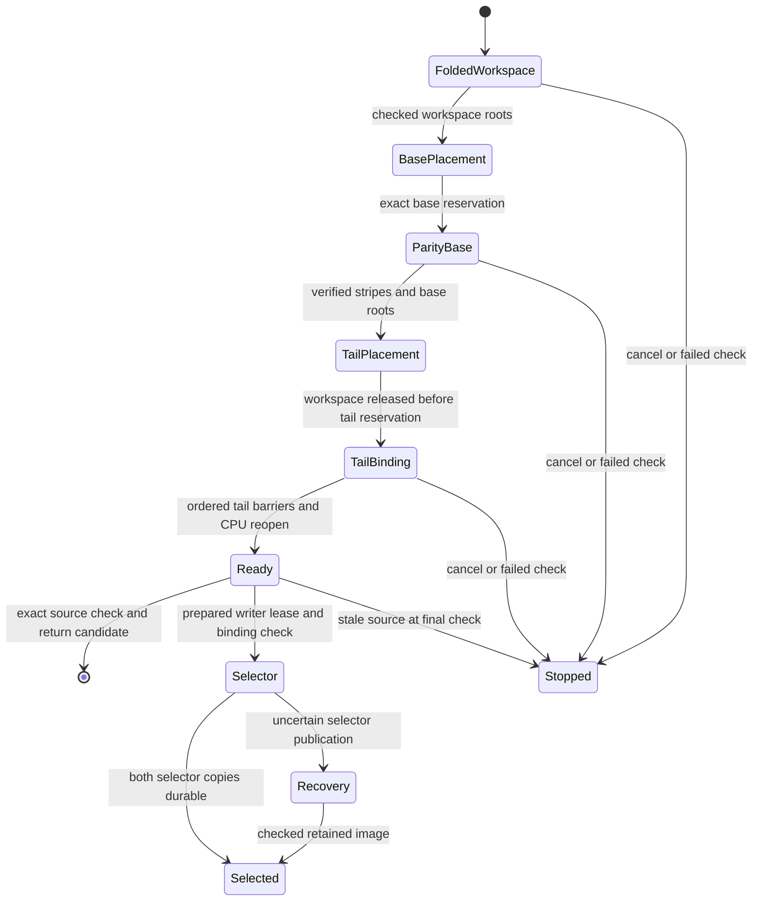

# Sealed indexed images

A detached, immutable FlitzFS image protects packed native data with checked
stripes. It keeps an exact CPU read and restore path while reducing the space
used by the mirrored payload layout. Its current entry point is
`NativeFilesystemSnapshot::create_sealed_indexed_copy`. Windows sessions
continue to use the writable indexed layout. A sealed image can be restored to
a new writable indexed image through `NativeFilesystemWriter::compact` or
`recompress`.

## Layout and interpretation

Use the explicit `NativeImageKind::sealed_indexed` read descriptor with an
admitted maximum physical size. All numeric fields are little-endian. The outer
extent must match the extent recorded in a valid root. The inner stream must be
an exact single-stream paged object store with the same identity. It presents
an indexed native namespace.

Two 128-byte roots start at offsets 0 and 65,536. The first stripe starts at
131,072. The write target supplies a qualified failure unit. The stripe unit is
the larger of that unit and 4,096 bytes. Supported units are powers of two
through 65,536 bytes.

| Root offset | Bytes | Field |
| --- | ---: | --- |
| 0 | 8 | `FLTXSP01` |
| 8 | 8 | Stripe unit |
| 16 | 8 | Inner stream length |
| 24 | 8 | Complete sealed length |
| 32 | 16 | Image identity |
| 48 | 48 | Reserved zeroes |
| 96 | 32 | BLAKE3 of bytes 0–95 |

Each stripe consists of up to eight data units, one descriptor unit and one
XOR parity unit. Only the final stripe may have fewer than eight data units.
The final logical unit is zero-padded. The parity unit is the XOR of all
data units and the descriptor. For `D = ceil(inner_length / unit)` data units,
complete length is `131072 + unit * (D + 2 * ceil(D / 8))`.

| Descriptor offset | Bytes | Field |
| --- | ---: | --- |
| 0 | 8 | `FLTXSD01` |
| 8 | 8 | Zero-based stripe ordinal |
| 16 | 16 | Image identity |
| 32 | 8 | Data unit count |
| 40 | 24 | Reserved zeroes |
| 64 | 32 per data unit | BLAKE3 of each full data unit |
| After unit digests | Through the last 32 bytes | Reserved zeroes |
| Unit size − 32 | 32 | BLAKE3 of the preceding descriptor bytes |

The reader verifies every fetched data unit. A small cache retains digests
from four verified descriptors. Recovery obtains the remaining units,
reconstructs the missing data or descriptor and verifies its digest before
returning bytes. An explicit audit rereads the roots and descriptors and
checks parity. A sound image can still be read if one root is lost. Two
intact roots must agree. The checksums detect damaged bytes and the parity
covers one lost unit per stripe. Recovered damage is reported through
`degraded_checkpoint`. The inner paged store keeps its checked metadata.

### Packed stripe descriptors

`FLTXSP03` uses the same root fields, with the two roots at offsets zero
and one failure unit. The stripe descriptor remains independently checked.
Its record is 352 bytes, including all eight checksum slots and the final
checksum of bytes 0–319. Unused checksum slots in the final stripe are
zero. Each parity unit covers the data units and that stripe's descriptor
record zero-extended to a full unit.

With failure unit `U`, one descriptor unit can hold `P = floor(U / 352)`
records. A group contains up to `P` consecutive stripes, each storing its
data followed by its parity. One shared descriptor unit follows the group.
Records start at multiples of 352 within that unit. The writer clears
unused space. The defined checks cover each referenced record.

For `D = ceil(inner_length / U)` data units and `S = ceil(D / 8)` stripes,
the complete sealed length is
`2 * U + U * (D + S + ceil(S / P))`. All data and parity units remain
separately aligned. Losing a descriptor unit can affect several stripes.
Each affected stripe reconstructs its own descriptor from its independent
parity and data. Two lost units in the same stripe can exceed recovery
coverage. The reader independently verifies the reconstructed record and
refuses unverifiable bytes.

Version 3 is selected by its checked root. The current CPU reader also
opens versions 1 and 2. A reader without version 3 support refuses the new
root. The owned Windows memory factory selects version 3 during ordinary
cold sealing. The detached copy and paired file creation paths retain their
existing format choices while persistent-provider qualification proceeds.

## Publication and restoration

1. Open the closed mirrored checkpoint. Admit a new identity and two separate
   empty backings for the packed workspace and sealed output.
2. Build the checked workspace with the same encoded objects, rebinding the
   native root identity. Verify it independently.
3. Write all stripes to the output. Flush, check all parity and compare the
   logical stream byte for byte to the workspace.
4. Write and flush each root in turn. Reopen the detached image and verify the
   native namespace. The original remains available throughout these steps.
5. Restore into a fresh mirrored target for writable operation. Keep the
   original selected until a future volume coordinator verifies and selects
   a candidate under its own recovered generation rules.

The fixed roots and immutable stripes avoid update-in-place parity after
publication. Separate physical failure domains or independent replicas are
needed for recovery after whole-device loss. Physical qualification must
establish the actual write-failure scope, flush persistence and backing
ownership. See the [storage execution plan](architecture/ADAPTIVE_STORAGE_EXECUTION.md#4-backing-provider-qualification).
[OpenZFS copy-on-write](https://openzfs.github.io/openzfs-docs/Basic%20Concepts/Copy-on-write.html) ·
[Linux RAID parity consistency](https://docs.kernel.org/next/driver-api/md/raid5-ppl.html) ·
[Microsoft ReFS mirror-accelerated parity](https://learn.microsoft.com/en-us/windows-server/storage/refs/mirror-accelerated-parity)

## A sealed base with a writable tail

`NativeHybridBacking` exposes the ordinary mirrored indexed address space over
an immutable base and a separate writable tail. The detached builder plans
the compacted mirror with a new identity and writes one physical copy of each
payload and index unit to the workspace. A read-only view presents the mirrored
offsets for exact CPU checks before sealing. The workspace keeps the complete
131,072-byte root area. Its byte extent is that root area plus half of the
remaining mirrored extent. The sealed stream uses the same mapping, and the
volume selector resolves the bound base and tail as one indexed image.

The tail starts with two independently flushed 128-byte binding records at
offsets 0 and 65,536. Both records describe the same immutable layout.

| Record offset | Bytes | Field |
| --- | ---: | --- |
| 0 | 8 | `FLTXHB01` |
| 8 | 8 | Mirrored unit size |
| 16 | 8 | Original virtual end of the compacted mirror |
| 24 | 8 | Physical length of the sealed base |
| 32 | 16 | Native image identity |
| 48 | 32 | BLAKE3 binding of the two original paged roots |
| 80 | 8 | Admitted virtual capacity |
| 88 | 8 | Reserved zeroes |
| 96 | 32 | BLAKE3 of bytes 0–95 |

The normal mutable roots occupy the next 131,072 bytes in the tail. New data
and index writes append after that region, with the ordinary mirrored store's
barriers and copy-on-write publication. The sealed portion stays immutable.
The builder initializes and flushes both native roots before publishing either
binding record. It independently reopens the result before selection. Healthy
binding peers must agree. A surviving binding or a repaired cold unit supports
CPU readback. The backing reports observed degradation and refuses writable
admission until a verified rebuild supplies a fresh image. A full audit
refreshes binding, descriptor and checked data caches. Four verified data units
can be retained per base between audits.

The builder requires the combined base and initial tail to occupy fewer bytes
than the compacted mirror. `occupied()` counts the physical base and tail.
The native address-space extent still counts logical offsets as mirrored.
Controllers that schedule movement or reclamation need the actual backing
footprint and must also charge the selector, retained generations and scratch.
The existing detached `sealed_indexed` format and its CPU reader remain usable.
[ReFS mirror-accelerated parity](https://learn.microsoft.com/en-us/windows-server/storage/refs/refs-registry-values) ·
[OpenZFS RAIDZ](https://openzfs.github.io/openzfs-docs/Basic%20Concepts/Pool%20Structure/RAIDZ.html)

### Writable backing results

The standard native volume selector and file-session entry points delivered
and independently reopened a cross-extent write. Both layouts use the same
encoded data and the same selector space. The table counts that selector in
the active footprint. The staging column also includes the old image and the
folded workspace held during the current build.

| AIT 2026 split | Active compacted mirror | Active base and tail | Staging coexistence |
| --- | ---: | ---: | ---: |
| A–H | 16,130,048 bytes | 10,612,736 bytes | 35,315,712 bytes |
| I–P | 35,766,272 bytes | 22,880,256 bytes | 77,447,168 bytes |
| A–P | 51,617,792 bytes | 32,788,480 bytes | 111,828,992 bytes |

The full corpus saved 18,829,312 bytes, or 36.5% of the active mirror. Folding
directly reduced the workspace from 51,486,720 to 25,808,896 bytes and saved
25,677,824 bytes while the source, workspace and candidate coexisted. The
matched write added 180,224 bytes to each layout and left the base intact.
On the A–P small-read trace, checked data reuse cut the new layout's backing
traffic from 37,457,920 bytes to 22,532,096 bytes. The mirror read 19,058,592
bytes. These are matched process-local Windows traces with both read orders.

The 4 KiB and 64 KiB failure-unit fixtures replayed 534 tail write and flush
cuts. All reopened the complete old or new bytes. Another 21 binding cuts
preserved the source. Nine injected failures during workspace construction
also preserved the source and reached no base or tail writes. The 4 KiB and
64 KiB trials compared each folded unit with both slots of a separately built
mirror and verified exact capacity admission. Recovery checked one lost cold
or binding unit, rejection after two lost units in one cold stripe, read-only
rescue, and a same-ID base with different frozen roots. Background enrollment,
persistent range placement and mounted performance remain separate
qualification work.
[Folded staging receipt](evidence/folded-hybrid-workspace-2026-11-22.json) ·
[Original writable backing receipt](evidence/native-hybrid-backing-2026-11-22.json) ·
[AIT 2026 dataset](https://aitdcc.github.io/dataset.html)

### Cooperative preparation

A managed external indexed session can prepare the same base and tail while
its selected image continues serving files. The caller sets budgets for the
candidate and for preparation. It can reserve all three private backings at
the start or let the build request the base and tail when their sizes are
known. The same caller accounts for the selector and retained source.

The folded rebuild traverses and checks the existing paged records in bounded
units. It projects the base, tail and workspace before the first output write.
Each seal advance processes one stripe or one publication step. The workspace,
parity base and tail each issue at most one ordered flush per advance. The
candidate reopens through the independent CPU reader after the final tail
binding. The source must still match its exact in-memory checkpoint on each
advance and its checked backing checkpoint when the candidate leaves.
A staged allocator can use `required_store_bytes` to reserve the exact
parity image after the workspace check and the maximum usable tail after
the base check. Sealing releases the build's last workspace pin before
it requests the tail. Returning a store requires a distinct empty backing
with the admitted geometry and the same source checkpoint.
A foreground commit, unavailable backing or cancelled caller releases the
private work. The owner can return the checked candidate for detached use or
publish it on the same managed indexed session with
`NativeHybridBacking::Build::publish`. The caller registers the source and
base/tail mappings and retains their storage. The live path claims the exact
prepared indexed writer, rechecks the two tail binding records and the
sealed roots, and publishes the existing two-slot selector. Uncertain
publication retains both images for exact recovery. Ordinary open file
contexts stay bound to the same inodes across the switch. Provisional and
deletion-pending contexts defer selection.

Selection compares occupied bytes of both the active and prepared images.
An ordinary mirrored compaction also uses the occupied size of a selected
hybrid. Verified capacity repair can still admit a rotation. The caller
accounts for staging space and pinned generations until their actual
retirement. Owned indexed Windows memory volumes now use this path in
ordinary background maintenance. Paired backing files can carry a sealed
selection with a versioned placement in the head. The CPU reader also
accepts older mirrored selections.
[Persistent paired placement](PERSISTENT_VOLUME_FILE.md#sealed-paired-images)
[Windows write barriers](https://learn.microsoft.com/en-us/windows/win32/api/fileapi/nf-fileapi-flushfilebuffers) ·
[ReFS parity rotation](https://learn.microsoft.com/en-us/windows-server/storage/refs/mirror-accelerated-parity)

The full 16-file AIT 2026 fixture reopened byte for byte after 4,071 advances.
It kept the same 111,828,992-byte staged footprint as the earlier detached
build. The mixed 4 KiB and 64 KiB fixture completed verified selection and
refused stale work both during sealing and after completion. It also stopped
before the next tail write when the backing contract became unavailable, and
refused insufficient staging capacity before writing any candidate bytes.
[Cooperative preparation receipt](evidence/cooperative-hybrid-preparation-2026-11-22.json)

The live test on AIT DCC 2026 files A–P selected a 32,657,408-byte base and
tail over the mirrored 51,486,720-byte address space. Preparation coexisted
with the source and retained 111,828,992 bytes across both images, the
selector and workspace. Once ready, the switch read 464,446 backing bytes
and issued two selector writes and two barriers. The same open handle
continued reading. An independent CPU reopen from the retained bytes checked
all 16 files. The model also recovered both selector outcomes in 24
write and flush fault cases across 4 KiB and 64 KiB failure units.
The tests exercise a live native session with memory backings.

The public input is described in *The 2026 Algorithmic Information Theory
Data Compression Challenge*.
[AIT DCC dataset](https://aitdcc.github.io/dataset.html) ·
[Live selection and fault evidence](evidence/live-hybrid-selection-2026-11-22.json) ·
[Btrfs balance](https://btrfs.readthedocs.io/en/stable/Balance.html) ·
[OpenZFS scrub and resilver](https://openzfs.github.io/openzfs-docs/Basic%20Concepts/Operations/Scrub%20and%20Resilver.html)

### Reads during capture and tail writes

A hybrid can issue the existing leased snapshot reads when the sealed base
and writable tail both support concurrent reads. The lease holds the
selected image and immutable indexed records while ordinary file I/O
continues. Read-ahead keeps its existing checkpoint and content checks.

The sealed reader keeps four checked descriptor entries and four checked
data units. Cache lookups and publication run under a short lock. Backing
reads, digest checks and parity reconstruction run outside it. An explicit
audit clears the caches and prevents older in-flight reads from inserting
their results after that clear. Observed damage is recorded across readers.

Capture cancellation stops at a checked read boundary or after an issued
Windows request retires. That result ends capture without a parity retry or
a damage report. A real stripe failure still follows the CPU recovery path.
[Sealed AMD read verification](evidence/sealed-amd-read-captures-2026-11-23.json) ·
[Microsoft thread resource priority](https://learn.microsoft.com/en-us/windows/win32/api/processthreadsapi/nf-processthreadsapi-setthreadpriority) ·
[Windows cancellation and request lifetime](https://learn.microsoft.com/en-us/windows/win32/api/ioapiset/nf-ioapiset-cancelioex)

The owned Windows memory controller also prepares and selects the image
with the SDK dispatcher callbacks active. A file opened before selection
continues to serve verified AMD and CPU reads. The retired volume can
reopen for ordinary writes and the independent CPU reader verifies the
edited bytes.
[Automatic placement and readback](evidence/automatic-memory-sealing-2026-11-23.json)

## Verification on Windows

The test creates and reopens real indexed images on instrumented memory
backings. It recovered 109 individual root, data, descriptor or parity unit
losses across 4 KiB and 64 KiB geometries. Two lost data units in one stripe
failed closed. Of 51 interrupted write and flush cases, 43 detached outputs
had no selectable root and eight reopened with exact data. The prior image
remained recoverable in every case. The CPU restore test successfully appended
a write and reopened the result as a mirrored image.

| AIT 2026 files | Logical bytes | Mirrored image bytes | Sealed image bytes |
| --- | ---: | ---: | ---: |
| A–H | 13,136,308 | 15,998,976 | 10,240,000 |
| I–P | 25,153,011 | 35,635,200 | 22,523,904 |
| A–P together | 38,289,319 | 51,486,720 | 32,440,320 |

All nine Windows trials reopened every file byte for byte. For A–P, the
complete sealed allocation is 37.0% smaller than the already compacted
mirrored image. The change comes from protection and packing. Both images
use the same existing encoded file objects. On the pilot's small-read trace,
the verified descriptor cache lowered backing traffic from 53,272,576 to
36,024,320 bytes, versus 19,058,592 bytes for the mirrored image. The test
always reads that mirror first. The recorded elapsed times describe these
process-local runs. Mounted performance and physical durability require their
own measurements. Windows codec and raw-only suites passed 206 and 205 tests.
The focused ASan run passed the runtime preflight and both storage tests. A
separate ASan pass verified the complete AIT workload.
[Trial and source receipt](evidence/sealed-indexed-images-2026-11-22.json) ·
[AIT 2026 dataset](https://aitdcc.github.io/dataset.html)
