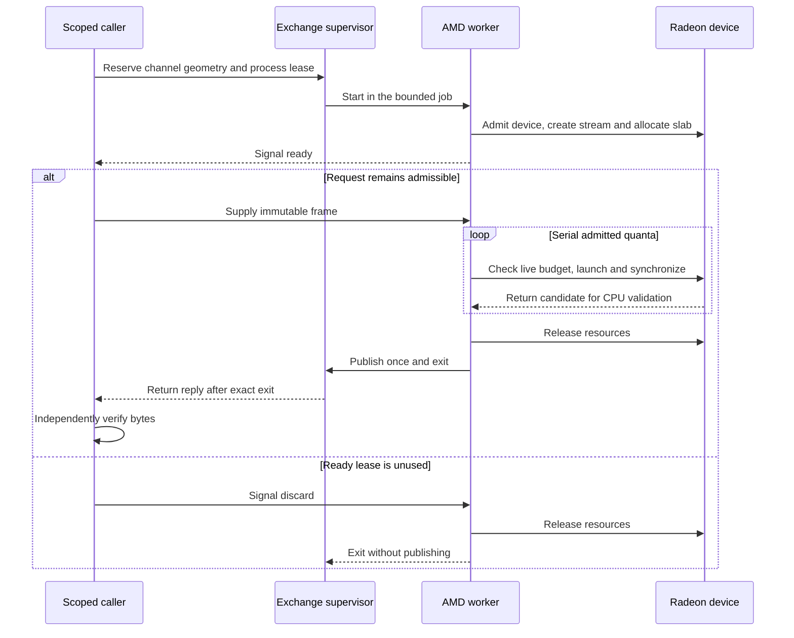
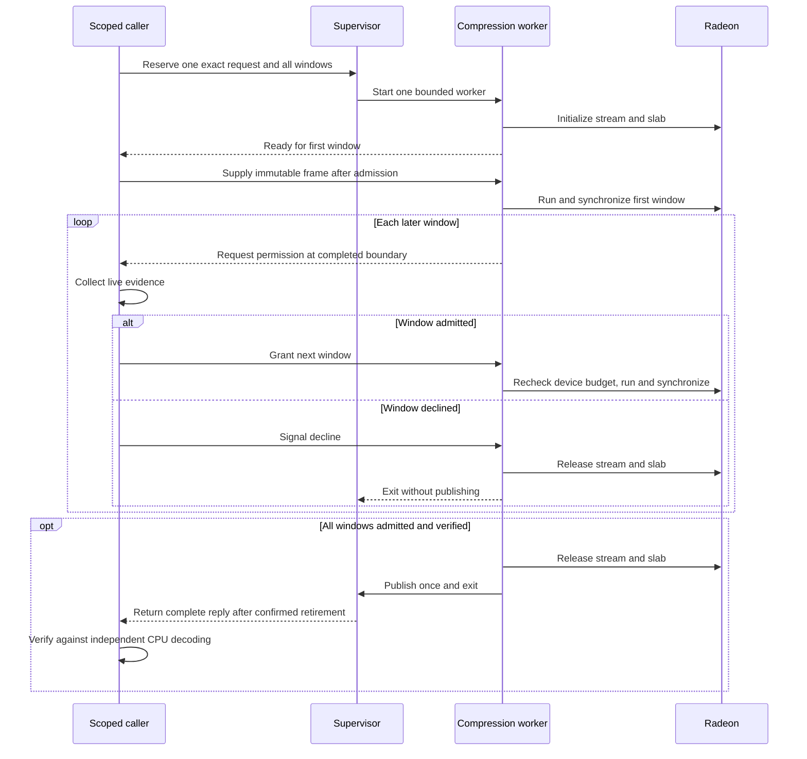

# Process-isolated worker communication

Research and implementation date: 8 November 2026.
Baseline: `2996b7b319aa92d28e0df71b17d6bf1dda4f957e`.
This is initial development; the repository owner decides when to release.

## Goal and scope

Connect the bounded batch representation to a separately supervised process
without exposing application files, requiring a GPU, or adding a persistent
service. The existing CPU reader remains independent. This change does not
load HIP, execute a kernel, automatically route filesystem reads, or claim
GPU performance. The worker test explicitly executes CPU semantics.

## Plan and research decisions

1. Inspect the existing batch/gate contracts and Windows process supervisor.
   Reuse its creation-time Job Object, no handle inheritance, one-process limit,
   memory/CPU ceilings and confirmed termination result. Do not invent another
   process-launch path or silently relax limits.
2. Keep messages bounded and independent of native structs. Transfer only
   request identity, block descriptors, payload, statuses and output. The helper
   reconstructs its own PreparedGpuBatch and independently validates the frames.
3. Choose pagefile-backed mappings rather than temporary application files,
   inherited handles or an unbounded pipe reader. Use unpredictable local-session
   names, explicit current-user protected DACLs, non-inheritable handles and
   create-only collision checks. Do not use the privileged global namespace.
4. Publish a length only after bytes are written. The parent waits for confirmed
   successful process exit before inspecting the response; a ready flag cannot
   authorize concurrent reading or acceptance of a later-failing helper.
5. Before returning decoded bytes, check the requested execution backend, exact
   request identity, every status and byte equality with the retained independent
   CPU reference. Exercise partial publication, corrupt headers, stale identity,
   wrong backend, timeout, failure after publication and guard corruption.
6. Retain the existing no-GPU and no-mount default tests; add a real Windows
   child-process test on hosted CI. A CPU helper test is not a HIP-worker test.

Microsoft documents that CreateFileMapping may OPEN an existing named object;
ERROR_ALREADY_EXISTS must be rejected, not interpreted as exclusive creation.
The mapping uses INVALID_HANDLE_VALUE, so no existing application file can be
extended by mapping creation. PAGE_READONLY views prevent normal writes through
the helper's request view. Named mapping objects do not themselves provide a
synchronization wait; successful child termination supplies that boundary here.
Interlocked publication supplies a full memory barrier, but alone is not a
license to consume bytes from a still-running process.

AMD documents that runtime cleanup can synchronize with outstanding work.
The GPU result deadline is not a driver kill switch. A future HIP helper must
collect its OWN process-specific memory telemetry; the parent's DXGI usage is
not a substitute for the allocating child's usage. The current tests collect
no live GPU telemetry and do not weaken the existing result gate.

## Portable message contract

Both messages have a fixed 32-byte little-endian header. Requests use FLZREQ
and responses FLZRSP, each followed by two zero bytes. The next eight bytes
hold a nonzero request identity. Headers and block records reserve fields that
must remain zero. Unknown encodings, trailing bytes and truncated frames fail.
There are no raw pointers, paths, native structs or CPU-reference bytes on wire.

A request holds a block count, total payload/decoded extents, and one 12-byte
record per block: kind, fill, reserved bits, decoded length and stored length.
Payloads follow densely in record order. Before proportional allocation the
parser admits the complete framing and each extent. Preparation retains the
existing eight-block, 64 KiB/block, 256 KiB total-output ceilings and supported
six-codec subset. The maximum request frame is 262,272 bytes.

A response identifies CPU-semantic or HIP execution, task count, output length,
and one status per task before the output. The maximum response frame is
262,464 bytes. This execution tag is a declaration from a TRUSTED helper, not
cryptographic proof of hardware execution. accept_worker_reply rejects a backend
mismatch, stale identity, missing/pending/failed tasks, unequal bytes or malformed
framing before returning any candidate output. GPU acceptance additionally needs
the existing timing and hardware-budget gate; this change does not bypass it.

## Windows exchange and resource ownership

run_worker_exchange is an explicit internal API, not called by the CLI or mounted
filesystem. It starts the exact supplied trusted executable without a shell and
appends a fixed worker marker plus a random 128-bit channel identifier. No data
paths, credentials or private source content are added to the command line.
A process-wide try-lock refuses a second simultaneous exchange without queuing.

The two fixed-size, non-executable mappings occupy a total of 524,800 bytes
including transport headers/guards, before page rounding. This is separate from
private copies, runtime overhead and the child process limits. Admission checks
physical and commit headroom for the child allowance plus mappings and a 512 MiB
reserve before mapping creation. This snapshot is not a physical reservation.
The reused supervisor applies its default 128 MiB committed-memory and 20% CPU
limits, one active process, below-normal priority, bounded wait and up to two
additional seconds to confirm timeout termination. OS calls can still block.

The parent copies the request before launching; the helper receives a read-only
view and makes its own private copy. The response length starts at a pending
sentinel. Publication claims that sentinel atomically, copies within its fixed
capacity and finally publishes the length. Double publication is rejected.
No HIP cleanup runs in this transport. On timeout, unsuccessful exit or
unconfirmed termination, no response bytes are returned. For successful exits,
the parent checks transport headers, guards, request immutability and response
length before copying. The caller must still use accept_worker_reply.

Mappings, views, descriptors and process handles have scoped cleanup on success
and exceptional paths. A new explicitly requested exchange can run after a
failed CPU fixture; there is no automatic retry loop. This does not permit a
future poisoned HIP session to restart without its separate admission policy.

## Threat model and unfinished work

The executable and its containing directories must be trusted. The random
name and current-user DACL isolate ordinary accidental/cross-user access, not
hostile same-user processes, administrators, injected code or hostile drivers.
Tests deliberately demonstrate that same-user write access can reopen a named
object; unchanged-input/reference checks detect their test mutations. This is
not an encryption or security-sandbox feature. Pagefile-backed data may be paged
by Windows; memory-only here means no application-managed temporary data files,
not a guarantee that plaintext never reaches storage.

There is no public GPU worker binary, native runtime loader, hardware-budget
handshake, low-latency persistent worker, actual HIP dispatch, GPU-enabled mount,
or performance result. Process startup allowance is not the per-batch GPU
result deadline. Hardware execution and cleanup still require separate isolated
qualification; process resource limits cannot promise a healthy kernel driver.

## Executed checks before publication

The baseline passed its 16 portable CTest entries. The new wire suite passed
705 assertions, including exact six-codec/empty-payload/full-cap round trips,
all truncations of a small frame, every one-byte reply mutation, deterministic
request mutations, wrong backend/identity, over-limit sizes and failed statuses.
All 17 portable entries passed in codec-enabled, external-codec-disabled and
Clang AddressSanitizer/UndefinedBehaviorSanitizer builds: 51 test executions.
Hosted Windows outcomes require their matching CI run; no Windows success is
inferred from Linux tests.

The Windows test launches only its own executable. It checks cross-process byte
parity, actual read-only views and protected single-user DACLs, job settings,
invalid transport metadata, double publication, failure/timeout after publication,
new explicit exchange after timeout, rejection of malformed tokens and bounded
handle accounting. It creates no application fixture files and loads no GPU.

## Primary sources

- https://learn.microsoft.com/en-us/windows/win32/api/memoryapi/nf-memoryapi-createfilemappingw
- https://learn.microsoft.com/en-us/windows/win32/memory/creating-named-shared-memory
- https://learn.microsoft.com/en-us/windows/win32/memory/file-mapping-security-and-access-rights
- https://learn.microsoft.com/en-us/windows/win32/api/memoryapi/nf-memoryapi-mapviewoffile
- https://learn.microsoft.com/en-us/windows/win32/api/synchapi/nf-synchapi-waitforsingleobject
- https://learn.microsoft.com/en-us/windows/win32/api/winnt/nf-winnt-interlockedexchange
- https://learn.microsoft.com/en-us/windows/win32/api/bcrypt/nf-bcrypt-bcryptgenrandom
- https://rocm.docs.amd.com/projects/HIP/en/latest/doxygen/html/group___memory.html
- https://rocm.docs.amd.com/projects/HIP/en/latest/reference/hip_runtime_api/modules/stream_management.html

Related repository contracts: HIP_BATCH_PLAN.md, PROCESS_ISOLATION.md, and the
existing source-pinned FlitzZip study. No other repository is changed.

## Asynchronous sessions and independent CPU completion

WorkerExchangeSession now provides an explicit supervisor/controller API.
start clones bounded input and starts one lowest-priority supervisor thread.
try_result performs an acquire-load and returns either pending or an immutable
transport result; it does not wait, query an adapter, terminate a job or run
driver cleanup. The independently prepared GpuResultGate can select CPU bytes
while that session and its exact helper remain alive. Selecting CPU remains
terminal for the gate, including a subsequently correct late reply.

request_cancel signals a private unnamed event. The SUPERVISOR waits for child
exit or that event, performs job termination if needed, and retains the existing
two-second exit-confirmation allowance. Cancellation racing normal completion
cannot authorize a transport response if observed before publication.
Cancellation after publication does not rewrite an immutable result; the
caller's terminal CPU-selected gate still rejects a late candidate.

ProcessObserver retains the original process HANDLE, allocated with its event
before launch; it never reopens a PID. Observers are single-launch, and the PID
is published only after exact-handle ownership is established. An incomplete
retirement keeps one bounded supervisor waiting on that same object. Failed
observation disables admission instead of busy-polling an invalid handle or
creating replacement workers. No timer or changed configuration proves exit.

Destroying or moving a session neither joins the supervisor nor frees its live
protocol buffers. Shared ownership retains input, mappings and observation
through the background operation. Admission requires BOTH confirmed exact-child
retirement and signalled exact-supervisor-thread exit. The coordinator retains
one thread-observation handle and reaps it with a zero-time query on subsequent
explicit admission/status checks. Thus repeated completions cannot accumulate
a tail of retired-but-still-running supervisor threads. There is no queue.

The synchronous run_worker_exchange API is an adapter over this same mechanism.
An optional stop token lets an owning metadata task cancel its exact child
through the existing process observer. A request stopped before admission
returns without a worker.
It preserves exception reporting and allows at most two additional seconds for
its already-retired supervisor to exit before returning ordinary completed
results. Missing supervisor-thread confirmation produces the explicit
supervisor_exit_unconfirmed code and no response bytes; admission remains held.
An unconfirmed-retirement result can return while separate supervision continues.
retirement_confirmed itself checks both process and supervisor-thread retirement
with a zero-time thread observation, so policy callers cannot mistake child exit
alone for full supervisor retirement.

All wire, payload, mapping, child memory/CPU, creation-time assignment and
headroom gates remain. Admission additionally accounts for two private request
copies, one reply and a 4 MiB supervisor/overhead allowance, beyond mappings and
the existing 512 MiB reserve. This is conservative snapshot admission, not a
physical-memory reservation or a hard cap on the containing application.
Completed session results retained by an external caller remain caller-owned;
a filesystem coordinator must bound their lifetime/queue as well.

New hosted Windows fixtures cover asynchronous actual byte parity, moved-from
ownership, cancellation, launch failure, rejection of overlapping starts,
abandonment with continued supervision and byte-exact CPU selection while the
exact helper is still live. These tests execute CPU semantics only. Their
exact-commit outcomes must be inspected before calling this source qualified.
Unconfirmed kernel/driver retirement and real HIP dispatch remain unqualified.

This is a transport/lifetime primitive. Production integration with
GpuRecoveryPolicy, runtime/package identities, discovery, AMD telemetry, an
actual HIP worker and filesystem routing remains unfinished. No normal CLI or
mounted read launches this session. The process-source Crawl4AI capture group
records the official multiple-wait, CRT-thread, thread-priority and handle-close
sources alongside the separately retained durability captures.

## First-use native error accounting

The first Windows checkpoint passed asynchronous byte/fallback/cancellation/
abandonment checks but failed its unchanged zero-growth handle assertion after
the new missing-helper route. A separate process probe that imports no transport
measured one handle added by the FIRST FormatMessageA call: 69 to 70 in static
runtime and 70 to 71 in the native lane. Eight further formatting calls,
exception capture/release, and nine sequential error threads stayed flat.
Microsoft's STL system_error implementation calls that same Windows formatter.

The warmup therefore now exercises BOTH actual successful and missing-helper
transactions before the strict handle baseline. Four additional real failed
launches and the existing repeated successful/fault cases must retain the
zero-growth assertion. There is no increased tolerance. The synchronous adapter
also reaps its confirmed coordinator thread-observation handle immediately;
asynchronous ownership still persists until exact retirement. The diagnostic
mode requires explicit resource admission and runs in a SEPARATE process from
the transport test. Hosting flags are not admission evidence.
Exact corrected-commit results remain required before qualification.

## Recovery policy connected to explicit requests

GpuWorkerController now composes this transport with GpuRecoveryPolicy and a
fresh result gate per admitted attempt. CPU selection remains independent of
cancellation; exact child/thread retirement releases the corresponding policy
ticket. A new CPU request can proceed while an older helper retires, while
another worker remains forbidden. GPU_WORKER_CONTROLLER.md specifies terminal
selection, failure classification, bounded ownership and external trust
prerequisites. Hosted tests still run CPU helpers only; real HIP dispatch,
qualified discovery/provisioning and normal filesystem routing remain absent.

CPU result selection and final worker-outcome reporting are separate. A pending
ticket keeps the old gate/reference/generation until immutable late output can
be classified, even if a later CPU request replaces foreground bytes. Late
unavailability/corruption strengthens configuration suppression without changing
terminal CPU data or double-counting failures; retirement still requires both
exact child and supervisor. This bounds one old gate plus one current CPU batch.

## Match frames

The generic channel can carry the separate match frame without enlarging its memory mappings. Match requests contain an exact source digest and at most 64 KiB of owned bytes. Replies contain at most 4096 explicitly serialized 8-byte lane records. Parent byte validation and actual child/supervisor retirement remain required. The Windows CPU fixture connects these frames to real native-session publication and tests fallback while a held helper remains live. No ordinary operation starts a worker automatically.

## Identity metadata frames

The explicit installed-runtime identity diagnostic uses a separate 40-byte
request/reply kind described in HIP_IDENTITY_METADATA.md. Existing mapping caps,
protected local-session objects, failure-empty output and confirmed successful
child exit remain required. Metadata is not a decoder candidate and cannot pass
the normal byte-reply acceptor. CPU transport fixtures do not establish HIP
execution; normal file operations still never launch a worker.

## Explicit memory-observation metadata

GPU_MEMORY_OBSERVATION.md defines a private fixed 256-byte reply for one explicit
SDK diagnostic using the existing bounded decode request. Its distinct magic,
request/adapter/allocation binding, completed-step flags and three serialized
snapshots cannot pass a normal data-reply acceptor. The trusted child may report
a typed computation refusal through a successful metadata exit only after module
retirement; the parent still requires actual successful process/supervisor exit.
No candidate bytes are returned, admission rules changed, runtime retried or
normal filesystem routing enabled. A CPU fixture declaring flags is transport
evidence only, not GPU execution or driver-cleanup evidence.

## Bounded LZ4 candidate messages

[LZ4_WORKER_FRAMES.md](LZ4_WORKER_FRAMES.md) defines the new distinct message kind.
Preparation owns up to eight admitted chunks and the complete existing device
layout. Source identity covers count, sizes and plaintext. Producer and parent
both CPU-decode every candidate against their own source before copying it.
Missing optional decoding refuses explicitly. The 262244/262272-byte frame caps
fit existing mappings; no transport limit, process/thread path or retry changes.

The new Windows fixture uses only its own trusted CPU test binary and the same
channel/job constraints. It covers success, absent decoding, malformed input,
corrupt candidate and failure after publication, with unchanged exact retirement,
closed mappings and zero-growth handle checks. New-source execution is pending.
Neither those CPU semantics nor backend declarations establish actual GPU work.
Normal operations still never launch a worker or load the private candidate DLL.

## Packed XOR advice batches

Packed XOR reuses the bounded shared-base batch and its verified source
windows. Window ABI 3 retains the version 1 batch and group tags and 16 KiB
member slots. Window ABI 4 uses version 2 of `FLFSABQ` for the batch request,
`FLFSAXP` for the batch reply and `FLFSAXG` for each reply group. It reserves
64 KiB per member. The worker verifies the request version, slot stride,
identities, plan counts and original source digests before use.

Each slot starts with a four-byte little-endian body length, followed by
the packed body and `0xff` padding. A zero length declines the candidate.
The sized transport charges the exact request and reply sizes, including
copies. The ABI 4 device slab includes the base, current members and output
slots. Its launch grant counts only the XOR dispatches.
The controller derives each grant from current host and device headroom.

Reply decoding validates the envelope and slots after successful exact-child
exit and supervisor retirement. The controller keeps the ticket active while
the writer checks each nonempty body against its exact staged member. Incorrect
bytes or framing quarantine the configuration and release the other replies.
A yielded or obsolete window abandons the remaining checks. Empty slots decline
advice and the writer proceeds on CPU.
[Packed XOR native admission](INDEXED_NATIVE_VOLUME.md#batched-amd-advice)

## Resource-sized transport (experimental)

The new explicit `WorkerExchangeSession::start_sized` and
`WorkerChannel::open_sized` routes accept exact request/reply capacities chosen
for a resource-admitted window. They share the SAME process-wide admission lease,
supervisor, cancellation, process observer, protected create-only mappings,
immutable input comparison and successful exact-child-exit rule. They create no
queue or persistent service. Legacy entry points, fixed payload frames and their
wire bytes remain unchanged.

The supervisor owns one immutable request snapshot before its thread starts.
Sized callers can share an existing snapshot. A producer that moves a private
allocation into a snapshot relinquishes all writable aliases. The child copies
its read-only mapping once and can move that private allocation to its parser.
The shared-base batch validates each group and keeps views into that allocation.
The supervisor compares the original request with the mapping after confirmed
child exit and before returning the reply.
[Windows mapping access and coherency](https://learn.microsoft.com/en-us/windows/win32/api/memoryapi/nf-memoryapi-mapviewoffile)

The shared-base caller can pass the verified package lease with its immutable
snapshot. The supervisor owns that lease while it runs. The serialized volume
owner can also borrow the exact supervisor wait handle while retaining its
session. It separately checks child retirement after the supervisor wakes it.
[Owned Windows controller](WINFSP_OWNED_CONTROLLER.md#amd-shared-base-search)

Shared-base producers validate the complete plan before starting the batch
builder. Each append copies one base and its member extents directly into
the final frame and digests the copied bytes. The builder moves the frame
into an immutable snapshot and binds typed views to those same bytes. The
receiving worker independently checks geometry, the enclosing digest and
the nested request digests using the existing format.

The sized transport uses distinct request/reply magic and control version 2.
The channel exposes its checked physical and commit requirement before
construction. The shared-base probe includes its own pending preparation
footprint when using this estimate. Both channel endpoints still sample
live memory during admission.

Capacities must fit the signed publication-length representation and their
complete accounting (three request copies, two reply copies and guards) must
fit half the enforced child's committed-memory allowance. Mapping sizes are
never inferred from untrusted shared control fields. The child must independently
receive its exact expected capacities and verify the existing single-process,
kill-on-close process/job memory limits before opening either mapping. The
actual codec-frame parser and independent CPU reference check remain required.
This transport alone is not a new compression message format or GPU execution.

Before proportional copies or launching the supervisor, the parent rechecks
current physical AND commit headroom, including the child allowance, all parent
copies, 4 MiB supervisor overhead and a separate 512 MiB reserve. Sized work may
use at most the selected share (at least divisor 16) of the remaining headroom.
The supervisor repeats that check before mapping creation; the child repeats
admission before mapping/copying. Snapshots are admission observations, not
physical reservations or protection against a kernel fault.

`ProcessBudget::memory_share_divisor == 0` keeps the historical 64..256 MiB
fixture profile. The explicit resource profile removes that absolute MiB
ceiling: `plan_resource_process_budget` rounds the configuration-qualified
COMPLETE child peak upward and compares it with both fresh memory pools. Unknown,
zero, overflowing, insufficient or unsafe-share inputs refuse without allocation.
The launch supervisor independently rechecks the selected share and enforces the
exact resulting process/job bytes at creation. CPU scheduling and process-lifetime
controls remain independent; extra memory never authorizes a longer kernel or
more concurrent processes. Product runtime peak calibration and actual adaptive
GPU routing remain unfinished.

Explicit CPU fixtures transfer 3,145,765 request bytes and 2,097,223 reply
bytes, compare the entire reply, and reject incompatible legacy/capacity framing,
corrupt guards, failure after publication, double publication and cancellation.
They check the same exclusive admission, exact retirement, closed mappings and
zero-growth handle baseline as the legacy suite. Those sizes are TEST fixtures,
not product caps or assumed host specifications. Exact-source CI outcomes are
required before qualification; no owner-PC execution is authorized by these tests.

## Wider AMD copy dispatches

An approved copy-search profile can admit more member extents to each
kernel dispatch. The wide request and reply use `FLFSABQ\7` and
`FLFSABP\2`. The queued timing record uses `FLHPB006`. The worker
requires the typed version 11 window entry and checks its actual device
grid and thread limits. The parent sizes each dispatch from the approved
ceiling, the available memory and the staged group. Nested copy records
use the existing 32-bit coordinates and independent byte checks.

One worker reuses index storage, a stream and a transfer slab for all funded
groups in its immutable request. Results remain private through complete
worker retirement and independent CPU verification. A worker that
refuses the wider request leaves the original inputs available to CPU
grouping. Profiles without an approved dispatch ceiling use version 2.
[Installed profile](AMD_RUNTIME_DISCOVERY.md#shared-base-package-profile) ·
[Wider dispatch evidence](evidence/amd-wide-copy-dispatch-2026-11-20.json)

## AMD packed-XOR startup measurements

The wide packed-XOR diagnostic supports a setup profile with the
`FLHPB004` marker. It records the host time spent in the HIP stream creation
and slab allocation calls within the existing combined setup phase. The
verifier binds both times to the original request and adapter and rejects
durations that exceed the recorded setup phase. Diagnostics use the existing
supervised exchange, require confirmed worker exit, and verify candidate bytes
on CPU before comparing timings. The original `FLHPB002` and `FLHPB003`
profiles retain their original layout.
[Startup evidence](evidence/amd-anchor-stream-setup-2026-11-19.json)

## Compact sparse XOR exchange

The sparse XOR batch uses request tag `FLFSABQ\4` and reply tags
`FLFSASP\1` and `FLFSASG\1`. Each group has an exact length and each member
has a checked length followed by its sparse XOR body, or a zero length
for a refused candidate. Capacity admission still uses full member slots.
The slot entry checks lengths and padding before compacting them. The arena
entry places a word count and an ordered directory of offsets and byte
lengths at the start of the admitted result region. Workgroups use one
32-bit atomic reservation per nonempty body. The worker waits for its
stream, reads the directory and validates all populated ranges before
copying the used payload. The ranges must cover the used prefix exactly.
The worker checks alignment padding and restores member order in the reply.
An inconsistent directory ends the exchange as an integrity failure.
[HIP device functions](https://rocm.docs.amd.com/projects/HIP/en/latest/how-to/hip_cpp_language_extensions.html) ·
[HIP stream management](https://rocm.docs.amd.com/projects/HIP/en/latest/reference/hip_runtime_api/modules/stream_management.html)

Both device entries put the same request and source digests in the
same reply format. The parent verifies framing and confirmed worker
retirement. The writer independently verifies decoded bytes before
publication. The `FLHPB005` diagnostic binds the stream/slab timings,
readback byte count and device result layout to the request, geometry and
adapter. Readback includes directory bytes and the aligned payload.
[Sparse XOR format](INDEXED_NATIVE_VOLUME.md#sparse-xor-members)
[Matched transport measurements](evidence/amd-direct-sparse-xor-2026-11-19.json)
[Physical readback measurements](evidence/amd-sparse-device-readback-2026-11-19.json)

## Mixed-codec batch

The mixed batch uses request tag `FLFSABQ\5` and reply tags `FLFSACP\1`
and `FLFSACG\1`. Kernel ABI 9 uses the checked arena layout. Every nonempty
member body starts with a little-endian 32-bit codec identifier, followed
by the existing candidate bytes. Identifier 1 selects sparse XOR and
identifier 2 selects modular delta. A zero-length member defers to CPU.
Unknown identifiers, mismatched body lengths and invalid directory
ranges reject the exchange.

One workgroup evaluates both candidate sizes against the uploaded base.
It compares the bytes the indexed volume would store, accounting for the
modular parameters that fit inside the common member header. An exact
modular bias fills that header alone, so the workgroup can skip the sparse
size pass in that case. The workgroup writes only the selected body.
Live device admission includes the shared memory for both encoders.
All existing stream, transfer and dispatch checks apply to the combined
work, and the parent waits for confirmed retirement before consuming it.
[AMD performance guidelines](https://rocm.docs.amd.com/projects/HIP/en/latest/how-to/performance_guidelines.html)

The native writer strips the private codec identifier, reconstructs the
member on CPU and compares it to the owned input. Alternative CPU codecs,
revision validation and the full compacted-size check govern publication.
[Mixed-codec validation](evidence/amd-mixed-codec-selection-2026-11-19.json)

## Full-tile reference pricing

Request tag `FLFSABQ\6` admits sparse-XOR reference pricing over complete
resident groups. Reply tags `FLFSARP\1` and `FLFSARG\1` carry sparse bodies
with a reference member number in each group header. Zero denotes the
original base. The remaining numbers identify the staged members in their
request order. The decoder checks each number against the deterministic set
of candidates derived from the launch grant.

The planner charges the encoding launches and each preceding pricing pass.
Pricing includes the original base in every comparison, including a pass
that considers another member as the base. The number of candidates depends
on the available launches and group sizes. The owner uses the ordinary
sparse route if the launch grant or complete resident input cannot admit
reference pricing. Device entry ABI 10 writes one checked price per peer.
The worker selects the lowest sum and uses ABI 8 to encode against it in
the same stream. It transfers only the used sparse bodies. [AMD HIP
reduction guidance](https://rocm.docs.amd.com/projects/HIP/en/latest/tutorial/reduction.html)

The native writer applies a selected reference to a complete new group
before preparing any member frames. It retains the original base as a member
and independently verifies the input, decoder results and live identities.
The complete protected compacted-size comparison governs publication.
[Indexed shared-base format](INDEXED_NATIVE_VOLUME.md#automatic-candidate-discovery)
[Full-tile reference measurements](evidence/amd-full-reference-pricing-2026-11-19.json)

## Qualified waits in copy-search exchanges

The indexed Windows owner can use the existing `FLHPB002` phase record
with a qualified copy-search queue. The record is a fixed-size trailer in
the sized reply. Its identity includes the request digest, the transfer
geometry and the dispatch count. The controller admits the trailer within
the same transport and resource budgets. It checks the record before
verifying the copy ranges against the immutable request. A malformed
record follows the existing integrity-failure path.
[Owned controller](WINFSP_OWNED_CONTROLLER.md#amd-shared-base-search) ·
[AMD performance guidance](https://rocm.docs.amd.com/projects/HIP/en/latest/how-to/performance_guidelines.html)

## One-request prepared exchange

The prepared sized exchange uses channel control version 3. The parent creates
two fixed-capacity mappings and two initially unsignalled manual-reset events.
The child opens the request mapping read-only. It signals readiness after the
setup delegated by its adapter. The parent can then supply the exact-size
immutable snapshot once. Both modes share the same process-wide lease and
creation-time job. Readiness can be observed independently of the existing
success and retirement boundary.

The worker copies the request into private storage before decoding it. The
parent still verifies its immutable input and reply extent after exact child
exit. The caller independently verifies decoded bytes before accepting the
result. If the ready lease is no longer useful, the parent can send a discard
marker before supplying data. The child retires its resources and exits without
publishing. Cancellation during setup or submitted work keeps the existing
bounded stop path. Fresh admission requires the exact child and supervisor to
retire. The qualifying caller can now run the prepared exchange with a live admission
check at readiness. Stop or refusal cancels the exchange before the frame is
supplied. The same exact-child and supervisor retirement checks govern both
the prepared and immediate sized exchanges.
[Detached native write trial](OWNED_DEFERRED_WRITES.md#detached-radeon-write-trials)

A readiness wait duplicates the event handle and observes the exact supervisor
as well. This keeps the waiter valid while the supervisor releases its channel
handles. [Microsoft event creation](https://learn.microsoft.com/en-us/windows/win32/api/synchapi/nf-synchapi-createeventw) ·
[Microsoft wait semantics](https://learn.microsoft.com/en-us/windows/win32/api/synchapi/nf-synchapi-waitformultipleobjects) ·
[Microsoft mapping access](https://learn.microsoft.com/en-us/windows/win32/api/memoryapi/nf-memoryapi-mapviewoffile)

### Bounded grouped read preparation

The grouped read preparation uses control version 7. The parent and child
independently bind fixed maximum request and reply sizes. The parent can
queue one immutable request within the bound while the child initializes.
The child checks both mappings when it opens them and copies only the exact
published request after its initial setup completes. A queued request
cannot be replaced. A superseding foreground read or failed capture can
cancel the lease, which releases unused resources and discards late output.
The supervisor supplies bytes only after successful, confirmed child exit.
The application then verifies the reply's exact length, request identity
and decoded data. Existing exact-size and repeated channels retain their
previous controls.
[Prepared grouped-read evidence](evidence/windows-prepared-group-worker-2026-11-24.json)

## Admission between windows

The experimental windowed prepared exchange uses control version 4. The caller
supplies an exact window count and the same immutable request for the entire job.
The first admission attaches its bytes. Each later admission authorizes work on
the next part of those bytes. One child owns the initialized device, stream and
slab throughout. The child finishes transfer, synchronization and verification
for the current window before it requests the next one.

The endpoints reuse the readiness and supply events. The parent resets
readiness before granting permission. The child resets supply before it asks
again. A separate decline event lets a paused child release its device resources
and exit without publishing. The caller may revoke a running request through the
bounded supervisor. The job deadline covers the complete exchange.

Acceptance requires the expected number of permits, exact successful child
exit, confirmed supervisor retirement and verification of the original request.
The controller can keep CPU work authoritative while a burst is pending.
The scoped native LZ4 fixture can request this transport explicitly. Production
selection requires matched device evidence and an admitted package.
[Windows event semantics](https://learn.microsoft.com/en-us/windows/win32/sync/event-objects) ·
[Windows wait semantics](https://learn.microsoft.com/en-us/windows/win32/api/synchapi/nf-synchapi-waitformultipleobjects)

## Reusing an initialized GPU worker

A worker can retain the initialized HIP runtime and reuse its stream and
working buffers while Windows manages device power. In three Radeon trials a
single worker served all eight admitted windows. It took 1.64–2.04 seconds
to signal first readiness. Total time varied against the ordinary sweep.
The worker retired at the job boundary in every trial.
[Windows Radeon trials](evidence/windows-prepared-gpu-windows-2026-11-23.json) ·
[AMD HIP initialization](https://rocm.docs.amd.com/projects/HIP/en/docs-10.2.0/reference/hip_runtime_api/modules/initialization_and_version.html) ·
[Windows GPU queue power transitions](https://learn.microsoft.com/en-us/windows-hardware/drivers/display/user-mode-work-submission)

A qualified prepared write route starts a source-free worker after a
matching CPU completion. It uses the existing one-request prepared
exchange. A later request needs matching geometry, current budgets and
enough time remaining in that same job. Unused preparation can be
canceled while CPU operations continue. Shutdown retains the exact
supervisor handle until retirement. The child exits before the parent
uses its reply.
[Prepared write selection](OWNED_DEFERRED_WRITES.md#preparing-for-a-later-write) ·
[Windows Job Objects](https://learn.microsoft.com/en-us/windows/win32/procthread/job-objects) ·
[Windows handle waits](https://learn.microsoft.com/en-us/windows/win32/api/synchapi/nf-synchapi-waitforsingleobject)

Proving useful context reuse across multiple independent requests still
requires matched complete-operation measurements, bounded resources and
an exact publication boundary.

### Separately admitted requests

The experimental version 5 exchange uses a finite sequence of same-sized
private requests. The parent receives a readiness signal and checks admission
before each supply. After the first job completes, the worker asks for a new
immutable frame. The parent replaces the previous input only at that boundary.
The worker snapshots the new bytes before using them.

Uniform LZ4 uses one HIP stream and slab for all requests with matching
geometry. Each job completes synchronization, readback and memory checks
before the next admission. Between jobs the worker waits on events.
The supervisor verifies exact child and thread exit before exposing the
length-framed replies. The caller checks each reply against its own request
identity and CPU decode. A refusal or failure retires the sequence, and its
results are discarded.

The Windows Release, codec-free and AddressSanitizer transport suites passed.
The CPU compute model also verified a single setup and retirement for two
requests and for refusal at the second boundary.

On the Radeon RX 9070 XT, two independent synthetic 64 KiB requests took
3.27–3.94 seconds using two fresh workers and 2.32–2.54 seconds using one
worker in three alternating paired trials. The complete exchange was
28–38% shorter with reuse. The second readiness signal followed the first
by 9.5–13.0 milliseconds with reuse. Every reply passed independent CPU
verification. In a separate refusal trial the parent declined the second
input, the worker retired, and the exchange exposed no reply.
[Prepared request evidence](evidence/windows-prepared-worker-requests-2026-11-24.json)

### Finishing a prepared burst

Control version 6 reserves a maximum request count and aggregate reply
budget. At a readiness boundary after at least one completed request,
the caller can supply another frame, finish the work already supplied, or
cancel the burst. The finish marker uses the existing supply event and
leaves the previous frame intact for the supervisor's comparison. The
child consumes the finish marker at that boundary, retires the stream and
slab, closes the modules and publishes the completed replies once.

Acceptance requires successful exact child exit. The supervisor compares
the last supplied input and checks one complete reply frame for each
successful supply, including the first. A missing or extra frame discards
the result. The caller receives the reply count and bytes after confirmed
supervisor retirement. It still independently verifies each reply. A
cancellation, deadline or failed retirement discards the exchange.

The Windows Release, codec-free and AddressSanitizer transport suites
passed eleven cases. They covered full and short bursts, premature finish,
cancellation and stop, early publication, failure and timeout after
publication, and missing or extra reply frames. In two live Radeon runs,
a worker reserved three requests, completed two distinct 64 KiB requests and
exited normally after the finish signal. Both replies in each run decoded
byte for byte on CPU. The version 5 cancellation control exposed no replies.
[Finished-burst evidence](evidence/windows-finishable-worker-bursts-2026-11-24.json)

The native replay can capture and supply another committed write at this
boundary. [Arriving native write evidence](evidence/windows-native-arriving-write-burst-2026-11-24.json)

The volume controller can now park an admitted version 6 worker at that
boundary and hand it a later write. It derives the wait from observed
arrival and setup costs, and checks fresh resource and foreground evidence
before supply. The worker releases its retained HIP state when the burst
finishes or is cancelled.
[Controller arrival evidence](evidence/windows-controller-arriving-write-bursts-2026-11-24.json)

A worker qualified for shorter version 6 continuations interprets the
original request and reply capacities as upper bounds after the first
request. The first request still matches the prepared geometry. The next
frame must declare exact lengths within both capacities and keep the same
chunk size. The worker derives a smaller active sweep from that frame and
uses the existing stream and slab. Each launch retains independent CPU
verification and checks the inactive tail of the original allocation.
Version 5 and the first request in version 6 retain exact capacity checks.
The transport tests cover a successful shorter continuation, a shorter
initial frame and a continuation that exceeds the prepared capacity.
[AMD HIP memory management](https://rocm.docs.amd.com/projects/HIP/en/latest/doxygen/html/group___memory.html) · [Windows transport and controller evidence](evidence/windows-mixed-size-resident-worker-2026-11-24.json)
