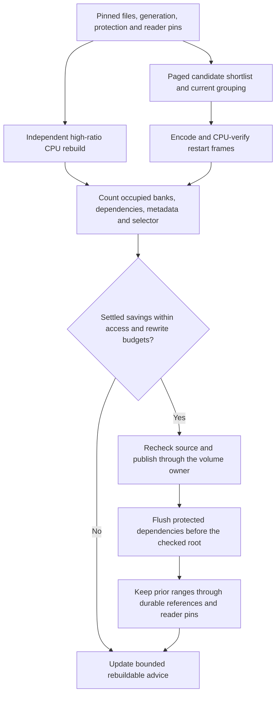
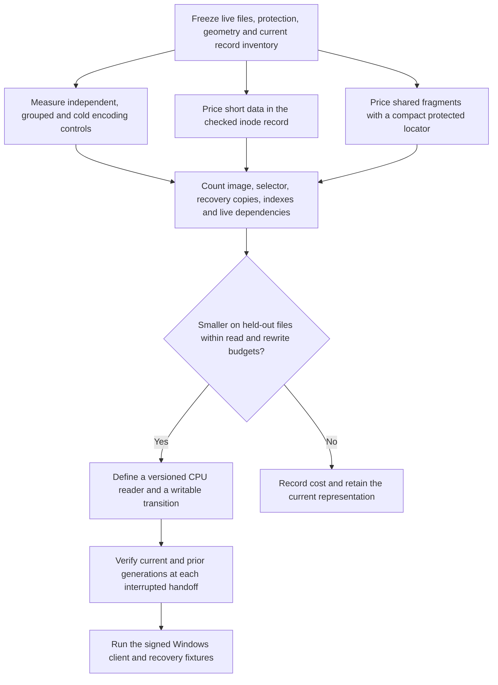

# Adaptive compression and storage execution

This work extends the [target design](TARGET.md) and the
[release gates](../RELEASE_EXECUTION_PLAN.md). Optimize the complete protected
footprint first. Measure access time, resource use and storage writes as
constraints on each size improvement. The ordinary Windows read and write
paths, CPU recovery and existing user-visible file semantics carry across every
representation.

## 1. Price protection and selection before compressing more

The [sealed image and writable tail](../SEALED_INDEXED_IMAGE.md#a-sealed-base-with-a-writable-tail)
can now expose an ordinary indexed address space through the native volume
selector. The base folds checked identical mirror units and protects them
with parity. New writes keep the existing mirrored copy-on-write path. The
complete AIT corpus used 36.5% fewer active bytes, including the selector in
both layouts. The byte savings held through the same small write. Direct
folding stages one copy of each paired unit. It cut complete AIT staging
coexistence from 137,506,816 to 111,828,992 bytes, including the prior source.
[Folded staging verification](../evidence/folded-hybrid-workspace-2026-11-22.json)

The native session can now prepare the folded workspace, protected base
and writable tail incrementally. Each advance yields after its bounded
work, including individual ordered flushes. The full AIT fixture preserved
the staged footprint and exact CPU readback. A managed external indexed
session can select the prepared pair while retaining its open handles.
The Windows allocator fixture now reserves the exact base, decommits the
workspace, and reserves the full usable tail under the same domain budget.
It independently reopens the selected image after bounded retirement of the
pinned mirror. The owned memory controller now runs this sequence with
ordinary Windows SDK callbacks. The same open file continued through
selection and consumed two independently verified Radeon frames.
[Cooperative preparation](../SEALED_INDEXED_IMAGE.md#cooperative-preparation) ·
[Verification](../evidence/cooperative-hybrid-preparation-2026-11-22.json) ·
[Live selection verification](../evidence/live-hybrid-selection-2026-11-22.json) ·
[Deferred placement verification](../evidence/deferred-hybrid-placement-2026-11-22.json) ·
[Automatic selection verification](../evidence/automatic-memory-sealing-2026-11-23.json)

The paired-file implementation now places the base and tail inside the
inactive image range and binds their geometry to the selector epoch.
The workspace occupies a disjoint area at the end of that range and
retires before tail binding. Admission uses the fitted staging geometry,
the backing's allocation allowance and a durably settled write charge.
The CPU reader can recover either complete selected layout after an
interruption and verify a mirrored successor when a sealed data unit
needs repair. The SDK fixture exercised the same open handle through
selection and a later tail write.
[Paired placement](../PERSISTENT_VOLUME_FILE.md#sealed-paired-images) ·
[Paired placement verification](../evidence/paired-sealed-placement-2026-11-23.json) ·
[Windows range allocation](https://learn.microsoft.com/en-us/windows/win32/api/winioctl/ni-winioctl-fsctl_query_allocated_ranges)

The disposable NTFS mount verified the original Win32 handle through
sealed selection and a subsequent committed write. Nine process cuts
then exercised workspace retirement, candidate fencing and both selector
records. The independent CPU reader verified the chosen image and the
continuation after reopening. NTFS reported that the inactive range was
released after recovery.
[Mounted process verification](../evidence/windows11-mounted-paired-sealing-2026-11-23.json)

The Radeon RX 9070 XT decoded two verified frames from the reopened
paired layout in the sparse-memory SDK fixture. An unsupported worker
configuration was refused after a single request. The CPU route returned
the same bytes immediately and continued preparing later requests.
Independent CPU recovery verified the selected image after both trials.
Combine the AMD path with the mounted Win32 path on the same volume
before counting it as an end-to-end result.
[Reopened paired AMD evidence](../evidence/amd-reopened-paired-sealed-read-2026-11-23.json)

The Windows file controller can keep the folded workspace in locked memory
using the current idle grant and the existing process-wide lease. Either
workspace feeds the same independently checked base and ordered selector
publication. Resource pressure retires an incomplete workspace in bounded
steps. File placement remains available when memory admission fails.
The SDK fixture saw about 58% fewer attempted backing bytes with the
locked workspace and the same final allocation. The mounted NTFS guest
verified a live handoff and two interruption points on that route.
Measure complete read cost, returned allocation and attempted rewrite
traffic on real devices. Dense backing needs its own internal segment
reuse and recovery qualification.
[Paired scratch placement](../PERSISTENT_VOLUME_FILE.md#sealed-paired-images) ·
[Workspace placement evidence](../evidence/volatile-paired-workspace-2026-11-23.json)

ReFS moves cold contents through bounded containers. OpenZFS accounts for
space retained by snapshots during rewrites. FlitzFS's current whole-image
preparation holds the old generation alongside the verified candidate, so
the allocator must charge both until the selector settles and the last
reader releases the old mapping.
[ReFS tiering and destage](https://learn.microsoft.com/en-us/windows-server/storage/refs/refs-registry-values) ·
[OpenZFS rewrite](https://openzfs.github.io/openzfs-docs/man/v2.4/8/zfs-rewrite.8.html)

### Settled-size qualification and candidate publication

In the writable indexed path, mirrored payload banks round up the sum of
stored records and headers. Mirrored index pages and the outer selector
have their own geometry. A small decrease in stored bytes can remove both
banks at a boundary. Automatic maintenance can try a prefix frame against
an already staged and checked base without requiring a whole unit of raw
savings. The more expensive assembled-section search has a separate work
threshold. The writer compares encoded alternatives and publishes an
improvement only when the proposed compacted upper bound is smaller than
the incumbent lower bound.
[Paged placement and comparison](../../src/paged_store.cpp) ·
[Prefix admission and exact CPU decode](../../src/native_indexed_volume.cpp) ·
[Measured allocation boundary](../evidence/windows-protected-prefix-banks-2026-11-24.json)

The next qualification design uses three comparisons with explicit shared
inputs. Freeze file revisions, initial write policy, live objects and reader
pins. Compare independent re-encoding and group candidates under one
protection profile. Exercise sealed parity and provider relocation with the
encodings fixed in a second comparison. Run foreground access and durable
publication against the resulting protected representations. Record
temporary coexistence separately from settled space and retain exact readback
for every arm.

Keep independent re-encoding detached for the initial comparison. Move the
winning workload to cooperative production work only when the measured
gain pays for backing writes, decode cost and live temporary space. An
extent version change invalidates staged proposals. The advisory catalog
can replay or discard interrupted planning, while root authority and
published decode dependencies remain protected with the chosen volume
format.
[Implementation and exits](../RELEASE_RECONCILIATION_2026-11-24.md#first-settled-size-implementation-sequence)

### Protected short files and complete size

In the 192-file CPython profile, retaining the current records and reducing
their encoded data payload to zero would still occupy 466,944 of 524,288
bytes. For these sizes, test eliminating records as well as compressing
payload. Existing indexed extents consume a data object and an extent key
in addition to the inode and name. The object store charges a checked
record and an index entry in each protected copy.
[Size decomposition](../evidence/windows-protected-size-frontier-2026-11-25.json) ·
[Indexed ownership](../../src/native_indexed_volume.cpp) ·
[Packed pricing](../../src/paged_store.cpp)

The matched 192-file run reduced settled image and selector bytes by
98,304 while retaining both protected copies. A held-out named tree
with 374 files and 160 directories saved 172,032 bytes on the host
with matching protection. An isolated signed WinFsp guest verified
creation, sparse growth, shrink, rename and reopen with the ordinary
memory-volume owner. Fresh Windows memory and volume-file creation select
inline data automatically. For existing images, establish unsupported-writer
refusal and net occupied-size benefit before activating a capability through
gradual migration.
[Wire and lifecycle contract](../INDEXED_NATIVE_VOLUME.md#inline-short-file-data) ·
[Named Windows qualification](../evidence/windows-inline-named-and-adaptive-read-2026-11-25.json) ·
[Modeled interruption coverage](../evidence/windows-inline-small-files-2026-11-25.json) ·
[Persistent creation evidence](../evidence/windows-persistent-inline-reconciliation-2026-11-25.json)

1. **Prototype private layouts.** Price an inline file value in its
   existing checked inode and a packed fragment record with slice
   offsets and exact binding. For the inline candidate, calculate
   the inode's encoded length after adding the value and remove the
   separate object and extent key in the trial. For the shared record,
   charge the locators, restart headers, references and retained
   dictionaries. Count live bytes, reader-pinned history and temporary
   copy space. Use authored tiny-file trees and a held-out named tree
   with real names, ACLs and modification patterns.
2. **Specify one authoritative representation for each range.** Bind
   inline bytes to an inode revision and length. For external slices,
   bind their object, generation, offset, length and verified bytes
   before exposing a read. Validate the full logical range, EOF,
   holes and capacity changes. Keep random work within a declared
   restart and read envelope even when a group spans many files.
   Verify lookup and directory traversal with held handles while
   individual files grow, truncate, rename, unlink and reopen.
3. **Publish through the existing fenced owner.** Stage complete new
   records, the inode, and any allocator and reference edits behind
   the current root and source revisions. Publish after the protected
   copies and their metadata are durable. Retain the old representation
   until every surviving root and reader permits retirement. A newer
   reader accepts old extents. An older writer must reject the new
   capability before accepting a writable owner. Test both
   directions of promotion through growth, interruption and rollback.
4. **Promote a winning policy only after a matched trial.** Measure
   metadata read amplification, write amplification, scrub and
   reclaim cost, and time to settle on unchanged bytes. Compare
   equally protected profiles before any change to failure isolation.
   Apply the best tested layout for each workload and backing based
   on observed resource cost. Keep the local learner's nominations
   and rejected alternatives rebuildable from authoritative data.

Btrfs demonstrates inline values in a checked metadata leaf. EROFS
demonstrates inline tails and shared fragments. FlitzFS needs its own
copy-on-write transitions, independent CPU recovery and release evidence
for each representation.
[Btrfs design](https://btrfs.readthedocs.io/en/stable/dev/dev-btrfs-design.html) ·
[EROFS layout](https://erofs.docs.kernel.org/en/latest/ondisk/core_ondisk.html)

## 2. Learn which collective work is worth doing

Use the existing sparse paged coherence index as a starting point. Learn at
chunk or fragment granularity. Keep entries keyed to content and generation,
with band postings, compact cluster representatives and a bounded set of
ranked neighbors. Sample common buckets with retained cursors so a large
family does not starve other candidates. Validate proposal recall against an
exhaustive match on small controlled data. Then measure postings visited,
bytes read and memory across geometric namespace sizes and a skewed, held-out
larger size. An all-pairs similarity matrix would require quadratic space and
update work. [FAST 2026 RubikFS](https://www.usenix.org/conference/fast26/presentation/huang)

Trial exact duplicate references, independent compression, shared dictionaries,
direct reference residuals and independently decodable short-file frames.
Feature-test shifted and content-defined fragments before replacing current
extent boundaries. A group can span thousands of files. Its read plan follows
a frame index and a bounded set of exact references, with limits chosen from
observed decode work and the resource grant. Use verified content identity and
direct readback as the authority for sharing.

Start with a small quantized decision tree or integer ranker trained to predict
**net protected bytes saved** and wasted trial work. Use already available
sample statistics, similarity, existing compression, access profile and current
resource measurements. Save model size, scores and the selection policy in
versioned advisory state. Bootstrap on AIT A–H and grouped revision families
from CPython. Reserve I–P and unrelated lineages for evaluation. Compare against
a frozen hand-written policy with equal trial budgets, including missed savings
and discovery effort. Corpus coverage beyond either split remains a separate
measurement.
[AIT 2026 dataset](https://aitdcc.github.io/dataset.html) ·
[Lossless codec selection research preprint](https://arxiv.org/abs/2509.25219)

Automatic indexed discovery now starts from the actual encoded payload bytes
of the current members. Four fixed-point estimates track the recent observed
yield of positional, shifted, masked and modular discovery. The controller
uses the observations when it next orders buckets. Prior representatives can
supply an existing reference. Each proposed replacement still has to pass the
independent CPU reconstruction and protected compacted-size checks. The
estimates live with the controller and start fresh on attachment.

Two alternating comparisons per workload on Windows produced identical
settled image sizes for all AIT 2026 splits and the paired CPython revisions.
For the revisions, the new ordering wrote 8,192 fewer bytes during
maintenance and ended at the same 819,200-byte compacted image. The AIT splits
made no group writes in either policy. Exact readback passed for both the
original and selected image in every trial.
[Collective candidate comparison](../evidence/collective-yield-ranking-2026-11-22.json)

Continue fitting and evaluating locally using admitted idle-work outcomes.
Introduce model changes through the same selection test. Persist only checked
advisory state that can be rebuilt from live data. Compare complete committed
bytes and independently verify the CPU output for every selected candidate. A learned model that changes the
stored coding is a separate experiment. Trial fixed-point context prediction
of transformed residuals with bounded restart frames and immutable, versioned
tables. Include model bytes, dependency protection, cold CPU decoding and
AMD scheduling in the price. A new mandatory decoder needs format
capability checks, historical fixtures and CPU rescue coverage.
[StateSMix learned lossless compression preprint](https://arxiv.org/abs/2605.02904) ·
[Tufa Labs measured model and payload costs on enwik9](https://tufalabs.ai/research/tufazip/)

## 3. Put AMD on ordinary reads and writes

FlitzZip's independent rANS segments, separately validated model and batch
descriptors, reusable workspace and stream-local cleanup inform the worker
implementation. FlitzFS defines its own restart framing, access granularity
and durable metadata contract. Bind the ROCm SDK distribution, actual HIP
runtime and module identities independently, along with the adapter and role.
[FlitzZip device decode workspace](https://github.com/strmt7/FlitzZip/blob/11396b5123505a4a1959173e1db2d0858c10dd6d/src/gpu/hip_rans.cpp#L79-L133) ·
[FlitzZip owned batch route](https://github.com/strmt7/FlitzZip/blob/11396b5123505a4a1959173e1db2d0858c10dd6d/src/gpu/hip_codec.cpp#L945-L972) ·
[AMD ROCm 10.2 release notes](https://rocm.docs.amd.com/en/docs-10.2.0/about/release-notes.html)

- **Foreground write.** Integrate the finite installed worker into ordinary
  write and flush paths for eligible windows. Match against fast CPU encoding,
  charging transfers, framing, CPU verification and durable commit. Run with
  competing I/O and with the GPU unavailable. The successful durable choice
  can use a different CPU and GPU encoding.
- **Cold size.** Run GPU candidate search, transforms or encoding in admitted
  quanta. Confirm the same logical bytes and better settled size than the
  current selected representation before publishing. Record when accelerated
  work increases the search yield but leaves the same chosen codec.
- **Foreground read.** Route frames already supported by the worker through the
  normal indexed range reader. Verify exact bounds, identity and a CPU-computed
  digest of reconstructed bytes before returning them. Initially compare all
  results against the independent CPU decoder. Qualify the digest-based
  read path separately so successful device work can eventually avoid duplicate
  CPU decoding. Track time to data and memory movement for isolated small reads
  and multi-frame requests.

The indexed session read path can now consume a ready native LZ4 result. It
keys that result to the verified image, object generation, decoded length
and decoded digest, and the CPU checks the complete result before file-range
projection. A missing or rejected result decodes the same checked record on
CPU. The decoder hook runs on the existing serialized read path and returns
without waiting. The owned Windows controller now has a qualified AMD read-ahead producer.
Mounted AMD measurements remain open. The pinned LZ4 Release and AddressSanitizer runs each checked
one accepted ready result and three rejected replies, with exact CPU
fallback on the same stored records.
[Windows verification](../evidence/pinned-provider-indexed-lz4-read-2026-11-22.json)

The private [native AMD LZ4 decoder](../NATIVE_AMD_LZ4_READ.md) now passes
byte-exact synthetic and public-data reads on the development adapter. The
older GPU decoder supports different block kinds and a 65,536-byte block limit. A full indexed extent includes a 24-byte header
in addition to its 65,536 data bytes. Give native LZ4 decode its own
resource-sized batch contract. Validate total lengths, sequence boundaries,
copy distances, final literals and alignment before input reaches the device.
Qualify both wave widths where available, with the same stored frames decoded
through the independent CPU library. Measure the complete read path before
automatic admission. The isolated child transport now returns two real AMD
frames through indexed session reads, and the SDK callback can consume an exact
ready result once. The independent CPU path served reads while the child was
pending and after a module refusal. The next step is to qualify a prepared
producer and anticipatory reads. Measure complete lifetime cost and short-read
hit rate before changing the ordinary mount's default route.
[Isolated-worker verification](../evidence/native-amd-lz4-ipc-2026-11-22.json)
[Pinned AMD LZ4 decoder](https://github.com/ROCm/hipCOMP-core/blob/03df9f7369211ee15d370817165224c73fdc9a46/src/LZ4Kernels.cuh#L921) ·
[LZ4 block format](https://github.com/lz4/lz4/blob/dev/doc/lz4_Block_format.md)

The prepared native LZ4 worker now separates setup from submission and
exact retirement. An indexed file handle can supply an owned encoded frame
without decompressing its payload. On Radeon RX 9070 XT, the two-frame
prepared path took 34–45 ms from submission through verification and
retirement. Paired CPU reads took 117–297 µs. Use these measurements to keep
small demand reads on CPU and price the full cost of a larger speculative
window before scheduling it automatically.
[Prepared native read qualification](../NATIVE_AMD_LZ4_READ.md#prepared-native-reads)

The indexed ready path can now bind a captured frame to the stored digest
in the current paged index. A hit skips fetching its compressed record and
checks the decoded bytes before delivery. The public AIT A two-frame fixture
reduced backing reads on demand from 144,341 to 18,168 bytes with an already
verified AMD result. The scheduler still needs to account for capture,
preparation, execution and the chance that the data goes unused.
[Indexed ready read qualification](../NATIVE_AMD_LZ4_READ.md#reusing-a-verified-ready-frame)

An opt-in controller baseline sizes a forecast from ordinary sequential
reads and clips it to the available scratch and frame budget. The checked
memory-backed capture shares a paged query across the admitted extents while
ordinary callbacks continue. Verified demand can refresh the backing cost
after a refusal. Capturing four extents together reduced preparation I/O by
39% against four independent captures. Foreground reads now reuse the
checked metadata for the exact same storage checkpoint. With that reuse,
the complete four-extent fixture requested 14.4% fewer backing bytes than
ordinary reads. The complete one-extent path requested 4.8% more. The Windows helper can
acquire an approved installed read role after a cadence-eligible demand.
Shorter intervals use CPU before any decoder budget query. Bind deployment
to full-path measurements and bounded foreground interference for each
workload.
[Installed decoder selection](../NATIVE_AMD_LZ4_READ.md#installed-decoder-selection) ·
[Sequential read-ahead qualification](../NATIVE_AMD_LZ4_READ.md#qualifying-sequential-read-ahead)

Use [GPU recovery](../GPU_RECOVERY.md) for immediate CPU continuity and
evidence-driven retry admission. A declined, failed or late reply never
authorizes stored data or changes the selected version. Bind measurements to
running adapter and workload roles. Enroll a path after matched live runs prove
useful compression or read work through the same production operation.

## 4. Backing provider qualification

Collect provider identity, lifetime, geometry and access capabilities before
admitting work. Windows exposes logical sector size, physical atomicity and
preferred alignment separately. Keep transport, seek penalty, queueing,
TRIM, write-cache behavior and removal as separate advisory values. A USB
bridge can report incomplete characteristics and a SATA bus can carry
either solid-state or rotating media. Sparse range reclamation depends on
the outer filesystem's supported operations. Admission to write still
depends on the provider's qualified recovery contract. Preserve unknown
fields and use measured I/O on the selected provider to tune maintenance.
[Windows storage property IDs](https://learn.microsoft.com/en-us/windows/win32/api/winioctl/ne-winioctl-storage_property_id) ·
[Windows file storage geometry](https://learn.microsoft.com/en-us/windows/win32/api/winbase/ns-winbase-file_storage_info) ·
[Windows write-cache queries](https://learn.microsoft.com/en-us/windows-hardware/drivers/storage/querying-for-the-write-cache-property) ·
[Windows sparse file operations](https://learn.microsoft.com/en-us/windows/win32/fileio/sparse-file-operations)

The Windows file provider now admits qualified local fixed and removable
volumes. The Explorer helper binds the selected parent's volume GUID
before mount preflight. The writable provider compares that GUID before
creating or reopening the file, opens the path under the GUID, and verifies
the opened file's normalized path. Free-space checks and allocation
geometry use the same GUID. Creation sizing uses the smaller of caller-visible
free space above the reserve and the backing filesystem's maximum file extent.
The NTFS extent bound uses the actual cluster size. The reserve is one
sixteenth of caller-visible capacity, rounded up and capped at 1 GiB. The
provider checks the extent and sparse allocation geometry before exclusive
creation and again on the opened file. Existing volumes keep their declared
logical capacity on reopen, while future backing growth uses the live
extent bound. Flush and failure-unit requirements still govern writes.
Sparse range reclamation uses the qualified NTFS path. The
read-only Windows probe confirmed the GUID and DOS path for the development
drive root and its test directory. The next probe obtained storage properties
through a metadata-only handle to that same volume. It observed SATA transport,
a seek penalty, and TRIM disabled. The ordinary directory handle refused the
three storage property queries. The probe read no backing bytes and made no
write attempts. Removable media and physical persistence still require device
tests.
[Read-only storage probe](../evidence/windows-backing-media-2026-11-22.json)
[Windows final paths by handle](https://learn.microsoft.com/en-us/windows/win32/api/fileapi/nf-fileapi-getfinalpathnamebyhandlew) ·
[Caller-visible free space](https://learn.microsoft.com/en-us/windows/win32/api/fileapi/nf-fileapi-getdiskfreespaceexw) ·
[Windows drive types](https://learn.microsoft.com/en-us/windows/win32/api/fileapi/nf-fileapi-getdrivetypew) ·
[NTFS per-file geometry](https://learn.microsoft.com/en-us/openspecs/windows_protocols/ms-fsa/4e3695bd-7574-4f24-a223-b4679c065b63) ·
[Windows allocation cluster size](https://learn.microsoft.com/en-us/windows/win32/api/fileapi/nf-fileapi-getdiskfreespacew)

The disposable Windows guest reported an NTFS file limit of 16 TiB minus
64 KiB. It refused a request one byte above that limit before creation.
The selected ordinary-size volume preserved existing bytes and passed
independent CPU reopen.
[Extent and reopen verification](../evidence/volume-file-extent-2026-11-22.json)

| Provider | Signals and tailored decisions |
| --- | --- |
| In-process RAM and external RAM disks | Bind the volatile lifetime at attach. Resize work against physical and commit headroom, and charge both the selected image and its staged replacement. Yield or cancel private preparation when memory pressure rises. Check a RAM disk's reported geometry separately from its lifetime. |
| NVMe and other queued solid-state storage | Start with the qualified commit order and measure useful queue depth alongside foreground latency. Group adjacent low-priority requests when this lowers complete I/O cost. Relearn throughput after sustained slowdown and preserve the same flush fences. |
| SATA SSD | Learn queue and flush bounds for the actual device. Shorten write bursts during sustained slowdown and prefer reuse that avoids growing the backing file. Account for reclamation writes and test sparse reuse separately from device discard. |
| HDD | Use reported seek penalty and random versus sequential observations. Group nearby reads and writes while preserving publication order. Favor sequential passes in idle windows. |
| USB-attached SSD and HDD | Keep transport, seek behavior and removal independent. Qualify the bridge, outer filesystem and active cache policy together. Revalidate a fresh attachment before resuming work after removal. |
| USB flash drives and memory cards | Test write and flush costs after short bursts and after the device slows under sustained work. Favor internal reuse and cheaper candidate preparation where it saves committed bytes. Charge rewrites against confirmed gains and reserve room for foreground writes. Keep cache and removal qualification specific to the attachment. |
| Unclassified backing | Start from the qualified provider contract and conservative concurrency. Change one dimension at a time as ordinary I/O supplies evidence. |

Select the placement by the backing filesystem and its qualified contract.
Use the locked-memory allocator for an in-process volume, reclaimed sparse
ranges for the qualified NTFS profile, and segment reuse for qualified dense
files. Choose the layout before tuning I/O sizes, depth or maintenance
pacing. An NVMe enclosure on USB, a SATA drive and a memory card can each
carry a different outer filesystem and expose different cache behavior.
Retain separate observations for every attachment.

The sparse provider must check returned allocation after deallocation and
account for the rounded ranges NTFS reports. For dense media, compare space
eligible for internal reuse with actual reduction in host-file allocation.
When cache descriptors are unavailable, keep the state unknown and require
the same independent power-loss and removal checks used for a reported
device. The exFAT allocation bitmap describes that filesystem's cluster
ownership. The FlitzFS checkpoint must establish ownership of internal
segments independently.
[Windows allocated ranges](https://learn.microsoft.com/en-us/windows/win32/api/winioctl/ni-winioctl-fsctl_query_allocated_ranges) ·
[Windows range deallocation](https://learn.microsoft.com/en-us/windows/win32/api/winioctl/ni-winioctl-fsctl_set_zero_data) ·
[exFAT specification](https://learn.microsoft.com/en-us/windows/win32/fileio/exfat-specification) ·
[Windows cache-property queries](https://learn.microsoft.com/en-us/windows-hardware/drivers/storage/querying-for-the-write-cache-property)

An externally created RAM disk needs its own volatile lifetime contract. A
backing file and successful flush can establish the file provider's barriers
within that lifetime. Reopening after power loss requires persistent storage.
Windows removable write-caching behavior follows the active removal policy.
FlitzFS should observe behavior through the attached provider and keep its
own commit barriers and detach sequence on every device.
[Microsoft Windows removal policies](https://learn.microsoft.com/en-us/windows/client-management/client-tools/change-default-removal-policy-external-storage-media) ·
[Windows media and device hotplug fields](https://learn.microsoft.com/en-us/windows/win32/api/winioctl/ns-winioctl-storage_hotplug_info) ·
[NVM Express Base Specification 2.4](https://nvmexpress.org/specification/nvm-express-base-specification/) ·
[Microsoft NVMe storage queries](https://learn.microsoft.com/en-us/windows/win32/fileio/working-with-nvme-devices) ·
[Microsoft file flush contract](https://learn.microsoft.com/en-us/windows/win32/api/fileapi/nf-fileapi-flushfilebuffers)

### Backing loss during I/O

The Windows file provider marks the current backing unavailable when an
I/O result reports device loss, missing media, a media change or an
invalidated file on an externally changed volume. The first such result
persists for the lifetime of the opened file and is shared with concurrent
captures. The provider refuses new backing requests and writer acquisition.
Operations already issued retain their buffers until Windows confirms
completion. Cancellation, a bus reset and other request errors follow
the existing operation failure path. An uncertain publication still
requires checked CPU recovery. A new handle goes through the selected
volume GUID, file and image checks before it can serve the filesystem again.
[Windows handle and device errors](https://learn.microsoft.com/en-us/windows/win32/debug/system-error-codes--0-499-) ·
[Windows media and disconnection errors](https://learn.microsoft.com/en-us/windows/win32/debug/system-error-codes--1000-1299-) ·
[Backing lifetime verification](../evidence/windows-backing-lifetime-2026-11-22.json)

### Admission from observed backing cost

The mounted controller now measures reads, writes, barriers and selected
control operations on the backing during each maintenance step. The memory
provider and the qualified Windows file provider supply observations from
their actual calls. Each capture belongs to the current maintenance thread.
The counters distinguish bytes requested from exact calls that completed.
These are logical provider operations. Device-level write amplification
requires independent measurements.

The controller keeps a separate recent backing-cost estimate for group
preparation, compaction and payload scrubbing. It uses the estimate along
with the last step's elapsed time to decide whether another step fits the
current idle window. New observations gradually lower a slow estimate.
A fresh window can still admit one step under the existing live resource
and foreground checks. The controller charges any overrun to its existing
elapsed-work pacing. This changes admission between synchronous steps.
[Backing-aware maintenance verification](../evidence/backing-maintenance-admission-2026-11-22.json) ·
[Windows background resource scheduling](https://learn.microsoft.com/en-us/windows/win32/api/processthreadsapi/nf-processthreadsapi-setthreadpriority) ·
[Windows monotonic timing](https://learn.microsoft.com/en-us/windows/win32/sysinfo/acquiring-high-resolution-time-stamps)

The ordinary Windows file attachment carries a profile from its exclusive
backing handle into the controller. When an adjacent CPU demand read checks
native LZ4 input and predicts the next range, that demand can supply the
first read-ahead cost estimate. The estimate comes from the requested read
and includes its verification and decode. The forecast carries the first
sample until the controller consumes it once or foreground activity replaces
the forecast. After a refusal, a matching demand sample stays with its open
context until that context supplies another forecast. Live idle, memory and
foreground checks govern admission for speculative work. A fresh controller
learns from its own requests.
The disposable NTFS test matched the profile to an independent Windows
query of the same backing file. It verified a one-use demand sample,
discarded a replaced forecast, checked the existing idle budget boundary
and repeated the sample after exclusive reopen. A separate mounted
handoff checked the same backing path through selector publication.
[Opened backing profile](../PERSISTENT_VOLUME_FILE.md#create-inspect-and-resume) ·
[Windows verification](../evidence/windows11-attached-storage-profile-2026-11-23.json)

Continue the backing-dependent work in this order.

1. Qualify any optional device advisory queries against the actual selected
   backing, with finite ownership and deadlines. Keep filesystem-level range
   reclamation, advertised device TRIM and qualified flush behavior independent.
   Preserve unknowns where the file handle and device supply different evidence.
2. Use the positioned file provider for bounded opt-in capture. The Windows
   guest verified independent foreground access and pinned range retirement.
   Qualify it on persistent devices before automatic admission, separating kernel
   request count, provider bytes and device service in the trace. Select the
   next quantum from the observed cost on this attachment and current headroom. Test nearby physical range grouping on seek-sensitive
   devices, and increase read concurrency on queued devices only where the
   measured foreground tail permits it. Coalesce eligible writes within the
   existing commit order.
   [Positioned file I/O](../PERSISTENT_VOLUME_FILE.md#positioned-windows-file-io)
3. Charge backing write attempts, retained generations and temporary space to
   each optimization. Keep recovered space and estimated device wear distinct
   from application bytes. Size reduction remains the goal. Repeatedly rewriting
   marginal candidates consumes the budget without a corresponding gain.
   Give integrity repair precedence and resume optional work from checked cursors.
4. Qualify the [dense backing path](#dense-backing) separately from NTFS sparse
   files. Keep existing volumes readable by the independent CPU reader.
5. Qualify each persistent provider's barriers, interrupted writes and removal
   on disposable media. A volatile provider preserves files while its owner and
   backing survive. Measure matched foreground and background workload traces on
   real devices when authorized. Keep reported transport, outer filesystem,
   allocation, recovery scope and observed performance in each result.
   Include USB flash and removable SSD cases under the Windows removal policy
   in effect. Exercise loss before and during reads, write and flush boundaries
   and failed retirement. Have the Windows helper retire the dispatcher and
   wait for a matching availability event. Check both the backing volume GUID
   and the FlitzFS volume identity before automatically reopening and verifying
   the acknowledged bytes independently. Try attaching a different device at
   the former drive letter and verify refusal. Repeat the matched DiskSpd and file
   workflow on actual devices with the same cache settings, recording plain
   and compressed NTFS results where the comparison fits. Compare occupied
   bytes, rewrite traffic, tail latency and time to regain useful capacity.
   Record physical wear telemetry only when the device exposes it.

### Dense backing

The helper selects packed or sparse allocation for the qualified local NTFS
provider. The capacity calculation reserves the catalog, both image ranges
and the packed format's anchors and directories. The in-process memory
provider has its own lifetime and allocation contract.
Microsoft lists exFAT and FAT32 without sparse-file support, and lists a
file-size limit of about 4 GiB for FAT32. A USB device can carry either NTFS or exFAT.
The ordinary file provider applies a FAT32 extent bound when the caller
supplies a qualified nonsparse contract. The packed allocator reuses internal
space and can shorten a qualified ordinary file after same-group or
cross-group evacuation. Recovery qualification remains open for exFAT and
FAT32. For an external RAM disk,
establish the backing lifetime explicitly before treating its bytes as volatile.
A single backing file must stay within the outer filesystem's file-size limit.
Supporting a larger FlitzFS volume on FAT32 would require a separately
qualified segmented backing with a stable identity for every member and
ordered flush across the files that participate in one checkpoint.
[Windows filesystem capabilities](https://learn.microsoft.com/en-us/windows/win32/fileio/filesystem-functionality-comparison) ·
[Filesystem capability flags](https://learn.microsoft.com/en-us/openspecs/windows_protocols/ms-fscc/ebc7e6e5-4650-4e54-b17c-cf60f6fbeeaa)

The [packed volume file](../PERSISTENT_VOLUME_FILE.md#packed-allocation-on-ordinary-files)
maps both virtual image lanes into physical allocation groups. Published
directories can add previously unowned virtual units ahead of a filesystem
checkpoint. Removing existing owners requires selector convergence and reader
retirement before the independent directory transition. The authority to
release a range remains with the filesystem, which avoids modifying every
allocation group when the namespace checkpoint advances.

1. Measure mount and recovery cost over increasing numbers of physical groups
   and fragmented runs. Bound startup memory and group reads with a pageable,
   independently verifiable directory index if the full scan exceeds the
   attachment's headroom or open budget. Keep the mirrored group records
   usable as the recovery source for that index.
2. Carry the session's physical file length, reusable interior bytes,
   releasable tail and sampled allocation into helper diagnostics. Report
   temporary hold space and reservations from their actual owners. Cap new
   volumes by the actual file limit, current available growth and staged-copy
   cost. Qualify exFAT and FAT32 independently before enabling attachments.
3. Qualify the implemented cross-group relocation and prefix-preserving
   shortening on every enabled provider. Confirm that the owner can
   resume mixed-version anchor publication, finish directory recovery,
   protect captured readers and return allocated bytes while the client
   remains active. Reduce moves that save little space for their measured
   copy and metadata traffic.
4. Charge the candidate's actual writes, metadata and temporary overlap to
   the maintenance decision. Measure the backing file's allocated bytes
   separately from its logical length and internal free space. A candidate
   that frees interior ranges may improve future reuse. Report a reduction
   in outer-file space only after allocation decreases.
   [Windows file allocation information](https://learn.microsoft.com/en-us/windows/win32/api/winbase/ns-winbase-file_standard_info) ·
   [Windows end-of-file information](https://learn.microsoft.com/en-us/windows/win32/api/winbase/ns-winbase-file_end_of_file_info)
5. Test interrupted allocation and retirement on disposable devices under the
   actual removal policy and write cache. Require independent CPU byte
   verification followed by continued writes. Compare write amplification and
   useful compression against plain and compressed NTFS. Keep pending
   relocation below foreground demand and qualify physical shrink separately
   from internal reuse.

The versioned intent now uses the existing paired anchors. It binds the
affected ranges, directory generations, mappings and moved bytes. The
independent reader rolls a valid intent forward in memory. Writable recovery
finishes the peers before releasing either copy. The NTFS fixture released
an entire tail allocation group and continued writing after reopen.
Measure the gain in allocated bytes alongside metadata writes, latency
and temporary allocation before selecting a policy for each medium.
[Cross-group evidence](../evidence/dense-cross-group-2026-11-23.json) ·
[FAST '26 on placement and write amplification](https://www.usenix.org/conference/fast26/presentation/kim-jeeyun)

### Media qualification

Admit an operation using the qualified provider contract first. Then tune its
optional work with the actual attachment's observed throughput, queue delay,
flush cost, memory headroom and foreground contention. Capture capabilities
against the pinned volume identity. A positive no-seek or TRIM flag is
advisory. Keep unreported values unknown and recheck them on a new
attachment. Avoid loading performance estimates for a different volume
or removal policy. Keep the same independent CPU recovery path for GPU
and CPU writes on all backings.
[Windows sector-size and device flags](https://learn.microsoft.com/en-us/openspecs/windows_protocols/ms-fscc/3e75d97f-1d0b-4e47-b435-73c513837a57)

| Test family | Evidence needed for the supported mode |
| --- | --- |
| In-process RAM and external RAM disk | Verify pressure, cancellation and detach. Reopen and read exact bytes while the backing survives. Qualify a RAM disk's storage and lifetime separately from the in-process provider. |
| NVMe and SATA SSD | Use separate devices. Exercise low free space, flush stalls, mixed I/O and sustained repeated compaction. Record temporary space and attempted writes for every recovered byte. Vary queue depth and keep the change only where it improves end-to-end results. |
| Rotating disk | Exercise fragmented and sequential layouts. Verify that batching reduces random-read cost and that maintenance yields within the foreground tail budget. |
| USB SSD, USB flash and memory card | Test the NTFS and dense profiles separately where supported. Exercise unplug during copy, checkpoint publication and reclaim, plus reattach at a reused drive letter. Check the file extent limit and a nearly full backing. Record the active Windows removal policy and compare sustained writes with short bursts. Reopen only after revalidating the volume identity and committed roots. |
| Every persistent provider | Use disposable media for interruption and removal. Reopen with the independent CPU reader, verify acknowledged bytes and namespace, and repeat with GPU unavailable. Use matched plain and compressed NTFS baselines where each comparison can use the same backing, workload and cache settings. |

Use the same [benchmark protocol](../BENCHMARK_PROTOCOL.md) throughout.
Attribute reductions from codec choices, allocation reuse and outer-file
reclamation separately. Run performance comparisons on real devices.
Use isolated fault fixtures for crash sequences and retain evidence for the
actual outer filesystem, media and policy combination.
[Windows external-storage removal policies](https://learn.microsoft.com/en-us/windows/client-management/client-tools/change-default-removal-policy-external-storage-media)

## 5. Finish the autonomous Windows lifecycle

Bind installer, WinFsp integration, tray/helper, optional AMD worker and CPU
rescue tool to verified package versions. Have the helper drive discovery,
attach/detach, integrity checks, progress, repair, compaction and gradual
migration. Distinguish a user's initial volume/backing selection from routine
maintenance, which should run automatically. Persist only checked policy and
work state. Stop owned mount and worker resources on removal or shutdown.
Verify install, update, rollback and clean removal on the exact candidate.
Use a CPU reader with every supported mandatory format revision and keep older
representations readable while migration proceeds.

Use the [benchmark protocol](../BENCHMARK_PROTOCOL.md) for paired mounted
FlitzFS, plain NTFS and native-compressed NTFS. Measure complete allocated
bytes, foreground tails, readback, CPU/GPU usage and background/storage debit
for each media class. Extrapolate scaling only from measured ranges with an
independent validation point. Retain confidence intervals, losses and setup
details in the evidence. A stable release decision requires the integrated
results and remains with the owner.
