# Current FlitzFS architecture

The diagrams trace the implementation reconciled on 25 November. They
cover prepared AMD read delivery, mirrored cold copy across packed banks,
phase visibility during reclaimer steps and bounded rolling lookup.
[Release reconciliation](../RELEASE_RECONCILIATION_2026-11-25.md) ·
[Packed admission and sealing evidence](../evidence/windows-packed-admission-and-sealing-2026-11-25.json) ·
[Revised architecture](TARGET.md)

## 1. Process and build boundaries

Windows applications reach a mounted volume through the WinFsp driver and its
user-mode dispatcher. The experimental helper currently hosts the writable
adapter and its controller in the same process as the window and tray. Its
unmounted preview and the legacy single-stream CPU CLI are separate entry points.

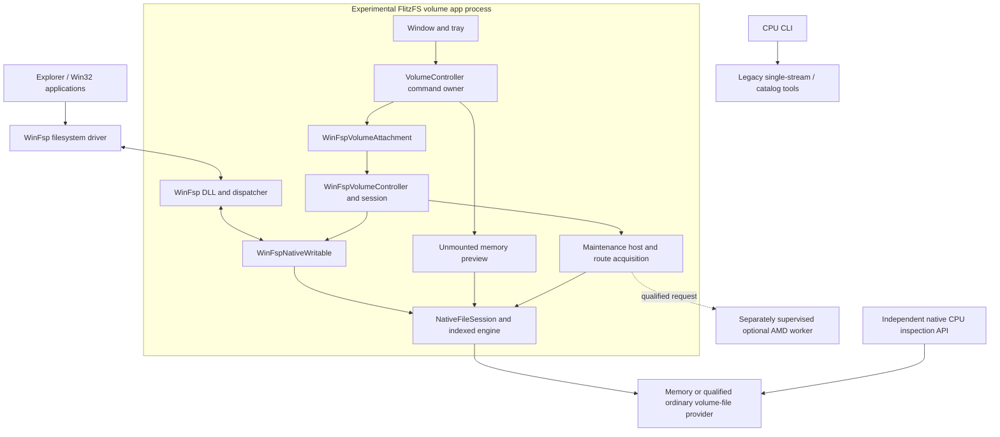

The portable core and CLI can build independently of the Windows app, the WinFsp
SDK and the ROCm worker. Explorer attachment, persistent file controls and
installed AMD acquisition have separate build inputs. The read-only catalog
callback adapter also remains a separate path. [Build options](../../CMakeLists.txt#L34)
· [app targets](../../CMakeLists.txt#L1289) · [Windows backings](../WINDOWS_VOLUME_BACKENDS.md)

## 2. Attach, stop and keep ownership

The file path uses an exclusive operating-system handle and an indexed audit
before a writable reopen. The memory path keeps its backing while detached so
the same volume can be attached again. An unconfirmed stop retains ownership and
blocks another attach.

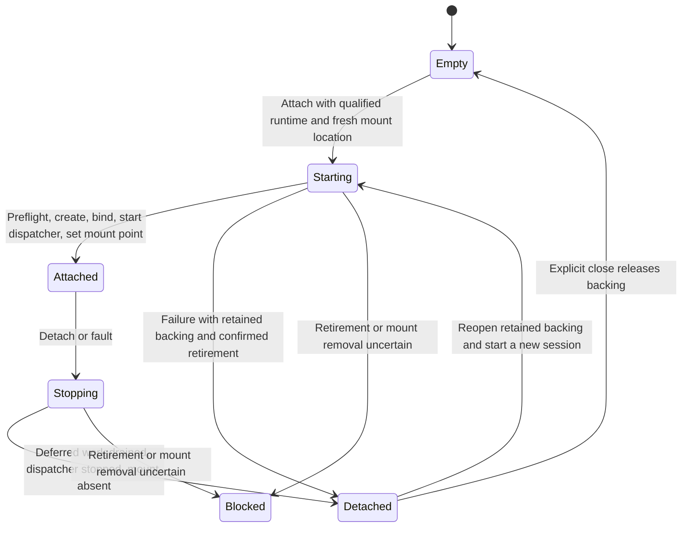

Fresh adapter creation can fail before any backing is retained. A user-mode
runtime DLL is checked beside the application, and the mount lifecycle holds
the adapter until after dispatcher stop and deletion. The persistent file
backing in the Explorer helper is a local NTFS file under the qualified
contract. New files use packed placement when capacity covers both virtual
image ranges, the reserved catalog and the packed directories. The exclusive
open selects the effective contract for existing packed or sparse files.
[Runtime and backing selection](../../src/windows/volume_app_winfsp.cpp#L67)
· [attachment and retirement](../../src/windows/winfsp_volume_attachment.cpp#L55)
· [dispatcher lifecycle](../../src/windows/winfsp_session.cpp#L101)
· [file-selection evidence](../evidence/helper-file-selection-2026-11-21.json)

## 3. Windows foreground write, with or without a GPU candidate

All native callbacks enter through the adapter's foreground accounting and
control lock. The current deferred service accepts at most one pending native
write. A conflicting entry can force CPU completion while the optional
worker is retiring. The independent storage commit determines status, transferred
bytes and file information in either route.
The SDK drives the deferred-write activation used in this diagram. The
ordinary helper has automatic installed acquisition entry points for
eligible read-ahead and collective work.
[Route activation](../../src/windows/winfsp_controller.cpp) ·
[SDK activation tests](../../tests/test_native_deferred_write_sdk.cpp)

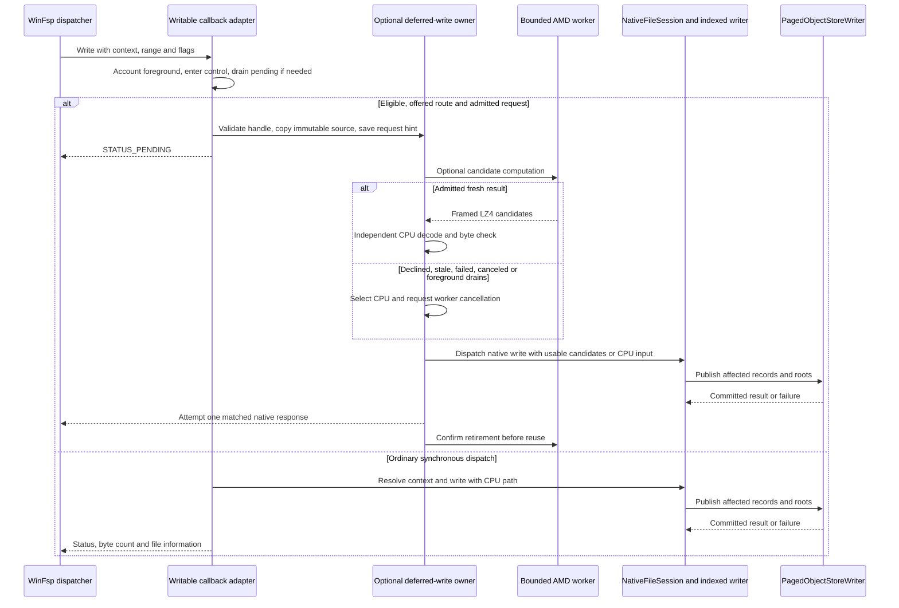

An explicit Flush goes through the same callback boundary and invokes the native
file/volume flush. Its effect on Windows-cached and mapped writes is a client
qualification question. The controller implements a foreground route offer.
At this baseline its callers are SDK tests. The separate live indexed write
fixture exercises real AMD through the native write bridge.
[Callback entry and drain](../../src/windows/winfsp_native.cpp#L418)
· [read, write and flush callbacks](../../src/windows/winfsp_native.cpp#L581)
· [deferred completion and response](../../src/windows/native_deferred_write.cpp#L157)
· [foreground route offer](../../src/windows/winfsp_controller.cpp#L443)
· [hardware write evidence](../evidence/amd-fresh-completion-observation-2026-11-21.json)

### Overlapping client flushes

The external Win32 client ran a cached write and a mapped write on separate
files. It flushed the mapped view and then called `FlushFileBuffers` on that
file. Both file-handle flush calls overlapped in the client. The mount owner's
serialized publication protocol still governs which generation becomes visible.

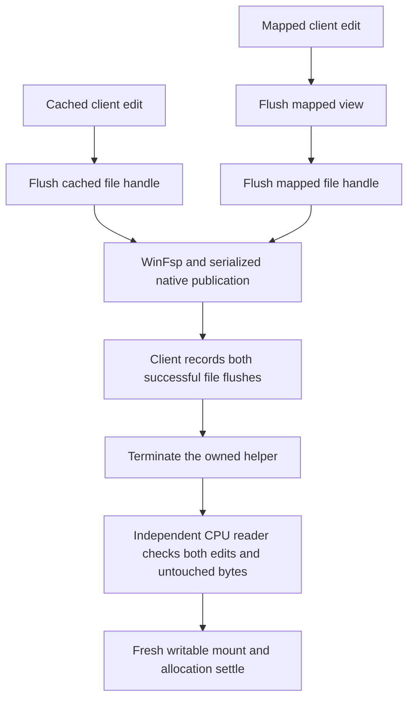

The packed and sparse guest traces each exercised three cycles. The process
cut after both acknowledgements occurred in cycle two. The durable-media gate
uses a separate failure campaign. [Mounted flush receipt](../evidence/windows-mounted-mixed-flush-recovery-2026-11-23.json)

## 4. Durable authority and advisory storage

The volume selector chooses one image identity and carries a minimum checkpoint
and namespace sequence. The paged image root selects its own object tree. Inode,
name, extent and lifetime records share that tree through typed key domains.
The image must hold the bytes required for decoding. Optimization state and
coherence postings can be rebuilt from the selected image.

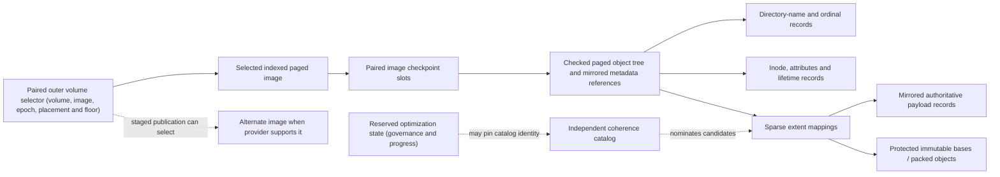

The memory provider reserves address space and commits pages on demand under a
shared resource domain. A qualified file provider can hold paired image and
catalog regions with independent lifetime pins. A linear file placement is also
readable under its narrower contract. [Memory allocation](../../src/windows/memory_volume.cpp#L79)
· [file regions](../../src/native_volume_file.cpp#L376)
· [selector binding](../../src/volume_head.cpp#L106)
· [typed records](../../src/native_indexed_volume.cpp#L22)
· [coherence backing](../../include/flitzfs/indexed_coherence.hpp#L92)

## 5. Indexed transaction and failure boundaries

Path updates layer an indexed transaction over the paged writer. The writer
stages append records and changed tree paths, validates newly written payload
replicas and publishes a root pair. The store updates its logical state only
after publication. This sequence illustrates a modifying, mirrored commit.

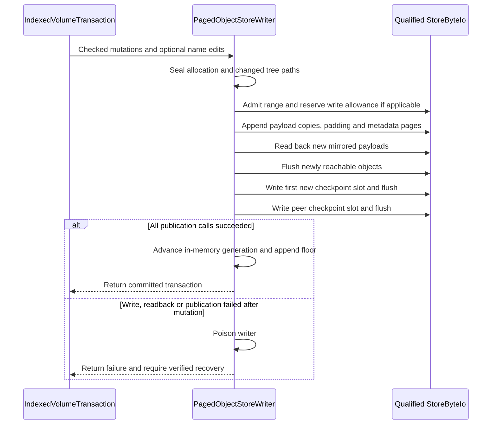

The outer selector changes during image handoff, with its own publication steps.
The same logical application operation can have more than one observable step
when Windows supplies a sequence of callbacks. Generation choice and recovered
bytes matter independently of whether a client already received success.
[Indexed commit](../../src/native_indexed_volume.cpp#L690)
· [physical commit](../../src/paged_store.cpp#L1947)
· [checkpoint slots and flush sequence](../../src/paged_store.cpp#L507)
· [outer selector publication](../../src/volume_head.cpp#L233)

## 6. CPU range reads and recoverable damage

The writable adapter resolves an open context to a native file handle. The
indexed view looks up the requested extents and reconstructs only the requested
ranges. A group member can use a protected base or a packed object. The CPU path
validates identities, lengths and digests before returning bytes.

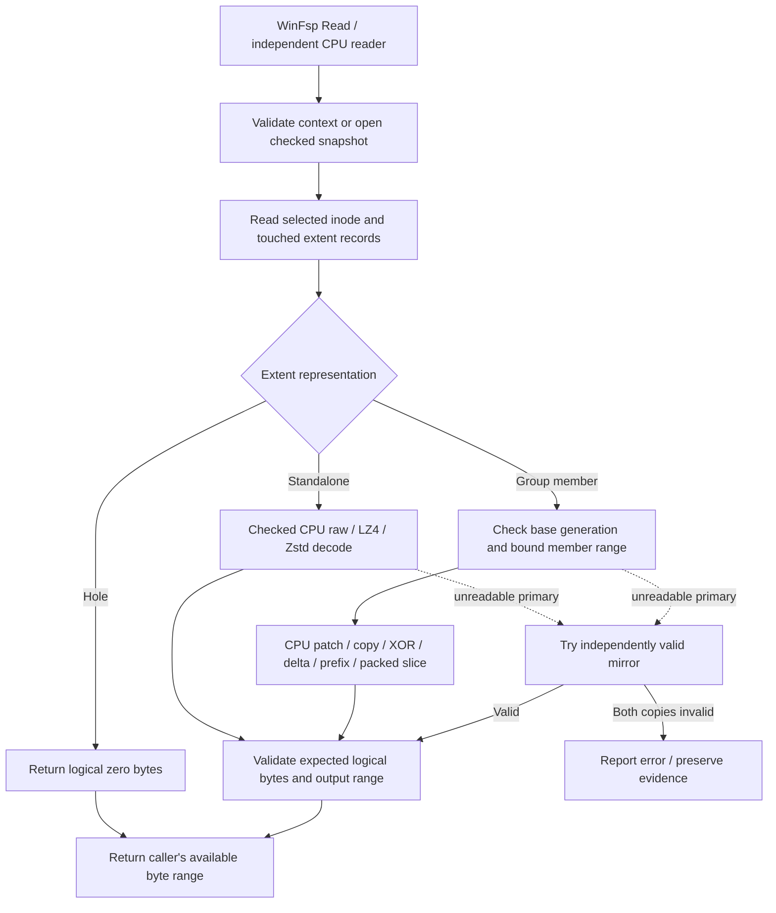

Query and decoded dependency caches, plus range limits, reduce ordinary read
work. Full audits and scrub cover different ranges. A healthy peer is an input to recovery or
repair, with replacement subject to ownership and publication checks.
[Callback range read](../../src/windows/winfsp_native.cpp#L581)
· [indexed extent decoding](../../src/native_indexed_volume.cpp#L213)
· [group methods](../../src/native_group_codec.hpp#L14)
· [paged peer reads](../../src/paged_store.cpp#L380)
· [mirrored payload behavior](../MIRRORED_PAYLOADS.md)

## 7. Reopen, repair and image switch

Read-only inspection and writable resume first establish the selected image.
The healthy indexed path takes both leases and fences. The exact checkpoint
binds the earlier decoded audit to the stored replicas verified after the
fences. Damaged protection and unresolved lifetimes take the checked recovery
path. Resolver, image and selector identity establish authority for writes.

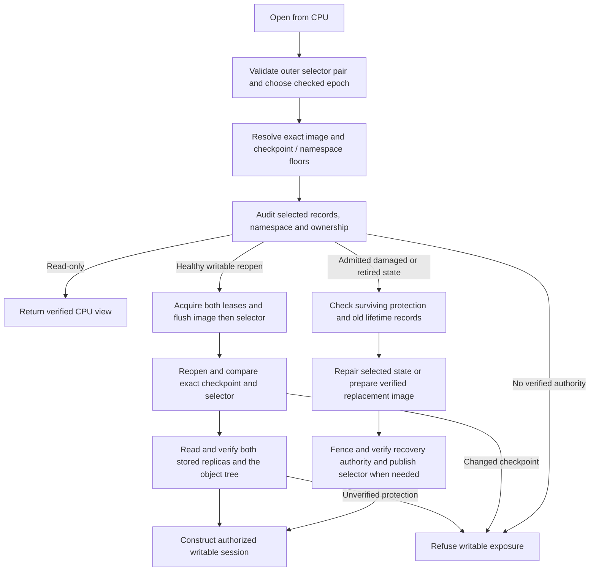

Normal indexed remount requires a full native audit and a stored mirror pass.
Both audits can read adjacent whole frames from one checked leaf and bank.
Replica spans must match byte for byte, and each frame passes its descriptor
and stored digest checks. The decoded pass then verifies each object on CPU.
The selected image and selector remain bound through the fences. Reader and
image pins constrain reclaimable storage. Repair requires a verified survivor.
[Decoded audit and stored replica reads](../evidence/indexed-decoded-reopen-runs-2026-11-25.json)
· [Single-frame reads](../evidence/indexed-record-read-coalescing-2026-11-23.json)
[Selector reopen and audit](../../src/volume_head.cpp#L158)
· [single-pass indexed audit path](../../src/native_session.cpp#L642)
· [stored mirror recheck evidence](../evidence/indexed-fenced-stored-recheck-2026-11-22.json)
· [mounted post-flush restart](../evidence/windows11-mounted-post-flush-recovery-2026-11-21.json)

### Background payload verification

The active Windows controller performs small replica checks during admitted
maintenance. It closes an observation only after verifying one unchanged
checkpoint from the beginning. Restored advisory positions can resume work.
Damage, repair or a change in selected state requires fresh complete coverage.

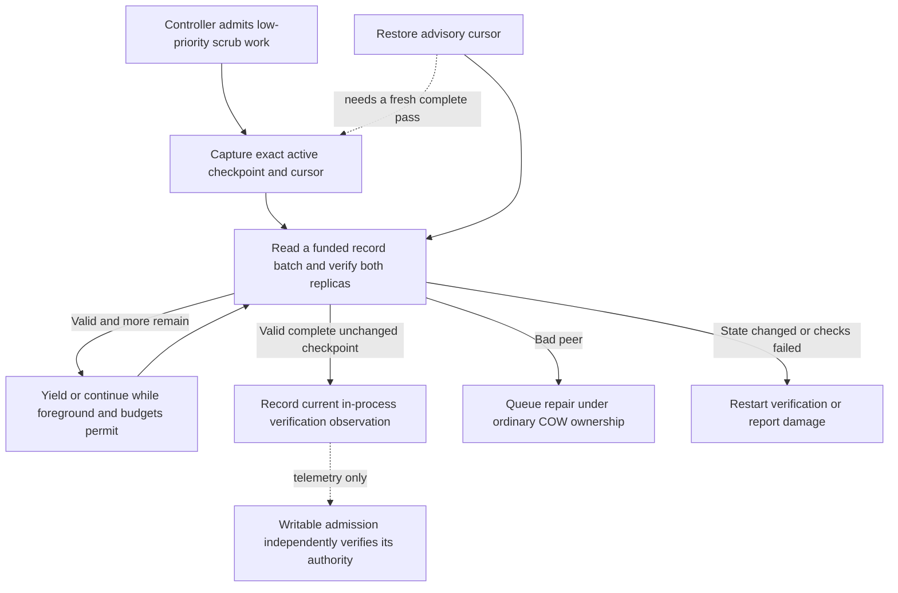

[Current scrub evidence](../evidence/indexed-scrub-checkpoint-2026-11-23.json) ·
[Scrub contract](../MIRRORED_PAYLOADS.md) · [Owned controller](../WINFSP_OWNED_CONTROLLER.md)

### Packed backing relocation

The ordinary packed reclaimer may relocate live units into an earlier
allocation group. The anchor intent records the checked transition of both
directories. Readers continue to use the old mapping until both directory
pairs and the cleared anchor pair have settled. Subsequent physical writes
use the backing provider's latest admitted extent. Optional sealing reserves
and prices the whole aligned workspace that contains the fitted image.
[Packed admission and cold-sealing evidence](../evidence/windows-packed-admission-and-sealing-2026-11-25.json) ·
[Corrected signed replay and scheduling evidence](../evidence/windows-maintenance-retry-delay-2026-11-25.json)

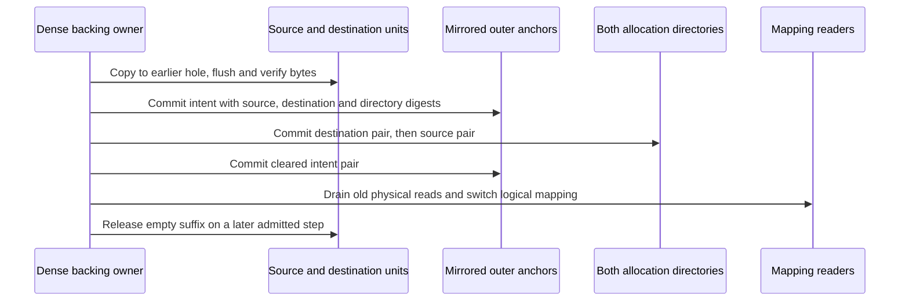

Reopen with a pending intent validates both directories and the destination
bytes. A verified original can supply read-only recovery and repair of a
damaged destination. The same evidence binds version-1 access and refusal
when neither copy verifies.
[Format and recovery](../PERSISTENT_VOLUME_FILE.md#moving-live-data-across-allocation-groups) ·
[Cross-group test evidence](../evidence/dense-cross-group-2026-11-23.json)

## 8. Background learning, grouping and reclamation

The Windows controller uses live resource samples and foreground activity to fund
an opportunity, plus elapsed-work pacing and host priority. The native scheduler
can advance a continuation or choose among independent kinds of work. Persistent
catalog entries include banded and projected keys and bounded alternatives.
Generation checks, CPU decoding and physical-size admission determine which
nominations change protected data.

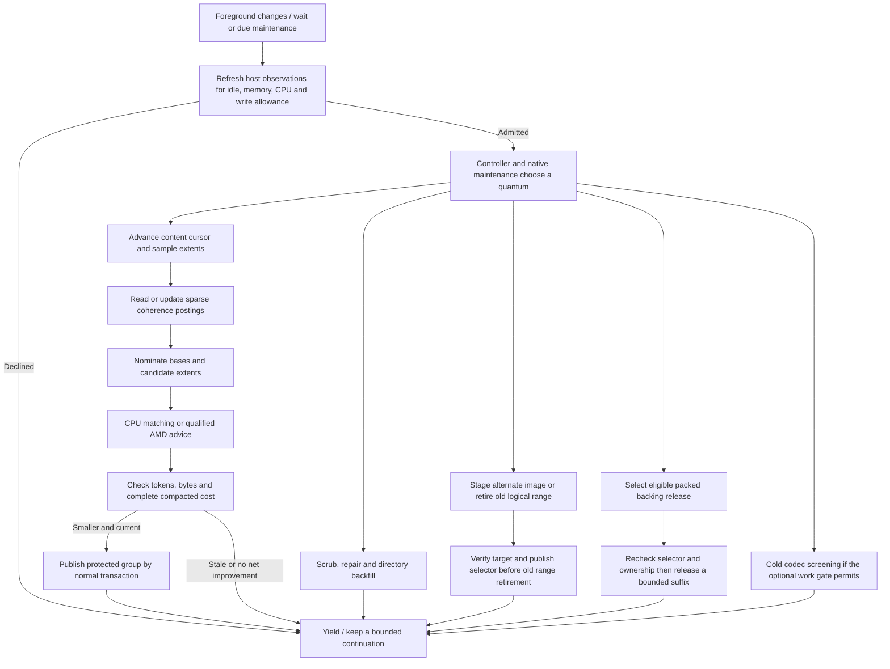

Existing grouping includes exact sharing, shared-base members and packed slices.
The sparse catalog can nominate a prior extent after it leaves the
resident window. An extent first checks the preceding key families,
then its preferred and remaining distinct rolling keys against the same
catalog snapshot. The existing live extent, exact-byte and complete-size
checks govern candidate publication.
[Secondary rolling lookup](../evidence/release-reconciliation-rolling-lookups-2026-11-25.json)
The current append layout reclaims normal churn by staged image replacement or
provider-supported tail/region release. It can reconcile unrelated commits
under bounds. Rebuild still requires alternate capacity and full passes.
Adjacent mirrored records share preserved copy and independent
verification work within one checked leaf. The mapper splits each
replica's stream at physical bank boundaries. Both target audits retain
record-level CPU comparisons before the new image can be selected.
[Staged copy evidence](../evidence/windows-bank-spanning-rebuild-2026-11-25.json) ·
[Independent verification evidence](../evidence/windows-bank-spanning-verification-2026-11-25.json)
[Windows scheduling and pacing](../../src/windows/winfsp_controller.cpp#L205)
· [native group advancement](../../src/native_maintenance.cpp#L1132)
· [persistent postings](../../src/indexed_coherence.cpp#L258)
· [shifted discovery](../evidence/indexed-shifted-coherence-2026-11-25.json)
· [file reclaimer](../../src/native_volume_file.cpp#L227)
· [staged rebuild](../STAGED_PAGED_REBUILD.md)

### Mounted reclaim admission and the native control

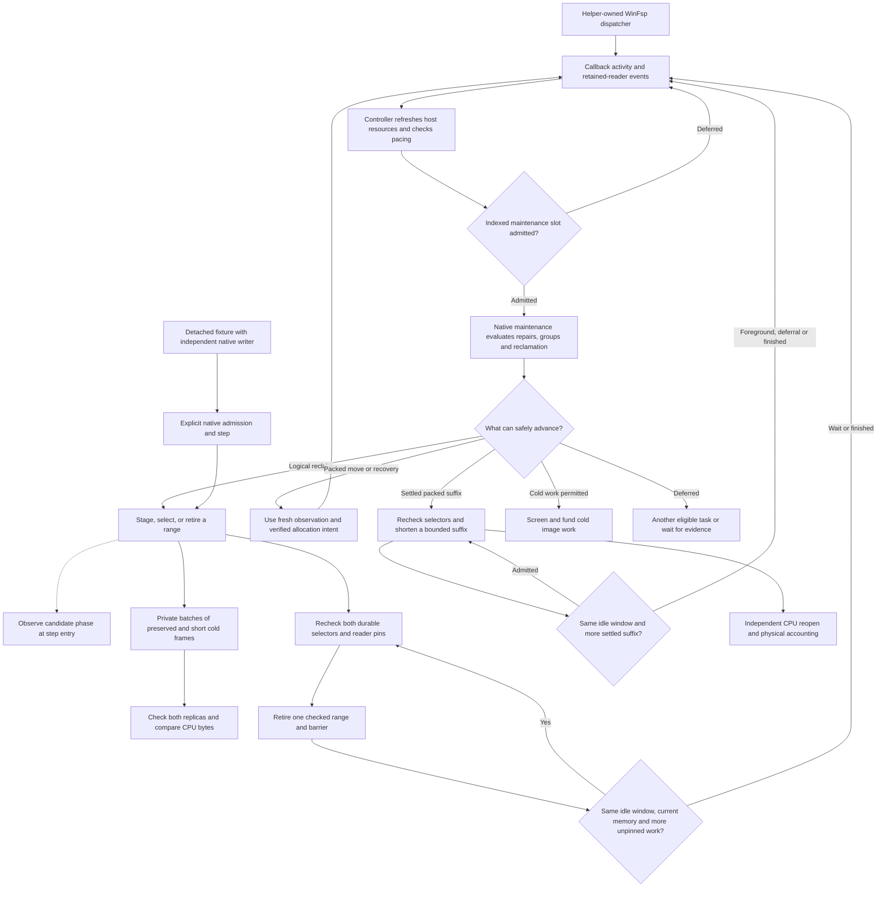

The earlier mounted trace completed inactive-range retirement, then withheld
eligible physical tail work behind the optional cold-work gate. File-backed
maintenance now admits eligible backing release through the ordinary idle
policy. The signed WinFsp guest crossed the packed group boundary and verified
both version-2 anchors, the held reader, independent CPU reopen and a continued
write. On the populated trace, the observer begins with a separately selected
compact image. Sparse backing completed old-range retirement while attached.
Packed backing progressed without reducing provider allocation in the
observation. All four observations verified the selected image and retired the
guest. The packed controller now has a separate continuation for confirmed
EOF shortening. Every step revalidates both selectors and ownership. The same
idle window can fund another shorten after the previous extent is checked.
Foreground activity, expiry or any transition away from confirmed shortening
ends that continuation. The observer counts its admitted steps separately.
It now also records each persistent-reclaimer outcome. The controller's
idle observation indicates that no work is eligible at that decision.
Each admitted reclaimer step can also report the phase of an existing
paged candidate at entry, its candidate identity, and its object cursor.
Backing calls, completed bytes and flushes accumulate against that phase
in a fixed-size array. During a long debt wait with pending work, the
controller can refresh the CPU reference once under background priority.
The refresh is charged to the existing deadline. Reclamation still needs
a valid window and current headroom at the paid step. Optional read-ahead
follows the reclaimer measurement scope and is included in the overall totals.
[Windows scheduling and live reference check](../WINDOWS_BACKGROUND_MAINTENANCE.md#trusted-opportunities-and-resource-priority)
Cold-eligible short frames share the mirrored
payload batch within a separate cold-input budget. The writer checks both
replicas and independent CPU bytes before index construction continues.
The fixture checks remaining work independently after detach.
[Matched cold rewrite](../evidence/windows-indexed-cold-batched-copy-2026-11-25.json)
[Ordinary mount observation](../evidence/windows-ordinary-reclamation-progress-2026-11-25.json)
[Populated retirement](../evidence/windows-mounted-range-retirement-2026-11-24.json) ·
[Packed continuation](../evidence/windows-packed-tail-continuation-2026-11-25.json) ·
[Next implementation slice](../RELEASE_RECONCILIATION_2026-11-25.md#ordered-implementation-and-decision-points)

## 9. AMD work and immediate CPU continuity

Package-enabled controllers can acquire installed AMD anchor and read-ahead
routes from eligible opportunities. The ordinary owner records bounded service-cost windows on eligible CPU
writes when a uniform package is configured. That observation records the
admitted geometry and policy for later calibration. The foreground write
interface accepts an independently qualified offer in SDK fixtures, and a
uniform acquisition can be cancelled through its supervised exchange.
[CPU write measurement](../OWNED_DEFERRED_WRITES.md#cpu-service-cost-from-ordinary-writes)

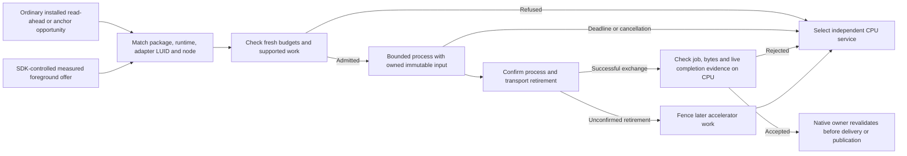

The most recent uniform worker change allows one qualifying replacement sample
after compute if its first sample has aged out. The same allocation baseline and
headroom checks apply. An invalid or still-stale result is discarded without an
additional launch. Current ROCm product, HIP API and loaded runtime ABI identities
are separately recorded. [Runtime discovery](../../src/windows/hip_route_discovery.cpp#L129)
· [GPU health policy](../../src/gpu_recovery.cpp#L61)
· [freshness checks](../../src/windows/hip_worker_budget.hpp)
· [selected-SDK and physical AMD results](../evidence/amd-fresh-completion-observation-2026-11-21.json)

The sweep worker can identify slab, transfer, launch, wait, verification and
retirement failures separately. Its explicit stream-copy comparison keeps
the same independent CPU verification and retirement boundary. The
ordinary helper still needs a measured foreground route for the admitted
write shape. [Stream copy and stage evidence](../evidence/windows-amd-stream-copy-2026-11-23.json)

### Prepared grouped read-ahead

An approved nonzero submission-lead profile lets the controller reserve a
single packed or mixed group before pulling the protected payload. It keeps
the forecast's exact snapshot and range identity. The checked capture can
queue a shorter immutable request inside the reserved maximum while the child
prepares HIP. A foreground operation interrupts capture or submission.
An already submitted request can outlast unrelated read-only callbacks
while its predicted stream and captured checkpoint are current. The native
read path remains independently decodable on CPU.

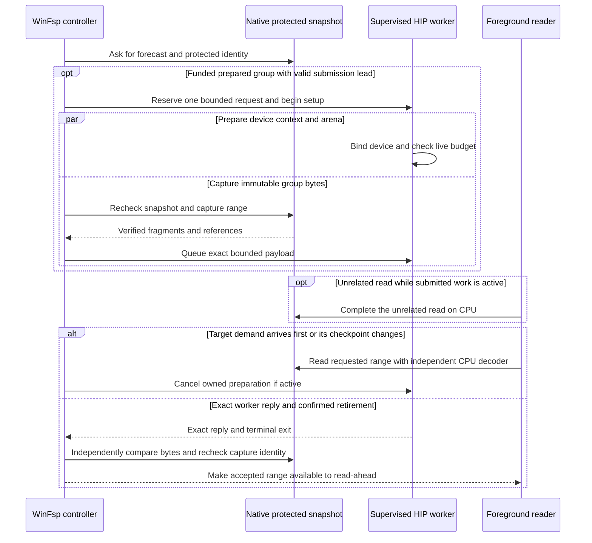

Windows transport and CPU-backed callback tests verify capture, refusal and
cancellation. Later admitted physical-host SDK trials consumed the exact
device-produced packed and mixed frames and verified each through the CPU
reader. The route uses separate models for a full startup and for dispatch
after confirmed readiness. Ordinary mounted read acceleration still needs a
matched CPU comparison with delivered bytes under real demand.
[Prepared worker evidence](../evidence/windows-prepared-group-worker-2026-11-24.json) ·
[Interleaved callback evidence](../evidence/windows-group-read-stream-binding-2026-11-25.json) ·
[Live grouped evidence](../evidence/windows-amd-group-supervisor-comparison-2026-11-24.json) ·
[Native LZ4 device evidence](../NATIVE_AMD_LZ4_READ.md)

## 10. Verification and remaining integration

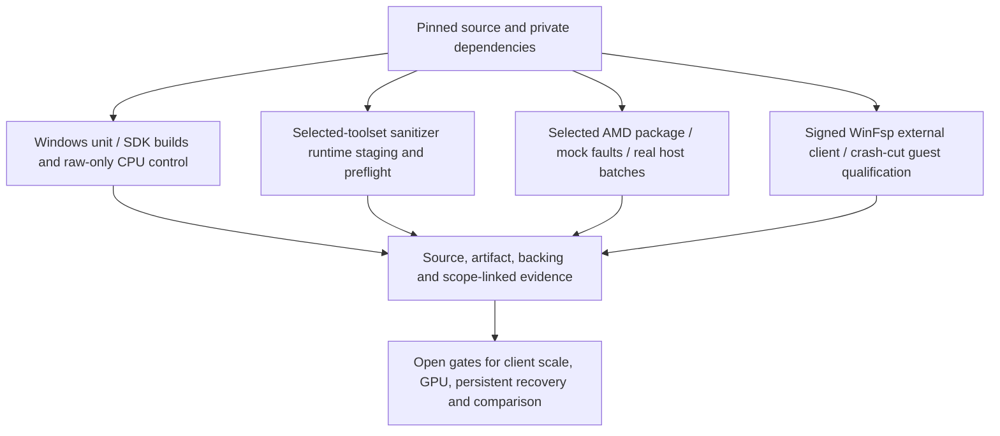

The scoped regression and signed mounted guest both verified the new retirement
scheduling. The validation receipt records the Windows, raw and sanitizer
suites and binds their terminal status to the changed source. Earlier installed
AMD read and fallback runs have separate receipts. The
[release gate ledger](../RELEASE_EXECUTION_PLAN.md#current-gate-ledger)
specifies the remaining Windows, storage and benchmark qualification.
[Validation guide](../validation/README.md)
· [sanitizer preflight](../../cmake/WindowsAsanRuntime.cmake)
· [installed AMD read evidence](../evidence/amd-reopened-paired-sealed-read-2026-11-23.json)
