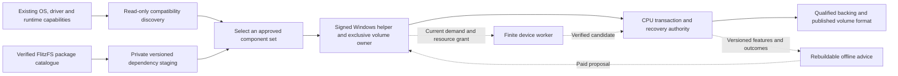

# FlitzFS release architecture review

Source reviewed on 26 November 2026. The tested source projection is
`cd5acee1be5ff1dcba537657cbc0c514c908ac39` on parent `eed13ab39fceaf2ee7ef92b9a163bec1797d18dd`.
The [current architecture](CURRENT.md) shows the code in use. The
[target architecture](TARGET.md) describes the remaining transitions, and the
[E01–E13 contracts](../IMPLEMENTATION_PLAN.md#3-execution-order-and-dependencies)
and [release gate ledger](../RELEASE_EXECUTION_PLAN.md#current-gate-ledger)
specify the individual exits.

The mechanical review recorded all 1,173 tracked paths, their Git blobs, and
line inventories for every decoded text file. It covered 455 first-party
source files with 132,507 lines and 13 upstream source files with 13,303
lines. The Python, JSON, YAML and PowerShell syntax checks found no failures.
The source review below follows ownership, persistence, dependency and device
entry points. Its coverage combines the complete mechanical inventory with
targeted manual review of those paths.
The corresponding Windows build passed 241 tests. The focused raw-only
and AddressSanitizer builds passed their read owner and recovery checks.
[Source inventory, checks and research receipts](../evidence/windows-installed-read-route-recovery-2026-11-26.json)

## Current source authority

| Area | Implemented mechanism | Release consequence |
| --- | --- | --- |
| Windows namespace and lifecycle | WinFsp projects the indexed volume through the writable adapter. The controller owns maintenance, verified results and retirement. The external Win32 fixture records byte, namespace, sharing and flush witnesses. [Callbacks](../../src/windows/winfsp_native.cpp) · [Owner](../../src/windows/winfsp_controller.cpp) · [Client](../../tests/windows_volume_app_tests.cpp) | Extend the same client through the installed helper and a qualified mount. Bind pathname semantics, mapping, read-ahead, write acknowledgement and stop/restart to one exact installation. |
| Attach and scale | Indexed names, inodes, extent maps and payload lookup are paged. `IndexedVolumeView::verify_inventory` still walks the records and checks their relationships before writable admission. The owned memory revision can preserve checked replica reads through the fences. [Indexed inventory](../../src/native_indexed_volume.cpp) · [Paged replicas](../../src/paged_store.cpp) | Separate healthy attach cost from explicit full verification. Prove a generation-bound ownership summary against the full audit in comparison mode before letting it admit writes on a persistent provider. |
| Publication and repair | The file owner stages isolated ranges, retains selected history for readers and binds the selected base and tail. The memory provider now uses the independently checked packed stripe descriptors during sealing. [Paired owner](../../src/native_volume_file.cpp) · [Hybrid reader](../../src/native_hybrid_backing.cpp) · [Packed base](../../src/protected_stripe_image.cpp) | Document uncertainty before each acknowledgement. Qualify effective failure units, flush ordering, copy retirement and independently restored bytes for each durable provider. |
| GPU service | The controller acquires a pinned read role on eligible demand. The package currently carries exact qualified role and device inputs. Native read work retains quarantine across replacement bindings; verified output enters the existing CPU-readable route. [Role discovery](../../src/windows/hip_route_discovery.cpp) · [Read worker](../../src/windows/native_lz4_read_worker.cpp) · [Package binding](../../tools/ci/bind_installed_amd_package.py) | Compare complete call-to-use cost in an ordinary mount. Qualify multiple independently measured tuples without requiring a host-specific application build. |
| Compression and learning | The current owner funds bounded scans, fragment nominations and shared-base trials, then prices representation and publishes through CPU-verified transactions. Short-file packing and descriptor packing reduce metadata or protection costs on named workloads. [Group planner](../../src/native_maintenance.cpp) · [Complete protected sizes](../evidence/windows-packed-stripe-descriptors-2026-11-26.json) | Measure candidate recall against a settled-byte oracle on unseen data. Keep learning advisory and checkpointed independently of required decoder state. |
| Deployment and dependencies | The build binds WinFsp and packaging inputs through explicit toolset and manifest checks. The app resolves its accelerator artifacts relative to its own installation. [Build entry points](../../CMakeLists.txt) · [Bundle staging](../../tools/ci/stage_hip_worker_bundle.py) · [Volume helper](../../src/windows/volume_app.cpp) | Move per-host selection into a trusted capability catalogue. Verify private provisioning, upgrades, rollback and removal on different existing Windows compositions. |
| Measurement | Memory-backed Windows fixtures exercise correctness and occupied bytes. Previous physical Radeon callbacks established verified output. The external operation trace and native NTFS controls are specified. [Trace](../BENCHMARK_PROTOCOL.md#populated-windows-operation-trace) · [Native compression controls](../BENCHMARK_PROTOCOL.md#plain-and-native-compressed-ntfs) | Use signed guest mounts for correctness, then matched live Windows measurements and sustained recovery evidence for the declared support matrix. |

## Architecture for portable installation and runtime

The installer manifests describe shipped files, capability requirements
and tested compatibility tuples. They do not encode an installer PC's
directory, GPU model, installed tool locations or capacities. Detection
uses OS build and architecture, a compatible signed filesystem component
and the actual installed AMD runtime and adapter. Stage user-mode
dependencies into a versioned FlitzFS directory. Verify fixity and the
complete required set before activation. Reuse compatible system
components, and preserve existing packages, drivers and service settings.
Provision a newly required kernel component only through its separately
qualified signed new-install path. Rollback removes or deactivates
FlitzFS-owned changes.

The helper chooses a provider and budgets from actual live headroom.
The volume owner remains the only author of commits and acknowledgements.
A device result or optional advice can propose bytes or a representation
independently verifiable and recoverable on CPU. Device state never
supplies a durability or namespace assertion.
[Owner guidelines](../../AGENTS.md#data-and-host-protection)

## Implementation order

### 1. Establish the ordinary client and portable installation contract

- Use the existing populated Win32 client as the cross-package witness.
  Record operation identity, demand, selection, acknowledgement and
  digest across fresh attach, replacement and detach. Include cached
  and mapped writes and an independent CPU reopen.
- Record the signed helper, user-mode SDK, native driver interface, OS
  build and runtime actually selected. Take before and after inventories
  on clean Windows, a host with a compatible existing component, and a
  host with an incompatible or unavailable component. Exercise an
  interrupted privately staged install and its rollback.
- Refactor discovery into a deterministic list of candidate bundles
  and observed capabilities. Keep app-local dependency setup idempotent.
  Scope file, service and handle ownership before checking activation
  and stop. Reuse the verified package metadata instead of embedding
  development paths into product artifacts.
- Exit when one exact package installs and runs through the client and
  cleanup witness on the supported matrix. Keep unsupported combinations
  available for CPU verification where the provider permits it.
  [Windows lifecycle](../IMPLEMENTATION_PLAN.md#11-e08--windows-semantics-explorer-and-owned-volume-lifecycle) ·
  [Setup and packaging](../IMPLEMENTATION_PLAN.md#13-e10--safe-dependency-setup-packaging-and-supported-volume-workflows)

### 2. Measure useful AMD work across the full call path

- Start with the existing ordinary read transcript and the known
  grouped continuation. Bind offered, submitted, verified and consumed
  work to the same handle, image generation and actual adapter. Carry
  an operation ID through SDK callback, controller, worker and ready bytes.
- Compare matched CPU, cold device and admitted ready device arms on
  the real host. Separate the Windows cache regime from worker readiness.
  Charge capture, discovery, startup, transfers, verification, cancellation
  and retirement. Use actual throughput, p99, occupied bytes and the share
  of results consumed before demand to decide which shapes earn selection.
- Make the smallest proven scheduling change. Start with the observed
  setup duty and read-ahead admission before a new kernel. Keep conclusive
  CPU service whenever admission refuses. Extend the exact role recovery
  computation to a same-configuration device fault. On driver or device
  replacement, require verified changed evidence and child retirement.
- Exit when an installed ordinary workload consumes verified AMD
  compression and decompression results with useful measured benefit.
  Run missing, late, changed and refused cases through the same client.
  [AMD integration](../IMPLEMENTATION_PLAN.md#6-e03--useful-automatic-amd-execution-and-cpu-continuity) ·
  [Read route recovery](../GPU_RECOVERY.md#installed-native-read-bindings)

### 3. Prove ordered persistence and bounded writable admission

- Use the full inventory as the reference to classify name uniqueness,
  live object ownership, dependency references, retained readers and
  allocator reservations. Generate an authority summary from the actual
  changed pages and root generation. Run it in comparison mode during
  every create, replace, truncate, seal, repair and migration cut.
- Bind the effective write failure unit and flush semantics for each
  storage provider. Test from a disposable backing. Record the last
  acknowledged client operation, all known barriers and the image readable
  by independently launched CPU recovery. Price the additional repair
  work of shared descriptor units and peak retained allocation.
- Measure attach and resident-state growth with multiple populated
  file count and file size distributions. Hold out a higher feasible
  tier. Report the predictive error and uncertainty before projecting
  tens of millions of files. Keep full verification independently
  available for exceptional or ambiguous state.
- Exit on agreement between the old audit and the new proof, correct
  acknowledgements across interruption, and a demonstrated scalable
  ordinary attach route on the declared providers.
  [Native storage and scaling](../IMPLEMENTATION_PLAN.md#4-e01--scalable-native-inode-name-and-extent-storage) ·
  [Provider fault matrix](../IMPLEMENTATION_PLAN.md#14-e11--durability-repair-and-independent-failure-qualification)

### 4. Improve the settled compression frontier

- Freeze new held-out file families before tuning. Use AITDCC and the
  existing traceable revision and asset sets as controls. Add mixed small,
  large, already compressed and changing files without splitting related
  variants between training and holdout. Keep the exact source and output
  digests.
- Partition the cost into live data, index and representation overhead,
  dependencies, parity, retained generations, additional written bytes
  and peak scratch. Compare strong independent encoding, existing group
  compression and a shortlisted alternative at the same failure coverage.
  The last whole-group merge tied after sealing, so require settlement
  evidence before increasing this search budget.
- Use a bounded exact oracle on representative subsets to label actual
  saved allocation. Measure attainable savings missed by the sparse
  shortlist. Try one change per cause with a CPU decoder and bounded
  restart units. If grouping helps, keep ordinary names and independent
  checked member ranges in the namespace.
- Exit with held-out byte-for-byte recovery, material complete-size
  improvement against the strongest applicable controls, and usable
  read performance under repair and churn.
  [Collective representation and search](../IMPLEMENTATION_PLAN.md#8-e05--stronger-collective-compression-research-and-selection)

### 5. Learn the low-impact policy from measured outcomes

- Key observations by content revision, provider geometry, codec
  capability and workload context. Retain sparse candidates and timed
  outcomes in the existing rebuildable advisory area. Charge the
  catalogue, scan cursor and access metadata to the same budget.
- Compare the existing deterministic scoring with a compact supervised
  ranker or a bounded adaptive selection policy. Train on actual saved
  allocation and measure useful candidate recall at equivalent CPU, GPU,
  temporary space and rewrite cost. Validate drift, restarts, selected
  group membership and fair progress under foreground contention.
- If llama.cpp is evaluated, give it the same bounded structured features
  and outcome labels. Include model footprint, setup, inference cost and
  gained settled bytes. Keep deployment contingent on the measured
  advantage. Maintain an independently recoverable volume when advice
  is absent, interrupted or rebuilt.
  [Persistent coherence](../IMPLEMENTATION_PLAN.md#7-e04--persistent-sparse-coherence-and-candidate-discovery) ·
  [Autonomous policy](../IMPLEMENTATION_PLAN.md#10-e07--autonomous-learning-resource-control-and-background-policy)

### 6. Freeze and qualify an owner-reviewable candidate

- Freeze signed artifacts, supported OS and driver tuples, CPU readers,
  historical format fixtures and the dependency manifest. Exercise
  resume, gradual upgrade, downgrade export and repair with retained
  readers. Bind all durability statements to the actual backing and
  declared failure model.
- On installed hardware, alternate matched DiskSpd and named client
  workloads across FlitzFS, plain NTFS, and Windows-native compressed
  NTFS. Verify the per-file compression state and the complete allocated
  volume cost. Record cold and steady reads, writes, p99, interference,
  occupied bytes and independent readback.
- Soak the exact candidate with churn, idle duty, memory pressure and
  interrupted recovery. Assemble evidence for every release gate and
  the exact supported matrix. The owner decides when to release.
  [Release gates](../RELEASE_EXECUTION_PLAN.md#current-gate-ledger) ·
  [Benchmark protocol](../BENCHMARK_PROTOCOL.md)

Installation and the Win32 witness can proceed alongside production
read recovery and the storage proof. Comparative release evidence requires
all three lanes. Keep the existing **59–127 person-week** low-confidence
estimate until the mounted AMD comparison, attach curve and persistent
recovery campaign constrain the remaining work.

## Research decisions

- Base the Windows compatibility matrix on observed builds and signed
  artifacts. Microsoft's release table treats 26H1 as the servicing
  track for new devices. The WinFsp interface supplies the callback
  transfer and lifecycle contracts for the ordinary client trace.
  [Windows 11 versions](https://learn.microsoft.com/en-us/windows/release-health/windows11-release-information) ·
  [WinFsp interface](https://winfsp.dev/doc/WinFsp-API-winfsp.h/)
- Check installed AMD capabilities independently of product revision.
  The current Core SDK notes list HIP 7.17 under ROCm 10.2 and describe
  disabled stream priorities. Windows device readiness and DXGI
  topology changes supply rediscovery evidence. Recovery still relies
  on the actual supervised computation and output.
  [AMD release notes](https://rocm.docs.amd.com/en/docs-10.2.0/about/release-notes.html) ·
  [DXGI topology](https://learn.microsoft.com/en-us/windows/win32/api/dxgi/nf-dxgi-idxgifactory1-iscurrent)
- Use `compact /C` and the NTFS compression control as the native
  comparison. Preserve filesystem-level workloads in addition to
  DiskSpd and AITDCC codec controls.
  [Windows compact](https://learn.microsoft.com/en-us/windows-server/administration/windows-commands/compact) ·
  [NTFS compression control](https://learn.microsoft.com/en-us/windows/win32/api/winioctl/ni-winioctl-fsctl_set_compression) ·
  [DiskSpd 2.3](https://github.com/microsoft/diskspd/releases/tag/v2.3) ·
  [AITDCC datasets](https://aitdcc.github.io/dataset.html)
- RubikFS motivates measuring jointly selected similarity and access
  locality. DOGI's oracle and WARP's device results motivate logging
  placement retirement and write cost as separate outcomes. FS-PI
  highlights the need to qualify the whole I/O path when protection
  metadata moves.
  [RubikFS](https://www.usenix.org/conference/fast26/presentation/huang) ·
  [DOGI](https://www.usenix.org/conference/fast26/presentation/kim-jeeyun) ·
  [WARP](https://www.usenix.org/conference/fast26/presentation/song) ·
  [FS-PI](https://www.usenix.org/conference/fast26/presentation/gupta)
- Compare numerical candidate ranking before selecting an inference
  stack. XGBoost documents group-based ranking. llama.cpp documents a
  local library and hardware backends. These establish possible test
  arms and give no FlitzFS-specific savings or runtime guarantees.
  [Learning to rank](https://xgboost.readthedocs.io/en/latest/tutorials/learning_to_rank.html) ·
  [llama.cpp build and backends](https://github.com/ggml-org/llama.cpp/blob/master/docs/build.md?plain=1)
