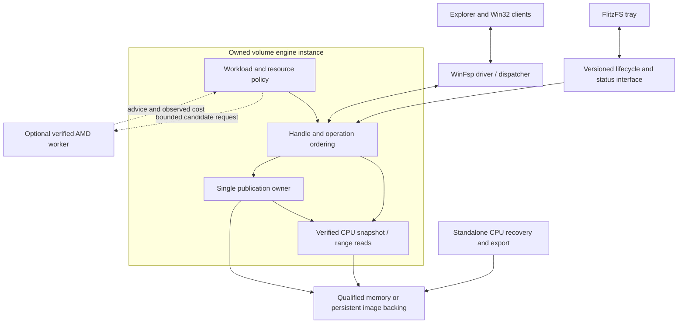
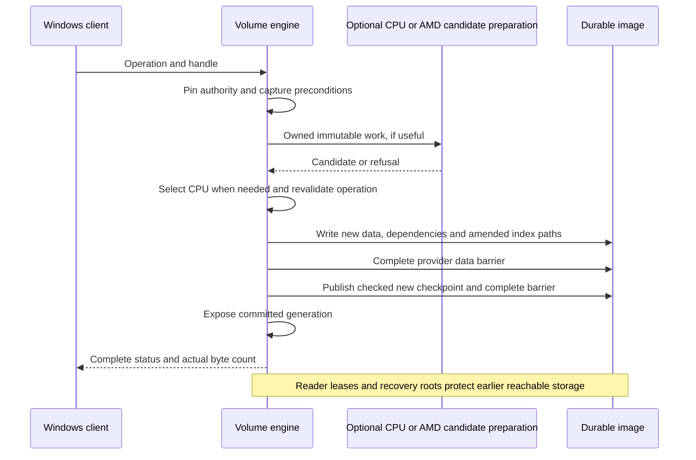
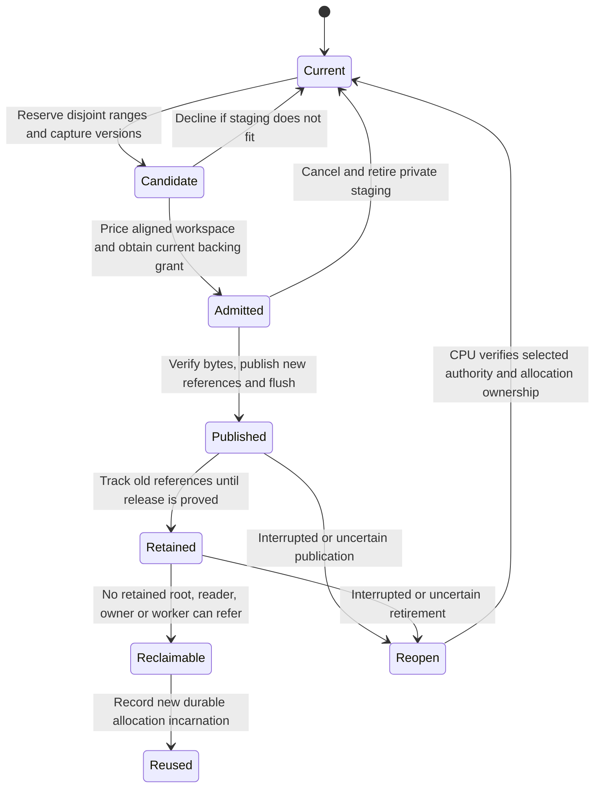
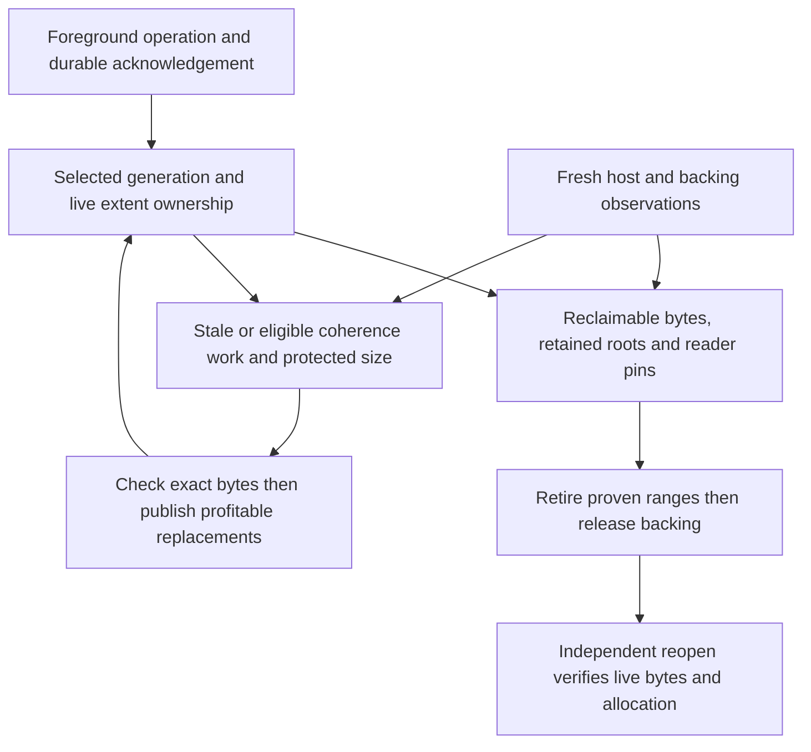
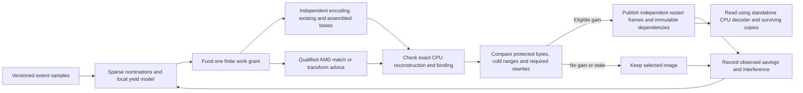
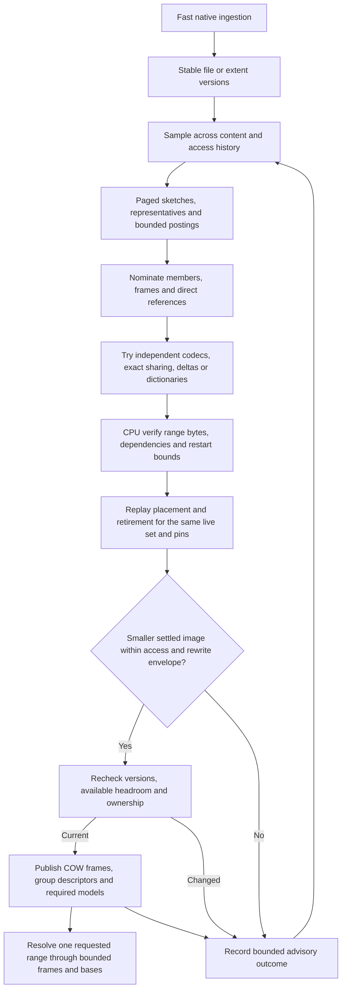
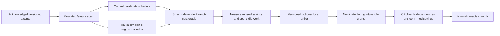
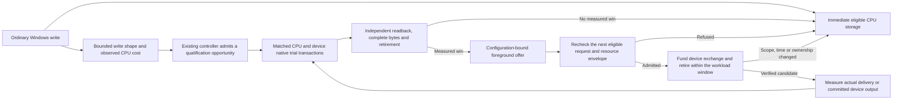
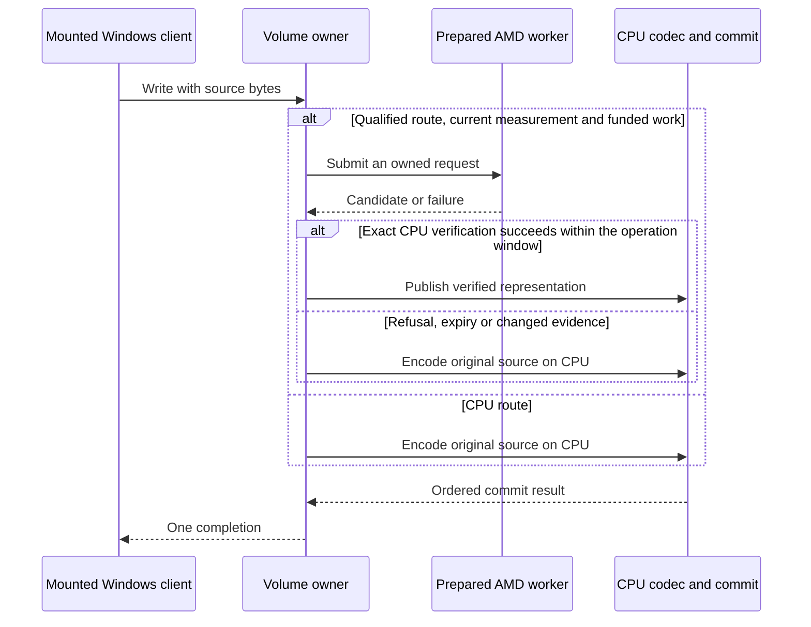
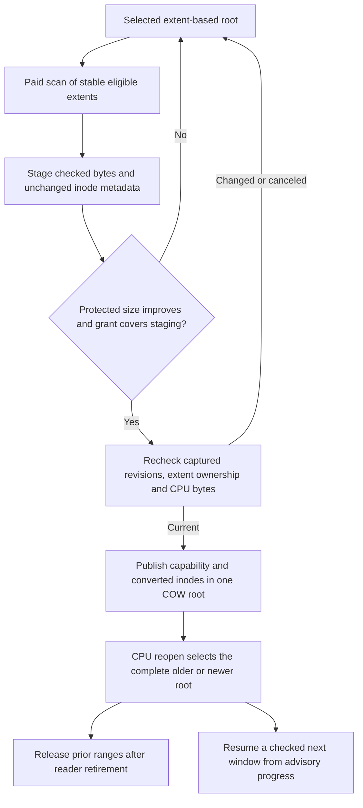

# Revised FlitzFS architecture

The [current architecture](CURRENT.md) and [source review](REVIEW.md) describe
the reviewed implementation. This document specifies the proposed boundaries for
the Windows 11 x64 product. Each change has an implementation and acceptance
sequence in the [development plan](../IMPLEMENTATION_PLAN.md#3-execution-order-and-dependencies).
The current integration design ties durable publication, bounded AMD work,
sparse advice and measured settlement to the same Windows operation witness
and complete occupancy record.
[Reconciled design](../RELEASE_RECONCILIATION_2026-11-25.md#current-reconciliation-and-prioritized-design) ·
[Implementation order](../IMPLEMENTATION_PLAN.md#execution-after-retained-amd-admission)

## 1. Separate volume ownership from presentation and acceleration

Use the existing WinFsp native interface for Explorer and Win32. Give an
independently supervised volume engine the exclusive backing lease, Windows
callback contexts, CPU recovery, resource reservations and authority to publish.
The tray submits commands and observes progress through a small versioned
controller interface. It can reconnect to a live engine and display the
difference between detached, recovering, write-fenced and unavailable.

Build a private, foreground-started engine first. Test UI restart, orderly stop,
session teardown and a crash of each process in isolation. WinFsp's launcher
and service integration are deployment options to qualify against the required
user/logon scope. A deployed mode must account for its owned processes and
registrations on uninstall. The installed WinFsp driver and AMD driver are
separate dependencies. [WinFsp architecture](https://winfsp.dev/doc/WinFsp-Design/) ·
[WinFsp service architecture](https://winfsp.dev/doc/WinFsp-Service-Architecture/)

Memory and durable image providers share the operation and format contracts.
Each advertises capacity, flush and isolation semantics actually supplied by its
backing. An image stored on a physical drive can provide an Explorer volume.
Direct block-device provisioning requires its own provider, geometry, ownership
and qualification. The image-based contract cannot confer block-device support.

## 2. Make operation ordering and acknowledgement observable

Preserve the current serial commit owner until metrics identify the cost of
staging, lock holding, barriers and response delivery. Give each accepted
operation a captured context identity, touched range, mutation assumptions and
acknowledgement outcome. Under the owner, pin the actual selected image and
record versions. Prepare optional compression or metadata candidates outside the
publication lock. Before writing, compare the generation-bound context and
operation preconditions. Re-read append EOF, constrained geometry, deletion
and allocation as appropriate. CPU selection can proceed when the optional
GPU service is busy, uncertain or being retired.

Initially keep one accepted pending write. Add disjoint-range batching or group
commit only once ordering tests show preserved append, EOF, rename, cleanup,
close, Write and Flush semantics. Record a response attempt separately from
a client's observed success. Cached and mapped client paths get explicit
tests with acknowledged application operations and their actual barriers.
[Official WinFsp native release](https://github.com/winfsp/winfsp/releases/tag/v2.2)
· [Windows file flush](https://learn.microsoft.com/en-us/windows/win32/api/fileapi/nf-fileapi-flushfilebuffers)
· [Windows mapped-view flush](https://learn.microsoft.com/en-us/windows/win32/api/memoryapi/nf-memoryapi-flushviewoffile)

The versioned transaction contract must specify which roots are required to
acknowledge a change. Preserve the current paired publication barriers until
a new format and dependency model pass the same interruption oracle. A lost
response can coexist with a complete and durable transaction. After recovery,
an acknowledged mutation must be present within the supported failure model.
An uncertain mutation can appear only in one allowed, internally complete
state. The native owner must fence uncertain publication and reopen through the
verified CPU authority. [Ordered recovery research](https://www.usenix.org/conference/osdi25/presentation/cui)

## 3. Make reopen and reclamation scale incrementally

Keep the existing append-layout readers and write ordering checks. Introduce
a distinct feature capability for reused ranges. Extend the proposed transaction
root with checked allocation summaries, record/digest identities, per-allocation
incarnations and a durable retirement ledger. A read pins the referenced root,
image or range generation. The reclaim transaction proves that the range is
unreachable from active, retained recovery and pinned-reader authorities before
it becomes allocatable. Recovery validates the old/new allocation owners and
prevents reuse if ownership is uncertain. Changing a range allocation must
change its incarnation. A stale offset alone conveys no access.

Qualify three mechanisms separately before combining them:

1. Mount admission with generation-bound validation. Keep the complete CPU
   inventory audit as reference. Derive a fast path from checked root summaries,
   bounded dirty-range records and the current ownership contract. Check pages
   and payloads on access, run a resumable whole-volume audit and keep explicit
   full verification for recovery. Unknown coverage forces the verified
   recovery path. Measure startup work and the time to discover off-path damage.
   Run the candidate decision beside full verification first, with no authority
   to attach. Bind any later reusable coverage to the exact root and selector
   generations, exclusive backing lease, checked allocation incarnations and
   complete identification of changed ranges. An in-process scrub observation
   only covers payload replicas at its observed checkpoint. Retain an explicit
   full-audit recovery path and treat unverifiable overlap or changed external
   state as reasons to require it.
2. Same-layout segment repair or evacuation. First correlate the ordinary
   candidate's phase, provider calls and allocation with client demand.
   When waiting dominates, tune admission from that evidence. When moving
   verified live bytes dominates, evaluate local evacuation. Copy only proven live objects,
   compare generations before publication and retire storage under existing
   reader and object pins. Measure host and provider bytes written, allocator
   metadata and live bytes moved. Retain the staged image rebuild as fallback.
   Attribute reusable logical slots, freed contiguous tail and physical
   allocated bytes separately. For a compatible packed backing, first compare
   placement that keeps a newly selected image out of releasable tail groups
   with bounded post-publication relocation. A trim requires verified mapping
   ownership and no live references at the provider's allocation granularity.
   Reconcile the settled allocation against the selected-image length, pinned
   generations and unavoidable backing overhead. Use that accounting and the
   measured live-move cost to choose placement, local reuse or relocation.
   [Retirement and physical allocation evidence](../evidence/windows-mounted-range-retirement-2026-11-24.json)
3. Reusable allocation. Publish old-to-new ownership in the same transaction
   as the new references. Model interrupted allocation, pending release,
   competing readers and recovery at each barrier before allowing a new writer
   to allocate the range.

Use two measured costs for evacuation. The provider's releasable
allocation is the sum of complete eligible units after relocation.
Relocation cost includes rounded protected data, changed mappings,
retirement writes, CPU verification and workspace. Pinning or an
unqualified provider makes a unit's immediate release value zero.
Choose positive net release under the current grant and favor colder
units with low live data and fewer affected dependencies. Track
freed physical bytes and reusable holes individually. Compare this
score with a read-only trace of ready-transaction grouping and the
existing packed tail path before creating a new format.
[Ordered mounted investigation](../RELEASE_RECONCILIATION_2026-11-25.md#1-reduce-occupied-bytes-and-repeated-writes-along-the-ordinary-client-path)

Fresh indexed images can place append-only payloads and new index
pages in one new mirrored pair. This retains the qualified failure
unit and separate replicas. After measuring the complete allocation
effect, attribute the remaining growth to ordered foreground
transactions. Compare grouping already-ready callbacks under the same
durability and visibility contract. Keep the sector-geometry
observation in the receipt and qualify a smaller declared failure unit
separately. [Current placement and reader contract](../MIRRORED_PAYLOADS.md) ·
[Btrfs mixed allocation design](https://btrfs.readthedocs.io/en/stable/mkfs.btrfs.html) ·
[Windows file storage geometry](https://learn.microsoft.com/en-us/windows/win32/api/winbase/ns-winbase-file_storage_info)

A physical extent grant belongs to the provider's latest admission. A
later grant can reduce authority. Any resized candidate needs both a
fresh grant and sufficient complete aligned staging. Keep CPU service on
the selected, independently verified authority throughout preparation.
Compare the prospective reuse ledger with the chosen image's full audit
before treating a retired range as free.
[Admission and staging evidence](../evidence/windows-packed-admission-and-sealing-2026-11-25.json)

Track accounting at each layer. Logical user bytes, encoded live records,
redundancy/index bytes, retired history, provider-allocated bytes and peak
temporary reservations answer distinct questions. Use the measured total
provider cost for release comparisons. The current read rules use append order
as an integrity invariant. A new allocator must preserve equivalent guarantees
under its compatible format contract. [Current paged reference checks](../../src/paged_store.cpp#L255)
· [write-once recovery study](https://www.usenix.org/conference/osdi25/presentation/pan)

### Measure physical release independently of cold convergence

The volume owner can observe backing allocation reach the independently
verified retained floor while grouping still has eligible work. Keep
allocator progress and optimization progress as separate signals. Advance
either task with its own fresh grant. Count durable physical candidate
ranges, root or reader pins, and provider release observations for
allocation. Count checked candidates, complete-size deltas, negative
rechecks and rewrite cost for optimization. A lack of idle credit defers
eligible work. It cannot change the bytes the owner acknowledges.
[Ordinary mounted witness](../evidence/windows-cpu-tile-and-ordinary-settlement-2026-11-25.json)

## 4. Optimize complete size with bounded random access

Use the protected byte cost to choose the representation for each restart
extent. The implemented assembled-prefix comparison is a candidate in
this process. Keep the focus on reproducible savings beyond a single
synthetic family. Charge its extra CPU work before expanding the shortlist.
[Current candidate flow](CURRENT.md#11-compression-over-an-assembled-base)

Write data quickly using the best observed fitting raw, LZ4, Zstd or
verified AMD path for its class and current host. Schedule stronger collective
work after evidence of useful similarity, durable-state stability and available
background capacity. A logical group can hold one file or thousands. A small
read resolves a separately indexed restart frame and a bounded set of immutable
dependencies. A large logical group never forces a whole-group decode.

Use a sparse catalog keyed by content sketches and versioned extent or fragment
tokens. Try rolling or content-defined chunking for candidates whose alignment
moves. Compare against the current indexed band and projection scheme and exact
sharing. Let paged postings return bounded candidates. Preserve a persistent
cursor across runs and different samples from highly populated buckets.
Validate selected versions and byte identity on the authoritative image.
Measure candidate recall and rejected work against an exhaustive oracle on
controlled small sets, then test skewed, changing and real million-entry
namespaces without making a square similarity matrix.

Collect measured lookup, reference and representation costs separately.
Use a small exhaustive family replay to decide whether to improve
retrieval, change the shared representation or reduce protected record
overhead. The seven-file prefix improvement and unchanged broader
frontiers make parser strength a useful control for that replay. Use
`NativeFileSession` and the independent CPU reader to verify finalists
with ordinary allocation and identical protection.
[Prefix trial and held-out controls](../evidence/windows-prefix-parser-reconciliation-2026-11-25.json)

Price each representation after its selected generation settles and old
reader pins release. The measured store cost includes the selector,
protected frames, indexes, mandatory references, allocation rounding and
physical backing after retirement. Track temporary coexistence, scratch
and actual writes alongside it. Compact roots already removed 120 KiB
of fixed cost from one 4 KiB placement. The next corpus comparison
should distinguish achievable savings in the payload encoding from
savings in its protection layout. A new placement must preserve the
declared failure coverage and exact independent CPU range decoding.
[Occupied-byte decomposition](../evidence/windows-compact-paged-roots-2026-11-25.json)

Use an ordered coordinate, payload revision and image identity as the
minimum resumable advice. A scan unit gets a checked view, samples
within the current grant and returns owned features before releasing it.
After publication, refer to immutable protected dependencies. On restart,
verify a cursor and candidate revision in the newly selected authority.
When a cursor is stale, resume from confirmed coverage or restart a bounded
range. Store completion coverage per range so a hot bucket or repeated
overwrite cannot indefinitely displace cold candidates. The background
store can be rebuilt from checked live data after advice loss.
[Current sample scope](CURRENT.md#indexed-maintenance-sample)

Price the search before adding a representation. The current scanner
can query all distinct rolling keys while the writer funds one stored
key per representative. Keep that control as the baseline.

| Observation on the same frozen cohort | Change to evaluate |
| --- | --- |
| Most high-value references are already nominated | Spend idle work on encoding and placement for these live sets. |
| Catalog misses dominate and a bounded exact-key plan can share checked page reads | Compare shared index reads and a generation-bound negative result cache. Keep the existing per-op backpressure and audit coverage. |
| Offset changes hide high-value fragment matches | Prototype content-defined fragment sketches and a costed shortlist beside the current index. Include postings, sampled input, rewrites and RAM in the result. |
| Exhaustive direct references also leave substantial bytes | Try independently decoded subgroup dictionaries, reversible transforms or learned residuals on that cohort. Charge each required table and restore path. |

[Secondary lookup controls](../evidence/release-reconciliation-rolling-lookups-2026-11-25.json) ·
[FAST ’26 offset-independent delta work](https://www.usenix.org/conference/fast26/presentation/zhang-zhihao-parasync)

A concrete first challenger is **similar fragments with multiple independent
references**. Measure same-position, shifted and content-defined samples.
Cluster a bounded batch by estimated shared bytes and access behavior. Choose
one or more compact immutable reference/dictionary objects for the region.
Each member chooses standalone compression, a direct reference plus residual,
or a small independently decodable frame shared by short objects. Compare
complete bytes against current protected shared bases and independent Zstd or
LZ4. Charge every model, index, publication, mirror and retained reference.
Keep direct-dependency decoding initially. Treat any deeper dependency design
as a new format with an explicit peak-work proof. The prototype remains
replaceable if another family demonstrates better held-out results.
[RubikFS similarity and hotness study](https://www.usenix.org/conference/fast26/presentation/huang)
· [EROFS compressed clusters](https://erofs.docs.kernel.org/en/latest/design.html)
· [Btrfs compression units](https://btrfs.readthedocs.io/en/latest/Compression.html)
· [Zstandard dictionary training](https://github.com/facebook/zstd/blob/dev/programs/README.md)

Additional candidates include reversible type-aware transforms, trained
dictionaries and fixed-point learned entropy models with independent frames.
Fit locally on bounded samples and test held-out versions or unrelated groups.
Publish a learned representation only after its complete cost, peak resident
state, write amplification and cold/random access series pass. Store the exact
required tables/model with versioned, mirrored decode dependencies. Native
codecs and the recovery package decode on CPU independently of learning, GPU,
runtime installation and online access. Required model bytes are accounted for
even when amortized across many members.

## 5. Share measured resource and rewrite budgets

The [adaptive storage execution plan](ADAPTIVE_STORAGE_EXECUTION.md) defines
concrete selection, AMD read/write and backing qualification steps.

Use a host resource coordinator to assign separate foreground reserves and
background allowances across open volumes, CPU work, memory/commit, device
memory, device quanta and storage write cost. Size allowances from observed
demand and latency. Charge sampling,
verification, durable writes, canceled work and GPU setup. Lower host priority
where supported, split work into bounded quanta and yield before scheduling
another quantum when I/O arrives or headroom falls. Keep generation-bound
progress so a restarted volume can resume the last confirmed work.

Within each opportunity, choose the next checked operation by actual evidence
of urgency and expected durable benefit. A release operation that can fund
future writes outranks an unfunded codec trial. Estimate the recent cost of each
phase, charge measured resource consumption afterward and yield before a
foreground arrival can inherit several queued maintenance steps. Foreground
pressure can defer an optional phase even while an idle timer is open. Use
matched replay to tune this policy, with bounded minimum progress for eligible
scrub and retirement so compression trials cannot starve them.

Persist advisory baselines, candidate outcomes, sampled access class, cursors,
debits and schema version in the reserved area. Evidence of content,
configuration or workload change can fund another attempt. Use timing to pace
funded work, including health and integrity periodicity, with event-driven
wakeups. Rebuild damaged or incompatible advice without changing the selected
data. Prefer audit and repair when integrity evidence requires it. Give
migration, compaction and codec trials separate quotas. Observe the impact of
their combination before enabling their defaults.

Record deadlines from admission through result selection and retirement.
Windows submission priority is only one signal. ROCm documents limits on HIP
stream priority, so use work size, finite process lifetime, cancellation
between units and fresh headroom to enforce the host policy.
[AMD HIP stream management](https://rocm.docs.amd.com/projects/HIP/en/docs-10.2.0/reference/hip_runtime_api/modules/stream_management.html)
· [Windows video-memory observations](https://learn.microsoft.com/en-us/windows/win32/api/dxgi1_4/nf-dxgi1_4-idxgiadapter3-queryvideomemoryinfo)

## 6. Qualify distinct AMD roles on complete work

Use the same route identity and health model for each role but bind
cost and admission evidence by role. Record the ROCm distribution, HIP headers,
loaded runtime hash and ABI, worker/module identities, adapter LUID and node,
representative input shape, workload, device memory and recovery generation.

- **Fast ingestion.** Connect the installed package discovery and calibrated
  ordinary write route. Offer work only for measured shapes where full
  transfer, validation and commit cost earns capacity. Compare a paired
  CPU route, with immediate CPU selection under refusal and concurrent I/O.
- **Collective search and compression.** Use the installed anchor/reference
  path and finite batches to test additional profitable candidates per idle
  opportunity. Include occupied size, search recall, host interference and
  write debit in the decision. The CPU owner verifies candidates independently.
- **Recovery and optional reads.** Keep recovery entirely CPU. Qualify GPU
  range acceleration separately if complete read cost improves after integrity
  validation. The identical volume and range remain available from the CPU
  decoder when the device cannot execute.
- **Packaging.** Bind each role's dependencies explicitly. Qualify the optional
  package in a private stop-confirmed process using the target installed
  runtime. Build and link isolated role controls to detect cross-role symbol
  dependencies early. Link shared verified routines explicitly for each role.

Keep a ready worker inside the owning mount while measured demand and
live headroom justify its retained buffers. The controller decides
readiness from request cadence, queued work, service cost and observed
pressure. It expires the lease when those conditions change. AMD's
current HIP documentation describes stream priorities as disabled.
Enforce background limits through bounded submissions, cooperative
yielding and cancellation of pending work. Measure prepared streams before
trying reusable graphs. Graph replay is a candidate when dispatch overhead is
a material share of a winning repeated workload. Qualification binds the
actual Windows package and exact device and runtime.
[AMD HIP graphs](https://rocm.docs.amd.com/projects/HIP/en/docs-10.2.0/how-to/hip_runtime_api/hipgraph.html) ·
[AMD HIP stream management](https://rocm.docs.amd.com/projects/HIP/en/docs-10.2.0/how-to/hip_runtime_api/asynchronous.html)

The normal controller owns calibration beside discovery. Callbacks emit a
bounded demand and CPU-cost observation. The controller admits complete paired
native trials with a fresh idle/resource window and an explicit input owner.
Qualifying observed work produces a scoped offer; each actual request is
admitted again against its shape, policy, bounds and live route. A canceled
probe can be repeated at a new qualified opportunity after retirement. Refusal
due to runtime/device identity or pressure requires corresponding evidence.
[Detailed calibration steps](../IMPLEMENTATION_PLAN.md#e03-and-e08-qualify-ordinary-amd-foreground-io)

Define two measurements for each candidate. The detached pair attributes
encoder and protected-image cost on matched inputs. The mounted pair
measures the client-visible operation including preparation, verification,
publication and response. Only the full measured operation can qualify the
production route. Bind the preference to the active layout and a measured
workload class. Revalidate the budget and configuration when submitting.
A verified LZ4 candidate can skip CPU re-encoding when the foreground
transaction has the same protected append layout under the candidate and
a lower bound on CPU output. Exact compacted-size selection still prices
the actual encoded alternatives. Measure the effects on settled occupancy,
and compare the ready and cold device paths independently. Keep
per-request lossless verification and CPU recovery independent of the
selection model.
[Allocation proof](../evidence/windows-verified-lz4-allocation-2026-11-25.json)

[Detailed sequence](../IMPLEMENTATION_PLAN.md#2-make-the-amd-path-useful-before-enabling-it-by-default)

Runtime acquisition uses fresh, role-specific evidence. Resource pressure
uses a fresh observation. Device, runtime or integrity failures require a
suitable requalification signal and confirmed retirement before reuse. An
unready or unavailable route leaves the CPU path available while the owner
records the reason. Use repeated matched mounted runs and live hardware
observations before enrolling each accelerated role by default.
[AMD ROCm Core release notes](https://rocm.docs.amd.com/en/develop/about/release-notes.html)
· [current controlled and live GPU results](../evidence/amd-fresh-completion-observation-2026-11-21.json)

## 7. Format compatibility, repair and upgrade

Commit a matrix of supported historical format capabilities, including earliest
and latest readable versions, enabled read and write features and recovery
requirements. Retain the existing target of reading images from at least three
preceding software releases once those releases exist. Ship a standalone CPU
reader with every codec needed by supported images. Each supported new reader must read the selected prior fixtures and
export their verified bytes, names, metadata and dependency information.
An older reader may read a compatible pinned view only while that compatibility
is supported and verified. Unknown required capabilities must fail before
mutation.

For the first gradual migration, keep format intent in the rebuildable
advice area. An intent or discarded candidate does not affect existing
readers. Start with linked, standalone extent-backed files whose checked
EOF is at most 512 bytes. Use the normal indexed scan's coordinate,
object identity, payload generation and inode revision. Price the
combined inode and mapping changes against the selected volume,
including both copies and actual geometry. Decline if the estimate
cannot prove a smaller settled image or the backing cannot fund
staging and preserve its recovery reserve. Revisit grouped extents
after qualifying their dependency accounting.

The first completed conversion publishes bit 10 with the new inode
and removes the old extent. Subsequent roots retain the feature.
Preserve Windows timestamps, security, stream size, logical allocation
and inode identity across a layout-only change. An older reader which
cannot understand the selected root must refuse before repair or write.
Require the candidate CPU reader to decode every supported historical
form. Freeze both binaries and test this through ordinary volume entry points.
[OpenZFS feature activation](https://openzfs.github.io/openzfs-docs/man/master/7/zpool-features.7.html) ·
[Btrfs compatibility fields](https://btrfs.readthedocs.io/en/latest/dev/On-disk-format.html) ·
[Current short-file layout](../INDEXED_NATIVE_VOLUME.md#inline-short-file-data)

For an upgrade, record the intended source and feature set and the resumable
migration cursor. Read both admitted representations while building the new
one. CPU-audit the candidate, publish the capability and root together, confirm
recovery from both sides of every barrier, then retire previous data only under
the same retention proof as ordinary writes. If the user needs an older
compatible representation after new features are committed, provide a
validated export or rollback route with an explicit account of later writes.

Use a backend-specific failure model. Single-copy damage may allow verified
peer recovery. Storage that loses every copy requires an independently verified
restore source. Probe write ordering, torn commits, lost flushes, uncertain
system calls, stale selectors or allocator state, model corruption, concurrent
pins and repair interruption. Measure on isolated persistent backings for any
claim about power loss, write ordering or media failure. An in-memory fixture
can establish logical state transitions and precise oracles.
[End-to-end integrity research](https://www.usenix.org/conference/fast26/presentation/gupta)
· [Microsoft resilient filesystem repair model](https://learn.microsoft.com/en-us/windows-server/storage/refs/refs-overview)

## 8. Compare the whole product

Define native-client workloads before optimizing. Use exact candidate
manifests and Windows build, driver, backing, CPU/GPU/resource and cache
evidence. Use DiskSpd for I/O shapes, Win32/Explorer fixtures for names,
metadata/cached writes and lifecycle, and paired corpus runs for size and
recompression. Keep NTFS with compression off and on as Windows controls where
the same fixture can support them. Use Btrfs, EROFS or other relevant filesystems
only for the corresponding capability and with disclosed OS, read/write and
backing differences. Include strong per-file and grouped codec controls,
with 7-Zip or Zstd settings and costs pinned. Measure hardware read/write
performance on the real host. Use disposable guests for correctness and isolation.

Cover mixed real files, similar versions, already compressed/encrypted content,
small files, concurrent churn and cold random reads. Freeze training and
held-out cohorts before selection. Report all cohorts and resource refusals, with
baseline/setup/settled provider bytes, peak work, write amplification,
throughput, tail read and write time, host responsiveness and time to settle.
Alternate matched trials, preserve raw observations and independently read back
every result. Practical access and low host impact are feasibility conditions.
Choose the smallest qualified complete image within them.
[Microsoft DiskSpd 2.3](https://github.com/microsoft/diskspd/releases/tag/v2.3)
· [DiskSpd test controls](https://github.com/microsoft/diskspd/wiki/Customizing-tests)
· [FlitzFS benchmark protocol](../BENCHMARK_PROTOCOL.md)
